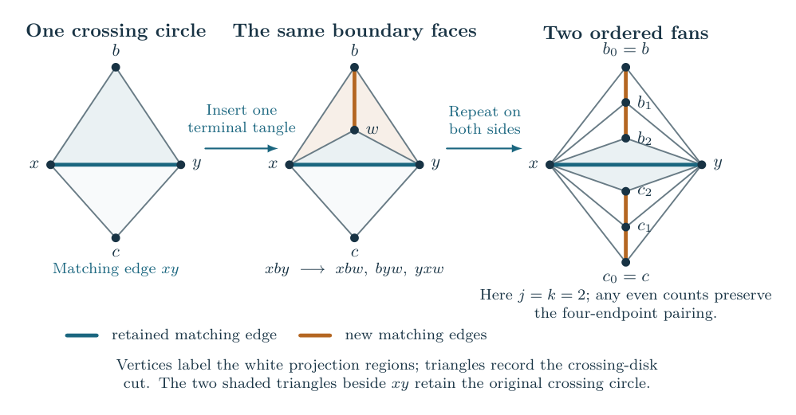

# Murakami’s Dream

Kashaev invariants and the hyperbolic volumes of knot complements.

**[Read the illustrated guide](https://sashakolpakov.github.io/murakamis_dream/)** ·
[Research papers](papers/README.md) ·
[Dependency graph](https://sashakolpakov.github.io/murakamis_dream/papers/dependencies.html) ·
[Reference manuscript](manuscript/README.md) ·
[Reproduction instructions](repro/README.md)

For a fixed hyperbolic knot $K$, the volume conjecture predicts

$$
 \lim_{N\to\infty}\frac{2\pi}{N}\log|K_N(K)|
       =\operatorname{Vol}(S^3\setminus K).
$$

Here $K_N(K)$ is the reduced Kashaev invariant at level $N$, with
unknot value one. This repository develops proofs for specified
families built from planar tangle diagrams. The diagram and every
twist number are fixed while $N$ tends to infinity.

For a first reading, start with
[the diagram, its finite evaluation, and the meaning of the limit](https://sashakolpakov.github.io/murakamis_dream/guide/starting.html).
The guide defines its terms before using the source-polynomial and
geometric constructions. The
[results chapter](https://sashakolpakov.github.io/murakamis_dream/guide/results.html)
states the precise hypotheses for each family.
Its [literature comparison](https://sashakolpakov.github.io/murakamis_dream/guide/results.html#comparing-the-result-with-other-volume-statements)
also distinguishes the Kashaev limit from Turaev–Viro volume statements,
and records restrictions such as odd levels or a specified link family.

## Planar constructions with arbitrarily many tangles

One general construction begins with a finite simple triangulation of
the sphere and a pairing of its triangles across selected edges. Every
triangle belongs to exactly one pair. The paired triangles specify
crossing-circle tangles and the connections between their strands.
The construction places the resulting augmented link in the three-sphere;
it does not require the tangle operations to form a tree.

There is an explicit finite decoration of this diagram for which the
volume conjecture holds after all twist regions receive sufficiently
long signed twists. At each original crossing circle, insert an even
number of additional terminal tangles on each side. The numbers are
chosen from the circle packing constructed in the proof. Give the new
pieces odd crossing parity, and choose the original parities so that
following the strands gives one knot. Every original and added twist
number may then be chosen independently, with either sign, beyond one
threshold for the decorated diagram.

The resulting knot is hyperbolic and its reduced Kashaev invariant has
the knot-complement volume limit through all integer levels. The added
tangles preserve the chosen endpoint pairing, but generally change the
knot. The theorem concerns this decorated knot; the original core’s
powers must also be sufficiently long. The companion paper
[Balanced circle packings from terminal tangle decorations](docs/papers/terminal-decorations.pdf)
proves the literal insertion, the packing recurrence and strict balance
at every old and new region. It imports the finite evaluation, analytic
and geometric results stated in the foundation papers. The
[statement and construction](https://sashakolpakov.github.io/murakamis_dream/guide/results.html#decorating-a-planar-diagram)
explain the quantifiers and the geometric condition that the decoration
establishes.

The proof controls the entire finite invariant, including the terms
outside the geometric contribution. A strict inequality at each crossing
circle, evaluated in one shared circle packing, makes those remaining
terms exponentially smaller. The geometric contribution is nonzero.
Its peripheral equations complete the auxiliary cusps by smooth solid
tori while leaving the main knot cusp complete, so the limiting action
is the volume of the actual knot complement.

## When the original diagram already satisfies the packing condition

A further theorem requires no added tangles. If the complete circle
packing satisfies the explicit **weak balance inequalities**, independently
sufficiently long signed twists at the existing crossing circles give
the full volume limit, provided the original strand connections form one
knot with no extra closed main component. Equalities in the packing
condition are allowed.
The proof perturbs the radii used in the coefficient estimate: a linear
entropy gain dominates the quadratic increase of the stationary action.

This is a condition on the unchanged diagram, not a claim about every
circle packing. [The statement and proof explanation](https://sashakolpakov.github.io/murakamis_dream/guide/results.html#an-unchanged-diagram-satisfying-weak-balance)
define all its quantities. Appendix P gives the proof and a quantified
extension allowing small failures of the local inequalities.

## Joining certified diagrams

A [triangular-sum theorem](https://sashakolpakov.github.io/murakamis_dream/guide/results.html#joining-diagrams-with-a-shared-weight-certificate)
preserves the full source estimate when certified matched spheres are
joined along specified triangles. Any fixed finite number of certified
pieces is allowed. An explicit sequence has $17+r$ crossing regions
after $r$ attachments and retains a failure of weak balance at its mark.
Its strict source certificates nevertheless give the volume limit after
independently sufficiently long fixed fillings. Appendix Q defines the
operation, its input certificates and its knot-component requirement.

Appendix R permits an insertion away from the protected edge. Its
attaching triangle has three positive circle curvatures; two must be
sufficiently small relative to the third at every coefficient witness
used by the core. An explicit even chain makes these ratios as small
as required. Consequently any fixed finite collection of certified
pieces can be attached to a suitable core, followed by independently
long fixed signed twists. The
[construction and proof](https://sashakolpakov.github.io/murakamis_dream/guide/results.html#inserting-a-piece-at-an-ordinary-triangular-face)
explain the boundary condition and the exact coefficient demands.

## Ordered tangle trees and explicit bounds

The reference account also develops Conway’s algebraic, or arborescent, constructions
by stacking and turning rational tangles. A reduction combines twist
boxes that can be brought together. Sufficiently large surviving *net*
twists give the volume limit; large individual counts alone need not
suffice when opposite signs cancel.

For an ordered tree with a crossing-circle tangle at every vertex and
at least one edge, a separate theorem gives an explicit sufficient
condition. If the signed crossing power at every vertex has magnitude
at least $2^{27}$, the volume equality holds, independently of the tree’s
size and depth. More generally, each vertex may satisfy either this
twist bound or the degree bound $2^{28}$. The latter allows any fixed power,
including zero. The original strand connections must form one knot,
with no extra component closed inside a tangle.

The [results chapter](https://sashakolpakov.github.io/murakamis_dream/guide/results.html)
also gives a summed criterion that can produce smaller bounds for a
particular tree, and explains the exact net-twist and closure reductions.
These explicit tree bounds and the planar decoration theorem have
different hypotheses; neither is a classification of all hyperbolic knots.

Two new companions extract separate inputs to the tree proofs.
[Newton coefficients and positive sources for Conway tangles](docs/papers/newton-tangles.pdf)
proves the exact turn, product, closure and circle formulas, including
repeated-root derivatives, and the variational limit of the positive
complete auxiliary-color source. Signed fillings still require their
own remainder and noncancellation estimates.
[Positive octahedra and primitive fillings for trees of crossing circles](docs/papers/circle-tree-geometry.pdf)
constructs the actual filled hyperbolic metric whenever
$\sqrt{d_v^2+n_v^2}\ge630$ at every vertex. This geometric criterion permits
zero powers at high degree; it does not by itself prove a quantum limit.
Its peripheral-volume input is a local differential from the geometric
foundation, so no independently long-twist assumption is imposed on
these zero-power cases.

[Volume asymptotics for trees of crossing circles](docs/papers/circle-tree-volume.pdf)
proves two distinct sufficient conditions in one 27-page account. The
summed condition is $\sum_v d_v/(d_v^2+n_v^2)\le2^{-25}$; the directed
condition uses local estimates along the tree. The proofs share their
finite kernel and Fourier trace, then establish their own remainder and
noncancellation estimates. Both give a uniform microscopic meridian
profile. The explicit first correction is retained under the summed
condition alone. Each proof verifies the geometric threshold above.

For every fixed strict Conway expression with at least two original
crossing circles,
[Holomorphic source asymptotics and volume limits for strict Conway compositions](docs/papers/conway-asymptotics.pdf)
proves the nonzero leading term of the entire filled invariant and its
volume limit, provided the actual closure is a knot and all signed powers
are independently sufficiently long. It imports the strict optimizer,
whole complementary-source bound and marked geometry by numbered theorem,
then proves the pure-source expansion and absolute action comparison.
Its separate signed local results and the quarter-index paper are not
premises of this volume theorem.

## The meridian and the A-polynomial

The 20-page
[moving-meridian source paper](docs/papers/moving-meridian-sources.pdf)
controls the actual finite source when the main meridian is
$M=q_N^s$, with $s$ in the stated fixed microscopic parameter sets.
It treats arbitrary strict product junctions, retains their shared
indices and proves a nonzero joint filling contribution for independently
long fixed signed powers. This supplies the error bounds needed to
expand the whole invariant, rather than only its selected local term.

The 13-page
[meridian-expansion paper](docs/papers/meridian-expansions.pdf)
then proves every inverse-level order for these strict sources and,
separately, for circle trees satisfying the summed or directed criterion.
The estimates hold on the translated parameter sets needed by a fixed
recurrence. The degree of each logarithmic coefficient identifies its
highest-degree term with the stationary action. A separate classical
argument identifies the resulting germ with the preferred longitude;
in particular, the first correction is determined by the preferred cusp
shape. The analytic expansion itself does not assume that geometric
identification.

Theorem 1.2 and Corollary 8.1 give a conditional consequence: start with a
specified fixed nonzero operator annihilating the **whole reduced
meridian function at every sufficiently large integer level**. Its first
nonzero classical symbol contains the selected geometric irreducible
factor. The proof retains the meridian divisor and sign in the exact
reduced/full normalization. It does not construct such an operator,
identify every A-polynomial factor or its multiplicity, or establish the
full AJ conjecture. For strict sources, the geometric corollary takes
the larger of the analytic and classical filling thresholds.
The new decorated planar theorem concerns the complete meridian value;
a corresponding moving-meridian theorem for that larger class remains
separate work.

## Reading and reproducing the work

The [collection of research papers](papers/README.md) now contains twenty-two
current drafts totaling 404 pages, ranging from 11 to 29 pages each.
They separate the exact finite
invariant, coefficient estimates, complex asymptotics and marked
hyperbolic geometry from the application theorems. The strict
Conway theorem and the summed and directed circle-tree criteria have
companion accounts with explicit proof dependencies. A separate local paper treats the signed
recurrence at the quarter index. Each paper states the numbered results
it imports and checks their hypotheses.

These papers extract selected results from the
[374-page reference manuscript](manuscript/README.md); they do not yet
replace it. The reference contains 93 pages of main text, 266 pages of
appendices and 15 pages of front matter and references. Its length came
from collecting several theorem families, repeated setup for separate
proofs, and alternative constructions in one continuous account.

The net-twist and zero-twist reductions now have a separate 15-page
topological account. The marked nonparabolic representations and preferred
longitudes have separate 22- and 29-page accounts. They prove the
geometric statements without importing quantum asymptotics. The new
20-page moving-source and 13-page meridian-expansion papers supply the
analytic steps and conditional recurrence implication described above.
Their theorem statements make these one-way dependencies explicit.
The consolidated 21-page strict geometry
paper includes the local proofs previously spread over three articles;
the two earlier editions remain available for existing citations. The
older local tree criterion now follows from the directed paper, without repeating its
separate induction. The reference remains frozen and is no
longer presented as a single journal paper. Its
[errata](manuscript/ERRATA.md) record corrections found during extraction.
Chapter 1 separates full volume theorems from completed partial results:
a finite filling estimate and a theorem about one geometric contribution
do not assert the volume limit for an arbitrary original invariant.
Each full-invariant theorem names the estimate that bounds its remaining terms. A completed implication retains its hypothesis; it is not counted as a proof that the hypothesis holds for every diagram.
The open remainder estimate for unchanged general diagrams is not a
premise of the restricted-family proofs.

The [paper reproduction command](papers/README.md#building-and-reproducing-the-papers)
runs twenty-five finite check groups. They compare exact matrix and
polynomial formulas, replay rational certificate inequalities, and check
normalizations and endpoint pairings. The source Fourier checks retain repeated-root derivatives and endpoint
terms; the local recurrence checks retain both source components and
both level parities. The new groups also check whole moving traces,
reflected pairings and exact reduced/full gauge and coefficient-recovery
identities. These computations
supplement the written analytic and geometric proofs; sampling levels
or diagrams does not establish those proofs.

The [manuscript audit](repro/MANUSCRIPT_AUDIT.md) records the proof
dependencies, corrections, and precise extent of the review. The
[Lean project](formal/README.md) verifies finite algebraic steps,
including polynomial reduction with repeated roots and independence
of its representative and root ordering, reduction of finite products,
and the first derivative of a product at a repeated root. It also checks
formal coefficient recovery under \(u=hs\), including the limitation
of any fixed finite-order expansion, and the local sector
comparisons and target cancellation for the triangular-sum construction.
It also checks the ordinary-boundary comparison, including the
different estimates for a wholly central piece and a piece containing
any noncentral term. A separate [Mathlib package](formal-real/README.md)
constructs the actual complex norm and real logarithmic rate, derives the
rate of a nonzero asymptotic contribution, and verifies the limit
implication when the entire remainder has a strictly smaller rate.
It also proves existence and uniqueness of the minimum of the explicit
supported triangle-entropy potential. Strict finite cut inequalities and
compatible total demand now construct the positive corner table,
connected incidence and unique grounded load balance. The potential's
lower bound, continuity and derivatives are proved in Lean; checking the
cut inequalities for the particular geometric incidence remains a
written application step.
The package now also proves the actual regrading ring map, formal
exponential projection and meridian denominator-clearing calculation.
The root-of-unity recurrence calculation now derives the Laurent
coefficient expansions, literal sine gauge, meridian factors and finite
equation expansion. From a specified nonzero polynomial coefficient
record, it removes the common $q-1$ factor and derives a nonzero classical
symbol and its formal characteristic identity. The actual operator,
its denominator chart, source normalization and nonvanishing, and the
source-ratio asymptotics remain application inputs. Another theorem
derives one common nonvanishing threshold and a uniform logarithmic
rate from a uniform microscopic profile. The
[paper-by-paper coverage record](repro/PAPER_FORMAL_COVERAGE.md) separates
these compiled implications from the analytic, geometric and topological
inputs still supplied by written proofs.
Appendix N explains why this
remainder is unique and states exactly what would identify a candidate
functional with its top coefficient. It also proves that the polynomial
resolvent recovers evaluation at an annihilating operator. An explicit
finite Fourier transform derives the actual Casimir annihilator and
the local face polynomial, including its scalar and endpoint conditions.
The face-grid
argument in Appendix O makes explicit why the total degree excludes
every unwanted monomial. The analytic estimates and geometric completion
remain written proofs with their stated hypotheses.

The scope of this research phase is frozen at these restricted families.
Its [stopping criteria](repro/MANUSCRIPT_AUDIT.md#where-this-research-phase-ends)
require a complete dependency chain for each retained conclusion and
reproducible finite certificates. Broader families, smaller constants
and the archived exploratory approaches are separate projects.

The [illustrated guide](https://sashakolpakov.github.io/murakamis_dream/)
also explains the approaches that remain incomplete. Its
[methods chapter](https://sashakolpakov.github.io/murakamis_dream/guide/methods.html)
introduces the techniques, gives their literature references, and
distinguishes completed arguments from proposed extensions. The
[algebraic approaches chapter](https://sashakolpakov.github.io/murakamis_dream/guide/algebraic.html)
defines the earlier torsor and gluing proposals, works out the
factorial model's move test, and explains the remaining comparison
problems. The
[research library](https://sashakolpakov.github.io/murakamis_dream/library.html)
retains the Fourier, torsor, weighted Cauchy, cube, and other approaches,
including failed estimates and the reasons they failed. These historical
notes are not additional premises of the manuscript's theorems.

The illustrated guide is the maintained documentation. Former Sphinx
addresses redirect to it; there is no second exposition to keep in sync.

| Directory | Contents |
| --- | --- |
| `manuscript/` | TeX paper, bibliography, figures, and compiled PDF |
| `repro/` | Check runner and the precise scope of its checks |
| `formal/` | Lean proofs of finite steps, with their remaining hypotheses stated |
| `book/` | Guide chapters and editable diagrams |
| `docs/` | Published illustrated guide |
| `notes/` | Detailed arguments and historical research notes |
| `experiments/` | Verification programs and recorded results |
| `tools/` | Paper, guide, and figure builders |
