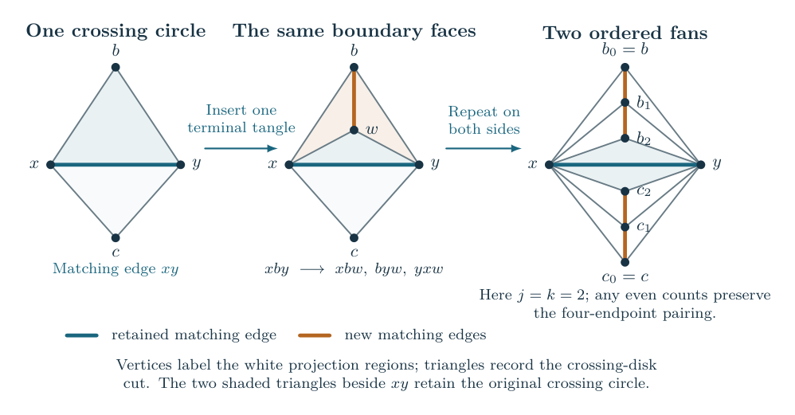

# Murakami’s Dream

Kashaev invariants and the hyperbolic volumes of knot complements.

**[Read the illustrated guide](https://sashakolpakov.github.io/murakamis_dream/)** ·
[Research papers](papers/README.md) ·
[Dependency graph](https://sashakolpakov.github.io/murakamis_dream/papers/dependencies.html) ·
[Volume reference](manuscript/README.md) ·
[Reproduction instructions](repro/README.md)

For a fixed hyperbolic knot \(K\), the volume conjecture predicts

\[
 \lim_{N\to\infty}\frac{2\pi}{N}\log|K_N(K)|
       =\operatorname{Vol}(S^3\setminus K).
\]

Here \(K_N(K)\) is the reduced Kashaev invariant, with unknot value one.
This repository develops proofs for specified planar tangle families.
The finite diagram and every twist number are fixed before the level
tends to infinity through all integers.

New readers can start with
[the diagram, its finite evaluation and the meaning of the limit](https://sashakolpakov.github.io/murakamis_dream/guide/starting.html).
The [results chapter](https://sashakolpakov.github.io/murakamis_dream/guide/results.html)
states the different hypotheses. Its
[literature comparison](https://sashakolpakov.github.io/murakamis_dream/guide/results.html#comparing-the-result-with-other-volume-statements)
distinguishes this invariant and limit from Turaev–Viro statements and
from results restricted to other level sequences or link families.

## One strict Conway proof

The [19-page Conway paper](papers/conway-asymptotics/README.md) proves a
nonzero whole-invariant asymptotic and the volume limit for every fixed
strict Conway expression with at least two crossing circles, provided
its strand connections give a knot and every auxiliary filling is
independently sufficiently long. Strictness is an explicit finite test:
each elementary leaf is a quarter-turned crossing-circle box;
leaf labels lie in \((0,1/2)\), a turn complements a label, a product
satisfies \(\max(x,y)<z<x+y<1\), and the closing outputs sum to one.
An elementary closing child is allowed.

The proof uses only the pure auxiliary source. Exact expansion of each
full integer crossing power handles odd, even, positive and negative
twists before estimating that source. The wire lattice, factorial
interpolation and nonzero Gaussian density are explicit. A global
Fourier gap and the whole filling-sum theorem then control cancellation.
The marked geometric comparison keeps the primitive integer slopes and
identifies the absolute knot-complement volume.

The [volume reference](manuscript/README.md) includes these same proof
files. The separate [quarter-index paper](papers/quarter-index-asymptotics/README.md)
contains the signed local results needed for its recurrence argument.

The supporting manuscripts are also from this project. They organize
the shared material into separately citable mathematical results.
There are 21 current subject papers; the Conway volume proof uses six
supporting papers, as listed in the
[collection guide](papers/README.md#the-conway-paper-and-its-supporting-proofs).
The [collection check](repro/results/paper-collection/summary.json)
keeps their sources, compiled exports and PDFs synchronized.
The [series audit](repro/CONWAY_SERIES_AUDIT_2026-11-25.md) explains the
notation corrections, added definitions and proof simplifications.
The seven papers use one [dated series edition](papers/conway-series.json)
for their mutual citations. The [collection-wide audit](repro/MANUSCRIPT_AND_LOGIC_AUDIT_2026-11-25.md)
covers the other fourteen papers, the reference, and the logical correspondence
with Lean.

For each eligible fixed construction, the long-filling assignments have
natural density one in their integer lattice. This is not density one
among distinct knots. Infinitely many short-coordinate assignments
remain outside the sufficient condition. Neither this theorem nor the
other sufficient criteria classify all arborescent knots or prove the
proposed arbitrary-short-filling extension.

The separate [ordered-reduction paper](papers/conway-reductions/README.md)
tracks net twists and the surviving closure before applying the strict
theorem. Large written powers can cancel; its reduction and component
hypotheses remain necessary.

## Exact operations that simplify the proof

The reference's conceptual chapter proves four concrete facts:

- Finite synthesis \(c\mapsto Bc\) has coefficient Gram form \(G=B^*B\),
  including any null directions; a closing row remains additional data.
- Shifted discrete Fourier orthogonality gives Parseval with its exact
  normalization.
- The full Hermite coefficient vector, with derivatives at double roots,
  has filling cost at most \(2\sqrt N(1+|n|/\sqrt{12})\).
- Eliminating stationary variables gives the Schur complement of the
  phase Hessian.

Linear corridors are contracted exactly before estimates. One
finite-lattice contour argument evaluates both the pure wire sum and its
color Fourier transform. These operations preserve the full source and
do not replace the global remainder or noncancellation arguments.

The chapter on complex asymptotics proves the packet-to-volume
implication. A nonzero limiting amplitude and a strict exponential gap
for the **entire** remainder give eventual nonvanishing and an ordinary
all-level logarithmic limit. A separate zero-safe cost lemma explains
why nonnegative polynomial filling costs preserve a source upper rate.

## Independent tree criteria

For an ordered tree with a crossing-circle tangle at every vertex and
at least one edge, write \(d_v\) for the degree and \(n_v\) for the
signed crossing power. The
[circle-tree volume paper](docs/papers/circle-tree-volume.pdf)
proves the volume limit under the summed condition

\[
                  \sum_v\frac{d_v}{d_v^2+n_v^2}\le2^{-25},
\]

or its separate directed criterion. A simple consequence of the
directed criterion permits, at each vertex,

\[
                  d_v\ge2^{28}\quad\text{or}\quad |n_v|\ge2^{27}.
\]

The degree alternative allows a fixed short or zero power. The tree
does not grow with the quantum level, and the strand connections must
form one knot without a component closed inside a box. The summed and
directed arguments retain their own source estimates and geometry;
they are not consequences of weakening the strict Conway threshold.
The local ratio test
\(\max_v d_v/(d_v^2+n_v^2)\le2^{-120}\) is a direct corollary of the
directed theorem, with no separate quantum induction. The summed proof
also retains its explicit first microscopic meridian correction; the
directed and local conclusions give the centered ratio \(1+O(N^{-1})\).

[Positive octahedra and primitive fillings for trees of crossing circles](docs/papers/circle-tree-geometry.pdf)
constructs the marked metric under the geometric condition
\(\sqrt{d_v^2+n_v^2}\ge630\). This metric criterion alone is not a
quantum volume theorem.

## Planar constructions beyond trees

A second construction starts from a finite simple triangulation of the
sphere with every triangle paired to an adjacent triangle. The paired
faces determine crossing-circle tangles and their strand connections.
A prescribed finite decoration inserts even stacks of odd terminal
tangles on both sides of each original crossing circle. The circle
packing determines how many are needed.

[Balanced circle packings from terminal tangle decorations](docs/papers/terminal-decorations.pdf)
proves the insertion and the strict packing inequalities at every old
and new region. Independently sufficiently long signed fillings at
**all** those regions then give the volume limit for the decorated
knot. The construction preserves its chosen endpoint pairing and
generally changes the knot type.



For an unchanged matched sphere, the reference instead assumes the
explicit weak balance inequalities, including their stated small-defect
variant. A perturbation of the coefficient radii gives a linear entropy
gain at a quadratic action cost. No assertion that every complete
packing satisfies weak balance is made.

Two further gluing results use full shared-weight certificates.
Protected triangular sums preserve them through a fixed finite
assembly. Ordinary triangular insertion requires two sufficiently small
boundary ratios at every chosen core witness; an explicit chain
constructs suitable cores. These results keep the original coefficient
demands and all locally allowed noncentral sectors. The
[worked statements](https://sashakolpakov.github.io/murakamis_dream/guide/results.html)
give their precise knot and filling conditions.

The geometric-contribution theorem for a general unchanged matched
sphere has a narrower conclusion: it evaluates one nonzero contribution,
not the entire remainder. A further source estimate is required before
that contribution gives a whole-invariant volume limit.

## Reading routes and separate developments

For the strict volume theorem, use the
[Conway paper's input list](papers/conway-asymptotics/README.md#proof-inputs)
or expand **The recorded proof route** in the
[dependency graph](https://sashakolpakov.github.io/murakamis_dream/papers/dependencies.html).
That route names the finite Newton calculus, strict optimizer,
whole-source bound, oscillatory filling theorem and marked geometry.
A paper that supplies one lemma does not thereby contribute all its
other results to the proof.

The [paper guide](papers/README.md) also keeps independent
moving-meridian, all-orders and preferred-longitude papers accessible.
Their conditional recurrence-symbol conclusion assumes a specified
fixed nonzero all-level annihilator; it does not construct one or prove
the full AJ conjecture. Those developments are outside the active
volume reference.

The revised volume account incorporates the
[first-edition errata](manuscript/ERRATA.md). Earlier tracked versions
are available in Git history. Historical alternative
approaches remain in the guide's
[methods](https://sashakolpakov.github.io/murakamis_dream/guide/methods.html)
and [algebraic approaches](https://sashakolpakov.github.io/murakamis_dream/guide/algebraic.html)
chapters and in the
[research library](https://sashakolpakov.github.io/murakamis_dream/library.html).
They are not additional premises of the current theorem.

## Reproduction and builds

The [reproduction guide](repro/README.md) distinguishes written proofs,
exact rational certificates, optional finite checks and typesetting.
Finite samples do not prove uniform analytic estimates or metric
completion. The [Lean code](formal-real/README.md) proves the retained
Gram and Schur block algebra, the actual shifted Fourier–Hermite mass
bound at every \(N\ge2\), and direct complex rate transfer.
[ConwayAssembly](formal-real/ConwayAssembly.lean) derives the whole
filled-remainder estimate from the exact coherent color contraction and
that coefficient bound. The source contour, nonzero packet and marked
geometry remain explicit written inputs. The [coverage map](formal/coverage.json)
names each module's manuscript statement. The
[statement contracts](repro/PAPER_FORMAL_COVERAGE.md) check the precise
hypotheses and conclusions; their dictionaries distinguish complete formal
statements from components and conditional applications. The
[cleanup record](repro/PROOF_PATH_CLEANUP_2026-11-25.md) gives the source
changes and replay.

Superseded proof sources and modules are deleted rather than copied
into backup directories. Use Git history for earlier tracked versions.

To build only the standalone Conway paper:

```sh
python3 tools/build_papers.py conway-asymptotics
```

To build the reference and guide:

```sh
python3 tools/build_manuscript.py
python3 tools/build_manuscript_guide.py
```

| Directory | Contents |
| --- | --- |
| `papers/` | Current subject papers and the dependency inventory |
| `manuscript/` | The active volume reference, figures, bibliography and errata |
| `repro/` | Reproduction commands and scoped records |
| `formal/` | Exact finite algebra, source support and scalar certificate proofs in Lean |
| `formal-real/` | Gram, Fourier–Hermite, Conway assembly and variational proofs in Mathlib |
| `book/` | Illustrated-guide sources and editable diagrams |
| `docs/` | Published guide, dependency graph and PDFs |
| `notes/` | Detailed arguments and historical research notes |
| `experiments/` | Verification programs and recorded calculations |
| `tools/` | Paper, guide, graph and figure builders |
