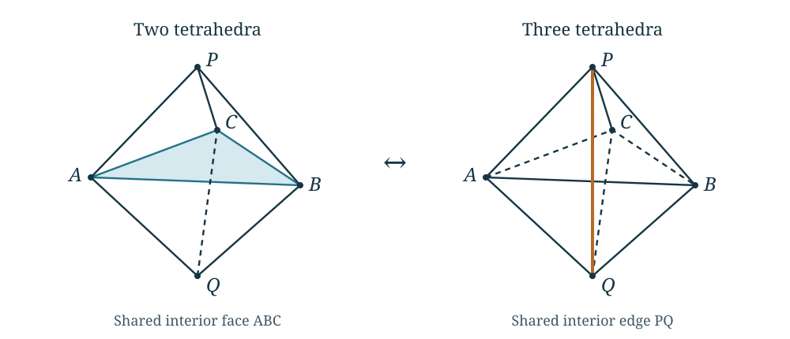

# Algebraic approaches and the tests they must pass

The algebraic approaches in this project try to retain an entire quantum
state and its relations, rather than estimate every summand separately.
They ask whether gluing, changes of coordinates, and evaluation at roots
of unity can determine the volume contribution. Several of these
constructions give exact identities. Their implications for the growth
of the original knot invariant require additional arguments, specified
below.

The [methods chapter](methods.md) introduces the finite invariant,
weighted estimates, Fourier transformation, and geometric optimization.
Here we explain the algebra behind some earlier proposals. This chapter
also retains an unsuccessful model: knowing why it fails as an exact
state is useful even when its volume rate is correct. These proposals
are not premises silently added to the manuscript's volume theorems.

## A positive factorial model and a change of triangulation

Fix an integer \(N\ge2\), and put
\[
 \zeta_N=e^{2\pi i/N},\qquad
 S_N(k)=\prod_{j=1}^k2\sin(\pi j/N),\qquad S_N(0)=1.
\]
The index satisfies \(0\le k<N\), so these products are positive.
The finite quantum factorial
\[
 (\zeta_N;\zeta_N)_k=\prod_{j=1}^k(1-\zeta_N^j)
\]
has the exact expression
\[
 (\zeta_N;\zeta_N)_k
 =(-i)^k\exp\!\left(\frac{\pi i k(k+1)}{2N}\right)S_N(k).
\]
Indeed, each factor is
\(1-e^{2\pi i j/N}=-2i\,e^{\pi i j/N}\sin(\pi j/N)\).
Thus the positive model retains the magnitudes of familiar quantum
factorials. Removing their phases changes a sum of such terms.

A triangulated model must also be compared under changes of its
triangulation. In a \(2\leftrightarrow3\) move, two tetrahedra sharing a
face are replaced by three tetrahedra surrounding an interior edge.
The boundary triangulation is unchanged. An exact identity must compare
the two evaluations with the same boundary data and with every internal
summation measure included.

In the drawing, \(P,Q\) are the apices and \(A,B,C\) the equatorial
vertices. The two tetrahedra are \(PABC\) and \(QABC\). The three are
\(PQAB\), \(PQBC\), and \(PQCA\). The shaded face on the left and the
highlighted edge on the right are internal.

For the symmetric test in the [comparison of the custom definitions](../../notes/custom_literature_equivalence.md#21-the-factor-eight-test-has-a-measure-scale-asymptotic),
take \(6\mid N\). The two bare evaluations are
\[
 B_{2,N}=S_N(N/3)^{-6},
 \qquad
 B_{3,N}=S_N(2N/3)^{-3}
   \sum_{p=1}^{N/3-1}
       \bigl[S_N(p)S_N(N/3-p)\bigr]^{-3}.
\]
The sum is over the additional internal label on the three-tetrahedron
side. At \(N=6\),
\[
 S_6(1)=1,\quad S_6(2)=\sqrt3,\quad
 S_6(4)=6,\quad B_{2,6}=\frac1{27},\quad B_{3,6}=\frac1{216}.
\]
The ratio is eight. More generally, the calculation in the linked note
gives \(B_{2,N}/B_{3,N}\sim N\) along \(6\mid N\). Consequently the two
expressions have the same logarithmic rate, since \(\log N/N\to0\),
while their finite values differ. Multiplying one side by \(N\) fixes
the leading scale, but already fails to give equality at \(N=6\).

This test does not decide whether a model with additional boundary
factors could satisfy an exact move law. For example, a product of
three factors \(1+M^{a_j}\), with integers \(a_j\), equals eight at
\(M=1\). To use such an explanation, one must construct the generic
boundary state, derive its multiplier, and verify compatibility under
successive moves. A numerical ratio at one boundary value does not
determine that multiplier.

The completed positive variational result is retained. Equivalence of
this positive model with the original Kashaev invariant remains
unproved. For the literature origin of the quantum pentagon relation,
see [Faddeev and Kashaev, *Quantum Dilogarithm*](https://arxiv.org/abs/hep-th/9310070).
Their operator identity and the bare positive sum above are different
objects.

## Hilbert 90 solves a transport equation

Let \(E/F\) be a finite cyclic extension of fields, of degree \(r\),
and let \(\sigma\) generate its Galois group. For \(a\in E^\times\),
its norm is
\[
 \operatorname{Nm}_{E/F}(a)=\prod_{j=0}^{r-1}\sigma^j(a).
\]
Hilbert's theorem 90 says that norm one is equivalent to
\[
                         a=\frac{b}{\sigma(b)}
             \quad\text{for some }b\in E^\times.
\]
The norm of such a quotient is one by cancellation of consecutive
factors. The converse is the substantive assertion. See
[Milne, *Fields and Galois Theory*, version 4.22, Corollary 5.24](https://www.jmilne.org/math/CourseNotes/FT422.pdf).

This has a direct interpretation for a scalar difference equation.
If \(\sigma(y)=a\,y\) and \(a=b/\sigma(b)\), then
\(\sigma(by)=by\). Multiplication by \(b\) removes the coefficient
from the equation. In this setting a *gauge* is precisely such an
invertible change of the dependent variable. Reversing the convention
for the equation reverses the quotient.

The theorem gives existence of \(b\); it does not estimate its absolute
value under a chosen complex embedding. It also allows multiplication
of \(b\) by any element of \(F^\times\). A comparison of quantum
periods must retain the normalization selecting a particular gauge
and control the sizes of that gauge and its inverse as \(N\) grows.

There is an explicit warning within the original source calculations.
The [primitive gauge calculation](../../notes/actual_hilbert90_gauge_dilogarithm_action.md)
works in the nilpotent algebra \(\mathbb C[z]/(z^N)\). Put
\(Q_N=e^{2\pi i/N}\). In that algebra it constructs the unique unit
\(g_N\) with constant term one satisfying
\[
             \frac{g_N(Q_Nz)}{g_N(z)}
                     =\frac1{(1-z)(1-Q_Nz)}.
\]
Both denominators are units because their constant terms are one.
This is a concrete cyclic transport equation in a ring with
nilpotents, not a direct application of the field theorem above.
Choose the unique polynomial representative of degree less than
\(N\). On \(|z|\le1/4\), the calculation proves
\[
 g_N(z)=
 \exp\!\left(\frac{2\operatorname{Li}_2(z)}{h_N}
                      +O(N^{-1})\right),
 \qquad h_N=\frac{2\pi i}{N}.
\]
Here \(\operatorname{Li}_2(z)=\sum_{k\ge1}z^k/k^2\) on this disk.
The proof estimates the finite polynomial itself, including its
truncation error. For complex \(z\), the real part of its leading
exponent can have size proportional to \(N\). Exact trivialization of
the transport can therefore carry an exponential cost.

The [polynomial companion construction](../../notes/pointed_companion_source_and_polynomial_hilbert90.md)
provides another exact change of coordinates, retaining the original
input vector and output row. Its residual spectral polynomial has
not thereby been identified with the knot's geometric A-polynomial.
Both constructions are useful algebraic results with stated remaining
comparison problems.

## Why a Koszul complex appears

Suppose \(R\) is a commutative ring of coefficients and the gluing
conditions are \(H_1=\cdots=H_s=1\), where \(H_i\in R\).
Write \(f_i=1-H_i\). The quotient
\(R/(f_1,\ldots,f_s)\) imposes these equations. A Koszul complex
also records relations between the equations.

For one equation its entire definition is the two-term sequence
\[
                 0\longrightarrow R
                   \xrightarrow{\ f_1\ } R\longrightarrow0.
\]
For two equations it is
\[
 0\longrightarrow R
 \xrightarrow{\ c\mapsto(-f_2c,f_1c)\ } R^2
 \xrightarrow{\ (a,b)\mapsto f_1a+f_2b\ }R
 \longrightarrow0.
\]
The composite map is zero. Its degree-zero homology is
\(R/(f_1,f_2)\). The degree-one homology is the set of relations
\(f_1a+f_2b=0\), modulo the relations
\((a,b)=(-f_2c,f_1c)\) already supplied by the first map.
For \(s\) equations one takes the tensor product of the corresponding
two-term complexes, with the usual alternating signs. This is the
[standard Koszul construction](https://stacks.math.columbia.edu/tag/0621).

There is a particularly concrete reason for it in the finite
translation calculation. Let \(V\) have basis
\(e_0,\ldots,e_{n-1}\), and define
\[
 Te_j=e_{j+1}\quad(j<n-1),\qquad Te_{n-1}=H e_0.
\]
Then \(T^n=H I\). The cokernel of \(1-T\) identifies all the \(e_j\),
and its final relation is \((1-H)e_0=0\). More precisely, separate
changes of basis in the domain and codomain, using no division,
reduce \(1-T\) to
\[
                   \operatorname{diag}(1,\ldots,1,1-H).
\]
The [finite translation proof](../../notes/rational_period_pushforward.md#4-the-algebraic-gluing-support-is-a-koszul-reduction)
gives those bases explicitly. This is a reduction of a linear map,
not conjugation of \(T\) by one basis change. Each diagonal entry
one gives a two-term complex \(R\xrightarrow{1}R\), whose homology
is zero and which can be removed by an explicit chain homotopy.
The remaining complex is \(R\xrightarrow{1-H}R\). For several
commuting translations on separate tensor factors, tensoring these
reductions gives a chain equivalence with the Koszul complex of
the equations \(1-H_i\). It preserves homology without asserting
that the original and reduced complexes have equal dimensions.

A sequence is *regular* if its generated ideal is proper and each
\(f_i\) is a non-zero-divisor after the preceding equations have been
imposed. For such a sequence the higher Koszul homology vanishes; see
[Stacks Project, Lemma 15.31.2](https://stacks.math.columbia.edu/tag/062F).
With redundant equations it can remain. For example, in
\(R=\mathbb Q[x]\), the sequence \((x,x)\) has degree-one homology
\(R/(x)\): every relation is \((a,-a)\), and the boundaries are
exactly those with \(a\) divisible by \(x\). By contrast, the single
equation \(x^2\) has zero higher homology although its quotient has a
nilpotent element. Singularity or nonreducedness alone does not
establish a failure of Koszul exactness.

This construction describes simultaneous algebraic constraints.
It does not select an integration cycle, prove a nonzero quantum
evaluation, or determine a regulator constant. Those are additional
data and arguments.

## What cyclotomic rigidity can determine

The elementary model of a rigidity argument is a polynomial
\(P(q)\in\mathbb Q[q]\) which vanishes at infinitely many distinct
roots of unity. It must be zero: a nonzero polynomial has at most
its degree many roots. The polynomial is fixed throughout this
argument.

Compare the level-dependent polynomials \(P_N(q)=q^N-1\).
Each vanishes at \(\zeta_N\), but none is the zero polynomial.
Moreover,
\[
 \left.q\frac{d}{dq}P_N(q)\right|_{q=\zeta_N}=N.
\]
Thus knowing the root values does not give their transverse
derivatives. A *jet of order \(k\)* at a point means its Taylor
coefficients through order \(k\), or equivalently its derivatives
of orders \(0,\ldots,k\). Values are only jets of order zero.
The cyclotomic polynomial \(\Phi_n(q)\) is the monic polynomial
whose roots are the primitive \(n\)-th roots of unity. In
characteristic zero, divisibility by \(\Phi_n(q)^{k+1}\) means
vanishing of all these derivatives through order \(k\) at every
primitive \(n\)-th root.

There is also an established uniqueness theorem for a different,
precisely specified class. Habiro's cyclotomic completion is
\[
 \widehat{\mathbb Z[q]}
   =\underset{n}{\lim_{\leftarrow}}\mathbb Z[q]/I_n,\qquad
 I_n=\bigl((1-q)(1-q^2)\cdots(1-q^n)\bigr).
\]
An element is a compatible system of polynomial residue classes,
not an arbitrary list of values at different levels. Each root
of unity gives an evaluation because the displayed product
eventually vanishes there. The full Taylor series at one root
determines an element of this completion; its values at all roots
also determine it. These are injectivity statements in
[Habiro, *Cyclotomic completions of polynomial rings*, Theorems 5.4 and 6.3](https://arxiv.org/abs/math/0209324).
The integer coefficient ring and the specified completion matter.
These statements neither put an arbitrary level-dependent state
in that completion nor estimate its size. A proposed regulator
comparison would first have to be constructed in the same class.

The [whole algebraic comparison theorem](../../notes/whole_period_cyclotomic_rigidity.md)
works with a fixed algebraic presentation, bounds on its possible
comparison maps, and the required quantum jets. Its reconstruction
argument uses separation of exponents and finite linear algebra.
The [rank-one descent theorem](../../notes/full_rank_one_cyclotomic_descent.md)
likewise has a fixed rational coefficient and whole cyclic transport
identities as hypotheses. Neither theorem manufactures an algebraic
comparison with the geometric period from isolated numerical values.

The geometric distinction is equally important. Nondegenerate gluing
equations with a fixed meridian can select algebraic tetrahedron
shapes \(z_1,\ldots,z_t\). If these shapes realize the specified
oriented hyperbolic triangulation of \(Y\), with its required
peripheral completion, its volume is the regulator value
\[
 \operatorname{Vol}(Y)=\sum_{j=1}^t D(z_j),\qquad
 D(z)=\operatorname{Im}\operatorname{Li}_2(z)
                 +\log|z|\arg(1-z),
\]
with the orientations retained and the continuous Bloch–Wigner
interpretation of \(D\). An arbitrary algebraic gluing solution
has not yet been shown to realize that metric. Algebraicity of the shapes does not make
this dilogarithm evaluation algebraic. More importantly, it does
not show that the original finite quantum evaluation has this
exponential rate.

The [selected-period analysis](../../notes/cyclotomic_rigidity_selected_period.md)
tests exactly this distinction. In the figure-eight example, the same
state has exponential growth at the complete meridian and bounded
values on fixed ordinary-color sequences approaching that meridian.
A proposed uniform comparison must retain the derivative data and
the correct domain. Uniqueness of an algebraically specified object
does not prove that a proposed regulator period satisfies its
equations.

## Regge symmetry and nilpotent transport

A Regge involution fixes a pair of opposite tetrahedral edges.
If the other four edge lengths are \(a,b,c,d\), put
\(s=(a+b+c+d)/2\) and replace them by
\[
                         s-a,\quad s-b,\quad s-c,\quad s-d.
\]
For a tetrahedron in Euclidean, spherical, or hyperbolic space,
the geometric Regge theorem identifies the transformed dihedral
angles and proves equality of volume; see
[Akopyan and Izmestiev, *The Regge symmetry, confocal conics, and
the Schläfli formula*, Theorem 1.1](https://arxiv.org/abs/1903.04929).
This is a specific transformation of one tetrahedron, not an
arbitrary change of a knot's triangulation. At ideal vertices the
edge lengths are infinite, so the ideal discussion below uses
angles and logarithmic shapes instead of substituting into this
finite-length formula.

For an ideal tetrahedron, opposite dihedral angles agree. The
angle data are a triple \((\alpha,\beta,\gamma)\) with sum \(\pi\).
The [Regge and period calculation](../../notes/regge_period_covers_and_a_curves.md)
shows that the faithful finite action on these angle data reduces
to their permutations. Logarithms of the shapes retain additional
translations and a central period coordinate.

The elementary model for the latter is the Heisenberg group
\[
 H(a,b,c)=
 \begin{pmatrix}1&a&c\\0&1&b\\0&0&1\end{pmatrix}.
\]
Multiplication gives
\[
 H(a,b,c)H(a',b',c')
    =H(a+a',b+b',c+c'+ab').
\]
Every commutator has \(a=b=0\), so it is central; commutators
with a further group element are the identity. This is the
meaning of *two-step nilpotent*. The linked note constructs a
specific lattice of this type for the lifted classical period,
together with the finite permutation action. The full group
need not be nilpotent merely because a finite-index subgroup is.

Nilpotence can simplify a differential equation. If \(A(t)\) is a
strictly upper-triangular \(3\times3\) matrix and \(U'=A(t)U\),
\(U(0)=I\), then products of three such matrices vanish. The exact
solution at \(t=1\) is
\[
 U(1)=I+\int_0^1A(t)\,dt
       +\int_{0<s<t<1}A(t)A(s)\,ds\,dt .
\]
Differentiating the analogous formula with upper endpoint \(t\)
verifies the equation. The integrals themselves can still be
transcendental. The classical logarithmic construction therefore
offers a tractable transport problem, but it does not place the
entire quantum knot state in this three-dimensional system.
That further representation and its selected solution have to be
constructed.

## Passing to a cover and descending

Two different kinds of cover occur. Labeling the vertices of a
tetrahedron removes a finite ordering ambiguity in its shape.
A finite covering map \(p:Y'\to Y\) of hyperbolic manifolds changes
the manifold. These operations have different consequences.

In the ideal-shape calculation, reordering four vertices gives
six possible cross-ratios,
\[
 z,\quad\frac1{1-z},\quad\frac{z-1}{z},
 \qquad
 1-z,\quad\frac1z,\quad\frac{z}{z-1}.
\]
The twenty-four vertex orderings give each cross-ratio four times.
Away from shapes with a stabilizer, the six cross-ratios form a
sixfold cover of the unordered shape space. At a symmetric shape,
including the regular ideal tetrahedron, some of them coincide:
the stabilizer and the chosen logarithmic data must still be
recorded. Orientation matters even away from those points.
The first three Bloch–Wigner values equal \(D(z)\), and the last
three equal \(-D(z)\), so their unweighted sum is zero. Retaining
the orientation sign is necessary to descend the volume; simply
averaging over the orderings would erase it. The
[explicit period calculation](../../notes/regge_period_covers_and_a_curves.md#2-the-explicit-twist-on-the-logarithmic-period)
derives these signs and the logarithmic transformations.

For an orientation-preserving manifold cover of degree \(D\),
the pulled-back metric gives
\[
                         \operatorname{Vol}(Y')
                                  =D\,\operatorname{Vol}(Y).
\]
Choose a torus boundary component upstairs and compatible
peripheral bases. Suppose its meridian and longitude map to
\[
 \mu'=\mu^a\lambda^b,\qquad
 \lambda'=\mu^c\lambda^d,\qquad ad-bc>0 .
\]
For simultaneously selected eigenvalues of a restricted
representation, this gives the monomial map
\[
                    M'=M^aL^b,\qquad L'=M^cL^d.
\]
The determinant is the degree of that boundary-torus cover.
It need not equal \(D\) when there are several boundary
components upstairs.

The [cover calculation](../../notes/regge_period_covers_and_a_curves.md#4-what-a-finite-manifold-cover-does-to-the-geometric-a-curve)
uses these equations to eliminate the downstairs variables from
a marked geometric A-curve. It keeps track of possible
multiplicities and the distinction between one and several cusps.
Representations upstairs need not extend downstairs, so this
restriction construction alone does not recover every component
of the upstairs character variety.

Descent of the quantum invariant needs more: a relation between
the actual finite states, their boundary evaluations, and their
normalizations. Volume multiplication supplies no such relation.
A cover can simplify the classical geometry or remove a branch
ambiguity while leaving this quantum comparison unresolved.

## How to read these results together

| Construction | Established output in the linked argument | Additional step for the unrestricted volume conjecture |
|---|---|---|
| Positive factorial model | A variational volume rate for its specified positive sum | Exact comparison with the original invariant, including phases and move factors |
| Hilbert-90 gauge | An invertible change solving the specified algebraic transport | Bounds for that change and the original boundary evaluation |
| Koszul reduction | Simultaneous gluing constraints and their relations | The contributing cycle, normalization, and nonvanishing |
| Cyclotomic reconstruction | Uniqueness within the stated fixed algebraic class | Construction of a regulator comparison inside that class |
| Regge and nilpotent transport | Explicit changes of the lifted classical tetrahedral period | A compatible transport of the whole quantum knot state |
| Finite manifold cover | Volume multiplication and peripheral restriction | A source-preserving quantum descent formula |

The [results chapter](results.md) gives the separate full volume
theorems already proved for specified knot constructions. The
[frontier chapter](frontier.md) explains which estimates are missing
for the unchanged general source. The exact algebraic results here
remain useful without being treated as substitutes for those estimates.
