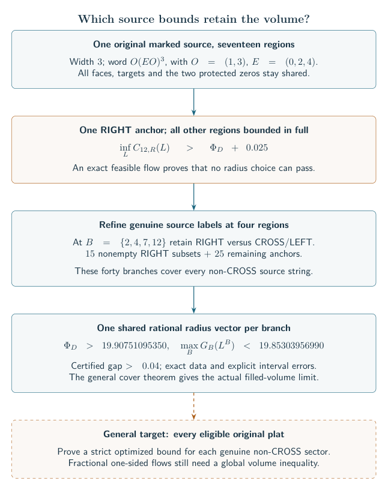
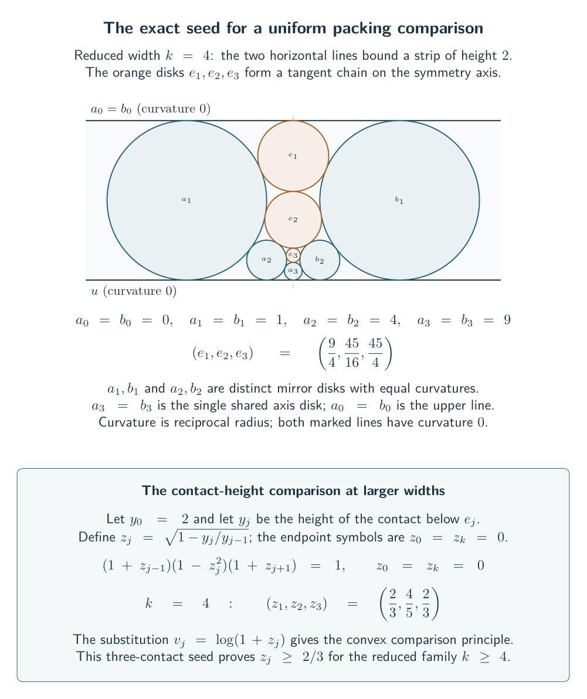
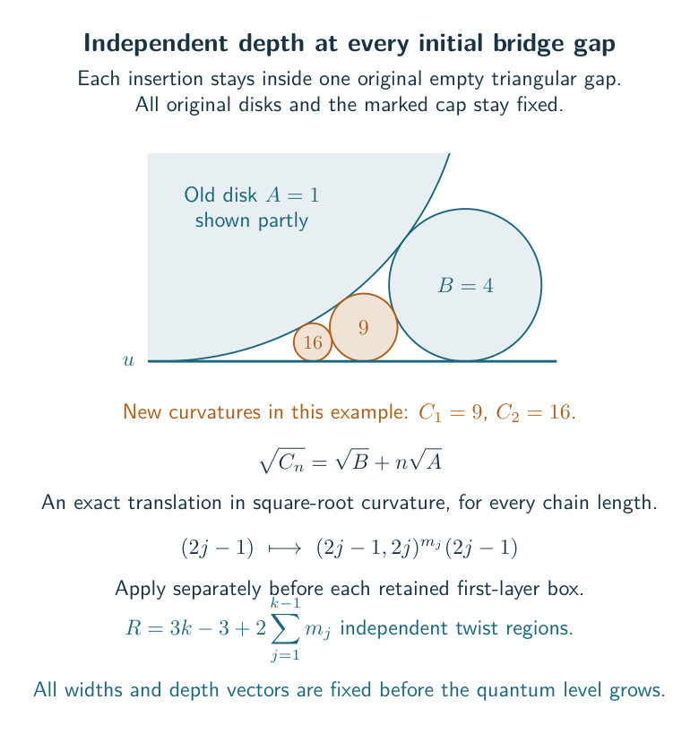
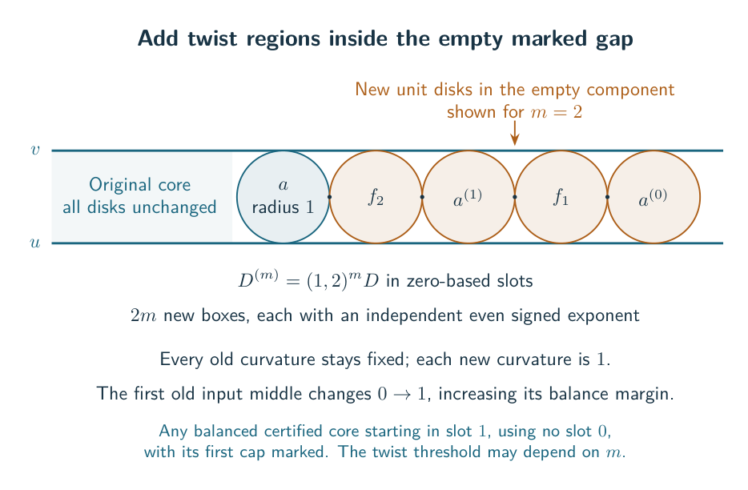
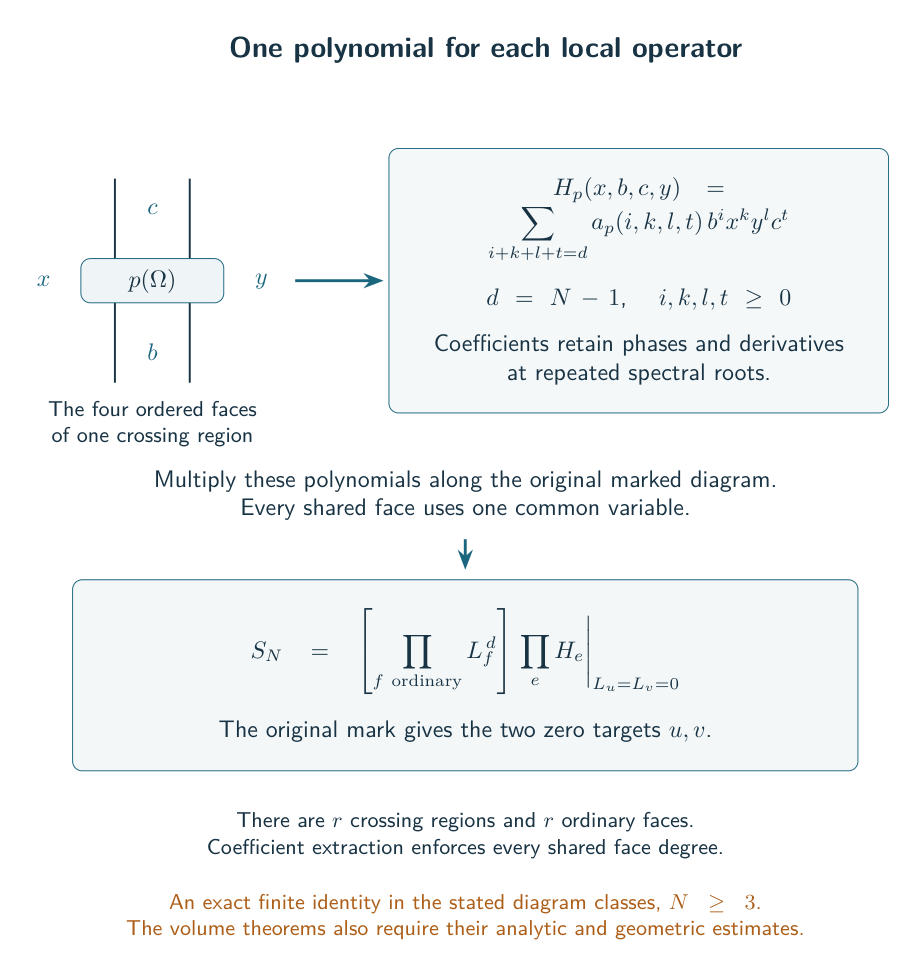
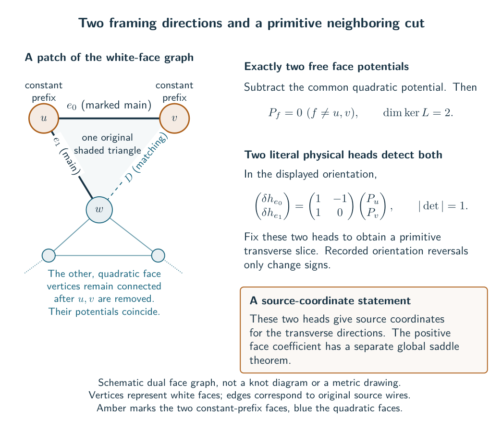
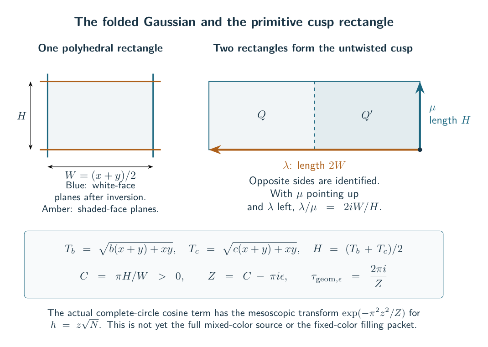
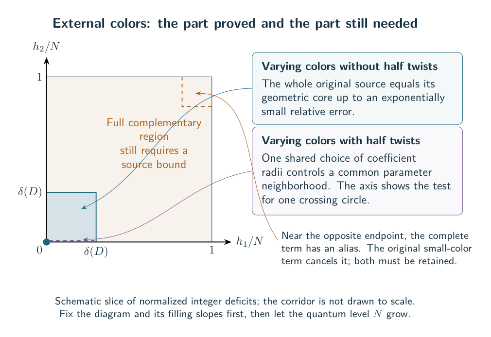
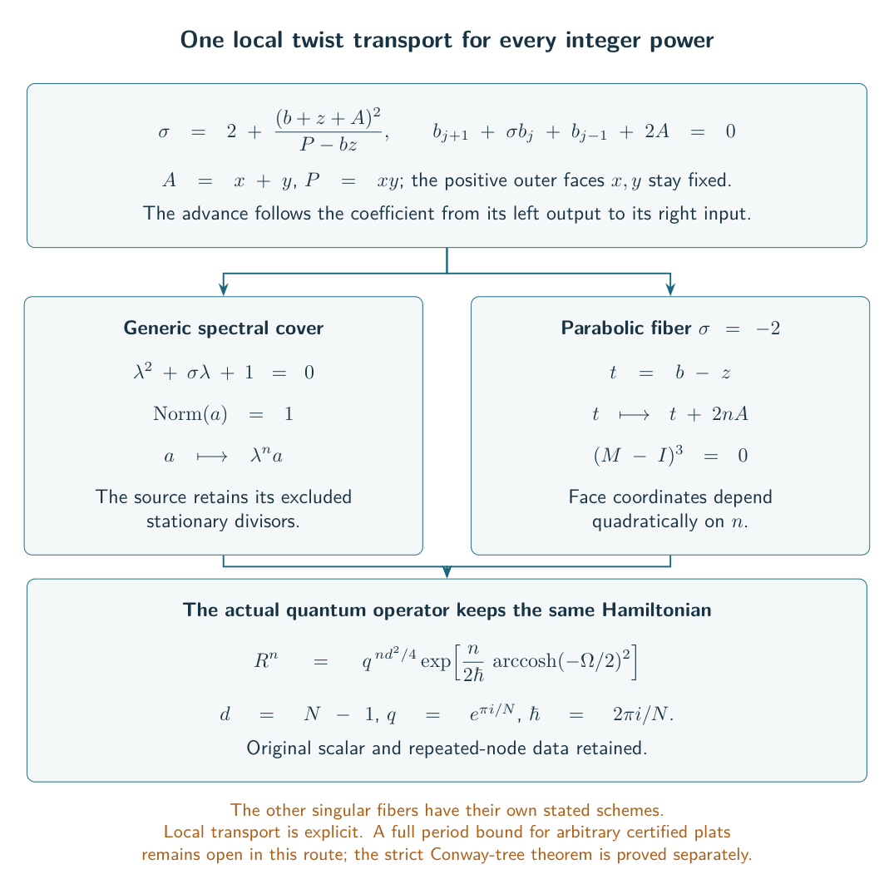
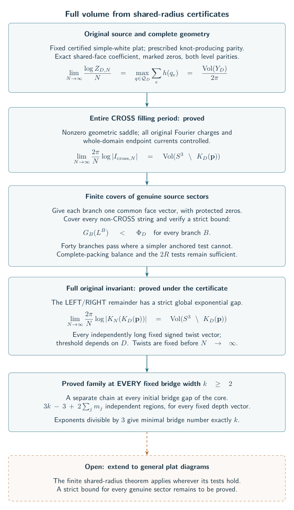

# The current general frontier

The target remains a volume theorem for broad classes at every fixed bridge width. The [new one-end layer family](../../notes/general_one_end_layer_long_filling_volume.md) now gives the full original invariant's limit for every $k\geq2$, with $3k-3$ independently long fixed signed twist regions and exact-bridge-$k$ subfamilies. The wider [balance theorem](../../notes/general_complete_radius_balance_filling_volume.md) applies to every certified diagram passing its finite complete-packing test. The unrestricted conjecture remains open.

## A general finite cover of the source sectors

The [finite-sector cover theorem](../../notes/general_actual_sector_cover_filling_volume.md) gives the full original filled-volume limit whenever a finite cover of all non-CROSS source strings has strict shared-radius bounds. Each branch keeps genuine CROSS/LEFT/RIGHT labels and uses one common face vector with the original protected zeros. The diagram, half-twist pattern and independently long signed filling parameters remain fixed before the quantum limit.

This strictly extends the [anchored criterion](../../notes/general_anchored_shared_radius_filling_volume.md). On the **same original seventeen-region marked plat**, an exact rational flow proves that one anchored bound exceeds the complete volume rate by more than $0.025$, for every choice of radii. A refined cover with forty branches has a certified gap greater than $0.04$ below that rate. The [separation theorem](../../notes/actual_shared_radius_certificate_separation.md) and its portable verifier establish both inequalities using rational data and explicit interval errors.

Complete-packing balance still implies the anchored criterion. The earlier marked five-region example with word $(1,3,2,1,3)$ fails balance but passes six anchored witnesses. We now have two strict extensions of certificate classes, without claiming an inclusion theorem for unmarked knots with arbitrary alternative presentations.

The [undivided-capacity theorem](../../notes/actual_complete_source_cauchy_capacity_gap.md) also identifies why optimizing one positive torus is insufficient: at a strictly unbalanced complete packing, even level-dependent optimal radii lose an exponential factor. The actual coefficient still has the complete volume rate.

The remaining universal target is precise:

$$\inf_{L>0}\left[\sum_e A_{e,\sigma_e}(L)-\sum_f\log L_f\right]<\Phi_D
\quad\text{for each genuine non-CROSS string }\sigma.$$

This condition would finish the full invariant theorem for every certified diagram where it holds. Its validity for all eligible plats remains open. The unrefined anchored condition is now known to be non-universal. Fractional one-sided comparison flows require a global estimate; their pure endpoints and the [fixed-triangle gap](../../notes/actual_fixed_triangle_boundary_capacity_gap.md) do not settle the intermediate mixtures.

## The class and the order of quantifiers

Fix an essential $2k$-strand plat diagram $D$, $k\geq2$, with a hyperbolic augmented exterior $Y_D$ and its actual primitive cusp markings. The [general target](../../notes/general_augmented_plat_long_twist_target.md) asks for a threshold $T(D)$ such that

$$\min_i |m_i|>T(D)\quad\Longrightarrow\quad
\lim_{N\to\infty}\frac{2\pi}{N}\log|K_N(K_{D,\mathbf m})|
=\operatorname{Vol}(S^3\setminus K_{D,\mathbf m}).$$

The diagram and every signed full-twist number $m_i$ are fixed **before** the quantum level $N$ tends to infinity. The prescribed parity pattern must give a knot. The threshold may depend on the diagram; no threshold depending only on $k$ is asserted.

Under a positive marked gluing certificate, the [geometric filling theorem](../../notes/general_augmented_plat_long_filling_quantifiers.md) supplies a geometric threshold for independently long signed fillings. The quantum threshold is proved under the finite-sector cover criterion, including the simpler anchored and complete-radius conditions below. Universal fixed-sector coverage remains open.

## An explicit full-invariant family at every width $k\geq2$

The [one-end layer theorem](../../notes/general_one_end_layer_long_filling_volume.md) proves the volume limit for a family with $3k-3$ independently long signed twist regions, for **every fixed $k\geq2$**. In conventional braid-generator numbering, take the standard plat closure of

$$\left(\prod_{j=1}^{k-1}\sigma_{2j}^{\alpha_j}\right)
\left(\prod_{j=1}^{k-1}\sigma_{2j+1}^{\beta_j}\right)
\left(\prod_{j=1}^{k-1}\sigma_{2j}^{\gamma_j}\right).$$

Choose the first-layer exponents odd and the other two layers even. This gives one knot component. For each fixed width and retained half-twist sign pattern, sufficiently large absolute full-twist parameters, independently chosen and fixed before $N\to\infty$, give

$$\lim_{N\to\infty}\frac{2\pi}{N}\log|K_N(K)|
=\operatorname{Vol}(S^3\setminus K).$$

The right side is the actual smooth filled hyperbolic volume. Both level parities are included, with no ratio condition between twist magnitudes. The global remainder is bounded by the balance theorem below.

There is also a subfamily with **minimal bridge number exactly $k$**: require every box exponent to be divisible by $3$, keeping the same odd/even pattern. The [Fox-coloring certificate](../../notes/actual_fox_coloring_exact_plat_bridge.md) gives exactly $3^k$ colorings; a $b$-bridge knot has at most $3^b$. This congruence is needed for the bridge lower bound, not for the volume theorem.

The geometric proof is uniform. Reflection of the actual marked packing reduces its contact heights to

$$ (1+z_{j-1})(1-z_j^2)(1+z_{j+1})=1,\qquad z_0=0,\quad z_{k-1}=1. $$

Here the equation holds at the interior indices $1\leq j\leq k-2$. After $v_j=\log(1+z_j)$, strict convexity gives a comparison principle; the right boundary is $v_{k-1}=\log2$ and is never substituted into the singular interior function. Translated copies of the exact three-node seed $(2/3,4/5,2/3)$ prove $z_j\geq2/3$ when $k\geq4$. The cases $k=2,3$ have exact small packings. For $k\geq3$, the final circle occupies its actual bounded tangency gap; $k=2$ uses its explicit three-unit-circle packing. Together these facts give $e_j/(a_{j-1}+a_j)\leq9/4$ at every relevant port, so the [zero-middle lemma](../../notes/actual_zero_middle_nine_quarter_balance.md) proves strict source balance.

This proves a family at each $k\geq2$, rather than all $k$-bridge knots. The earlier reduced-layer family at $k\geq4$ is [preserved separately](../../notes/general_reduced_layer_long_filling_volume.md). The wider complete-radius criterion remains available for other diagrams; the unrestricted conjecture remains open.

## Independent tangle depth at every initial bridge gap

The [simultaneous bridge-gap theorem](../../notes/general_simultaneous_bridge_gap_filling_volume.md) permits a separate fixed depth $m_j\geq0$ at every first-layer bridge gap of the one-end core. Replace its zero-based slot $2j-1$ by

$$ (2j-1,2j)^{m_j}(2j-1),\qquad 1\leq j\leq k-1. $$

The later two layers stay in their original order. The resulting family has

$$ R=3k-3+2\sum_{j=1}^{k-1}m_j $$

independently long signed twist regions. For every fixed width, depth vector and prescribed knot-producing half-twist pattern, sufficiently long fixed fillings have the **full original invariant's actual hyperbolic-volume limit**. The threshold may depend on this whole diagram. Taking new exponents even preserves the original knot parity automatically; more general fixed half-twist patterns are allowed when the resulting permutation gives a knot. The mod-$3$ exponent condition again supplies minimal bridge number exactly $k$.

The geometry is explicit. In each original empty gap between the exterior line and two disks of curvatures $A\leq B$, insert a chain with

$$ \sqrt{C_n}=\sqrt B+n\sqrt A. $$

The original core disks remain fixed, and the gaps have disjoint interiors. The exact original face sweep verifies that simultaneous insertions have precisely these contacts. New ports have largest middle curvature at most $9/4$ times the sum of their outer curvatures, so the proved entropy bound gives balance. The one-end core's increasing side curvatures verify $A\leq B$ uniformly in width. This supplies arbitrary independent tangle depths across the first layer; it does not classify all $k$-bridge knots or arbitrary plat words.

## Arbitrarily many twist regions at each fixed width

The [marked unit-chain theorem](../../notes/general_marked_unit_chain_filling_volume.md) extends any balanced certified core whose first box has zero-based slot $1$, which uses no slot $0$, and whose first cap is marked. Prepend $(1,2)^m$, assigning each new box its own even signed exponent. The original knot parity and marked cap are retained.

In the actual circle packing, the prefix inserts $2m$ unit disks into an empty component between the two marked lines. Every old disk stays fixed. For $m>0$, all new ports satisfy balance and the changed first core port has a larger balance margin. This proves a closure operation for every $m$, without inferring it from a finite list of packings.

Applied to the every-width core above, this gives **$3k-3+2m$ independently long signed twist regions for every fixed $k\geq2$ and $m\geq0$**. Each fixed diagram has the full original invariant's actual filled-volume limit; its threshold may depend on both $k$ and $m$. The mod-$3$ exponent condition again gives minimal bridge number exactly $k$. The added boxes use the first four physical strands. This is a general closure rule, not coverage of arbitrary multilayer plats.

## A full filling theorem with a finite geometric hypothesis

Take a fixed certified simple-white augmented plat and its original marked complete packing. At each crossing region write the four face curvatures as $(x,b,c,y)$; the two protected curvatures stay exactly zero. Put $A=x+y>0$. The [algebraic balance lemma](../../notes/actual_triangle_entropy_algebraic_balance.md) shows that

$$ (A+b)(A+c)\geq\max\{b^2,c^2\} $$

at every region is sufficient for the [full invariant theorem](../../notes/general_complete_radius_balance_filling_volume.md). The stronger test $|b-c|\leq x+y$ is often simpler to check. All regions use the **same actual complete packing**, with one common scale; separately chosen local radii do not give this certificate.

For each such fixed diagram $D$, there is a threshold $T(D)$ so that every independently signed fixed full-twist vector with $|p_i|>T(D)$, and the prescribed knot-producing parity, satisfies

$$\lim_{N\to\infty}\frac{2\pi}{N}\log|K_N(K_D(\mathbf p))|
=\operatorname{Vol}(S^3\setminus K_D(\mathbf p)).$$

The right side is the volume of the actual smooth filled exterior. The twists are fixed before $N$ grows; no bound on their relative sizes is imposed. This theorem does not assert minimal bridge number, a width-only threshold, or that all certified diagrams pass the test.

The sharper hypothesis is $Q_b(0)+Q_c(0)>\log b,\log c$ for the positive middles, where $Q$ is the original triangle action. Its proof follows three steps. The [entire CROSS period](../../notes/general_all_cross_long_filling_volume.md) has the filled-volume rate, with every Fourier charge and endpoint current controlled. The [global LEFT/RIGHT estimate](../../notes/actual_global_left_weighted_spectral_envelope.md) bounds every surviving one-sided factor strictly below its CROSS rate under balance, at all face phases on the same coefficient torus. Finally, integration by parts on the original whole domains makes the full remainder exponentially smaller than the nonzero CROSS contribution.

**Coverage now includes the explicit family above at every $k\geq2$.** Its recurrence proves actual $Q$-balance uniformly via the zero-middle $9/4$ bound; the stronger product test can fail for this family. Extending to general plat diagrams remains open.

## A whole-source equality at arbitrary fixed width

The [signed augmented-source theorem](../../notes/general_signed_augmented_source_volume.md) proves

$$\lim_{N\to\infty}\frac{2\pi}{N}\log|A_{D,N}|
=2\operatorname{Vol}(Q_D)=\operatorname{Vol}(Y_D).$$

Here $A_{D,N}$ is the original marked complete-circle source, with its actual normalization and retained exterior framing factor. The input is a connected original plat projection and a **labeled convex ideal right-angled polyhedron** realizing its actual cut and face pairings. Each retained half-twist exponent may independently be $0,+1,-1$. The width and matching graph are arbitrary and fixed; both level parities and composite levels are included.

This is a theorem about complete augmented **links**, including patterns whose main strands form one component. The older mixed-color route to filling their crossing circles uses the external-color estimates below; the new fixed-root balance theorem provides a separate route. The theorem does not assert that every reduced plat has the required geometric certificate. Parallel belts producing a white bigon fail this certificate; the [coverage check](../../notes/general_untwisted_augmented_source_literature_coverage.md) explains why their known even-level zeros are compatible with the theorem.

The proof is recorded and independently reviewed within this project. That is distinct from external peer review.

## The original source as one homogeneous coefficient

The [homogeneous source theorem](../../notes/actual_homogeneous_casimir_face_source.md) now applies to **every original Casimir-polynomial coupon**. For a coupon $f_e(\Omega)$, its exact face operator gives one polynomial $H_{f_e}(x,b,c,y)$ of degree $d=N-1$, with nonnegative integer exponents and its original complex coefficients. The whole marked contraction is

$$Z_N=\left[\prod_{f\ \mathrm{ordinary}}L_f^d\right]
\left.\prod_e H_{f_e}\right|_{L_u=L_v=0}.$$

The identity retains the actual cup/cap factors, physical endpoint zeros, the second-head mark, and both parity cosets. It includes small colors, signed crossings, arbitrary polynomial combinations and disconnected replacements. No smoothing forest or ordering of dependent operators is needed. The finite face grid has $N^{R+1}$ points; its local inverse Fourier factors and mark give exactly the coefficient above. Degree $dR$ excludes every additional level alias.

Complete circles recover the earlier positive formula below: their $H$ contains an exact factor $N$, followed by the original folded-channel sum. Thus the general identity and the complete-source normalization agree.

Let $R$ be the number of crossing circles, $d=N-1$, and $a_i$ the original internal channel labels. At each circle, the [literal source identity](../../notes/actual_complete_circle_positive_face_polynomial.md) gives two determinant polynomials and one forced-zero polynomial:

$$D_a(x,b,y)=\det\!\left[bI+\frac{x}{2}H_-+\frac{y}{2}H_+\right],\qquad
\widetilde P_s(x,y)=\sum_{j=0}^{s}\frac{S_s}{S_jS_{s-j}}x^{s-j}y^j,
\quad s=d-2a.$$

The matrices are the original positive Hermitian matrices, and $S_j=\prod_{r=1}^j2\sin(\pi r/N)$. These polynomials have nonnegative coefficients for **every** folded label. Their combined degree at a circle is $2a+s=d$.

The [exact marked coefficient theorem](../../notes/actual_original_marked_face_coefficient.md) then converts the actual finite head sum into one coefficient:

$$A_{D,N}=\chi_{D,N}N^R\sum_{\mathbf a}
\left(\prod_i k_{a_i}\beta_{a_i}^2\omega_{a_i}^{\epsilon_i}\right)
\left[\prod_{f\ne u,v}L_f^d\right]
\left.\prod_i D_{a_i,\mathrm{in}}D_{a_i,\mathrm{out}}
\widetilde P_{s_i}\right|_{L_u=L_v=0}.$$

Every scalar is specified by the original source. The mark removes exactly the two face exponents $u,v$. The other $R$ target exponents already use the entire degree $dR$, so there is no additional Fourier alias. Local polynomial zeros enforce the original unwrapped support; the primitive face grid supplies the exact power $N^R$. Even-level carries cancel only after the whole marked expression is assembled.

For $\epsilon_i=0$, this is a positive sum after removing the common unit phase $\chi_{D,N}$. With half twists, the same coefficients remain positive and their channel phases are summed explicitly by the signed theorem.

## Why the coefficient has the actual geometric rate

The proof uses one circle-packing radius for each shared white face. It does not independently maximize the tensor factors.

1. The [rank and curvature theorem](../../notes/actual_original_boundary_transverse_rank.md) leaves exactly two flat framing directions. Removing the two marked faces and fixing the common scale gives a positive Hessian of size $N$.
2. The [global coefficient theorem](../../notes/actual_positive_face_coefficient_saddle.md) bounds the entire coefficient torus. A finite positive-matrix contraction gives exponential decay away from its unique angular maximum, followed by a nonzero relative Gaussian asymptotic.
3. The [absolute action calculation](../../notes/actual_original_boundary_stationary_character.md) cones the marked ideal vertex to the actual white and shaded facets. Their Lobachevsky contributions give $2\operatorname{Vol}(Q_D)$, with the additive constant fixed by the original determinant normalization.
4. The [uniform channel-rate theorem](../../notes/actual_positive_face_channel_rate.md) controls every internal label at those same radii. Its circle rate increases strictly to the fold. This bounds the whole source from above; one positive folded coefficient supplies the matching lower bound in the untwisted case.
5. The [signed extension](../../notes/general_signed_augmented_source_volume.md) proves a uniform relative Gaussian estimate from the original finite continuants. It sums the actual half-twist phases and bounds all remaining labels. Its leading coefficient is nonzero at both level parities.

More precisely, put $M=\lfloor(N-1)/2\rfloor$, $s_0=N-1-2M$ and $t_i=M-a_i$. If $F_N(\mathbf a)$ denotes the positive sector coefficient including its $\beta$ factors, the actual shared-radius saddle gives

$$\frac{F_N(\mathbf M-\mathbf t)}{F_N(\mathbf M)}
=\exp\!\left[-\sum_i C_{i,N}\frac{t_i(t_i+s_0)}{N}\right](1+o(1)),\qquad C_{i,N}>0.$$

The exact phase ratio is $\omega_{M-t}/\omega_M=\exp[\pi i t(t+s_0)/N]$. Retaining the original multiplicities, the channel sum therefore contributes

$$ (\pi N)^{R/2}\prod_i(C_{i,N}-\pi i\epsilon_i)^{-1/2}(1+o(1)). $$

Here $C_{i,N}$ is evaluated at the exact finite critical radius and tends to a positive geometric value $C_i$. The factor cannot vanish. The estimate is relative throughout a window wider than $\sqrt N$, and the proof controls both its intermediate and macroscopic tails.

## How far this is from the requested knot theorem

The complete signed source, the full local packet, and the entire CROSS filling period are proved. The new balance condition also closes the full original remainder. The remaining distance to the requested general theorem is now:

| Required step | Status | Remaining scope |
| --- | --- | --- |
| Entire CROSS period, including all charges | Proved with the actual filled-volume rate | No remote-charge restriction in this sector |
| Full one-sided remainder at balanced complete radii | Proved; yields the full invariant limit | The finite balance hypothesis must hold on the actual marked packing |
| Actual family coverage | Proved for every $k\geq2$, with exact-bridge subfamilies | Extend beyond this family and the finite balance criterion |

These are separate statements: the conditional theorem applies to every passing diagram, while the recurrence proves coverage for the explicit family. The diagonal and short-moving sector estimates also survive without balance, but do not cover every macroscopic one-sided sector.

The external-color reflection route is also retained below, with its own corridor and alias estimates. Its internal deficits $s_i=N-1-2a_i$ and external filling-color deficits $h_i=N-j_i$ are different variables. The [fixed complex core theorem](../../notes/actual_complete_core_complex_packet.md) now controls the complete-image term with $\boldsymbol\chi=\mathbf h/N$ in a fixed complex neighborhood:

$$\frac{F_N(N\boldsymbol\chi)}{F_N(0)}
=e^{N(S_N(\boldsymbol\chi)-S_N(0))}
\sqrt{\frac{\det K_N(0)}{\det K_N(\boldsymbol\chi)}}
\bigl(1+O(N^{-1})\bigr).$$

Here $S_N$ is the selected joint critical action and $K_N$ its nonsingular Hessian. The square root is fixed at $\boldsymbol\chi=0$. The theorem proves nonvanishing uniformly and $S_N\to S$ holomorphically. The [geometric deformation theorem](../../notes/actual_complete_core_geometric_deformation.md) identifies this limiting action on the actual marked peripheral branch:

$$2\pi\operatorname{Re}S(\boldsymbol\chi)
=\operatorname{Vol}(\rho_{\boldsymbol\chi})
+\frac12\sum_i\operatorname{Re}U_i\operatorname{Im}V_i,
\qquad U_i=-2\pi i\chi_i.$$

Thus for small **real** $\boldsymbol\chi$, the exact complete-core polynomial has rate $\operatorname{Vol}(\rho_{\boldsymbol\chi})$. At zero this is the complete augmented-link volume. For complex meridians the displayed boundary correction is necessary. The relative asymptotic still retains $S_N$; convergence alone does not justify substituting $S$ in its exponential. The [finite-level action transfer](../../notes/general_long_filling_varying_action_transfer.md) now proves that the filling calculation can retain $S_N$ throughout and take its limit at the end. Its remaining hypotheses are the full mixed-source estimates.

The [external reflection theorem](../../notes/actual_external_circle_reflection_and_cusp.md) gives an exact interface. An original color $N-h$ circle is a cosine-weighted complete circle plus a literal color $h$ circle. The complete term has a proved Fourier limit for $h=z\sqrt N$, and its coefficient matches the primitive cusp shape:

$$\frac{F_N(\sqrt N\,\mathbf z)}{A_{D,N}^{\boldsymbol\epsilon}}
=\exp\!\left[-\sum_i\frac{\pi^2z_i^2}{Z_i}\right](1+o(1)),
\qquad \tau_{\mathrm{geom},i}=\frac{2\pi i}{Z_i},\quad Z_i=C_i-\pi i\epsilon_i.$$

This holds uniformly for bounded complex $\mathbf z$, with fixed derivatives. It is a theorem about the specified complete term. The full mixed source also contains small-color terms, and the complete term has a full-size opposite-end alias. At that endpoint the small-color term cancels it exactly. A proof for the filling transform must retain this cancellation and control the entire combined source.

The [source-divisor transfer](../../notes/general_long_filling_source_divisor.md) explains the final quantifier: a nonzero analytic amplitude germ gives a result outside an exceptional divisor, while all independently long slopes require the stronger unit or coordinate-monomial condition. The established complete core has a unit amplitude. To use it for the original filled invariant, the other terms and the color complement must still have a proved gap.

## The exceptional edge now has an exact algebraic description

The [finite Fourier-period theorem](../../notes/actual_positive_face_fixed_fold_packet.md) gives an exact four-component difference equation for the original complete-circle core. Its shift range is bounded independently of $N$. It retains the actual finite polynomial solution, both fold endpoints, the Fourier gauge and the full classical determinant factors. Its selected local characteristic is an explicit palindromic quartic. After the shared-face extraction, the equation couples neighboring face coefficients; a scalar equation for the whole knot has not yet been derived.

The [exponential interpolation theorem](../../notes/actual_positive_face_exponential_fold_interpolation.md) improves the original fixed-real estimate to an exponentially accurate comparison on the actual channel grid, uniformly for complex face radii. Analytic iterations on nested disks and contraction of the actual finite recurrence establish that comparison. The complete-core theorem then converts the finite channel grid by exact cotangent contours and evaluates the joint saddle. This closes the fixed-neighborhood analytic step for the complete term.

The [coupled polynomial system](../../notes/actual_whole_source_coupled_face_difference_system.md) retains every shared-face coefficient and the exact fold-selection relation. It matches the ordered classical momenta on regular charts. At a triangle with two marked zero faces the local quadratic has a double root. The [marked circle-pattern theorem](../../notes/actual_marked_deformed_circle_pattern.md) recovers the shared strip, all source-stationary face radii, and selected eigenline germs directly from a nonsingular finite geometric system. The [primitive collar calculation](../../notes/actual_deformed_circle_primitive_collar.md) then fixes the actual disk word, half-twist shear and line-face limit. Its single side pairing has multiplier $E_bE_c/D$; the double-reflection word has its square. Keeping that distinction and the actual eigenflag lets the global theorem verify every group relation and the regulator differential.

## What the remaining small-color terms now reduce to

The [exact small-circle operator](../../notes/actual_small_circle_polynomial_face_insertion.md) preserves the face polynomial ring after summing all original paths. Its apparent negative powers cancel because the physical endpoint coefficients vanish. The original total-degree argument then excludes every whole-level Fourier alias. At fixed positive radii, a color $h$ insertion costs at most $C^{h-1}$ in the weighted coefficient norm.

The [simultaneous correspondence](../../notes/actual_simultaneous_small_circle_face_correspondence.md) now covers **every untwisted subset with connected identity smoothing**, including protected outgoing faces and cyclic dependencies between operators. Its proof checks polynomiality separately in each merged-face component, while retaining all other formal path choices. It needs no global elimination order. The earlier [ordered construction](../../notes/actual_ordered_small_circle_face_insertions.md) remains a useful special case.

Disconnected identity smoothings have a different exact conclusion. If the inserted colors satisfy

$$2\sum_{i\in J}(h_i-1)<N-1,$$

their entire original subset contribution is **zero**. The ordinary face targets require more degree than the retained Laurent terms can supply. This includes the mesoscopic window at both level parities, with every remaining complete-circle phase retained. Deleted ports carrying a half twist are still outside these results.

For the required geometric gap, the [smoothing-capacity theorem](../../notes/actual_matching_smoothing_angle_capacity.md) supplies a sufficient angle-flow and entropy condition when an untwisted color-one circle is deleted. The polynomial operator carries any compatible strict gap to small colors, at the stated $C^{h-1}$ cost. It does not supply the gap itself.

The [fixed-radius criterion](../../notes/actual_smoothing_fixed_radius_gap.md) gives another sufficient bound without requiring a regular smoothed minimizer. Its explicit certified matched-graph family shows that the corresponding capacity test can fail when only the merged face varies. A source-coverage correction distinguishes that functional example from an original flat-plat source counterexample: the latter would need a presentation adapter that has not been proved. The graph geometry and capacity calculation remain valid.

The [capacity decomposition](../../notes/actual_smoothed_source_capacity_blocks.md) now handles those boundary limits. Compact angle duality remains exact even when the positive-radius infimum is not attained. Loops give an infeasible angle problem; separating two-edge cycles split the capacity into an additive sum. Each nontrivial simple block has a constructed circle packing and an actual convex ideal right-angled polyhedron, with

$$\Phi_{\mathrm{smoothed}}=\sum_B\frac{\operatorname{Vol}(Q_B)}{\pi}.$$

Double-triangle blocks contribute zero. The formula is independent of each block's adjacent marked pair; it does not move the quantum mark or factor the finite quantum source.

The [strict representation-volume theorem](../../notes/general_representation_volume_kernel_strictness.md) supplies the strict comparison when the smoothed source is itself certified hyperbolic. Its actual filling quotient kills an essential meridian. An independently checked natural-map argument proves that a representation with such a kernel has strictly smaller absolute volume. Thus the connected regular smoothing has a strict capacity gap, and the simultaneous operator estimate transfers it to small colors. A simple smoothed white triangulation supplies its required polyhedron by the block construction.

The [actual block representation](../../notes/actual_smoothed_block_representation_volume.md) now closes the nonzero degenerate-block case. It retains the original cuts and face pairings, including matching cuts whose shaded pairings run between blocks. Compatible finite horospherical corners and a uniform short-edge tetrahedron bound identify the regulator with the sum of block volumes. The representation kills the deleted meridians, so the strict-volume theorem applies. No geometric decomposition of the whole smoothed exterior or finite quantum factorization is assumed.

Combining that strict gap with the exact subset identities proves a **general untwisted color corridor**. For any fixed set $E$ of untwisted varied ports, the other ports staying complete with their original signs, there are $\delta(D),\gamma(D)>0$ such that

$$\left|A_N(N-\mathbf h_E,N_{\mathrm{else}})-F_N^E(\mathbf h)\right|
\leq N^{K(D)}e^{N(\operatorname{Vol}(Y_D)/(2\pi)-\gamma(D))},
\qquad 0\leq h_i\leq\delta(D)N.$$

The [whole-source corollary](../../notes/general_untwisted_mixed_source_volume_corridor.md) combines this gap with the zero-free core. After shrinking the corridor, their ratio is $1+O(e^{-cN})$. Consequently, for any physical integer sequence $\mathbf h_N/N\to\boldsymbol\chi$ in that corridor,

$$\lim_{N\to\infty}\frac{2\pi}{N}\log\left|A_N(N-\mathbf h_{N,E},N_{\mathrm{else}})\right|=\operatorname{Vol}(\rho_{\boldsymbol\chi}).$$

This is a limit for the **whole original mixed source**, with the actual marked geometric representation on the right. It holds at arbitrary fixed width and both level parities. A complete metric on a filled knot is a further assertion, and the full filling transform still needs its complementary-color estimates.

The [homogeneous theorem](../../notes/actual_homogeneous_casimir_face_source.md) also gives a joint signed/unsigned corridor under an explicit finite certificate. Put $F_e=F(x,b,y)+F(x,c,y)$ for an unchanged circle, and use the four-angle potential $G(b,x,y,c)$ for a replaced signed circle. For an unsigned replacement the sharper potential is $I(b,c)=\log\max(b,c)$. For every nonempty reflected subset $S$, it suffices to find shared positive face weights with

$$\mathcal C_S(\ell)=\sum_{e\notin S}F_e(\ell)
+\sum_{e\in S}\Psi_{\epsilon_e}(\ell)
-\sum_{f\ \mathrm{ordinary}}\log\ell_f
<\frac{\operatorname{Vol}(Y_D)}{2\pi},\qquad
\Psi_0=I,\quad\Psi_{\pm1}=G.$$

A face has one weight wherever it occurs; different subsets may use different choices. The graph has finitely many subsets. Their strict margins absorb the $C^{h_i-1}$ insertion costs on one sufficiently small fixed color cube. This proves an exponentially accurate ratio to the geometric core and the same whole-source representation-volume limit displayed above. The proof covers interacting signed ports and disconnected subsets. What remains unproved generally is the **existence** of these certificates.

The simpler original-packing test $g_e=F_e-G_e>0$ at every varied port implies the certificate, including marked-zero limits after regularization. It is sufficient and is not automatic. A rationally certified width-three instance proves that the criterion has actual diagram examples. The earlier [one-port theorem](../../notes/actual_signed_small_circle_face_kernel.md) and its explicit curvature tests remain useful special cases.

The [positive Newton calculation](../../notes/actual_positive_newton_capacity_obstruction.md) explains why the far-color problem cannot be reduced to a presumed universal entropy comparison on all certified matched graphs. Its exact local kernel has nonnegative coefficients, but an explicit shared-face feasible state gives a capacity above the geometric complete value. The coefficient lower bound retains the true Newton weights. The graph family has not yet been adapted to the original flat-plat compiler, so this remains a polynomial-capacity obstruction, not a claimed flat-plat source counterexample. In the actual alternating expansion the omitted sign changes a critical equation. A proof using that expansion must retain the sign.

The [resummed small-circle formula](../../notes/actual_resummed_small_circle_face_kernel.md) now gives every local coefficient by a finite rational generating function, with an explicit Fourier formula when one outer degree vanishes. It also disproves a tempting far-color shortcut: even after the Newton cancellations, a unique-path coefficient can be exponentially larger than the corresponding crossing coefficient. This is a local norm obstruction, not a counterexample to a bound after the full shared-face extraction. For this external-color route, general signed-certificate existence and the entire complementary color region, including combined opposite-end aliases, remain unresolved. The direct-power spectral route below has a proved full local source packet.

The [near-maximal-volume theorem](../../notes/general_representation_volume_peripheral_gap.md) gives a general geometric criterion for the latter problem. For a fixed finite list of marked peripheral words, keeping any $|\operatorname{tr}^2\rho(\mu_i)-4|$ bounded away from zero forces a uniform positive volume gap. Its proof derives convergence to the marked complete representation from near-maximal volume. Using this criterion for the quantum source still requires a bound on the actual full period; a characteristic equation or the complete-image term alone does not provide that bound.

The previous operator and torsor approaches remain available. The exceptional operator is the original normalized Casimir polynomial, with its [general character relation](../../notes/actual_matching_edge_polynomial_geometric_action.md) and [exact resolvent period](../../notes/actual_matching_edge_continuant_operator_period.md). The original marked transport, genuine quantum normals, odd framing source, logarithmic class and relative boundary currents are preserved in the [source and torsor routes](../library.html). The new coefficient identity and signed Gaussian resolve the complete contraction without assigning an arbitrary relative cycle.

The [retained Newton critical equations](../../notes/actual_alternating_newton_peripheral_branch.md) provide a further algebraic comparison. Keeping the actual alternating sign and finite sine-factorial ratios yields a localized quadratic relation. After the shared-face equations are eliminated, an explicit rational change identifies its closure with the original untwisted primitive-collar trace relation. The selected square roots and meridian lift remain specified. The external action derivative distinguishes reciprocal Newton branches that have the same trace square. Their real Newton indices lie outside the terminating low-color range, so this comparison does not establish a contributing finite-sum cycle or a global volume bound.

The [full local action comparison](../../notes/actual_newton_complete_local_action.md) goes further on the explicitly selected reciprocal logarithmic sheet: $\Psi_{\mathrm{Newton}}=S_{\mathrm{core}}+\pi i$ as holomorphic germs near completeness. It matches every shared-face derivative, the external momentum, and the additive phase. This theorem concerns an untwisted local port. The physical $h=1$ kernel has only its $r=0$ Newton term, whereas this continued critical point has $r/N>1/2$; matching the action therefore does not select a contribution to that finite sum. The full-source estimate must still retain the actual endpoints and signed compositions.

The global knot quantum A-operator and its selected period have not been derived from this identity. The coefficients and source relations provide a concrete finite object for that work; they are not being renamed the knot A-polynomial.

## Direct twist transport on the Casimir conic

The [direct-power identity](../../notes/actual_direct_long_power_source.md) offers an alternative to the external-color expansion. Kernels on the same pair compose exactly by $H_{fg}=[z^{N-1}]H_f(x,b,z,y)H_g(x,z,c,y)$. Every fixed signed twist power can therefore remain inside its original box, with its phases and repeated Casimir-node data intact.

The [crossing transport theorem](../../notes/actual_crossing_casimir_torus.md) derives a conserved quantity from the actual crossing characteristic. With the outer faces fixed, set $A=x+y$, $P=xy$. The coefficient advance satisfies

$$\sigma=2+\frac{(b+z+A)^2}{P-bz},\qquad b_{j+1}+\sigma b_j+b_{j-1}+2A=0.$$

Here $\sigma$ is the principal symbol of the original Casimir. On a smooth generic fiber, the quadratic cover $\lambda^2+\sigma\lambda+1=0$ supplies an explicit norm-one coordinate with transport $a\mapsto\lambda^n a$. The reference point used to trivialize the torsor is excluded from the regular stationary chart; all intermediate excluded divisors remain recorded. At $\sigma=-2$ the transport is additive, with an affine matrix satisfying $(M-I)^3=0$. The other endpoint $\sigma=2$ is a nonreduced double line and has a different action.

The canonical two-form fixes the orientation and Hamiltonian. The existing exact Gaussian functional calculus, now checked for every integer power, retains that same Hamiltonian and all Hermite data. These are local source statements at arbitrary bridge width. Different boxes need not have commuting Casimirs, and the shared-face contraction still requires an estimate that preserves phases.

The [physical meridian theorem](../../notes/actual_crossing_torus_meridian_transport.md) now connects this transport to the actual filled diagram. The half powers in the original physical kernel give the reciprocal momentum $p=r_H^{-1}$. The outer head derivative fixes the common scale of the two meridian flags. With both included, a positive crossing gives the literal Hurwitz move

$$ (A,B)\longmapsto(A^{-1}BA,A),\qquad P=BA, $$

and the negative crossing gives its inverse. The entire ordered product $P$ is preserved. The trace alone would not fix these conventions.

For any fixed plat width and any fixed integer powers, the shared wire equations and the original cup/cap/mark phases then assemble **every full regular layered critical point** into a boundary-parabolic representation of the actual filled knot group. This is a regular forward morphism, with its excluded divisors and logarithmic characters specified. It does not show that a root of a cleared whole-box equation lifts to that chart. It also does not classify protected-zero, singular or escaping critical points of the original marked coefficient. In particular it supplies no nonzero coefficient for the geometric branch in the finite sum.

There is a general reason to retain those phases. The direct-power note proves that the positive envelope obtained by taking absolute values of the canonical Hermite spectral terms has growth at least the complete drilled volume, even after shared-radius optimization. It cannot establish the strictly smaller filled-volume rate. The torsor gives explicit transport; bounding its original global period remains the decisive step.

## The full spectral numerator and the remaining estimate

Put $\chi_N(\sigma)=2T_N(\sigma/2)+2$ and $V_N(\sigma)=\chi_N(\sigma)(\sigma-\Omega)^{-1}$. The [spectral total-derivative identity](../../notes/actual_spectral_total_derivative_source.md) rewrites each original twist operator using this polynomial numerator, including both the ordinary projector and the nilpotent term at every repeated node. Its exact Fourier formula has zero charge identically zero; the nonzero charges and endpoint currents remain. Values of the complete-channel kernel alone do not determine the independent derivative data.

The [Gaussian numerator theorem](../../notes/actual_gaussian_resolvent_numerator_and_cap.md) gives a concrete object to estimate after sewing:

$$(-1)^{N-1}V_N(-2\cosh w)
=L_N+2\sum_{h=1}^{N-1}\cosh((N-h)w)L_h.$$

Here the $L_h$ are the original physical-color coupons, with any separately retained half crossing multiplied on both sides in its original order. This is a polynomial identity retaining all repeated-node data. At $w=0$ it is the Fejer polynomial in the actual Casimir. After the displayed common sign $(-1)^{N-1}$, the homogeneous numerator at $\sigma=-2-u$ has nonnegative coefficients in $u$ and the four face variables, so its path expansion supplies a positive majorant for complex $\sigma$. The same face must still carry one shared weight throughout the diagram.

The Gaussian times the full resolvent also has a controlled closing cap near $+2$: its cost is $e^{o(N)}$ on a shrinking cap for each fixed twist power. The endpoint theorem and the full complex packet below now control the actual shared coefficient near $-2$, including its independent spectral derivative data. A local positive-weight norm can still exceed the complete geometric rate, and the twist Gaussian grows on one side of a fixed spectral ellipse. The later whole-CROSS theorem controls its intervening contour and every Fourier charge; the full source additionally requires the balance estimate or a replacement for it.

There is now an exact [even-level reduction of that shared coefficient](../../notes/actual_fejer_cross_half_source_reduction.md). The positive numerator splits into paths crossing the two middle spectral rows and paths staying on one side. If $H_M$ is the original maximal complete-channel polynomial, its crossing part satisfies

$$\frac{N}{2}H_M\ \leq\ P_{\mathrm{cross}}\ \leq\ \frac{3N}{2}H_M$$

coefficientwise. The original marked coefficient with crossing paths at every port therefore has the known complete-volume rate, under the same labeled geometric certificate. Every other nonzero term has one-sided ports forming a rooted forest: a one-sided port occupies more than half of a middle face's allowed degree, so no face can receive two such ports, and the original gap graph excludes a surviving cycle. The forest terms need not vanish, and their literal half-size blocks still use level $N$. This positive path partition is distinct from a decomposition into covariant color coupons.

The [global CROSS gap](../../notes/actual_global_cross_spectral_gap.md) and [whole-period theorem](../../notes/general_all_cross_long_filling_volume.md) now control this sector on its entire original contour. The [balance theorem](../../notes/general_complete_radius_balance_filling_volume.md) controls the full complementary source when its finite condition holds. Without that condition, the remaining obstruction is the macroscopic one-sided sector, not an uncomputed local geometric coefficient.

## Existing knot results and preserved alternatives

The [results chapter](results.md) retains the internally reviewed pretzel, belt-stack and signed Conway filling theorems with their original hypotheses. They do not exhaust arbitrary plats. The cube, Fourier, weighted-Cauchy, Karamata-inspired and torsor arguments remain in the [research library](../library.html), including failed intermediate estimates and their corrections. The current route adds a general exact coefficient and a whole-source augmented-link result without discarding those ideas.

The [simple-white criterion](../../notes/general_simple_white_plat_class.md) supplies the geometric certificate whenever the **actual** white cellulation is a simple triangulated sphere. This is a finite test on the given plat and its original matching. The proof permits arbitrary fixed width and separating triangles; an explicit slot-word construction gives knot-producing parity patterns at every supplied width. It does not assert that this presentation is minimal, or that every hyperbolic plat satisfies the test.

## The positive endpoint source has the actual complete volume

The [general endpoint theorem](../../notes/general_fejer_endpoint_source_volume.md) proves the full positive-source limit for every fixed connected original flat plat at arbitrary fixed bridge width, under its labeled convex ideal right-angled certificate. Let $Y_D$ be that actual untwisted augmented exterior, and let $Z_{D,N}$ be the original marked coefficient with the coupon $P_N=-V_N(-2)=4(2+\Omega_N)^{-1}$ at every port. Then

$$\lim_{\substack{N\to\infty\\N\ \mathrm{even}}}\frac{1}{N}\log Z_{D,N}
=W_D=\frac{\operatorname{Vol}(Y_D)}{2\pi}.$$

This includes every even level, with the original cup, cap, mark and coefficient normalization. It is a theorem about the specified positive endpoint source; that source is not renamed the filled knot invariant.

The [closed half-block estimates](../../notes/actual_fejer_half_block_entropy.md) and [full-kernel entropy theorem](../../notes/actual_fejer_full_kernel_entropy_identity_reduction.md) give a continuous local function $h$ on the entire degree-one simplex. Every degree-$N-1$ monomial occurs in the full positive kernel, so ordinary integral flow rounding gives

$$W_D=\max_{q\in\mathcal Q_D}\sum_e h(q_e),$$

where $\mathcal Q_D$ retains every shared-face target and both protected zeros. No fixed half-label filter is needed for this full-source formula. The earlier [test at $N_*=10R+2$](../../notes/actual_fejer_shared_entropy_variational.md) remains useful when individual cross/left/right patterns are kept: it detects finite degree offsets that a limiting pattern alone can miss.

The geometric upper bound uses exact source reductions. Pure-middle maximizing ports become literal identity coupons, and their [forest contraction](../../notes/actual_fejer_diagonal_identity_forest_reduction.md) preserves the rate and marked targets. The [hybrid Hall theorem](../../notes/actual_fejer_hybrid_tight_cut_reduction.md) keeps cross ports as two triangle rows and every strict one-sided port as one row. Its forced zeros give only permitted digon cuts; no one-sided difference is split into independent capacities. The [boundary regularity argument](../../notes/actual_fejer_nondiagonal_maximizer_regularity.md) then supplies finite positive shared multipliers on the resulting pieces.

The [actual group and chain assembly](../../notes/actual_fejer_hybrid_piece_representation.md) retains the original port pairings across those pieces and reconstructs a representation of $\pi_1(Y_D)$. Its relative volume is $2\pi W_D$, so the representation-volume bound proves the reverse inequality to the known all-cross lower bound. This uses the [signed cut-ball chain](../../notes/actual_fejer_signed_cut_ball_regulator.md), not the failed claim that an open regulator is invariant under resetting its reference flag. The fixed-degree convexity counterexample also remains valid; neither shortcut is needed.

Every fixed nonempty set of identity insertions has a strictly smaller rate, or gives the zero source: the reconstructed representation kills an essential original meridian. Separately, the [serial-coupon theorem](../../notes/actual_fejer_serial_coupon_bound.md) gives $H_{P_N}\leq H_{P_N^\ell}\leq N^{2\ell-2}H_{P_N}$ for the same ordered pair. It preserves the rate of a literal fixed serial chain, without asserting a replacement for arbitrary separating cuts.

The [unique-maximizer theorem](../../notes/actual_fejer_unique_geometric_maximizer.md) strengthens the endpoint equality: its only maximizing incidence flow is the original marked geometric one. Equality in the volume bound forces the constructed representation to be conjugate to complete holonomy; the actual based peripheral words then recover all labeled contacts and white circles. Compactness gives a strict entropy gap outside every fixed neighborhood, including the entire one-sided remainder. This holds at every fixed certified width; it supplies neither a diagram-independent gap nor control of the oscillatory filling cycle.

## Odd regularization and exact spectral derivatives

The [odd-level theorem](../../notes/actual_fejer_odd_regularized_full_numerator.md) retains the independent semisimple derivative through the actual covariant coupon

$$F_N=\begin{cases}
-V_N(-2),&N\text{ even},\\
V_N(-2)-N^{-2}\partial_\sigma V_N(-2),&N\text{ odd}.
\end{cases}$$

The odd coupon has the same uniform full local entropy $h$. Its original shared source $Z_{D,N;F_N}$ therefore has rate $W_D=\operatorname{Vol}(Y_D)/(2\pi)$ at both parities. The derivative in this formula is spectral, at the fixed root; it is not a genuine-$q$ normal.

Let $S_N(\boldsymbol\sigma)$ be the entire original shared contraction of the $V_N(\sigma_e)$ numerators, with all marked targets unchanged. For every multiindex $\alpha$ the finite estimate is

$$\left|\partial_{\boldsymbol\sigma}^{\alpha}S_N(-2,\ldots,-2)\right|
\leq e^R\alpha!N^{2|\alpha|}Z_{D,N;F_N}.$$

Positive path comparisons also bound the full numerator on shrinking complex spectral disks at upper rate $W_D$. These results retain the semisimple data missing from complete-channel samples. The later relative packet uses independently proved actual cofactor asymptotics to extend this control to a fixed complex neighborhood.

The [spectral remainder theorem](../../notes/actual_fejer_spectral_polydisk_complement.md) now carries the strict one-sided entropy gap to a small fixed complex neighborhood of $\sigma_e=-2$. If $\gamma_D>0$ is that gap and $\theta(r)=\operatorname{arcosh}(1+r/2)$, the absolute remainder exponent is at most $W_D-\gamma_D+\sum_e\theta(r_e)$. Small fixed radii preserve a gap; shrinking radii retain the full gap. The comparison preserves original path endpoints and the shared coefficient targets. It is an absolute bound. The all-cross asymptotic below supplies a nonzero reference on a fixed smaller neighborhood, where this remainder becomes exponentially small relative to the actual main term.

## The full numerator has a fixed complex geometric packet

The [full spectral packet theorem](../../notes/general_full_spectral_numerator_geometric_packet.md) concerns the entire original shared numerator $S_N(\boldsymbol\sigma)$, with $\sigma_e=-2\cos(2\pi\delta_e)$. For every fixed certified diagram, a fixed complex neighborhood of $\boldsymbol\delta=0$ has

$$S_N(\boldsymbol\sigma(\boldsymbol\delta))
=(-1)^{(N-1)R}\frac{N^{2R}e^{N A_N(\boldsymbol\delta)}}
{(2\pi N)^{(R-1)/2}\sqrt{\det H_N(\boldsymbol\delta)}}
\bigl(1+O(N^{-1})\bigr).$$

Here $A_N$ is the critical value of the exactly anchored finite complete-fold interpolants after the **one original shared-face extraction**, and $H_N$ is their normalized face Hessian after fixing the common scale. The square root is continued from its positive endpoint value. The finite anchors, mark, protected zeros, parity offsets and explicit $N^{2R}$ are retained. The numerator is nonzero on this fixed neighborhood for all sufficiently large $N$, and the estimate includes fixed derivatives and both level parities. It descends to a fixed spectral neighborhood of $\sigma_e=-2$.

The proof begins with [exact central cofactor factorizations](../../notes/actual_cross_cofactor_factorization.md). The [ordinary-middle packet](../../notes/actual_cross_cofactor_interior_packet.md) retains the sum over every physical starting row, while the [protected-middle packet](../../notes/actual_cross_cofactor_protected_packet.md) treats the original zero middle face and the initial row separately. Their analytic growth bounds and the exact physical nodes give [exponential interpolation rigidity](../../notes/actual_cross_cofactor_interpolant_rigidity.md). This controls the actual off-node numerator; it does not differentiate an arbitrary interpolation of repeated-node values.

The [global angular estimate](../../notes/actual_cross_cofactor_global_angular_gap.md) uses positive path comparisons, original determinant contraction and exact finite interpolation. It includes all terminal rows and protected-zero patterns; the [protected-middle angular proof](../../notes/actual_cross_cofactor_protected_angular_gap.md) is an independent direct recurrence argument. Connected shared-face incidence then bounds the entire angular complement. The original Cauchy torus supplies the nonzero Gaussian factor, and the strict one-sided entropy gap restores the full numerator relatively.

The [absolute marked-action theorem](../../notes/actual_cross_cofactor_marked_action.md) identifies $A_N\to A_0$ with the untwisted longitude action, including all face momenta and the marked line limits. Restore half twists exactly once by

$$A_{\boldsymbol\epsilon}=A_0+\pi i\sum_e\epsilon_e\delta_e^2,
\qquad U_e=\partial_{\delta_e}A_{\boldsymbol\epsilon},
\qquad V_e=-4\pi i\delta_e.$$

For the actual Gaussian exponent $n_e=\epsilon_e-2p_e$ and Fourier charge $\ell_e$, the critical equation is $U_e+p_eV_e=-2\pi i\ell_e$. At the unit-charge sufficiently long smooth-filling germ, its exact peripheral boundary correction cancels the Gaussian terms, giving the actual filled hyperbolic volume as the critical exponential rate. The following localized-period theorem establishes a contribution from this critical point. The subsequent whole-CROSS theorem controls its global charge sum.

The [local charge comparison](../../notes/general_local_charge_critical_monotonicity.md) now proves that the all-unit positive integer charge has the largest critical value within a fixed small scaled box. For independently signed slopes $n_i$ of sufficiently large magnitude and $1\leq\ell_i\leq a|n_i|$,

$$\operatorname{Re}S(\mathbf n,\mathbf1)-\operatorname{Re}S(\mathbf n,\boldsymbol\ell)
\geq\sum_i\frac{C_i}{2n_i^2}(\ell_i^2-1).$$

The inequality is strict for every other charge in that box, with no restriction on ratios between the slope magnitudes. It follows from separate evenness of the actual action and an exact derivative formula at its coupled saddle. This lemma compares **local critical values**. The original contour contribution requires the additional argument below, and charges outside this box remain uncontrolled.

## A nonzero localized original filling contribution

The [localized-period theorem](../../notes/general_localized_unit_charge_filling_period.md) now evaluates the original spectral integral on a fixed closed real cube $K_b=[-b,b]^R$. For every fixed vector of independently signed crossing powers $n_i=\epsilon_i-2p_i$ of sufficiently large magnitude, it translates that actual cube to the horizontal plane through the finite-$N$ saddle. All side currents are retained and have a fixed exponential gap. The Gaussian determinant branch is fixed by its positive real part, so the contour coefficient is proved rather than assigned.

Let $\mathcal U_{N,\mathbf n;b}$ be the sum of the original charges $\ell_i=\pm1$ on that cube. Then

$$\mathcal U_{N,\mathbf n;b}
=q^{\frac{(N-1)^2}{4}\sum_i n_i}(-2i)^R\sqrt{2\pi}\,N^{R+1/2}
\frac{\prod_i\sin(2\pi\delta_{N,\mathbf1,i})}
{\sqrt{\det H_N(\boldsymbol\delta_{N,\mathbf1})}\sqrt{\det Q_{N,\mathbf1}}}
 e^{N S_{N,\mathbf1}}\bigl(1+O_{\mathbf n}(N^{-1})\bigr).$$

The coefficient is nonzero, and all $2^R$ charge signs contribute equally. This is the raw marked contraction; its recorded final-diagram framing/component character multiplies the formula when converting to the final invariant convention. The finite action $S_{N,\mathbf1}$ remains in the exponential. At both level parities its limiting real part gives the actual smooth filling volume. The diagram and twists are fixed before $N$ tends to infinity, with no restriction on ratios between their magnitudes.

The same formula governs the **finite local charge sector** $0<|\ell_i|\leq\lfloor a|n_i|\rfloor$: all its nonunit contributions are exponentially smaller. This local theorem alone establishes neither dominance over remote charges nor a bound for the original invariant. The whole-CROSS and balance theorems above supply those additional steps in their stated scopes. The exact remaining period consists of finitely many selected-charge integrals outside $K_b$, plus every other charge on its whole original domain. The remote inside/outside sharp-cube series are not separately summed; they need not inherit the absolute summability of the original full-domain series. Endpoint currents are already encoded in the exact spectral identity.

The [fixed-root direct-power scope](../../notes/fixed_root_direct_power_scope.md) separates this remaining task from generic-$q$ deformation: this route needs no genuine-$q$ normal theorem. The whole-CROSS theorem and complete-radius balance estimate supply the subsequent global bounds under their stated hypotheses. The one-end layer family now satisfies balance at every $k\geq2$. General diagram coverage, or a replacement when balance fails, remains open.
