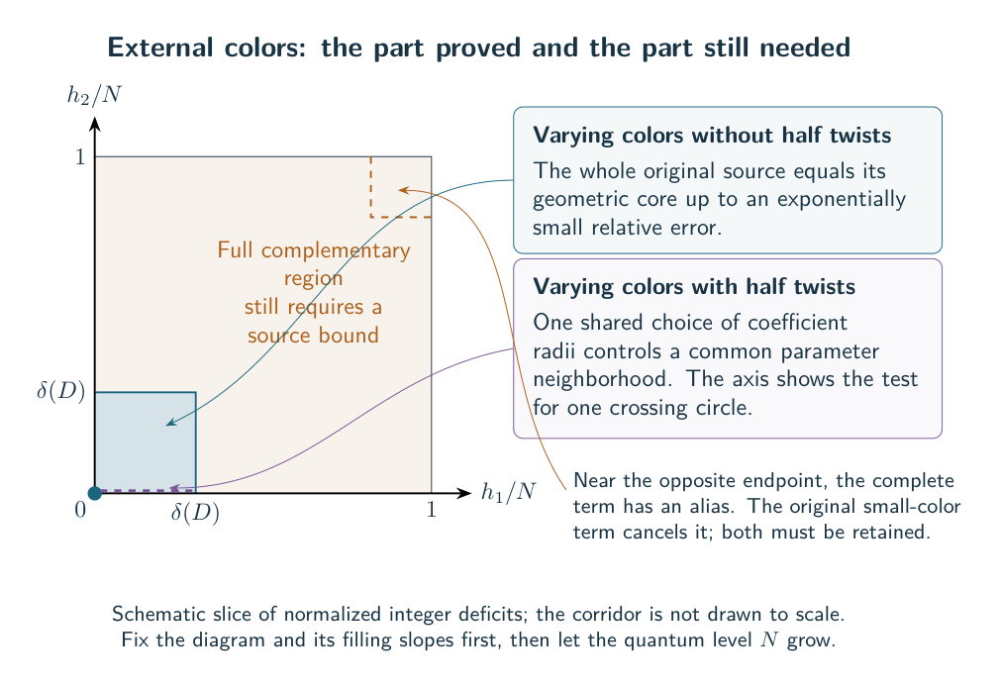

# What remains to be proved

The current papers prove volume limits for specified diagram classes
under explicit sufficient conditions. The central open problem in this
project is to remove the requirement that every surviving filling be
long. The question is about the original reduced Kashaev invariant and
the volume of the complete knot complement.

The [results chapter](results.md) gives the established hypotheses.
The [research status](../../notes/research_finite_exceptions_progress.md)
records the separate extension project. The manuscripts are frozen at
their stated results; exploratory lemmas are not added to their premises.

## The established long-filling result

Fix a finite strict Conway construction, its auxiliary crossing circles
and a half-twist pattern whose strand connections form one knot. Let
\(r\) be the number of auxiliary circles. Write
\(\boldsymbol p=(p_1,\ldots,p_r)\in\mathbb Z^r\) for the primitive
integer filling coefficients and \(K(\boldsymbol p)\) for the resulting
knot. All this data is fixed before the quantum level \(N\) grows.

The [Conway theorem](../../docs/papers/conway-asymptotics.pdf) supplies a
threshold \(P\), depending on the fixed construction, such that every
fixed assignment with \(|p_j|>P\) for all \(j\) has

\[
 \lim_{N\to\infty}\frac{2\pi}{N}
        \log|K_N(K(\boldsymbol p))|
       =\operatorname{Vol}(S^3\setminus K(\boldsymbol p)).
\]

The signs and relative magnitudes of the coefficients are unrestricted.
The strictness and knot-component tests remain part of the theorem.
The [ordered-reduction result](../../docs/papers/conway-reductions.pdf)
extends its use to presentations whose surviving net twists satisfy
these conditions. A large written exponent can cancel against another
one, so the hypothesis must be checked after that reduction.

For this fixed parameter lattice, long assignments have natural density
one. The excluded set is contained in a union of slabs
\(\{|p_j|\le P\}\). Each slab is infinite when \(r\ge2\). This does
not give finitely many exceptional assignments, or a density statement
for distinct knots ordered by crossing number.

Other papers permit some short powers under different conditions. The
[circle-tree criterion](../../docs/papers/circle-tree-volume.pdf) uses
summed or directed degree-and-twist inequalities. Planar weak balance,
terminal decorations and certified triangular gluings have their own
hypotheses. Those results do not prove the arbitrary-short-filling
extension of the Conway theorem.

## The desired statement after partial filling

Choose a proper subset \(S\subsetneq\{1,\ldots,r\}\), and fix an
arbitrary integer tuple \((p_j)_{j\in S}\). These coefficients may be
short, zero or have mixed signs. The proposed extension asks for a
threshold \(P_S\), allowed to depend on the construction and every
already fixed coefficient, such that all assignments satisfying

\[
                       |p_j|>P_S\qquad(j\notin S)
\]

and producing hyperbolic knots have the same original-invariant volume
identity. The partially filled exterior need not satisfy the positivity
conditions used at the unfilled augmented point. It must be analyzed
with its actual remaining boundary data.

This is stronger than proving another collection of isolated short-word
examples. The [partial-filling formulation](../../notes/research_finite_exceptions_under_partial_fillings.md)
keeps these quantifiers explicit. The proposed statement remains open.

If it were established for every proper subset and every fixed tuple,
a finite branching argument would give finitely many exceptional
assignments for each original template. At the first stage, an assignment
outside the long region has some bounded coordinate. There are finitely
many choices of that coordinate and its bounded value. Fix one such
choice and apply the proposed theorem to the remaining coordinates.
Repeat. There are at most \(r\) stages and finitely many branches at each
stage, so only finitely many fully bounded leaves remain. A threshold at
a later branch may depend on all earlier choices; no uniform threshold
over every partial filling is required.

Assignments and knot types must still be distinguished. Different tuples
can represent the same knot. In particular, zero fillings and exact cap
reductions can turn an apparently long twist into removable curls. The
remaining scalar is then the unresolved core invariant, up to its known
phase. Such padding shows why a general partial-filling theorem can be
substantially stronger than a collection of long-slope estimates.

A covering shortcut also needs care. If a finite unbranched cover extends
over a filled solid torus, a primitive meridian upstairs maps to the
primitive meridian downstairs, up to sign. In the pulled-back drilled
metric its length is unchanged, while a degree-\(d\) boundary cover
multiplies horotorus area by \(d\). Its normalized slope length therefore
becomes \(\mathcal L/\sqrt d\). This does not turn a fixed short filling
into a geometrically long one. The current research status explains this
restriction; a quantum descent theorem would be additional work.

## What a different orthogonality can simplify

Let \(B\) synthesize a physical boundary vector from coefficients:
\(v=Bc\). In a positive Hermitian pairing,

\[
                    \|v\|^2=c^*B^*Bc.
\]

The matrix \(B^*B\) is the Gram matrix of the spanning vectors.
It annihilates directions that represent zero. Replacing it by the
identity is valid for orthonormal coordinates, or after proving a
suitable comparison for the actual matrix. Squaring unrelated expansion
coefficients separately can otherwise count contributions that cancel
when the boundary states are assembled.

The [conceptual chapter](../../manuscript/sections/02-exact-concepts.tex)
and [formal statement guide](../../repro/PAPER_FORMAL_COVERAGE.md)
make this distinction precise. The original closing row remains part of
the data. A norm upper bound does not supply a lower bound for that one
matrix coefficient.

For the full color-orbit transform, Fourier orthogonality is already
exact. Arrange the complete value and ordinary colors as
\(c_N=(K_N,C_1,\ldots,C_{N-1})\), and use a unitary discrete Fourier
transform. If \(u_N\) is the transform of its first coordinate vector,
then

\[
 \widehat c_N=K_Nu_N+e_N,\qquad e_N\perp u_N,\qquad
 \|\widehat c_N\|^2=|K_N|^2+\|e_N\|^2.
\]

The [ordinary-color estimate](../../notes/ordinary_color_plancherel_bound_audit.md)
bounds \(\|e_N\|^2\) polynomially in \(N\), with the diagram fixed.
The missing geometric growth of the actual norm is not changed by
choosing another orthonormal basis. A better basis may nevertheless make
that norm accessible.

Internal tangle coordinates raise a different question. Repeated
Casimir roots require both values and derivatives. The
[local Hermite frame](../../notes/actual_tame_c0_hermite_source_frame.md)
retains both directions, and the
[ordinary-cap tree identity](../../notes/actual_cap_tree_angle_energy.md)
gives a positive normalized pairing for its specified trees. Arbitrary
interior crossings and overlapping gluings still require their own
compatibility argument. A channel invisible to one closing row can become
visible after another crossing; it cannot be discarded early.

## A fixed-degree minimum for the original source

The [normalized Conway formulation](../../notes/research_convex_normalized_conway_source.md)
turns exact packet equations into a positive least-squares problem. At
each proper vertex, let \(x_v\) be the full boundary packet, including
its repeated-root directions. After the stated normalization, a leaf,
turn or product has a prescribed map \(\Phi_v\), and \(L\) is the
original normalized closing row. The energy is

\[
 E_N(x)=\sum_{v\text{ proper}}
          \|\Phi_v((x_c)_{c\text{ child of }v})-x_v\|^2
                         +|Lx_{\mathrm{top}}|^2.
\]

The variables lie in a product of unit packet balls. Each product is
bilinear, so the energy has polynomial degree at most four. Its degree
is fixed as \(N\) grows; its number of coordinates is not. The full
Newton packet has dimension \(N\).

The note proves uniform strong convexity for this specifically normalized
problem, an interior minimizer, and the comparison

\[
 B_{\mathrm{tot}}^2e_N\le |K_N|^2
       \le\frac{197}{196}B_{\mathrm{tot}}^2e_N,
 \qquad e_N=\min E_N.
\]

The known budget \(B_{\mathrm{tot}}\) contains all local normalization
costs. It can contribute to the exponential rate and must be retained.
These inequalities include source zeros. Positivity of the energy does
not assert that its minimum is positive for every assignment.

The [orthogonal elimination](../../notes/research_conway_orthogonal_linear_elimination.md)
chooses one child packet at each binary product and retains those
variables as \(u\). The other variables, denoted \(z\), enter the
residual linearly:

\[
 E_N(u,z)=\|A(u)z+b(u)\|^2.
\]

The original normalized maps make the relevant linear solve uniformly
nondegenerate and its solution feasible. Thus the inner minimization
can be performed exactly:

\[
 \min_z E_N(u,z)
 =b(u)^*\left[I-A(u)(A(u)^*A(u))^{-1}A(u)^*\right]b(u).
\]

The bracket is an orthogonal projection. Its Gram factors remain in the
formula; they have not been replaced by independent coefficient costs.
An equivalent boundary formulation has a Gram matrix between
\(I\) and \((226/225)I\). The original scalar observation is retained.
Elimination removes linear variables, although the resulting rational
or expanded polynomial expression need not still have degree four.

The unresolved step is to evaluate this minimum at the geometric rate
after arbitrary fixed partial fillings. By the displayed comparison,
this would require two-sided exponential estimates for
\(B_{\mathrm{tot}}^2e_N\) at rate
\(\operatorname{Vol}(S^3\setminus K)/\pi\). In particular a lower
bound is needed. Substituting a trial configuration into a minimization
problem gives an upper bound. It does not prove that every admissible
configuration has energy at the desired scale.

Strong convexity does provide a useful lower certificate. With the real
Euclidean gradient, the same note proves

\[
 D_N(x):=E_N(x)-\tfrac12\|\nabla E_N(x)\|^2
       \le e_N.
\]

This polynomial has degree at most six. A configuration with
\(D_N(x)>0\) gives the genuine lower bound
\(B_{\mathrm{tot}}^2D_N(x)\le |K_N|^2\). For a geometric argument,
one would need configurations whose energies have the desired rate and
whose gradient defects are small relative to those energies. An absolute
error bound is insufficient when the energy itself is exponentially
small. Producing such a controlled positive certificate for every fixed
short partial filling is still open.

## Geometry and noncancellation are separate inputs

Casson--Rivin optimization concerns the volume on an angle-structure
domain. At a positive interior critical point, the permitted variations
supply the geometric gluing equations. The actual face identifications,
primitive peripheral slopes and absolute volume normalization remain
essential. The [geometry chapter](geometry.md) and
[marked-filling paper](../../docs/papers/marked-fillings.pdf) explain
those steps for their stated constructions.

For an oscillatory quantum sum, a geometric critical point must also
occur with a nonzero coefficient in the original contour or discrete
sum. Competing contributions must not cancel it at the same exponential
scale. The [whole filling theorem](../../docs/papers/oscillatory-fillings.pdf)
provides this conclusion from explicit local and global source
hypotheses. Extending those hypotheses across an arbitrary short
component remains part of the proposed partial-filling theorem.

## The external-color route and its exact cancellations

An external color is an auxiliary representation label used to expand
a crossing-circle operation. The full finite formula can contain
complementary colors, or aliases, in addition to the selected central
expression. A small-color term can cancel an alias of a complete-color
term. Estimating the latter alone changes the expression being bounded.

The [finite spectral paper](../../docs/papers/filling-bounds.pdf)
retains the derivative channels and the full closing functional.
The [Conway source estimates](../../docs/papers/conway-source-bounds.pdf)
control the required physical and Fourier complements for their stated
strict constructions. The
[Casimir-source paper](../../docs/papers/casimir-source-asymptotics.pdf)
evaluates the central contribution for its broader planar setting.
Its conclusion is distinct from an unrestricted bound for every
complementary source term. A positive local majorant or one small-color
corridor is therefore not a full source theorem.

## Direct twist transport and the classical operator question

The alternative operator approach keeps a signed power inside its
original tangle and follows the resulting quantum relations. Its local
classical spectral variables are not automatically the preferred
meridian and longitude of the closed knot. The gluing and closing maps
must identify the peripheral curve with its original marking.

The [meridian-expansion paper](../../docs/papers/meridian-expansions.pdf)
derives a selected classical factor under its stated hypotheses,
including a fixed nonzero annihilating operator and the needed source
expansions. It does not construct a universal operator from an arbitrary
local polynomial. The [torsor discussion](algebraic.md) explains the
coordinate and descent questions separately. The present finite-exception
target still concerns the original scalar invariant, whether its proof
uses Fourier sums, a variational minimum or operator relations.
