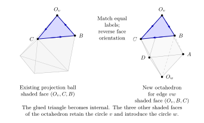
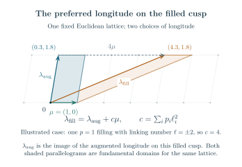
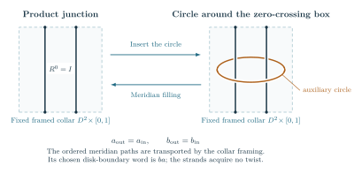

# Why the limiting action is the actual knot volume

The volume theorem has two geometric tasks. First, construct the
hyperbolic metric on the complement of the link drawn by the specified
diagram. Second, identify the normalized source action with that metric's
volume. Face labels, orientations and peripheral curves enter both tasks.

Throughout this chapter \(D\) is a fixed diagram. Its **augmented
exterior** \(Y_D\) is obtained by surrounding each recorded twist region
with an auxiliary crossing circle and retaining its specified half twist.
Filling those auxiliary cusps with the recorded integer slopes restores
the signed twist powers and produces the **filled exterior**
\(S^3\setminus K_{\boldsymbol p}\) when the main strands form a knot.
The knot cusp is left unfilled. The complete augmented action is
\[
             \Phi_D=\frac{\operatorname{Vol}(Y_D)}{2\pi}.
\]
A filled quantum asymptotic instead uses the generally smaller value
\(\operatorname{Vol}(S^3\setminus K_{\boldsymbol p})/(2\pi)\).
Here \(N\) denotes the quantum level; all diagram and filling data are
fixed before \(N\) tends to infinity.

For the [strict Conway tree theorem](../../notes/actual_conway_all_strict_tree_long_twist_volume.md),
the geometric construction, nonzero quantum contribution and bound on the
remaining terms are all proved. The planar constructions below also
establish their specified complements and marked deformations. For a
general planar source, proving that the complementary terms are
smaller than the geometric contribution remains a separate estimate. The
[results](results.md) and [frontier](frontier.md) chapters keep those
scopes distinct.

## The geometric objects and the required checks

Start with the augmented diagram: each twist region has an auxiliary crossing circle around its two strands. Cutting along the projection sphere and the original crossing disks divides its exterior into pieces with labeled faces. The labels remember exactly how to glue the pieces back. They also remember which curves on each torus end are the original meridian and longitude.

An **ideal vertex** lies at the boundary at infinity of hyperbolic space. A small horosphere about it cuts a Euclidean polygon from each adjacent cell. These polygons are the vertex links. In a complete link complement, the polygons around each end glue to a Euclidean torus. This torus is a cross-section of a **cusp**, the noncompact end of the manifold. Checking only that the dihedral angles sum to \(2\pi\) does not establish cusp completeness; the horospherical polygons must also match with the correct translations.

An **angle structure** assigns positive dihedral angles to the proposed cells while satisfying their internal angle relations and the sum around every glued edge. Its volume is the sum of the cell volumes. The angles still retain the actual incidence equations: two copies of one manifold edge are not independent variables. At an interior maximum, variation in every allowed direction gives the shape-matching equations. The proof must then show that these equations produce the original face pairings and complete ends.

A **marked** construction retains the chosen peripheral curves and their basepaths. This matters after filling. The equation that closes a meridian disk depends on a primitive pair of curves on the torus, not just on an unlabeled complex cusp shape. Replacing a primitive longitude by twice that curve would change the filling problem.

## The circle packing for a general planar core

A **simple white triangulation** is a triangulation of the projection
sphere with no loop or repeated edge. Its vertices label white faces of
the cut diagram. A perfect matching of the cubic dual pairs its triangles
into crossing disks; the cyclic orders record the four surrounding
strand ends. This matching and the chosen half twists determine which
main strands join, so the knot condition is a separate component test.

The [planar decoration theorem](../../notes/actual_balanced_terminal_fan_volume.md)
constructs the geometry of every such labeled simple sphere. Remove
one triangle and prescribe three mutually tangent boundary circles.
Maximize the concave angle function subject to angle sum \(\pi\) in
each triangle and \(2\pi\) at each interior vertex. The proof establishes
strict feasibility by a finite counting argument, so the maximum has
positive angles. Its multipliers give positive circle radii.

Euclidean triangles with side lengths equal to sums of adjacent radii
then develop into one embedded disk. Their angle sums remove interior
holonomy, and the convex triangular boundary gives degree one. This
proves that the circles have precisely the prescribed contacts.
The white-circle planes and the circles through the three contact points
of each triangle bound the required convex ideal right-angled polyhedron.

A terminal insertion adds the circle in one triangular gap. All old
circles remain fixed. Its three new supporting disks lie inside the old
shaded supporting disk, so the attached octahedron respects every other
face inequality. Repeating the insertion preserves convexity, even when
the original sphere has separating triangles or the tangle connections
have cycles. The two projection copies recover the actual augmented
link, with the original crossing-disk face maps.

For independently sufficiently long fixed fillings, the complete metric
is the starting point for the deformation. At circle \(e\),
let \(\mu_e\) be the disk-framed meridian and \(\lambda_e\) its
complementary primitive longitude. The logarithms \(U_e,V_e\) are
logarithms of their projective similarity multipliers, with the branches
continued from the complete structure. They are twice logarithms of
the corresponding determinant-one eigenvalues. The selected
peripheral logarithms satisfy the primitive equation
\(U_e+p_eV_e=-2\pi i\). The logarithmic cusp development has angular
period \(2\pi\), so its metric completion is a smooth solid torus on
that slope. The main meridian and longitude remain parabolic and the
knot cusp is complete. Thus the final volume is that of the knot
complement; it is generally smaller than the augmented volume.

## Filling conditions checked at individual circles

For the ordered tree with one crossing circle at every vertex,
let \(d_v\) count the incident octahedral pieces in one projection
half and let \(n_v\) be the signed crossing power. The
[geometric criterion](../../notes/actual_all_circle_vertexwise_geometry.md)
\[
                        \sqrt{d_v^2+n_v^2}\ge630
\]
at each vertex constructs a positive deformation through the full
filling path. The contraction bound is independent of the number
of vertices. The original primitive filling curve has logarithmic
period \(-2\pi i c\), for \(0\le c\le1\). At \(c=1\) it makes
exactly one full turn, and the endpoint is the smooth metric on
the original knot complement. The main knot cusp remains complete.

The volume decreases along this path by the Schläfli formula.
Its constant is fixed at the complete augmented exterior, which
has two regular ideal octahedra per tree edge. This proves that
the continued action is the actual hyperbolic volume. To obtain
a quantum volume equality one also needs the finite-sum estimate;
the [directed subtree theorem](../../notes/actual_all_circle_directed_volume.md)
supplies it under its stronger finite numerical test. In particular,
it suffices that every vertex independently satisfy
\(|n_v|\ge2^{27}\) or \(d_v\ge2^{28}\), with the original knot
pairing. This proves the actual complement-volume equality.
The summed criterion remains a useful alternative. The geometric
bound \(630\) alone is not a quantum estimate.

## The geometric proof for the explicit degree-and-twist bound

The [quantitative theorem](../../notes/actual_all_circle_quantitative_volume.md)
uses a particularly simple decomposition of the actual exterior.
Each vertex of its ordered tree is a crossing circle, and each tree
edge supplies one octahedron in each projection half. Inserting a
terminal child attaches an octahedron along a shaded crossing-disk
triangle. Reading the four strand joins shows that its other three
shaded faces are exactly the new disk faces. The adjacent white
projection faces join in their original order.

There are \(E\) octahedra in each half for a tree with \(E\) edges.
The [ordered decomposition proof](../../notes/actual_all_circle_octahedral_decomposition.md)
retains the left and right insertion order, the actual rotations of
child balls, and the single original half twist at each circle. These
data determine the original manifold and its primitive cusp curves.

The [angular formulas](../../notes/actual_all_circle_angular_octahedra.md)
subdivide the pair of octahedra into eight ideal tetrahedra. All shapes
are \(i\) at the complete point and remain positively oriented for
\(|\tau_v|<10^{-2}\). The numerical bound of the theorem puts the
entire path of filling equations inside this chart. Along the path,
the actual primitive slope has logarithmic period \(-2\pi i c\),
with \(0\le c\le1\). Its angular period is therefore \(2\pi c\).

The [completion argument](../../notes/actual_all_circle_geometric_completion.md)
proves that each auxiliary end is a punctured metric tube with these
periods. At \(c=1\), its core is smooth. Attaching these cores performs
the original surgeries, while the main cusp remains complete. The
boundary correction to the complex action cancels the filling term;
the resulting real value is the volume of this knot complement.
The constant is fixed by the complete augmented link, whose volume
is \(2E\,v_8\), where \(v_8\) is the volume of a regular ideal
octahedron.

This argument allows the full meridian logarithm to accumulate one
turn even when each angular variable is small. It is the step needed
for the short powers permitted by the criterion. The
[main-cusp continuation](../../notes/actual_all_circle_preferred_cusp.md)
then compares the marked representations and follows the preferred
longitude to the smooth endpoint.

## The strict-tree construction

The [net-twist reduction](../../notes/actual_conway_net_twist_volume.md) extends the use of this construction. It combines specified twist boxes by actual isotopies, retaining any half-turn of an intervening tangle. When its output is a strict presentation with sufficiently large combined twists, the geometric theorem below gives the output knot exterior its complete metric. The isotopy identifies that exterior with the input knot exterior, so the metric and its volume transfer directly. This comparison is made after the twists are inserted; it does not identify the auxiliary crossing-circle cusps of two different augmented presentations.

A Conway expression is a recorded sequence of two operations on tangles: stack two boxes, or turn one box through a quarter-turn. Its leaves are the original twist regions. The finite strictness test in the theorem is a compatibility test for the positive angles of these operations. It is not a claim that any written tangle expression becomes hyperbolic when its displayed exponents are large.

The geometric pieces follow these operations. Each leaf contributes an ideal quadrangular pyramid, and each retained product contributes an ideal triangular prism. Their volumes agree with the local terms of the complete quantum action. Each quadrilateral gluing face has four ordered ideal vertices. The order specifies which vertex is identified with which when two cells are attached; it is part of the geometry, not just a label for a boundary variable. The metrics of these faces are determined by derivatives of the action. When the full action is stationary under the shared-index constraints, those metrics agree across the actual ordered product faces.

The [general strict-mask geometry theorem](../../notes/actual_conway_general_strict_mask_geometry.md) proves that these pieces assemble with the original cyclic orders, including turns and the different boundary edge types. An edge type records whether its face is supplied directly by a leaf crossing disk or by the surrounding projection region. The bookkeeping is needed to prevent a formally matching quadrilateral from being attached to the wrong side. The proof rules out the vertex identifications that would collapse a shaded triangle, checks the edge cycles, and constructs positive rectangular cusp links.

The final identification with the diagram uses the [literal bowtie cut](../../notes/actual_conway_bowtie_projection_cut.md). A bowtie is the pair of triangular faces exposed by one crossing disk. Its four outer corners are joined by the actual main strands of the diagram. Reading those joins in their projection order determines every remaining face. Reversing the cut therefore recovers the original link exterior with its original auxiliary circles. Matching a count of vertices or a total volume would not suffice.

The [marked deformation theorem for the full strict class](../../notes/actual_conway_general_mask_marked_filling.md) extends the complete construction to nearby complex auxiliary colors. Its face maps satisfy the original group relations, including their translational parts. Every main cusp remains parabolic. On an auxiliary cusp it supplies specified logarithms \(U_i,V_i\) of the peripheral multipliers. Here a logarithm includes its chosen branch, so it records a winding that a bare eigenvalue would forget.

Write the actual twist weight as \(n_i=\epsilon_i-2p_i\), with \(\epsilon_i\in\{0,\pm1\}\) recording a retained half twist. The filling equation uses the primitive basis of this actual half-twisted link. For every fixed choice of sufficiently large independent signed \(p_i\), the nearby solution gives a smooth filling of the auxiliary cusp. The main knot cusp is never filled. The action, with its boundary correction, equals the volume of that resulting knot complement. The quantum theorem uses exactly this solution and normalization.

The peripheral deformation viewpoint has its classical foundation in
[Neumann and Zagier, *Volumes of hyperbolic three-manifolds*](https://archive.mpim-bonn.mpg.de/id/eprint/1122/).
The diagram-specific work here determines the primitive words,
the factor of two between multipliers and eigenvalues, and the absolute
constant of the source action. Those choices are retained when applying
the filling equations.

The next sections give further details and explain the older constructions that supplied parts of this argument.

## The full geometric longitude for strict trees

A cusp-shape calculation determines the tangent of a peripheral
curve, but the [strict-tree longitude theorem](../../notes/actual_strict_tree_geometric_characteristic.md)
identifies the entire nearby curve for every covered strict
long-filling construction. A meridian goes once around the
knot. Its preferred longitude follows the knot once with zero
linking number. Choose a local lift of the holonomy to determinant-one matrices.
Let \(M\) be the meridian eigenvalue and \(L\) the preferred-longitude
eigenvalue on the same selected line. The complete lift used here has
\((M,L)=(1,-1)\). These are eigenvalues, unlike the projective
multipliers \(e^{U_e},e^{V_e}\) used at the auxiliary cusps.

Write \(\mathcal E_T\) for the original physical quarter-turn
edges, and let \(x_e(M)\) be their continued stationary indices.
With \(X_e=e^{2\pi ix_e}\), the formula is
\[
 L(M)=-M^{-w(D)-\sum_i n_i}
       \prod_{e\in\mathcal E_T}
       \frac{M^2-X_e(M)}{1-M^2X_e(M)}.
\]
Here \(w(D)\) is the oriented writhe and \(n_i\) are the
original signed crossing powers. The filling path fixes the
logarithms and selects the branch; algebraic elimination
without that marking would retain other representations.

The preferred longitude changes under auxiliary surgery even though the
main torus is not filled. If \(\lambda_{\mathrm{aug}}\) denotes the
image of the augmented longitude on the filled main torus, then
\[
 \lambda_{\mathrm{fill}}
   =\lambda_{\mathrm{aug}}+
        \left(\sum_e p_e\,\operatorname{lk}(K,C_e)^2\right)\mu_K
\]
in its peripheral homology, with the disk-framed signs of the theorem.
This integral change of basis is one source of the framing exponent
in the formula for \(L(M)\).

The extension to a junction without a crossing circle uses
a literal identity box \(R^0\). Add a crossing circle around
its two straight strands and fill the new circle's meridian.
This returns the original tangle. The proof fixes a product
collar, a basepoint and access paths before taking any
representation, so both based puncture loops are preserved
in order. It then compares the full boundary tuples of
matrices. Agreement of one scalar trace would not suffice.

At a bare product junction the new angular variable has a
nondegenerate stationary point. Eliminating it returns the
original product action and its Hessian. The full system
remains regular when a physical edge has index one half;
the proof does not assume that a folded quadratic equation
has a simple root. The resulting representation factors
through the original filled knot group and agrees with its
marked geometric deformation.

Combining this identification with the full filtered expansion
gives the selected geometric factor of each genuine all-level
annihilator for the covered strict long fillings. The original
circle-tree operator theorem also applies under the earlier
summed condition or the local bound \(2^{-120}\). No equality of the
full A-polynomial or of recurrence ideals is asserted.
Marked ambient isotopy carries the intrinsic curve and factor
to the covered net-twist and arbitrary-closure inputs, even
when their auxiliary augmented links differ.

## How the cells and the diagram are identified

The [global Conway geometry theorem](../../notes/actual_positive_conway_hyperbolic_volume.md) supplies the face-pairing certificate for every cylindrical factor in its original positive seed-generated grammar. Here cylindrical closure joins each lower external strand to the corresponding upper strand; it differs from joining the two upper ends to each other and the two lower ends to each other. The later strict-mask theorem extends the geometric construction as described above. A leaf is an ideal quadrangular pyramid. A multiplication gate is a convex ideal triangular prism. Their volumes are exactly the source actions, and their ordered quadrilateral metrics are exponentials of the action derivatives.

Stationarity makes the shared quadrilateral gluing faces isometric under the literal stack maps. A boundary barrier proves that every unforced cell at the maximum is strict. The cells assemble into a convex ideal polyhedron; the actual cylindrical closure leaves only right-angled boundary edges. Reversing the projection and crossing-disk cuts reconstructs the original link. Four-step edge cycles give angle $2\pi$ with identity return, and matched rectangular horosphere links prove cusp completeness. Thus the two-copy volume is the volume of the actual complement.

The [closed bowtie-cut proof](../../notes/actual_conway_bowtie_projection_cut.md) identifies every oriented white and shaded face from the literal original wires. It corrects an earlier overstatement about open cells: a quadrilateral gluing face alone is not half of the physical four-punctured tangle boundary. The closed reconstruction uses the entire labeled ribbon graph and reversible disk cut. It also gives each complete crossing-circle cusp its primitive shape $2i\cot(\pi x_i)$.

The final product gate is forced flat and is removed from the geometric cell list using its exact unit source coefficient. This does not delete a quantum contribution or a link component. The [local cell proof](../../notes/actual_newton_ideal_prism_and_associativity.md) also identifies source associativity with two triangulations of one actual ideal cube.

A cap closure joins the two upper endpoints to one another and the two lower endpoints to one another. The [cap-sum reduction](../../notes/actual_conway_cap_sum_reduction.md) goes further: an actual two-punctured separating sphere splits every cap-closed product into componentwise connected sums. The quantum source factors and the angle polytope splits with it. This gives connected sums of theta links with strictly positive rate $4k v_8$, although the whole complement is not hyperbolic for $k\geq2$.

## Algebraic shapes and their volume regulator

The [algebraic optimizer theorem](../../notes/positive_source_algebraic_volume_period.md) applies to every rational affine ideal-angle problem with positive rational weights. On the smallest face containing the maxima, flat atoms contribute zero. The remaining Hessian is definite after quotienting by the rational directions that leave all nonflat angles unchanged. Exponentiated stationarity then proves that the nonflat shapes are algebraic, including boundary and nonunique maxima.

The Bloch group packages algebraic tetrahedron shapes together with the relations obtained by changing a triangulation. Its regulator evaluates those shape symbols by the oriented dilogarithm volume. For a shape \(z\notin\{0,1\}\), the
Bloch–Wigner dilogarithm gives the signed volume of the corresponding
ideal tetrahedron. A sum of shape symbols records the tetrahedra with
their orientations; the gluing relations remove its boundary.
[Neumann's extended Bloch-group construction](https://arxiv.org/abs/math/0307092)
also records logarithmic choices needed for the complex
Cheeger–Chern–Simons invariant. Here the real volume regulator is
calibrated on the specified geometric fundamental chain. The [Bloch regulator calculation](../../notes/actual_positive_source_bloch_regulator.md) proves that the conjugate-antisymmetrized shape sum is a rational Bloch class with regulator equal to the source maximum. For the retained cylindrical factors, the new actual cell realization supplies its geometric interpretation. The class comparison takes place after passing to a common finite conjugation-stable number field containing the source shapes and all glued ideal vertex coordinates. The two copies have opposite mirror orientations, producing precisely the shape symbols $[z]-[\overline z]$ of the geometric fundamental chain; no identification with the geometric trace field is claimed.

For a fixed positive Conway expression \(E\) in that earlier seed-generated grammar, let \(Z_{E,N}\) be its complete quantum sum. Its statement is

$$\lim_{N\to\infty}\frac{2\pi}{N}\log Z_{E,N}
=R_{F_E}(B_E),\qquad B_E=\sum_j([z_j]-[\overline{z_j}])\in B(F_E)_{\mathbb Q}.$$

Here \(z_j\) are the algebraic shapes, \(F_E=\mathbb Q(z_j,\overline{z_j})\) is the number field containing them and their conjugates, \(B(F_E)_{\mathbb Q}\) is the rational Bloch group, and \(R_{F_E}\) is its volume regulator at the specified complex embedding. For a retained cylindrical factor its value is now proved to be the actual complement volume. This regulator argument alone does not identify a generic main-meridian characteristic factor or prove arbitrary short-filling limits. The separate strict-tree longitude theorem above now identifies the selected factor for the covered long-filled knots. Actual all-level quantum A-operators exist by the finite cut-state proof, and the pointed operator-period theorem gives the same volume limit for those knots.

Fixing an output index of an open tangle changes the maximization problem. The resulting function of the scaled output \(b\) is its boundary profile. The [boundary profile theorem](../../notes/actual_conway_boundary_volume_relation.md) also gives a full limit for every coefficient approaching any output $b\in[0,1]$. On $(0,1)$ its optimizer is unique and analytic, and its boundary conjugate is the actual quadrilateral modulus $\exp(-v'_E(b)/\pi)$. This is a geometric meaning for the source boundary relation; the variable is not yet the knot's peripheral holonomy.

## The deformed source has actual peripheral holonomy

In the earlier positive grammar, the [marked deformation theorem](../../notes/actual_conway_marked_peripheral_deformation.md) constructs a representation of the actual link group for the auxiliary-color critical branch. Exact Möbius identities establish every white seam and shaded edge relation, including translations. All main cusps stay parabolic. Let \(\chi_i\) be the scaled auxiliary-color deficit, and let \(\phi(\chi)\) be the selected limiting action. For each auxiliary circle the primitive logarithms are

$$U_i=-2\pi i\chi_i,\qquad V_i=-2\partial_i\phi(\chi).$$

The function \(G=2\pi i\phi\), called a primitive because its derivative is the displayed peripheral one-form, satisfies $dG=\tfrac12\sum_i V_i\,dU_i$, with its constant fixed by the complete fundamental-chain volume. Exponentiated source stationarity gives an algebraic marked peripheral branch; the selected branch is locally a Lagrangian graph: the exterior derivative of that peripheral one-form vanishes on it. This statement concerns the auxiliary peripheral coordinates, with the main cusps held parabolic. The displayed peripheral multipliers are squared SL eigenvalues, and no entire A-polynomial is inferred merely by elimination.

At the original filling saddle, $U_i+p_iV_i=-2\pi i$ holds in the primitive disk marking. The actual nearby representation and the boundary-corrected regulator then identify the full quantum rate with the volume of the correctly filled complement. This applies to every retained robust factor and independently sufficiently long fixed signed integral fillings of any selected auxiliary circles. The component theorem keeps its link-only scope explicit.

## Half twists preserve the marked action through a shear

The [odd-coupon deformation](../../notes/actual_odd_conway_marked_peripheral_deformation.md) changes the shaded face pairings and checks their edge words at general complex parameters. The original odd-link peripheral paths give

$$U_i^\epsilon=U_i^0-\frac{\epsilon_i}{2}V_i^0,\qquad V_i^\epsilon=V_i^0,\qquad G_\epsilon=G_0-\sum_i\frac{\epsilon_i}{8}(V_i^0)^2.$$

These are also the exact derivatives and quadratic correction of the selected finite-source action. Write $M_i=e^{U_i}$ and $L_i=e^{V_i}$ for these auxiliary peripheral multipliers. On the marked double cover $\ell_i^2=L_i$, the half-longitude change becomes the integral monomial map $M_i^\epsilon=M_i^0\ell_i^{-\epsilon_i}$. The source selects the square root and its logarithm. The square root is part of the marked data. Changing it changes the logarithmic branch, so it cannot be discarded when comparing the source and the filling equation. The two possible square roots form a two-point
choice over a fixed nonzero \(L_i\); continuing a logarithm also records
integer multiples of \(2\pi i\). The term *torsor* means that a group
acts freely and transitively on such choices, without a distinguished
choice until a reference is fixed. This square-root cover is different
from the continuous freedom to rescale cusp horospheres, and from the
local Casimir transport curve described in the
[operator discussion](frontier.md#direct-twist-transport-and-the-classical-operator-question).

The square is a fundamental domain, not a metric cusp shape. Its amber segments form the single primitive curve $\mu+2\lambda$ after opposite sides are identified. The two sheets on the right are a local picture of $\ell^2=L$; the cover is not asserted to split globally. The selected logarithm retains the primitive filling equation $U+pV=-2\pi i$.

Smooth filling uses the primitive basis of the link with its retained half twists. Substituting a half-integer slope into the pure-link formula would double the primitive rotation angle when denominators are cleared. The actual odd-link construction avoids that error, keeps main cusps parabolic, and fixes the regulator at its complete volume. Together with the full changed-source estimates it yields the [general signed Conway knot and link theorem](../../notes/actual_odd_conway_long_filling_volume.md).

## A second route: circle patterns for general augmented plats

For a connected labeled right-angled augmented plat at any fixed bridge width, the [signed complete-source theorem](../../notes/general_signed_augmented_source_volume.md) identifies the original source rate with the actual complete volume. The [fixed complex core theorem](../../notes/actual_complete_core_complex_packet.md) now gives a nonzero analytic asymptotic for its complete-image external-color term. This construction is independent of the strict-tree recursion; the statements below retain their own hypotheses.

A circle pattern represents the labeled boundary faces by circles or lines at infinity, with the prescribed tangencies. The [marked circle-pattern theorem](../../notes/actual_marked_deformed_circle_pattern.md) reconstructs the two exceptional boundary faces as parallel lines and solves simultaneously for all finite circle centers and radii. The original positive face Hessian, followed by elementary rigidity of the center triangles, proves that this system has an invertible Jacobian. Its unique nearby solution has exactly the stationary radii of the source action, with one shared strip width and the selected boundary eigenlines retained.

The [primitive collar theorem](../../notes/actual_deformed_circle_primitive_collar.md) computes the actual side pairing, selected eigenflag and half-twist shear, including a common marked-line limit. The [global geometric assembly](../../notes/actual_complete_core_geometric_deformation.md) verifies the full original group presentation and identifies the core's limiting action with the marked geometric deformation. For complex meridian logs it retains the boundary correction $\tfrac12\sum_i\operatorname{Re}U_i\operatorname{Im}V_i$; for real external deficits this correction vanishes. For an unrestricted plat, these geometric and local core statements still need bounds on the remaining reflected-color terms before they imply a full filling theorem. Several separately certified plat families and the strict-tree class already have those bounds; see the [results](results.md) and [remaining scope](frontier.md).

An identity smoothing replaces a specified crossing-disk coupon by the identity and retains the remaining face identifications. For such a diagram, the [block capacity theorem](../../notes/actual_smoothed_source_capacity_blocks.md) removes the need to assume an attained positive-radius minimum. Here capacity is the infimum of the positive weighted expression used for a coefficient bound. The theorem splits degenerate angle problems along two-edge cycles and constructs each simple block's actual polyhedron. The [block representation and volume theorem](../../notes/actual_smoothed_block_representation_volume.md) then retains the original face pairings and realizes their volume sum as a regulator of the original group. Its deleted meridians lie in the kernel, so the [strict-kernel theorem](../../notes/general_representation_volume_kernel_strictness.md) proves strict loss for every nonempty connected untwisted smoothing with finite capacity. Loop-infeasible cases already have an arbitrarily low capacity bound.

The chain argument uses a controlled finite degeneration: cut corners have a common horospherical height and mutual distance $O(T^{-1})$. A uniform short-edge tetrahedron estimate makes the added volume vanish. Arbitrary ideal vertices merely approaching one another would not justify this step. The [near-maximal-volume corollary](../../notes/general_representation_volume_peripheral_gap.md) also gives uniform gaps from fixed marked peripheral trace conditions; applying those gaps to the remaining quantum color complement is still a source-estimate problem.

## A local tetrahedron is a genuine geometric result

In the local theorem with four external representation labels, the exact half-shifted color coordinate is

$$a_e=\frac{j_e+1/2}{N},\qquad \alpha_e=\pi-2\pi a_e.$$

The normalized scalar action is identified with the volume of the truncated hyperideal tetrahedron with these dihedral angles. The proof constructs the Gram matrix of the outward face normals in the Lorentz model of hyperbolic space, recovers edge lengths, checks the volume differential, and fixes the additive constant by an ideal calibration. Boundary values are continuous volume extensions.

This is stronger than observing that a factorial action resembles a dilogarithm. It is also local: a collection of such tetrahedra does not automatically form the knot complement.

## The global angle slice carries the topology

An actual ideal triangulation specifies which faces are glued, which tetrahedron edges belong to each manifold edge, and which peripheral curves represent meridians and longitudes. Its angle constraints must retain this incidence.

At a candidate maximum, stationarity must hold in every allowed angle direction. The corresponding shape and length equations must make adjacent cells agree. The resulting developing map must have the intended winding and end behavior. Complete cusps, or the specified filled peripheral equations, are part of the certificate.

The [source-volume certificate](../../notes/source_volume_casson_rivin_certificate.md) keeps these requirements explicit. An algebraic critical point can be isolated and still belong to the wrong component or have the wrong peripheral marking.

## A general certificate through volume maximization

For an ideal tetrahedron, its three independent positive
dihedral angles \(\alpha,\beta,\gamma\) have sum \(\pi\), and its
volume is
\[
 \Lambda(\alpha)+\Lambda(\beta)+\Lambda(\gamma),\qquad
 \Lambda(t)=-\int_0^t\log|2\sin u|\,du.
\]
An ideal triangulation imposes additional linear sums \(2\pi\) around
the manifold edges. These equations define its angle polytope.
Casson and Rivin's variational method recovers the nonlinear shape
equations by differentiating the sum of these volumes.
[Rivin's 1994 paper](https://annals.math.princeton.edu/1994/139-3/p02)
is a primary source for the volume method; the
[proof by Futer and Guéritaud](https://arxiv.org/abs/1004.0440)
explains the completeness implication in terms of angle variations.

For an actual marked ideal triangulation with torus vertex links, the [positive gluing criterion](../../notes/general_marked_positive_gluing_certificate.md) gives a direct proof of the Casson–Rivin equivalence: an interior critical point of the ideal-tetrahedron volume function is exactly a complete positive gluing. Strict concavity makes it the unique maximum, including over the closed angle polytope, and its value is the actual complement volume.

The proof keeps the geometry explicit. Lagrange multipliers prescribe one truncated length for each global edge. These lengths determine compatible corner horospheres; the face maps then match them, giving complete flat cusp tori. Conversely, compatible horospheres make the geometric volume stationary under all allowed angle variations.

There is a finite algebraic certificate using positive upper-half-plane phases and positive multiplier variables. The unique optimum has algebraic shapes. Neither its dilogarithm volume nor the original quantum period is asserted to be an algebraic number. Existence of an interior optimum on a proposed triangulation, and selection of its period by the quantum source, remain distinct questions.

For fixed critical shapes, choosing a horosphere at one cusp and then
rescaling it changes the decoration but leaves the hyperbolic metric
unchanged. With \(c\) cusps these independent choices form a torsor
for \((\mathbb R_{>0})^c\): there is one and only one tuple of scales
taking one decoration to another. This accounts for the decoration freedom in the algebraic certificate. It does not yet determine the quantum period, and extending the action to complex scalars requires retaining its sign kernels.

For augmented plats, the [actual matching-graph construction](../../notes/general_augmented_plat_matching_geometry.md) is one way to supply this certificate: a positive labeled right-angled polyhedron gives the marked complete exterior and an explicit positive ideal triangulation. The general gluing criterion does not require that particular polyhedral decomposition or a bound on bridge width.

## The general endpoint action has the actual volume normalization

The original augmented-plat coupon now has an [exact local critical-character map](../../notes/actual_augmented_plat_local_critical_character_map.md). It preserves the whole ordered meridian product, recovers the actual crossing-circle transport and retains both physical degree charts and signed half twists. On a correctly marked stationary branch, the original Fourier coupling gives $d(2\pi i\phi)=\tfrac12\sum_i V_i\,dU_i$ in its specified peripheral convention.

A [generic-framing theorem](../../notes/actual_augmented_plat_regular_geometric_phase_chart.md) places the complete geometric representation in regular charts for every coupon simultaneously. It also solves the unrestricted integral degree-lifting problem. It does not put that candidate into a contributing physical support chamber or choose a contributing Poisson sector.

The [endpoint regulator theorem](../../notes/actual_augmented_plat_endpoint_regulator.md) fixes the absolute constant. The fully normalized q-Hahn action and the original crossing-circle diagram have the same rational wedge. Their Bloch–Wigner regulators agree at a real point and hence throughout the connected regular chart. The original diagram cycle has degree one on each cusp, so its regulator is the actual augmented-link volume. Writing $Y_D$ for the actual augmented-link exterior of the fixed diagram $D$, the full stationary-action identity gives

$$2\pi\operatorname{Re}\phi(0)=\operatorname{Vol}(Y_D).$$

This holds at a regular, correctly marked full geometric critical point; the fixed endpoint channel has purely imaginary logarithm and introduces no residual real contribution. The theorem fixes the geometric candidate's value. A quantum cycle coefficient, a nonzero amplitude and bounds for other contributions remain separate parts of the general conjecture.

The same marked matrices now determine the [channel Hessian](../../notes/actual_augmented_plat_channel_hessian.md), without assuming a deformation theorem. If the endpoint transport is $I+b_iH_i$ with $H_i^2=0$, the actual primitive cusp shape is $\tau_i=(b_i-\epsilon_i/2)^{-1}$. Let $\xi_i$ be the scaled channel variables, $y$ the remaining magnetic variables, and $F$ the full local phase. After the two internal q-Hahn variables are eliminated on their marked critical sheets,

$$\frac{\partial^2 F}{\partial\xi_i\partial\xi_j}=-\delta_{ij}\frac{4\pi i}{\tau_i},\qquad \frac{\partial^2 F}{\partial\xi_i\partial y}=0.$$

Since $\operatorname{Im}\tau_i>0$, this channel block has negative real part. Eliminating those channels gives the color Hessian $\pi i\operatorname{diag}(\tau_i)$, with the factor of two in the transfer convention retained.

The [marked multi-cusp rigidity theorem](../../notes/general_marked_multicusp_gluing_rigidity.md) supplies a direct deformation proof from an actual positive ideal gluing certificate. Positive polarization makes the marked gluing Jacobian invertible; the developing-map inverse retains exact peripheral eigenflags, including infinitesimal data.

The [actual critical-scheme theorem](../../notes/actual_augmented_plat_critical_scheme.md) then reconstructs the whole ordered representation from the stationary magnetic variables and conversely. The magnetic Hessian has exactly two null directions, both from framing. After taking a transverse slice, there is a nearby holomorphic geometric stationary branch, with the displayed peripheral differential and absolute volume anchor. This classical existence statement is general in plat width under the certificate. Selecting it from the original quantum sum is a separate analytic requirement, now met for the specifically proved families but not asserted for every plat.

There is now an explicit [physical framing test](../../notes/actual_augmented_plat_physical_framing_criterion.md) for the domain of the joint kernel theorem. One rank-one projector records the common frame; traces of the original prefix words give finite strict inequalities for every input and output. The theorem distinguishes these inequalities from mere avoidance of algebraic chart poles. The [local sheet test](../../notes/actual_q_hahn_joint_complex_amplitude.md) then checks which characteristic root the finite source selects. Neither test asserts that a common solution or a contributing global cycle always exists.

The [right-angled framing obstruction](../../notes/actual_right_angled_selected_framing_obstruction.md) now rules out an all-central selected common frame for the certified right-angled plats. In the Lorentz model, the white face normals form a convex polyhedron whose facets correspond to the original shaded triangles. Under the oriented geometric strip conditions, the two flags determine a line through its interior. At each facet crossed by that line, a nonnegative relation among the three actual prefix diagonals violates strict physical support. Generic flags cross exactly two facets, so the obstruction involves exactly two local factors at every bridge width. Any two distinct facets can be prescribed, including the pair incident to the original marked physical edge. The [selected-factor corollary](../../notes/actual_augmented_plat_selected_factor_localization.md), using the [full physical packet](../../notes/actual_q_hahn_full_physical_complex_packet.md), now proves that every other ordinary factor is physical and source-selected. The selected square root is continued from the original source; the old pointwise principal-root test is not assumed outside the central domain. The completed contraction and global quantum cycle remain unresolved.

For the complete-circle source, the pair at a crossing-circle matching edge now has an [exact rewrite with four external representation factors](../../notes/actual_matching_edge_marked_four_port_block.md). Its four outside objects are all physical, so the [positive scalar estimate](../../notes/actual_matching_edge_racah_positive_scalar.md) applies to every target channel, independently of bridge width. The original row measure cancels its exponential factorial gauge. In this unrestricted-plat method, the target tensor, the remaining network and the original integration contour still require control; geometric localization alone does not estimate them.

The [finite selected-critical certificate](../../notes/actual_augmented_plat_selected_local_certificate.md) combines the positive gluing, common-frame and local-sheet tests, retaining the original logarithmic characters. When supplied, it identifies the geometric stationary germ with the source-selected local principal phase. At completeness the sheet tests also have an exact interpretation as oriented regions between the two actual disk circles. For other geometric realizations, existence of that simultaneous certificate remains open. For an unrestricted plat, this test alone does not show that the geometric point contributes to the original integration contour.

The same deformation coordinates give a [geometric long-filling corollary](../../notes/general_augmented_plat_long_filling_quantifiers.md) without a quantum input. Write $V_i(U)=U_i t_i(U)$ and set $e_i=1/p_i$ at filled cusps, $e_i=0$ at unfilled ones. The equations $V_i(U)+e_iU_i=-2\pi i e_i$ have an invertible Jacobian at completeness and a solution in one fixed polydisk. Their exact factorization bounds each $|U_i|$ by a constant times $|e_i|$. The existing geometric completion argument therefore applies to all independently long signed slopes. This proves the geometric threshold, while the volume-limit threshold still requires the quantum estimates.

## The local maximum can be the wrong global maximum

The four face-support inequalities alone are insufficient. In the local hyperideal theorem, differentiating the normalized action with respect to a color gives the corresponding edge length. Increasing every color preserves those support inequalities and pushes the maximum to an octahedral boundary configuration.

A manifold saddle therefore requires the actual global edge constraints or additional boundary contributions. This is a concrete obstruction to deriving the complement volume by multiplying separately maximized local estimates.

There is now an exact [geometric interpretation of a native magnetic energy](../../notes/actual_native_magnetic_energy_local_geometry.md). At the folded color, the highest-weight degree block gives four positive ideal tetrahedra forming a convex ideal octahedron, whose maximum is $v_8$. The full boundary operator has the larger rate computed in the [Plancherel theorem](../../notes/actual_matching_edge_magnetic_energy_profile.md). Away from the fold the normalized summands require a signed face term. These are local comparison geometries; placing their cells in the actual complement and matching the remaining phase equations still requires proof.

The [positive radial Fourier obstruction](../../notes/actual_positive_fourier_radial_geometric_obstruction.md) makes the phase issue concrete for the general certified right-angled source. Its retained cycle congruences close particular local momentum characters, including the cup signs and marked charge. They do not supply the real magnetic-coordinate matching equations carried by the discarded coefficient phases. An all-ordinary strict radial reconstruction would contradict the common-frame theorem above. This excludes that proposed geometric assembly, without asserting a strict gap between positive and coherent exponential rates.

## Shared cores explain the cube test

For the certified augmented graph geometry, the actual volume has the form

$$4b\,v_8+2\operatorname{Vol}(Q),$$

where \(Q\) is the supplied positive ideal right-angled central polyhedron and \(b\) counts the prescribed octahedral pieces in that construction. The exact cut, face, and cusp identifications are checked in its theorem. The core is shared by the graph; it is not a sum of independent vertex constants.

The cube is a useful nontrivial example of this phenomenon. Its projected quantum calculations recover the shared core contribution. Extending those estimates to the full source is still a quantum problem, even after the geometric complement has been constructed.
