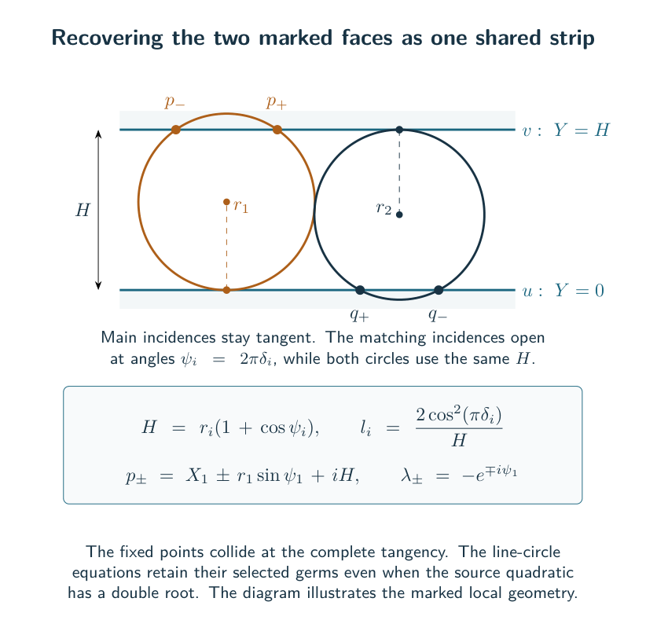
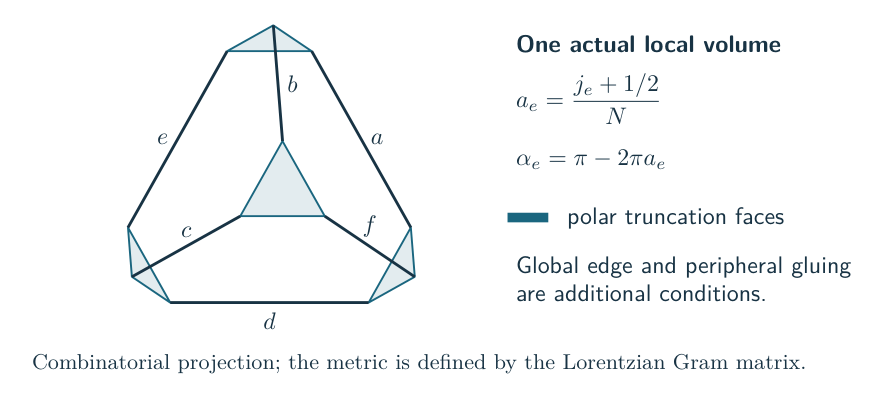
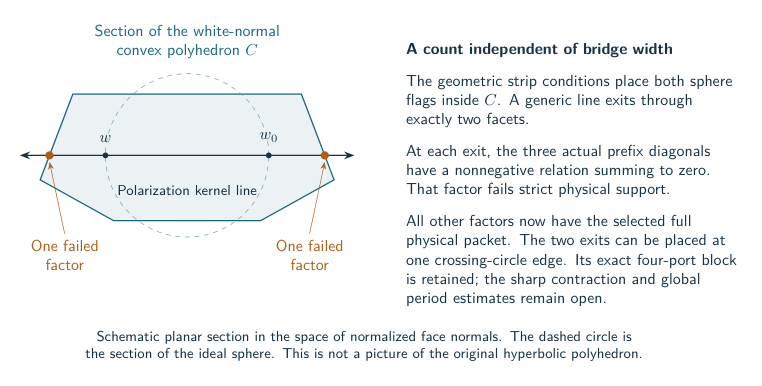
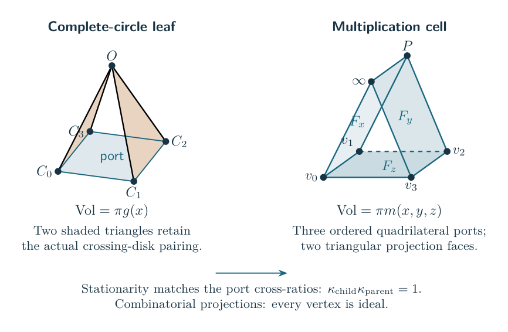
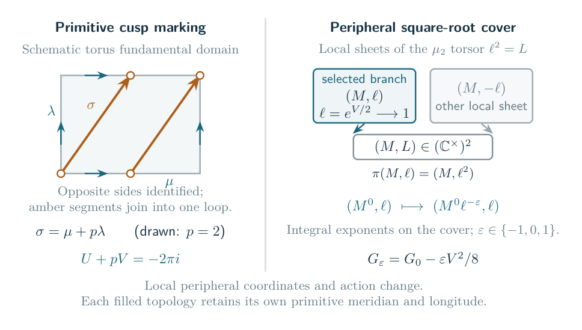

# Why the right side is hyperbolic volume

## The current general construction

For a connected labeled right-angled augmented plat at any fixed bridge width, the [signed complete-source theorem](../../notes/general_signed_augmented_source_volume.md) identifies the original source rate with the actual complete volume. The [fixed complex core theorem](../../notes/actual_complete_core_complex_packet.md) now gives a nonzero analytic asymptotic for its complete-image external-color term. The older local and operator routes below retain their separate scopes.

The [marked circle-pattern theorem](../../notes/actual_marked_deformed_circle_pattern.md) reconstructs the two exceptional boundary faces as parallel lines and solves simultaneously for all finite circle centers and radii. The original positive face Hessian, followed by elementary rigidity of the center triangles, proves that this system has an invertible Jacobian. Its unique nearby solution has exactly the stationary radii of the source action, with one shared strip width and the selected boundary eigenlines retained.

This reconstructs the face geometry. The actual primitive crossing-circle word and the regulator's boundary correction must also be checked before identifying the whole deformed action. The full filling theorem additionally requires the remaining reflected-color and far-alias bounds described in the [frontier](frontier.md).

## A local tetrahedron is a genuine geometric result

In the supported four-port theorem, the exact half-shifted color coordinate is

$$a_e=\frac{j_e+1/2}{N},\qquad \alpha_e=\pi-2\pi a_e.$$

The normalized scalar action is identified with the volume of the truncated hyperideal tetrahedron with these dihedral angles. The proof constructs its Lorentzian face Gram matrix, recovers edge lengths, checks the volume differential, and fixes the additive constant by an ideal calibration. Boundary values are continuous volume extensions.

This is stronger than observing that a factorial action resembles a dilogarithm. It is also local: a collection of such tetrahedra does not automatically form the knot complement.

## The global angle slice carries the topology

An actual ideal triangulation specifies which faces are glued, which tetrahedron edges belong to each manifold edge, and which peripheral curves represent meridians and longitudes. Its angle constraints must retain this incidence.

At a candidate maximum, stationarity must hold in every allowed angle direction. The corresponding shape and length equations must make adjacent cells agree. The resulting developing map must have the intended winding and end behavior. Complete cusps, or the specified filled peripheral equations, are part of the certificate.

The [source-volume certificate](../../notes/source_volume_casson_rivin_certificate.md) keeps these requirements explicit. An algebraic critical point can be isolated and still belong to the wrong component or have the wrong peripheral marking.

## A general certificate through volume maximization

For an actual marked ideal triangulation with torus vertex links, the [positive gluing criterion](../../notes/general_marked_positive_gluing_certificate.md) gives a direct proof of the Casson–Rivin equivalence: an interior critical point of the ideal-tetrahedron volume function is exactly a complete positive gluing. Strict concavity makes it the unique maximum, including over the closed angle polytope, and its value is the actual complement volume.

The proof keeps the geometry explicit. Lagrange multipliers prescribe one truncated length for each global edge. These lengths determine compatible corner horospheres; the face maps then match them, giving complete flat cusp tori. Conversely, compatible horospheres make the geometric volume stationary under all allowed angle variations.

There is a finite algebraic certificate using positive upper-half-plane phases and positive multiplier variables. The unique optimum has algebraic shapes. Neither its dilogarithm volume nor the original quantum period is asserted to be an algebraic number. Existence of an interior optimum on a proposed triangulation, and selection of its period by the quantum source, remain distinct questions.

For fixed critical shapes, the positive multiplier solutions form a concrete torsor: one independent positive horosphere scale per cusp acts freely and transitively. This accounts for the decoration freedom in the algebraic certificate. It does not yet determine the quantum period, and extending the action to complex scalars requires retaining its sign kernels.

For augmented plats, the [actual matching-graph construction](../../notes/general_augmented_plat_matching_geometry.md) is one way to supply this certificate: a positive labeled right-angled polyhedron gives the marked complete exterior and an explicit positive ideal triangulation. The general gluing criterion does not require that particular polyhedral decomposition or a bound on bridge width.

## The general endpoint action has the actual volume normalization

The original augmented-plat coupon now has an [exact local critical-character map](../../notes/actual_augmented_plat_local_critical_character_map.md). It preserves the whole ordered meridian product, recovers the actual crossing-circle transport and retains both physical degree charts and signed half twists. On a correctly marked stationary branch, the original Fourier coupling gives $d(2\pi i\phi)=\tfrac12\sum_i V_i\,dU_i$ in its specified peripheral convention.

A [generic-framing theorem](../../notes/actual_augmented_plat_regular_geometric_phase_chart.md) places the complete geometric representation in regular charts for every coupon simultaneously. It also solves the unrestricted integral degree-lifting problem. It does not put that candidate into a contributing physical support chamber or choose a contributing Poisson sector.

The [endpoint regulator theorem](../../notes/actual_augmented_plat_endpoint_regulator.md) fixes the absolute constant. The fully normalized q-Hahn action and the original crossing-circle diagram have the same rational wedge. Their Bloch–Wigner regulators agree at a real point and hence throughout the connected regular chart. The original diagram cycle has degree one on each cusp, so its regulator is the actual augmented-link volume. The full stationary-action identity then gives

$$2\pi\operatorname{Re}\phi(0)=\operatorname{Vol}(Y_D).$$

This holds at a regular, correctly marked full geometric critical point; the fixed endpoint channel has purely imaginary logarithm and introduces no residual real contribution. The theorem fixes the geometric candidate's value. A quantum cycle coefficient, a nonzero amplitude and bounds for other contributions remain separate parts of the general conjecture.

The same marked matrices now determine the [channel Hessian](../../notes/actual_augmented_plat_channel_hessian.md), without assuming a deformation theorem. If the endpoint transport is $I+b_iH_i$ with $H_i^2=0$, the actual primitive cusp shape is $\tau_i=(b_i-\epsilon_i/2)^{-1}$. After the two internal q-Hahn variables are eliminated on their marked critical sheets,

$$\frac{\partial^2 F}{\partial\xi_i\partial\xi_j}=-\delta_{ij}\frac{4\pi i}{\tau_i},\qquad \frac{\partial^2 F}{\partial\xi_i\partial y}=0.$$

Here $y$ denotes the remaining magnetic variables. Since $\operatorname{Im}\tau_i>0$, this channel block has negative real part. Eliminating those channels gives the color Hessian $\pi i\operatorname{diag}(\tau_i)$, with the factor of two in the transfer convention retained.

The [marked multi-cusp rigidity theorem](../../notes/general_marked_multicusp_gluing_rigidity.md) supplies a direct deformation proof from an actual positive ideal gluing certificate. Positive polarization makes the marked gluing Jacobian invertible; the developing-map inverse retains exact peripheral eigenflags, including infinitesimal data.

The [actual critical-scheme theorem](../../notes/actual_augmented_plat_critical_scheme.md) then reconstructs the whole ordered representation from the stationary magnetic variables and conversely. The magnetic Hessian has exactly two null directions, both from framing. After taking a transverse slice, there is a nearby holomorphic geometric stationary branch, with the displayed peripheral differential and absolute volume anchor. This classical existence statement is general in plat width under the certificate. Selecting it from the original quantum sum remains a separate unresolved theorem.

There is now an explicit [physical framing test](../../notes/actual_augmented_plat_physical_framing_criterion.md) for the domain of the joint kernel theorem. One rank-one projector records the common frame; traces of the original prefix words give finite strict inequalities for every input and output. The theorem distinguishes these inequalities from mere avoidance of algebraic chart poles. The [local sheet test](../../notes/actual_q_hahn_joint_complex_amplitude.md) then checks which characteristic root the finite source selects. Neither test asserts that a common solution or a contributing global cycle always exists.

The [right-angled framing obstruction](../../notes/actual_right_angled_selected_framing_obstruction.md) now rules out an all-central selected common frame for the certified right-angled plats. In the Lorentz model, the white face normals form a convex polyhedron whose facets correspond to the original shaded triangles. Under the oriented geometric strip conditions, the two flags determine a line through its interior. At each facet crossed by that line, a nonnegative relation among the three actual prefix diagonals violates strict physical support. Generic flags cross exactly two facets, so the obstruction involves exactly two local factors at every bridge width. Any two distinct facets can be prescribed, including the pair incident to the original marked physical edge. The [selected-factor corollary](../../notes/actual_augmented_plat_selected_factor_localization.md), using the [full physical packet](../../notes/actual_q_hahn_full_physical_complex_packet.md), now proves that every other ordinary factor is physical and source-selected. The selected square root is continued from the original source; the old pointwise principal-root test is not assumed outside the central domain. The completed contraction and global quantum cycle remain unresolved.

For the complete-circle source, the pair at a crossing-circle matching edge now has an [exact four-port source rewrite](../../notes/actual_matching_edge_marked_four_port_block.md). Its four outside objects are all physical, so the [positive scalar estimate](../../notes/actual_matching_edge_racah_positive_scalar.md) applies to every target channel, independently of bridge width. The original row measure cancels its exponential factorial gauge. The target tensor, remaining network and global cycle still require control; the geometric localization alone supplies none of those estimates.

The [finite selected-critical certificate](../../notes/actual_augmented_plat_selected_local_certificate.md) combines the positive gluing, common-frame and local-sheet tests, retaining the original logarithmic characters. When supplied, it identifies the geometric stationary germ with the source-selected local principal phase. At completeness the sheet tests also have an exact interpretation as oriented regions between the two actual disk circles. For other geometric realizations, existence of that simultaneous certificate remains open. Selection of a contributing global quantum cycle is unresolved.

The same deformation coordinates give a [geometric long-filling corollary](../../notes/general_augmented_plat_long_filling_quantifiers.md) without a quantum input. Write $V_i(U)=U_i t_i(U)$ and set $e_i=1/p_i$ at filled cusps, $e_i=0$ at unfilled ones. The equations $V_i(U)+e_iU_i=-2\pi i e_i$ have an invertible Jacobian at completeness and a solution in one fixed polydisk. Their exact factorization bounds each $|U_i|$ by a constant times $|e_i|$. The existing geometric completion argument therefore applies to all independently long signed slopes. This proves the geometric threshold, while the volume-limit threshold still requires the quantum estimates.

## The local maximum can be the wrong global maximum

The four face-support inequalities alone are insufficient. In the local hyperideal theorem, differentiating the normalized action with respect to a color gives the corresponding edge length. Increasing every color preserves those support inequalities and pushes the maximum to an octahedral boundary configuration.

A manifold saddle therefore requires the actual global edge constraints or additional boundary contributions. This is a concrete obstruction to deriving the complement volume by multiplying separately maximized local estimates.

There is now an exact [geometric interpretation of a native magnetic energy](../../notes/actual_native_magnetic_energy_local_geometry.md). At the folded color, the highest-weight degree block gives four positive ideal tetrahedra forming a convex ideal octahedron, whose maximum is $v_8$. The full boundary operator has the larger rate computed in the [Plancherel theorem](../../notes/actual_matching_edge_magnetic_energy_profile.md). Away from the fold the normalized summands require a signed face term. These are local comparison geometries; placing their cells in the actual complement and matching the remaining phase equations still requires proof.

The [positive radial Fourier obstruction](../../notes/actual_positive_fourier_radial_geometric_obstruction.md) makes the phase issue concrete for the general certified right-angled source. Its retained cycle congruences close particular local momentum characters, including the cup signs and marked charge. They do not supply the real magnetic-coordinate matching equations carried by the discarded coefficient phases. An all-ordinary strict radial reconstruction would contradict the common-frame theorem above. This excludes that proposed geometric assembly, without asserting a strict gap between positive and coherent exponential rates.

## Shared cores explain the cube test

For the certified augmented graph geometry, the actual volume has the form

$$4b\,v_8+2\operatorname{Vol}(Q),$$

where $Q$ is the supplied positive ideal right-angled core and the precise cut, face, and cusp identifications are checked. The core is shared by the graph; it is not a sum of independent vertex constants.

The cube is a useful nontrivial example of this phenomenon. Its projected quantum calculations recover the shared core contribution. Extending those estimates to the full source is still a quantum problem, even after the geometric complement has been constructed.

## The Conway maximum now builds the actual complement

The [global Conway geometry theorem](../../notes/actual_positive_conway_hyperbolic_volume.md) supplies the missing face-pairing certificate for every retained cylindrical robust factor. A leaf is an ideal quadrangular pyramid. A multiplication gate is a convex ideal triangular prism. Their volumes are exactly the source actions, and their ordered quadrilateral metrics are exponentials of the action derivatives.

Stationarity makes the shared ports isometric under the literal stack maps. A boundary barrier proves that every unforced cell at the maximum is strict. The cells assemble into a convex ideal polyhedron; the actual cylindrical closure leaves only right-angled boundary edges. Reversing the projection and crossing-disk cuts reconstructs the original link. Four-step edge cycles give angle $2\pi$ with identity return, and matched rectangular horosphere links prove cusp completeness. Thus the two-copy volume is the volume of the actual complement.

The [closed bowtie-cut proof](../../notes/actual_conway_bowtie_projection_cut.md) identifies every oriented white and shaded face from the literal original wires. It corrects an earlier overstatement about open cells: a quadrilateral port alone is not half of the physical four-punctured tangle boundary. The closed reconstruction uses the entire labeled ribbon graph and reversible disk cut. It also gives each complete crossing-circle cusp its primitive shape $2i\cot(\pi x_i)$.

The final product gate is forced flat and is removed from the geometric cell list using its exact unit source coefficient. This does not delete a quantum contribution or a link component. The [local cell proof](../../notes/actual_newton_ideal_prism_and_associativity.md) also identifies source associativity with two triangulations of one actual ideal cube.

The [cap-sum reduction](../../notes/actual_conway_cap_sum_reduction.md) goes further: an actual two-punctured separating sphere splits every cap-closed product into componentwise connected sums. The quantum source factors and the angle polytope splits with it. This gives connected sums of theta links with strictly positive rate $4k v_8$, although the whole complement is not hyperbolic for $k\geq2$.

## The maximum now has an algebraic source class

The [algebraic optimizer theorem](../../notes/positive_source_algebraic_volume_period.md) applies to every rational affine ideal-angle problem with positive rational weights. On the smallest face containing the maxima, flat atoms contribute zero. The remaining Hessian is definite after quotienting by the rational directions that leave all nonflat angles unchanged. Exponentiated stationarity then proves that the nonflat shapes are algebraic, including boundary and nonunique maxima.

The [Bloch regulator calculation](../../notes/actual_positive_source_bloch_regulator.md) proves that the conjugate-antisymmetrized shape sum is a rational Bloch class with regulator equal to the source maximum. For the retained cylindrical factors, the new actual cell realization supplies its geometric interpretation. The class comparison takes place after passing to a common finite conjugation-stable number field containing the source shapes and all glued ideal vertex coordinates. The two copies have opposite mirror orientations, producing precisely the shape symbols $[z]-[\overline z]$ of the geometric fundamental chain; no identification with the geometric trace field is claimed.

For every fixed robust positive Conway expression, the proved full-source statement is

$$\lim_{N\to\infty}\frac{2\pi}{N}\log Z_{E,N}
=R_{F_E}(B_E),\qquad B_E=\sum_j([z_j]-[\overline{z_j}])\in B(F_E)_{\mathbb Q}.$$

Here $F_E=\mathbb Q(z_j,\overline{z_j})$ is the conjugation-stable source shape field. The regulator uses the specified complex embedding. For a retained cylindrical factor its value is now proved to be the actual complement volume. The theorem does not establish a generic-meridian knot quantum A-operator or volume limits for arbitrary short fillings.

The [boundary profile theorem](../../notes/actual_conway_boundary_volume_relation.md) also gives a full limit for every coefficient approaching any output $b\in[0,1]$. On $(0,1)$ its optimizer is unique and analytic, and its boundary conjugate is the actual quadrilateral modulus $\exp(-v'_E(b)/\pi)$. This is a geometric meaning for the source boundary relation; the variable is not yet the knot's peripheral holonomy.

## The deformed source has actual peripheral holonomy

The [marked deformation theorem](../../notes/actual_conway_marked_peripheral_deformation.md) constructs a representation of the actual link group for the auxiliary-color critical branch. Exact Möbius identities establish every white seam and shaded edge relation, including translations. All main cusps stay parabolic. For each auxiliary circle the primitive logarithms are

$$U_i=-2\pi i\chi_i,\qquad V_i=-2\partial_i\phi(\chi).$$

Thus the source primitive $G=2\pi i\phi$ satisfies $dG=\tfrac12\sum_i V_i\,dU_i$, with its constant fixed by the complete fundamental-chain volume. Exponentiated source stationarity gives an algebraic marked peripheral branch; the selected branch is locally a Lagrangian graph in the auxiliary peripheral coordinates, with the main cusps held parabolic. The displayed peripheral multipliers are squared SL eigenvalues, and no entire A-polynomial is inferred merely by elimination.

At the original filling saddle, $U_i+p_iV_i=-2\pi i$ holds in the primitive disk marking. The actual nearby representation and the boundary-corrected regulator then identify the full quantum rate with the volume of the correctly filled complement. This applies to every retained robust factor and independently sufficiently long fixed signed integral fillings of any selected auxiliary circles. The component theorem keeps its link-only scope explicit.

## Half twists preserve the marked action through a shear

The [odd-coupon deformation](../../notes/actual_odd_conway_marked_peripheral_deformation.md) changes the shaded face pairings and checks their edge words at general complex parameters. The original odd-link peripheral paths give

$$U_i^\epsilon=U_i^0-\frac{\epsilon_i}{2}V_i^0,\qquad V_i^\epsilon=V_i^0,\qquad G_\epsilon=G_0-\sum_i\frac{\epsilon_i}{8}(V_i^0)^2.$$

These are also the exact derivatives and quadratic correction of the selected finite-source action. On the marked double cover $\ell_i^2=L_i$, the half-longitude change becomes the integral monomial map $M_i^\epsilon=M_i^0\ell_i^{-\epsilon_i}$. The source selects the square root and its logarithm. This is a concrete torsor carrying the required peripheral information.

The square is a fundamental domain, not a metric cusp shape. Its amber segments form the single primitive curve $\mu+2\lambda$ after opposite sides are identified. The two sheets on the right are a local picture of $\ell^2=L$; the cover is not asserted to split globally. The selected logarithm retains the primitive filling equation $U+pV=-2\pi i$.

Smooth filling uses the primitive basis of the **changed link**. Substituting a half-integer slope into the pure-link formula would double the primitive rotation angle when denominators are cleared. The actual odd-link construction avoids that error, keeps main cusps parabolic, and fixes the regulator at its complete volume. Together with the full changed-source estimates it yields the [general signed Conway knot and link theorem](../../notes/actual_odd_conway_long_filling_volume.md).
