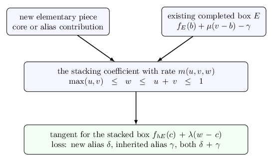

# A guide to the volume reference

[Read the reference PDF](../../manuscript/build/main.pdf) ·
[Source and build instructions](../../manuscript/README.md) ·
[Papers organized by subject](../../papers/README.md)

The reference begins with the volume theorem for strict Conway
compositions, proved through the pure auxiliary source.
It includes the same proof files as the
[19-page Conway paper](../../papers/conway-asymptotics/README.md).
The rest of the volume reference retains independent circle-tree
and planar constructions with their own hypotheses.

The companion manuscripts are from the same project. The Conway paper
uses five directly and one further geometric prerequisite, as explained
in the [collection guide](../../papers/README.md#the-conway-paper-and-its-supporting-proofs).
They reorganize the shared mathematical material; the long reference
also contains results outside this seven-paper route. The
[exposition audit](../../repro/CONWAY_SERIES_AUDIT_2026-11-25.md) describes
the corrections and expanded explanations. The seven-paper series has
160 pages in total; it is the complete prerequisite collection for the
19-page Conway result. The [collection-wide audit](../../repro/MANUSCRIPT_AND_LOGIC_AUDIT_2026-11-25.md)
extends that revision to all fourteen remaining papers and this 210-page
reference. Its logical comparison records exactly which statements Lean
proves and which application lemmas retain written proofs.

The signed local calculation used for the separate recurrence problem
is proved in the [quarter-index paper](../../papers/quarter-index-asymptotics/README.md).
Standalone meridian, longitude and recurrence papers remain
[available separately](../../papers/README.md#reading-routes-and-retained-boundaries).
The guide's other methods chapters keep the history of alternative
approaches; this chapter describes the current volume proofs.

Readers new to the invariant can begin with
[the first-reading chapter](starting.md). The
[results chapter](results.md) gives the complete family-by-family scope.

## The question and the fixed data

At level \(N\), let \(K_N(K)\) be the reduced Kashaev invariant of a
knot \(K\), normalized to be one on the unknot. For a hyperbolic knot,
the volume conjecture asks whether

\[
 \lim_{N\to\infty}\frac{2\pi}{N}\log|K_N(K)|
       =\operatorname{Vol}(S^3\setminus K).
\]

The volume is that of the complete knot complement. In every theorem
described here, the finite diagram, its strand connections, disk
framings and integer powers are fixed before \(N\) grows. The limit
includes all sufficiently large integer levels, not just primes or
one parity. The auxiliary crossing circles are filled; the main knot
cusp remains complete.

A crossing circle bounds a disk pierced by two strands. Filling its
primitive slope \(\mu_\ell+p_\ell\lambda_\ell\) inserts the recorded
twists, where \(\mu_\ell\) is its meridian and \(\lambda_\ell\) its disk
longitude. With retained half twist
\(\epsilon_\ell\in\{0,\pm1\}\), the crossing power is

\[
                       n_\ell=\epsilon_\ell-2p_\ell.
\]

The factor two distinguishes full twists from individual crossings.
The strand connections, including any component closed inside a box,
must give one knot.

## The strict construction

A two-strand tangle is drawn in a box with four ordered endpoints.
Stacking joins the adjacent endpoints without changing their order.
A quarter-turn carries the entire tangle and its crossing disks.
Cylindrical closure joins bottom-left to top-left and bottom-right
to top-right outside the last box.

The elementary leaf is the clockwise quarter-turn of an augmented
crossing-circle box; the turn carries its disk and endpoint labels.
Every occurrence has its own crossing circle. The
strictness test assigns a real label to every exposed output:

| Operation | Constraint |
| --- | --- |
| Elementary leaf | \(0<a<1/2\) |
| Quarter-turn | \(x\mapsto1-x\) |
| Product with inputs \(x,y\) and output \(z\) | \(\max(x,y)<z<x+y<1\) |
| Final closing pair | The two outputs sum to one; its forced product is omitted |

An expression is strict when these finitely many constraints have a
solution. An elementary closing child is allowed. A leaf at the
stationary value \(1/4\) is allowed as well; the proof does not
require separated roots of a signed leaf recurrence.

For example, \(C((h_1h_2)(h_3h_4))\) is strict when every leaf has
label \(3/10\) and the two product outputs have label \(1/2\).
Then \(3/10<1/2<3/5<1\). Retained crossing parities
\((0,1,1,1)\) give a knot: tracing the elementary endpoint pairings
through the stacks and the outside arcs gives one component and
no internally closed component.

For each fixed strict expression with at least two leaves and an
admissible parity pattern, there is a threshold \(P_0\). Every fixed
tuple with \(|p_\ell|>P_0\) at every auxiliary circle has the volume
limit. Signs and ratios are unrestricted. The tuple does not grow
with \(N\).

The assignments covered by this condition have natural density one
in \(\mathbb Z^b\), where \(b\) is the fixed number of circles.
Among integer tuples in \([-R,R]^b\), at most

\[
 b(2\lfloor P_0\rfloor+1)(2R+1)^{b-1}
\]

have a bounded coordinate. Their proportion tends to zero, but these
excluded slabs are still infinite. Different assignments may describe
the same knot. The theorem is not a density claim for distinct knots
ordered by crossing number or a result for every short filling.

## Five steps in the pure-source proof

The finite source is the evaluation of the augmented diagram as a
function of its auxiliary colors. A color is an integer representation
label; a circle is a component of the diagram. Summing colors and
filling a circle are different operations.

The pure source uses no retained half twists on the auxiliary circles.
Its core Newton coefficients are positive. The complementary-color
terms, called aliases, remain part of the physical invariant and need
separate estimates. The proof proceeds as follows.

1. **Keep the exact integer sum.** The finite Newton calculus gives
   product, turn and closing coefficients, including derivatives at
   repeated spectral roots. Turns substitute \(r\mapsto N-1-r\);
   the closing constraint has coefficient \(1\) or \(-1\).
   Solving these equations leaves a lattice of cell volume one,
   with every bounded integer offset retained.

2. **Interpolate the positive pure core exactly.** The canonical
   factorial \(G_N\) has precisely the finite sine-factorial values.
   Its complex expansion applies at the unique strict positive
   maximum. One lattice contour lemma gives the nonzero local
   Gaussian coefficient. This argument also works at a quarter-index
   leaf; no signed recurrence estimate is used.

3. **Pay for the physical and Fourier complements.** The source-bound
   theorem controls the full physical remainder and every
   macroscopic color deficit. A second use of the lattice lemma
   evaluates the color Fourier sum. A separate contour estimate
   bounds the rest of the Fourier torus. A local Taylor expansion
   alone would not supply that global estimate.

4. **Perform each full crossing power.** Fourier–Hermite inversion
   expands every positive or negative integer power, including odd
   powers, in ordinary colored circles. The whole filling-sum
   theorem retains all Fourier charges and endpoint currents and
   proves that their leading coefficient is nonzero.

5. **Identify the same action geometrically.** The marked classical
   shear restores the retained half twist and the original integer
   filling slope. The geometric theorem proves the metric on the
   specified filled exterior, its primitive cusp completion and the
   absolute action–volume equality.

The [Conway source guide](../../papers/conway-asymptotics/README.md#proof-inputs)
lists each numbered companion import. The proof requires all five
steps. A positive auxiliary sum alone does not control a signed
closing.

## What orthogonality does, and what it does not do

The reference opens with explicit linear-algebra propositions used
by the proof. They explain where exact simplification is available.

### Transport the coefficient pairing

Let \(B:\mathbb C^m\to V\) send coefficients \(c\) to a vector
\(Bc\) in a finite-dimensional inner-product space \(V\). Its Gram
matrix is \(G=B^*B\), with \(^*\) the adjoint. Then

\[
                \|Bc\|^2=c^*Gc,\qquad \ker G=\ker B.
\]

Thus the form becomes positive definite on the quotient by coefficients
representing zero. Under a coordinate change \(c=Sd\), it becomes
\(S^*GS\). It can be replaced by the identity only when those
coordinates are orthonormal.

A closing row \(\ell:V\to\mathbb C\) is additional data. The estimate
\(|\ell(Bc)|\le\|\ell\|\sqrt{c^*Gc}\) is an upper bound.
A large nonzero vector can still lie in \(\ker\ell\). The volume
proof must therefore estimate the specified closing, not replace it
by a norm.

A linear corridor is a sequence of prescribed linear maps. Replacing
it by their matrix product is exact. A product with one fixed input
can be part of such a corridor; a product with two independently
summed inputs cannot be treated as one prescribed map.

### Use all shifted Fourier characters

For a real shift \(\alpha\), set
\(w_k=e^{2\pi i(k+\alpha)/N}\), \(0\le k<N\). The coefficients

\[
 H_a=\frac1N\sum_{k=0}^{N-1}f_kw_k^{-a},
 \qquad 0\le a<N,
\]

satisfy

\[
 f_k=\sum_{a=0}^{N-1}H_aw_k^a,\qquad
 \sum_a|H_a|^2=\frac1N\sum_k|f_k|^2.
\]

The shift contributes only unit phases to the complete character
basis. The filling calculation uses \(\alpha=1/2\), so \(w_k^N=-1\).

The repeated spectral roots require normal data as well as values.
For the crossing power \(n\), the value data \(h_k\) have modulus one
and the normal data are
\(d_k=n(k-(N-1)/2)h_k\). Parseval controls both vectors. Their exact
coefficient reconstruction gives

\[
             \sum_j|\beta_j|
             \le2\sqrt N\left(1+\frac{|n|}{\sqrt{12}}\right),
\]

where the \(\beta_j\) are the coefficients of the full power in the
ordinary-circle basis. Discarding the derivatives would reconstruct
a different element of the nonsemisimple algebra. The estimate is a
polynomial filling cost; it does not prove a lower bound.

For the full closing, let \(j\in\{0,\ldots,N-1\}^r\) range over every
color tuple and let \(D_N(j)\) be the original source error. The exact
identity and its subsequent bound are

\[
 E_N=\sum_j\left(\prod_{\ell=1}^r\beta_{N,\ell,j_\ell}\right)D_N(j),
 \qquad
 |E_N|\le
 \left(\prod_{\ell=1}^r\sum_k|\beta_{N,\ell,k}|\right)B_N
 \quad\text{if }|D_N(j)|\le B_N\text{ for every }j.
\]

The sum remains coherent until the triangle inequality is applied.
For fixed powers and a fixed number of circles, the coefficient product
grows only polynomially. The Lean module
[ConwayAssembly](../../formal-real/ConwayAssembly.lean) derives this
whole-error estimate from the proved Fourier–Hermite bound.

### Eliminate stationary variables with their Hessian

Let \(F(y,t)\) be a holomorphic phase. Suppose \(F_y(y_0,0)=0\) and
\(F_{yy}(y_0,0)\) is invertible. There is then a local stationary
solution \(y_*(t)\). For
\(\Phi(t)=F(y_*(t),t)\),

\[
       \Phi_{tt}=F_{tt}-F_{ty}F_{yy}^{-1}F_{yt}.
\]

This is stationary elimination, not an exact contraction of the
finite sum. The displayed matrix is its Schur complement. In the
pure source, color evenness makes the mixed block vanish at zero.
The critical value \(\Phi(0)\) must also be retained: derivatives
alone do not determine the additive constant needed for volume.

## The final complex implication

The reference proves the final logarithmic step directly. Suppose
the exact invariant has the form

\[
 K_N=u_N\left(N^\rho a_Ne^{NS_N}+E_N\right),\qquad |u_N|=1,
\]

with fixed real \(\rho\), complex sequences
\(a_N\to a\ne0\) and \(S_N\to S\), and

\[
             \limsup_{N\to\infty}\frac1N\log|E_N|<\Re S.
\]

Here \(E_N\) is the **entire** remainder, not one selected tail.
The leading term has rate \(\Re S\), so the remainder divided by it
tends exponentially to zero. The reverse triangle inequality makes
\(K_N\) eventually nonzero and gives the ordinary limit
\(N^{-1}\log|K_N|\to\Re S\). If the marked geometric proof identifies
\(2\pi\Re S\) with the knot-complement volume, the desired volume
limit follows.

A factor \(1+O(N^{-1})\) belongs to the leading amplitude \(a_N\);
it need not have a smaller exponential rate. Also \(S_N\to S\)
permits the logarithmic conclusion without asserting
\(e^{NS_N}/e^{NS}\to1\).

The accompanying cost lemma is zero-safe. If nonnegative budgets and
costs satisfy \(B_N\) of upper rate at most \(b\), \(C_N\) of upper
rate at most zero, and \(|E_N|\le C_NB_N\), then the remainder has
upper rate at most \(b\). Upper rate means
\(\limsup N^{-1}\log(\cdot)\), with \(\log0=-\infty\).
In particular a nonnegative polynomial cost does not change that
upper rate. No division by a possibly zero budget is needed.

## Other volume families retain their own hypotheses

The ordered circle-tree construction has a crossing circle at every
vertex. An edge is a prescribed quarter-turn attachment, and the
cyclic order and strand frame are retained. For vertex degree \(d_v\)
and signed crossing power \(n_v\), the summed criterion is

\[
                   \sum_v\frac{d_v}{d_v^2+n_v^2}\le2^{-25}.
\]

A separate directed criterion has the simple sufficient consequence
\(d_v\ge2^{28}\) or \(|n_v|\ge2^{27}\) at each vertex. The degree
alternative permits fixed short or zero powers. The graph remains
fixed, and the component test must give one knot. The
[circle-tree paper](../../docs/papers/circle-tree-volume.pdf)
proves the two analytic routes separately. Its
[geometric companion](../../docs/papers/circle-tree-geometry.pdf)
constructs the metric under
\(L_v=\sqrt{d_v^2+n_v^2}\ge630\); that geometric criterion alone
does not establish a quantum asymptotic.

The local ratio test
\(\max_v d_v/(d_v^2+n_v^2)\le2^{-120}\) is now a direct corollary of
the directed theorem. A short numerical implication supplies its
degree-or-twist alternative, so no separate local quantum induction
remains. The summed proof still gives its explicit first microscopic
meridian correction. The directed and local statements give the
centered ratio \(1+O(N^{-1})\), without claiming that sharper correction.

For planar constructions, begin with a finite simple triangulated
sphere and a perfect matching of its dual triangles. Each matched
pair determines one crossing-circle region. There are several
different sufficient hypotheses:

| Construction | What supplies the full remainder bound |
| --- | --- |
| Terminal decoration | Explicit finite insertions give strict shared packing inequalities. |
| An unchanged matched sphere | Weak balance, including the stated small-defect extension. |
| Protected triangular sums | Certificates for all locally allowed noncentral strings in each input. |
| Ordinary triangular insertion | Certified pieces and small positive boundary ratios at every chosen witness. |

The terminal decoration preserves its chosen strand pairing but can
change the knot type. Its theorem fills all original and added
circles sufficiently long. The ordinary insertion also has a
fixed-boundary geometric minimization and retains the old coefficient
demands. None of these statements asserts a general remainder bound
for every unchanged sphere.

The [results page](results.md) gives the conditions and diagrams.
The reference keeps their complete proofs in the corresponding
chapters and appendices, rather than importing the strict Conway
conclusion into a different diagram class.



The supporting-tangent certificates are exact finite parts of specified
inequality proofs. Their rational points, domain cover and outward
bounds establish those inequalities; numerical optimization is not
part of verification. The figure is available as a
[vector PDF](../../manuscript/build/figures/attachment-tangents.pdf) and
[editable TikZ source](../../manuscript/figures/attachment-tangents.tex).

## Two useful conclusions that are not full volume theorems

The uniform filling appendix starts with a polynomial \(S_N\) of
separate degree at most \(N-1\) in \(r\) spectral variables. For fixed
crossing powers \(n_e\), its filled contraction satisfies

\[
 |Z_N|\le\prod_{e=1}^r(1+|n_e|/2)
                      \,\|S_N\|_{[-2,2]^r}.
\]

The constant is independent of \(N\), and the functional retains
the derivatives at repeated roots. A strict estimate for the shared
norm remains a separate premise of any volume application.

The matched-sphere geometric-contribution appendix evaluates one
specified central contribution of the original invariant. It proves
a nonzero asymptotic at the actual filled volume rate. Without a
complementary-source bound it does not prove that the whole invariant
has that rate. The restricted planar theorems above supply the missing
bound under their own conditions.

## Reading and reproducing the argument

For the strict result, read the conceptual chapter, then the shared
Conway proof. Its main export is Theorem \(\texttt{ca:main}\).
The standalone paper numbers the pure-source theorem as 3.1 and
the Fourier proposition as 3.2. Its
[input list](../../papers/conway-asymptotics/README.md#proof-inputs)
names the finite Newton algebra, strict optimizer, physical source
bound, whole filling theorem and marked geometry separately.
The [dependency graph](../../docs/papers/dependencies.html) records
these named uses; it does not prove the statements at its vertices.

The finite algebra and exact certificates can be replayed with:

```sh
python3 -I papers/conway-asymptotics/check.py
python3 repro/verify.py --output repro/results
```

For the registered paper checks:

```sh
python3 repro/check_paper_algebra.py --output repro/results/paper-collection/finite
```

The output records each bounded scope. Finite samples do not prove
uniform analytic estimates, a contour deformation or a primitive
metric completion. The [reproduction guide](../../repro/README.md)
lists the requirements and individual check groups.

Build the reference and guide with:

```sh
python3 tools/build_manuscript.py
python3 tools/build_book.py
python3 tools/check_book.py
```

The [source guide](../../manuscript/README.md) explains the outputs.
Typesetting and navigation checks are separate from mathematical
proofs. The [formal code](../../formal-real/README.md) proves the
retained Gram form and closing upper bound, shifted Parseval and full
Hermite coefficient mass bound at \(N\ge2\), complex bilinear Schur
block algebra, and direct complex rate transfer. ConwayAssembly uses
the actual coherent color sum to derive the whole remainder bound.
The analytic stationary germ, source contours, nonzero whole packet
and marked geometric equality remain written inputs. The
[coverage map](../../formal/coverage.json) records the exact manuscript
statements and remaining written contour/geometric inputs.

Earlier tracked versions remain in Git history. Historical
approaches are explained in [methods](methods.md) and
[algebraic approaches](algebraic.md), outside the current proof.
