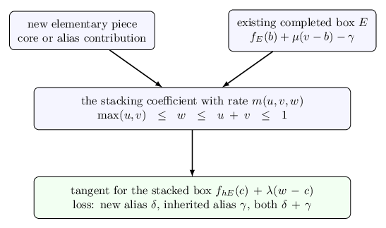

# A guide to the manuscript

The current PDF is a 374-page reference account. Its results have been
divided into [papers organized by subject](../../papers/README.md).
The 22 current papers total 404 pages and range from 11 to 29 pages each,
including references. Their shared foundations cover
finite spectral evaluation, coefficient estimates, source asymptotics,
oscillatory sums and marked geometry. The application papers give their
precise diagram and twist hypotheses and name the numbered statements
they use.

The Newton calculus and stationary-profile arguments now share one
26-page paper. It replaces two drafts totaling 32 pages by proving their
common support, lattice and maximization results once. The finite tangle
identities and the stronger completed-root leaf bound are retained, and
both earlier editions remain available for their existing citations.

The two circle-tree asymptotic papers now share a 27-page account,
[Volume asymptotics for trees of crossing circles](../../docs/papers/circle-tree-volume.pdf).
Their finite kernel, edge phase and Fourier trace are developed once.
The summed and directed conditions retain separate proofs and conclusions;
only the summed theorem gives the explicit first meridian correction.
The earlier 15-page editions remain available for existing citations.

The current Conway papers cover every fixed strict expression, rather
than only the reference manuscript's completed-root grammar. The proof
uses its own strict variational problem, bounds for the entire source,
pure-source asymptotic and marked filling geometry. The separate signed
recurrence paper near the quarter index is a reusable local result; it
is not a premise of this pure-source volume proof.

The geometric account now includes its local pyramid and prism
constructions, complete face maps and primitive collar calculations in
21 pages. The two earlier completed-root geometry editions remain
available for citations, but are no longer prerequisites of that account.
The directed circle-tree paper likewise makes the older local criterion
a consequence of one more general argument.

The moving-source estimates and all-orders recurrence implication now
have separate 20- and 13-page accounts. They use the exact moving finite
calculus, then prove the analytic estimates needed on the original
shared source. The nonparabolic representation and preferred-longitude
proofs have separate 22- and 29-page papers and enter only when the
analytic germ is identified geometrically. The operator implication
retains the hypothesis of a genuine fixed all-level annihilator.
The reference PDF remains frozen. Its measured length is 93 pages of main
text, 266 pages of appendices, and 15 pages of front matter and references.
Several theorem families and their separate dependencies accumulated in
that file. Repeated definitions and setup made individual appendices
readable on their own, while alternative constructions added further
length. The new division groups related proofs and imports their shared
foundations by numbered statement. The
[errata](../../manuscript/ERRATA.md) record corrections to the frozen account.

The [dependency graph](../../docs/papers/dependencies.html) records the
strict construction's normal form, boundary profiles, spectral estimates
and marked geometry separately. It also distinguishes the independent
local results from the premises of the final volume theorem. The
narrower completed-root theorem is not used to justify the broader
construction.

[Read the manuscript PDF](../../manuscript/build/main.pdf). The [editable sources and build instructions](../../manuscript/README.md) are available alongside it.

The paper contains completed proofs of volume equalities for decorated
planar diagrams, unchanged diagrams satisfying weak balance, and ordered-tree constructions, together with several
completed theorems whose conclusions are narrower. It derives the finite
quantum expression, constructs the labeled hyperbolic geometry, bounds
competing terms and performs the specified auxiliary fillings.
The families have different hypotheses, so the sections below introduce
their constructions separately.

Readers new to the source, meridian or tangle notation can begin with
[the first-reading chapter](starting.md). The
[results chapter](results.md) gives the complete family-by-family scope.
The illustrated guide also retains alternative approaches and their
obstructions; the manuscript presents the proved arguments and marks
partial conclusions explicitly.

## The planar decoration chapter

The planar construction begins with a simple triangulation of the
sphere and a chosen pairing of its adjacent triangles. These finite data
give a planar crossing-circle diagram in the three-sphere. The chapter
constructs its circle packing and then inserts even terminal stacks on
both sides of each crossing circle. The number of insertions is chosen
by an explicit curvature recurrence.

After that finite decoration, independently sufficiently long signed
twists at every old and new region give the full volume equality. A
specified parity pattern makes the main strands one knot. The inserted
tangles preserve this pairing and generally change the knot type. The
theorem does not require a tree of tangle operations or compare the
relative magnitudes of the long twists.

The new [terminal-decoration paper](../../docs/papers/terminal-decorations.pdf)
gives this construction in 13 pages. It proves the endpoint parity,
packing extension, exact recurrence and strict inequalities for every
old and added region. Its complete shared weights provide the certificate
required by the planar companion. The finite evaluation, nonzero central
filling contribution and primitive volume comparison are imported by
numbered theorem. The powers and the decorated diagram are fixed before
the quantum level grows.

The reference chapter explains the local construction and the inequality
it establishes. Its appendix gives the full proof: the variational packing,
the exact coefficient with its original mark and parity, the local
geometric contribution, all Fourier tails and boundary terms, and
completion to the actual smooth knot complement. The
[results page](results.md#decorating-a-planar-diagram) gives a detailed
introduction with the same figure.

## The packing criterion for an unchanged diagram

Appendix P proves the full volume limit under weak balance in the complete
circle packing. Its diagram is the original matched sphere; no terminal
pieces are added. The appendix defines the triangle potential before
stating the condition and derives its Hessian explicitly. It then changes
all ordinary coefficient radii from \(w_f\) to \(w_f^{1-t}\), leaving
the protected zeros fixed. Triangle entropy gives a positive linear loss
for every noncentral term, while stationarity bounds the full increase
in action by a quadratic function of \(t\).

A sufficiently small fixed \(t\) gives a strict bound for the entire
remaining polynomial. Appendix N transfers it through the original
filling functional, and Appendix O supplies the nonzero geometric
contribution and its actual knot-complement volume. Thus Appendix P
contains a full-invariant theorem under its explicit packing condition.
Without that condition or another proved remainder estimate, Appendix O
continues to have its narrower conclusion. The
[worked explanation](results.md#an-unchanged-diagram-satisfying-weak-balance)
states the constants and shows why the linear gain dominates.

## Composing certified matched spheres

Appendix Q proves that a full source certificate survives a specified
triangular sum. It describes the actual gluing, explains why the
ordinary joining face has one target, and treats all three local sector
choices. It requires certificates for every locally allowed noncentral
string, even when an input's final coefficient vanishes for another reason.

The theorem permits any fixed finite number of certified pieces. A
worked sequence starts with the seventeen-region rational certificate
and repeatedly adds a tetrahedral sphere. The proof locates an original
balance failure away from the attachment, so these marked diagrams remain
outside weak balance while retaining a full source estimate. The volume
conclusion uses the new diagram's own knot-component test and sufficiently
long fixed signed fillings. The
[illustrated explanation](results.md#joining-diagrams-with-a-shared-weight-certificate)
defines the variables and follows the cancellation at the joining face.

## Moving the meridian and obtaining every expansion order

A meridian goes once around the main knot strand. Its eigenvalue is
\(M\); completeness corresponds to \(M=1\) in the chosen lift.
The microscopic parameter is \(s\), defined by
\(M=q_N^s\) and \(q_N=e^{\pi i/N}\). Keeping \(s\) in a fixed
parameter set therefore makes \(M\) approach one as the level grows.

[Moving-meridian source estimates for strict Conway tangles](../../docs/papers/moving-meridian-sources.pdf)
proves estimates for the whole source in this regime. A product junction
without a crossing circle is called a bare junction. Such junctions can
be adjacent, so their shared indices must be estimated together. The
paper compares a deformed high-index trace with a reflected complete
trace, then reassembles the adjacent junctions using the exact finite
pairing. Its pressure, the maximum of the positive action over the
entire connected group, includes the action
already supplied by every attached branch. This avoids replacing shared
indices by independently chosen maxima.

Theorem 1.1 bounds all discarded terms before changing the filling
contours, and gives a nonzero holomorphic Gaussian expansion of the
retained finite wire sum. Theorem 1.2 evaluates every original filling
trace for sufficiently long fixed signed powers, with no restriction on
their ratios. It retains all Fourier charges, endpoint terms and
repeated-root derivatives. This is the source input for the strict case
of the next theorem; the summed and directed circle-tree cases have
their own source inputs.

[Meridian expansions and classical symbols of quantum recurrences](../../docs/papers/meridian-expansions.pdf),
Theorem 1.1, proves every prescribed expansion order for each of those
three source classes. Write \(F_N(M)\) for the original reduced
meridian function and \(K_N=F_N(1)\). The source theorems make
\(K_N\) nonzero for all sufficiently large levels. The exact reduced/full
conversion is
\[
 H_N(s)=\frac{\sin\pi s}{N\sin(\pi s/N)},\qquad H_N(0)=1.
\]
For every fixed positive integer \(L\), the normalized expansion is
\[
 \log\frac{F_N(q_N^s)}{K_NH_N(s)}
   =\sum_{r=1}^{L}N^{-r}p_r(s)+O(N^{-L-1}),
 \qquad \deg p_r\le r+1.
\]
The logarithm is the branch tending to zero. Each \(p_r\) is even and
vanishes at zero. The estimate holds uniformly on each disk
\(|s|\le R<1\), and on fixed compact sets in the upper half-plane
and their required integer translates. The proof treats both level
parities; lower coefficients may depend on parity, while their
highest-degree action coefficients agree.

The directed case needs an additional argument. Each subtree is divided
by its exact value at zero before it is passed to its parent. The
all-orders induction keeps this normalization and restores those
constants at the root. The established conditional error margins remain
in force outside the local saddle. The proof therefore does not replace
the directed criterion by the summed condition, and it retains the
allowed high-degree vertices with zero crossing power.

The highest-degree coefficients above determine the stationary action
germ. A later geometric identification turns its derivative into the
preferred longitude and identifies the first correction with the cusp
shape. The expansion itself uses no longitude theorem. It is microscopic,
not a large-level estimate at a fixed \(M\ne1\), and it makes no
moving-meridian claim for the decorated planar class.

## Completed results with narrower conclusions

Appendix N proves a finite norm bound for inserting signed twists.
Let \(S_N(\sigma_1,\ldots,\sigma_r)\) be the polynomial obtained
after the common face coefficient has been taken, and let \(n_e\)
be the fixed crossing powers. The polynomial must have degree at most
\(N-1\) in each spectral variable; the exact source construction
establishes this hypothesis. The bound is
\[
 |Z_N(\boldsymbol n)|
 \le\prod_{e=1}^r(1+|n_e|/2)\,
                         \|S_N\|_{[-2,2]^r}.
\]
Here \(Z_N\) is the original reduced ribbon contraction after
inserting those powers; the prescribed framing correction has unit
modulus. The bound's constant is independent of the level. It retains values and
derivatives at the repeated spectral roots and gives stronger bounds
when the polynomial vanishes at the nodes. A strict estimate for the
shared norm remains a separate hypothesis; the finite bound alone
is not a volume-limit theorem for a new diagram.

Appendix O treats the unchanged diagrams determined by simple matched
spheres. It proves a nonzero long-filling asymptotic for the central
recurrence-path contribution, called central in the finite formula.
The leading rate is the volume of the original filled complement,
with the correct primitive peripheral curves. This contribution is
one specified part of the invariant. The appendix does not bound
the complementary pieces for every such diagram and therefore makes
no general full-invariant claim for the unchanged cores.

These two results can be proved without resolving the general remainder
problem. To use them in a full volume proof, one must additionally
bound the complementary polynomial and compare its rate with that of
the nonzero geometric contribution. For the decorated planar family,
the prescribed insertions supply the strict comparison. For the tree
families, the recursive estimates supply it under their own hypotheses.
The open comparison for an arbitrary unchanged diagram is therefore
not an assumed step in those more restricted theorems.

## The ordered tangle construction

Start with two strands in a box whose four endpoints are labeled and kept in order. Insert an integer number of signed half-twists. A positive and a negative count give opposite crossing directions. Turn the box through a quarter-turn; this is the basic piece used in the construction.

Two boxes can be stacked in order, and a constructed box can itself be turned. After finitely many such operations, join the remaining outside endpoints by the prescribed cylindrical closure. Following the strands determines whether this produces a knot or a link. The theorem requires one component, with no closed component hidden inside a box.

The notation in the paper abbreviates these operations:

| Notation | Meaning |
| --- | --- |
| $R^n$ | Two strands with $n$ signed half-twists. |
| $T(F)$ | The quarter-turn of the tangle box $F$, with its endpoint order retained. |
| $h_i(n_i)=T(R^{n_i})$ | The $i$th basic twist piece. Different subscripts carry independent integers. |
| $FG$ | The ordered stack of $F$ and $G$. |
| $C(FG)$ | The prescribed closure of the four outside endpoints of that stack. |

These are operations on actual tangles. The notation does not mean that formal arithmetic with rational fractions has replaced an isotopy argument.

For the paper's main family, first stack two basic pieces. Thereafter one may turn a constructed box, stack two constructed boxes, or attach one additional basic piece on either side. The technical notes call a box obtained by these rules **completed**. This is a recursive name for a class of boxes; it does not mean that a Dehn filling has already been performed. Construct two such boxes $F$ and $G$, then close $FG$. The paper also handles its stated isolated stacks of at least three basic pieces.

## The theorem and its quantifiers

For each fixed permitted construction there is a threshold. Choose the twist integers independently, with either sign, beyond that threshold in absolute value, and choose their parities so that the endpoint pairing gives a knot. Fix all those integers. The theorem then proves

$$
\lim_{N\to\infty}\frac{2\pi}{N}\log|K_N(K)|
=\operatorname{Vol}(S^3\setminus K).
$$

Here $K$ is the resulting knot, $K_N(K)$ is the reduced Kashaev invariant at integer level $N$, and the right side is its hyperbolic complement volume. The limit includes even and odd levels and composite levels. The twist counts do not grow with $N$, and no restriction is imposed on their relative sizes. The threshold may depend on the entire construction.

To analyze the geometry, the proof first places an auxiliary crossing circle around each twist region. The resulting augmented link has a convenient decomposition into ideal hyperbolic cells. Filling an auxiliary circle means attaching a solid torus whose
meridian is the prescribed primitive slope
\(\mu_e+p_e\lambda_e\) on that boundary torus; this inserts the
recorded twists. In the knot theorem **all auxiliary circles are filled**. The cusp of the knot itself remains unfilled. Thus the conclusion is about the knot complement, not a closed three-manifold.

Two companion results extend the paper's recursive family. The [strict-tree theorem](../../notes/actual_conway_all_strict_tree_long_twist_volume.md) proves the estimates for every expression passing a finite angle-feasibility test. The [net-twist theorem](../../notes/actual_conway_net_twist_volume.md) then reduces an arbitrary ordered cylindrical product closure to one of those expressions or to an elementary two-strand braid closure. In the former case, the size condition applies to the combined twist numbers produced by the reduction. The [results chapter](results.md) states that condition and gives an example. The earlier PDF chapters retain their own theorem and proof; the new quantitative chapter is described next.

## A bound independent of the tree size

The chapter on directed subtree estimates gives one sufficient
twist threshold for every finite ordered circle tree with at
least one edge:
\[
                         |n_v|\ge2^{27}
\]
at every vertex, with either sign. The actual strand pairing
must give one knot without an internal closed component. A more
flexible consequence lets each vertex independently have this
twist magnitude or degree \(d_v\ge2^{28}\). The degree alternative
permits any fixed signed power. The whole tree and all powers
are fixed before the quantum level grows.

The [directed criterion](../../notes/actual_all_circle_directed_volume.md)
is proved from the exact polynomial obtained by evaluating a
subtree while retaining its attaching variable. The proof
establishes its nonzero value at zero, normalized bounds on
real and complex angles, and a nonzero first Fourier contribution
to the next trace. Each error is compared with the filling at
the current vertex. Different subtrees can have different decay
bounds. At the final vertex there is no outgoing variable, so
the proof does not impose an unnecessary outgoing bound.

The chapter and its full technical appendix retain the actual
finite trace, its boundary contributions and its orientation
factors. The geometric path identifies the resulting action
with the volume of the original knot complement. The earlier
local-message chapter proves an included, more restrictive
criterion, and the summed theorem below remains useful for
individual diagrams.

One consequence attaches an even stack of sufficiently many
long odd terminal pieces at each vertex of any fixed core
whose endpoint pairing is a knot. The insertion preserves
the pairing but generally changes the knot type. It supplies
covered knots with arbitrary prescribed powers at the core
vertices; it does not prove the theorem for the unchanged core.

## The quantitative circle-tree chapter

A further chapter treats a different explicit description of the
tangle construction: every vertex of an ordered tree carries an
integer braid, and each child tangle is turned before it is stacked
on the prescribed side of its parent braid. A terminal root gives
the cylindrical closure. The strand pairing must give one knot.

For vertex degree \(d_v\) and crossing power \(n_v\), the condition

\[
 \sum_v\frac{d_v}{d_v^2+n_v^2}\le2^{-25}
\]

gives the volume limit. It also gives a uniform profile as the
meridian moves by order \(1/N\), with its first correction expressed
by the preferred cusp shape. The [full statement](../../notes/actual_all_circle_quantitative_volume.md)
defines every framing factor and gives numerical sufficient bounds.
Some short powers are allowed at sufficiently high-degree vertices;
the earlier long-twist chapters retain their own construction class.

The classical part now has its own 15-page paper,
[Positive octahedra and primitive fillings for trees of crossing circles](../../docs/papers/circle-tree-geometry.pdf).
It proves the literal ordered cut, full peripheral maps and primitive
completion whenever $\sqrt{d_v^2+n_v^2}\ge630$ at every vertex. This
condition allows zero powers at high degree. It also identifies the
absolute critical action with the completed metric volume. The paper
uses only the geometric foundation's local peripheral-volume differential;
it does not impose that foundation's separate long-twist hypothesis or
claim a nonzero quantum asymptotic. The combined
[circle-tree volume paper](../../docs/papers/circle-tree-volume.pdf)
proves the full finite-sum asymptotic under either of its two stated
analytic criteria. The summed proof estimates the joint Fourier sum;
the directed proof evaluates subtrees with their exact normalization.
They share the finite algebra but use different global estimates.

The reference chapter illustrates an actual octahedral attachment and explains
why it recovers the original exterior. Positive tetrahedra continue
along the filling path until the primitive cone angle is \(2\pi\).
This constructs the smooth knot complement whose volume appears in
the quantum limit. Appendices E and F contain the full finite-sum, ordered-cut and
geometric-completion proofs, including their face maps, peripheral
words and uniform constants. The companion notes present the same
calculations separately.

## The geometric longitude and the quantum recurrence

Two companion papers give the geometric part of this argument.
[Nonparabolic holonomy of trees of crossing circles](../../docs/papers/nonparabolic-tree-geometry.pdf)
constructs representations of the original augmented-link group while
the main meridian varies. It proves full ordered conjugacy relations,
follows the chosen eigenlines through half twists, and identifies a
one-dimensional geometric germ after the auxiliary slopes are fixed.
The proof uses a positive ideal triangulation and its actual primitive
peripheral coordinates; equality of traces or slope eigenvalues alone
would leave necessary group relations unproved.

[Preferred longitudes of Conway tree complements](../../docs/papers/preferred-longitudes.pdf)
then determines the preferred longitude on that germ. Dividing it by
the explicit edge factors leaves a rational function of the meridian
alone. Regular reconstruction at every nonzero meridian value rules out
additional zeros and poles, so the discrepancy is a monomial. An explicit
cusp path determines the exponent, and a Seifert-surface frame argument
fixes the sign. The proof therefore does more than match the value and
first derivative at the complete point. Neither paper assumes a quantum
asymptotic or asserts a full A-polynomial identity.

The [strict-tree extension](../../notes/actual_strict_tree_geometric_characteristic.md)
allows product junctions without crossing circles, of arbitrary
valence and adjacency. Insert a circle around a literal identity
box at each such junction, then fill its meridian. This restores
the original framed collar and its ordered based puncture loops.
Eliminating the added angular variable gives the original product
action, including at a possible half-edge fold. The argument
therefore identifies the full marked representation germ of
the original long-filled knot.

The analytic implication is now Theorem 1.2 of the
[meridian-expansion paper](../../docs/papers/meridian-expansions.pdf).
Its hypothesis is a specified fixed, nonzero operator
\[
 P(q,M,T)=\sum_{j=0}^{r_P}a_j(q,M)T^j,\qquad TM=qMT,
\]
where the coefficients \(a_j\) are rational functions and \(T\)
replaces \(M\) by \(qM\). The same operator must annihilate the
whole function \(F_N(M)\) at every sufficiently large integer level.
An equation only for \(F_N(1)\), a fitted finite collection of levels,
or a finite meridian jet does not meet that hypothesis.

The exact equation requires the source at \(s,s+1,\ldots,s+r_P\).
The translated estimates supply all these values. After the exact
reduced/full gauge is included, comparison at every inverse-level order
gives a formal identity. The coefficient at degree \(h^{a+b}s^b\)
recovers the coefficient of \(h^a u^b\) before the substitution
\(u=hs\), where \(h=\log q\) and \(u=\log M\). This is why all
orders are needed. After clearing denominators and removing the common
power of \(q-1\), the first nonzero classical symbol consequently
vanishes on the selected analytic germ.

The optional Lean package connects an original root-of-unity
recurrence to the formal characteristic calculation. The
[Laurent-coefficient theorem](../../formal-real/LaurentExpansion.lean)
proves every coefficient expansion from its finite Laurent sum, including
negative powers. The literal sine gauge, shifted denominator exclusions,
meridian-factor expansion and finite equation assembly are also proved.
The actual recurrence, exact source normalization, eventual nonvanishing
and all-orders shifted source-ratio expansion remain inputs.

The [normalization theorem](../../formal-real/OperatorNormalization.lean)
constructs the quotient by the maximal common power of $q-1$ in a finite
polynomial coefficient record. It proves that the quotient has a nonzero
classical symbol and preserves the recurrence at the physical roots.
The [coefficient adapter](../../formal-real/OperatorCoefficientAdapter.lean)
connects this record to the finite Laurent theorem and reconstructs its
entire classical symbol. The actual rational denominator chart and the
passage to the selected holomorphic and geometric germ remain application
steps. No annihilator is constructed here.
The [coverage record](../../repro/PAPER_FORMAL_COVERAGE.md) states these
boundaries for every current paper.

Corollary 8.1 makes the separate geometric identification. It checks the
original group, eigenflag and primitive logarithmic filling equations
before applying Nonparabolic Geometry Theorem 1.2 and Corollary 7.1 and
Preferred Longitudes Theorems 1.2–1.3. In the strict class, the fixed
power threshold is the larger of the analytic and classical thresholds.
The conclusion is that the selected geometric irreducible factor divides
the first nonzero classical symbol, with the preferred exponent and
negative determinant-one sign retained.

These statements cover the strict long-filling sources and circle trees
under the summed condition or any directed certificate, including its
local \(2^{-120}\) corollary. They do not construct an annihilator,
identify the entire A-polynomial or factor multiplicities, or prove the
full AJ conjecture or equality of recurrence ideals. The frozen reference
locates the earlier arguments in Appendices H and M (expansions), I
(circle-tree geometry and longitude), and J (bare-junction extension).

## How to read the proof

The first part fixes the invariant normalization and derives the finite algebra of the tangle operations. A color is an integer representation label in that finite
calculation; a circle is a topological component carrying such a
label. Summing colors changes the evaluation and filling changes the
diagram, so the two operations must be distinguished. The source formula retains values and first derivatives at repeated spectral points, which explains the use of Hermite interpolation. Newton polynomials make the allowed integer indices at a product explicit. These support conditions are kept before taking a continuum limit.

The 18-page [Newton tangle paper](../../docs/papers/newton-tangles.pdf)
now proves the complete-meridian product, physical turn, closure and
colored-circle formulas with their repeated-root derivatives. For its
specified finite compositions, it also proves the positive complete
auxiliary-color source's variational limit and strict interior maximum.
It imports the finite paper's operator and reduced-invariant
normalization. Signed fillings require additional bounds and
noncancellation.

The [moving-meridian paper](../../docs/papers/meridian-tangles.pdf)
proves the finite formulas needed when the main meridian parameter
changes. Its first calculation is a physical partial trace, so the
normalization is fixed before introducing a polynomial functional.
It then derives each oriented turn from the evaluation and
coevaluation maps of the strand representations. The argument keeps
the entire polynomial algebra at collisions of spectral roots; values
alone would discard the derivative terms. Finally it contracts an
ordered tree, keeping every index, the edge factors and the single
closing scalar. Reordering that finite contraction does not change
the physical turn assigned to an edge. Estimating its growth is a
subsequent analytic problem.

The geometric part associates normalized state variables with angles of ideal pyramids and prisms. An ideal vertex lies at infinity in hyperbolic space. Strict angle inequalities produce genuine cells, and the ordered endpoint data determine their face identifications. A strictly concave angle functional has a unique geometric maximum. The proof then follows actual paths on the cusps to identify the meridian and longitude used for filling.

The [complete Conway geometry paper](../../docs/papers/conway-geometry.pdf)
gives this construction for the completed-root grammar. Matching edge
angles is only one part of the argument: the stationary equations match
the ordered quadrilateral faces, including their shear. The paper proves
convexity after each attachment, recovers the actual projection cut from
the boundary's cyclic orders, and checks the full face-pairing maps.
Compatible horospheres then prove cusp completeness. Summing the cell
volumes gives the absolute volume of the augmented complement. A separate
cusp calculation follows the original meridian and disk longitude and
uses the area of their parallelogram to prove that they form a primitive
basis. Four illustrations show the tangle operations, the two cells and
this cusp lattice. The resulting positive-source volume identity is
distinct from the signed invariant after filling the crossing circles.

The 12-page [Conway filling paper](../../docs/papers/conway-fillings.pdf)
continues this geometry. It defines its potential from the cells, keeps
the actual face maps and original peripheral curves, and solves the
primitive equations for independently long signed slopes. Its metric
completion checks that the new meridian winds exactly once. The volume
constant is fixed at the complete metric and carried to the same filled
fundamental chain. A quantum expansion is not needed for this classical
construction. Comparing the resulting action with the action of a finite
source is a separate analytic step.

The source estimates address a different issue: a signed sum can be much smaller than the sum of the absolute values of its terms. In the recursive tree proof, the exact reflection formula separates
a principal contribution from extra terms called aliases. In the
planar face-source proof, the three pieces instead refer to paths
through or on either side of a central recurrence cut. These are
different exact decompositions, with their own bounds. In each
full-invariant theorem the complementary estimate preserves the finite
supports. The recursive proof uses concavity and supporting tangents
to reduce two important estimates to finite rational certificates.
Appendix O deliberately evaluates only the central planar contribution,
as described above.

The 28-page [source-bound paper](../../docs/papers/conway-source-bounds.pdf)
now proves the whole-source bound for every fixed strict expression.
Theorem 1.1 treats three or more leaves; Corollary 9.1 proves the
separate two-leaf case. Its exact Fourier identities retain the first
derivatives at repeated spectral roots and all endpoint terms. Positive
comparison sums keep shared indices. Two supporting-plane inequalities
and the absolute boundary profiles then propagate the estimates through
the expression. The older signed local recurrence bounds remain useful
exports, but are not premises of this global argument.

The [Conway asymptotics paper](../../docs/papers/conway-asymptotics.pdf)
constructs a holomorphic interpolation of the pure source's actual
factorials and sums over its original integer lattice. This gives a
nonzero local expansion, including when a leaf index is one quarter.
The exact full crossing powers are expanded in ordinary colored circles
before filling. A second finite Fourier sum supplies the real-action
expansion and global bound required by the oscillatory filling theorem.
The physical source error is controlled separately. The resulting
asymptotic holds for the entire original invariant through both level
parities, for independently long fixed signed twists on any fixed strict
expression whose actual closure is a knot. A classical shear calculation
identifies its action, including the additive constant and primitive
integer slope, with the volume of that knot complement.



Near the geometric maximum, a complex asymptotic formula gives an exponential action, a nonzero leading coefficient and a controlled error. The paper calls this a local packet. The estimates outside that neighborhood show why the packet really determines the invariant; locating a critical point by itself would not rule out a missing or canceled contribution.

Finally, the filling transform is evaluated with all its Fourier modes and boundary terms. The marked meridian-longitude convention identifies the real part of its critical action with the volume after filling. This last normalization is what connects the finite invariant to the actual knot constructed at the beginning.

The technical appendices supply the main finite algebra, analytic interpolation estimates, certificate details and marked geometric calibration used in this chain. Named earlier finite-source and geometric lemmas remain explicit proof dependencies; the PDF does not reproduce every calculation in the technical library. The [proof-input map](../../repro/PROOF_INPUTS.md) locates these written inputs separately from the executable checks.

Appendix R extends the joining argument to a triangle with three positive
boundary curvatures. It proves the conditional disk minimum, accounts for
the original coefficient demands, and separates a wholly central inserted
piece from one containing any noncentral term. Explicit even chains
make the two required boundary ratios small. The
[worked explanation](results.md#inserting-a-piece-at-an-ordinary-triangular-face)
gives the notation, two diagrams, the finite certificate and the precise
volume conclusion. The new scalar comparisons are formalized in Lean;
the disk geometry and the analytic inputs remain written proofs.

## Reproduce the finite certificates

The companion papers have a combined finite-check command:

```sh
python3 repro/check_paper_algebra.py --output repro/results/paper-algebra
```

It runs 23 finite groups registered in the paper-check runner. They check physical Newton identities over
exact finite fields, terminal curvature and endpoint identities, and
circle-tree seam, peripheral and rational-bound formulas. The additional
moving-meridian checks use physical matrices at both ordinary and
colliding spectral parameters; the complete geometry checks verify
rational face-map identities and the endpoint pairing tables. Other
groups reproduce the complementary-color certificates and the
classical filling's symbolic periods, Hessian and volume boundary term.
The two new groups check whole moving Fourier traces, reflected pairings,
the exact reduced/full gauge and formal coefficient recovery. The output
records their bounded scope and source hashes. These checks do not
replace the proofs for every level, the all-length insertion argument,
or the construction and completion of a hyperbolic metric. In particular,
they do not prove recurrence existence or replace the uniform all-orders
remainder argument. The
[paper source guide](../../papers/README.md#building-and-reproducing-the-papers)
lists the software requirements and individual commands.

The quantitative chapter uses `python3 repro/run_research_checks.py curvature-fillings`. The [checks chapter](audits.md#checks-for-the-quantitative-volume-theorem) describes its three programs and their finite scope.

From the repository root, run:

```sh
python3 repro/verify.py --list
python3 repro/verify.py --plan
python3 repro/verify.py --output repro/results
```

The first two commands describe the checks. The third runs them serially, writes fresh results and compares them with the committed reference records. The [reproduction guide](../../repro/README.md) explains the software requirements and outputs; the [proof-input map](../../repro/PROOF_INPUTS.md) locates the written arguments behind each certificate.

These checks use rational bounds with explicit remainders, not a numerical search for maxima. They verify finite arithmetic used in the proof. They do not mechanically verify the topology, the invariant normalization, or every analytic step of the manuscript.

To build the paper and guide, use the commands in the [manuscript source guide](../../manuscript/README.md). The mathematical illustrations are supplied as editable TikZ sources as well as rendered assets. For the attachment diagram above, download the [vector PDF](../../manuscript/build/figures/attachment-tangents.pdf) or the [TikZ source](../../manuscript/figures/attachment-tangents.tex).
