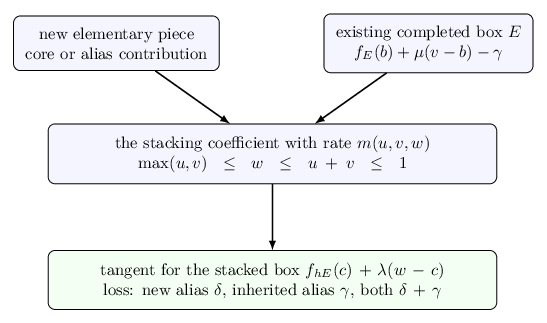

# A guide to the manuscript

The current PDF is a 374-page reference account. Its results are being
rewritten as [papers organized by subject](../../papers/README.md), each at
most 30 pages including references. Eight drafts separate finite spectral
evaluation, uniform local bounds, central source asymptotics, oscillatory
fillings, geometric filling, shared-face criteria, ordinary triangular
insertion, and the long three-braid application. Each application names
the results it imports and checks their hypotheses. The terminal
decoration, recursive Conway, quantitative circle-tree and longitude
results still need separate accounts. The reference PDF remains frozen.

The broader strict-tree extension in the research notes requires arguments
beyond the manuscript's completed-root grammar. The dependency graph
records its normal form, boundary profiles, spectral estimates and marked
geometry separately. Those notes are not silently substituted for the
narrower theorem or described as fully reviewed companion papers.

[Read the manuscript PDF](../../manuscript/build/main.pdf). The [editable sources and build instructions](../../manuscript/README.md) are available alongside it.

The paper contains completed proofs of volume equalities for decorated
planar diagrams, unchanged diagrams satisfying weak balance, and ordered-tree constructions, together with several
completed theorems whose conclusions are narrower. It derives the finite
quantum expression, constructs the labeled hyperbolic geometry, bounds
competing terms and performs the specified auxiliary fillings.
The families have different hypotheses, so the sections below introduce
their constructions separately.

Readers new to the source, meridian or tangle notation can begin with
[the first-reading chapter](starting.md). The
[results chapter](results.md) gives the complete family-by-family scope.
The illustrated guide also retains alternative approaches and their
obstructions; the manuscript presents the proved arguments and marks
partial conclusions explicitly.

## The planar decoration chapter

The planar construction begins with a simple triangulation of the
sphere and a chosen pairing of its adjacent triangles. These finite data
give a planar crossing-circle diagram in the three-sphere. The chapter
constructs its circle packing and then inserts even terminal stacks on
both sides of each crossing circle. The number of insertions is chosen
by an explicit curvature recurrence.

After that finite decoration, independently sufficiently long signed
twists at every old and new region give the full volume equality. A
specified parity pattern makes the main strands one knot. The inserted
tangles preserve this pairing and generally change the knot type. The
theorem does not require a tree of tangle operations or compare the
relative magnitudes of the long twists.

The chapter explains the local construction and the inequality it
establishes. Its appendix gives the full proof: the variational packing,
the exact coefficient with its original mark and parity, the local
geometric contribution, all Fourier tails and boundary terms, and
completion to the actual smooth knot complement. The
[results page](results.md#decorating-a-planar-diagram) gives a detailed
introduction with the same figure.

## The packing criterion for an unchanged diagram

Appendix P proves the full volume limit under weak balance in the complete
circle packing. Its diagram is the original matched sphere; no terminal
pieces are added. The appendix defines the triangle potential before
stating the condition and derives its Hessian explicitly. It then changes
all ordinary coefficient radii from \(w_f\) to \(w_f^{1-t}\), leaving
the protected zeros fixed. Triangle entropy gives a positive linear loss
for every noncentral term, while stationarity bounds the full increase
in action by a quadratic function of \(t\).

A sufficiently small fixed \(t\) gives a strict bound for the entire
remaining polynomial. Appendix N transfers it through the original
filling functional, and Appendix O supplies the nonzero geometric
contribution and its actual knot-complement volume. Thus Appendix P
contains a full-invariant theorem under its explicit packing condition.
Without that condition or another proved remainder estimate, Appendix O
continues to have its narrower conclusion. The
[worked explanation](results.md#an-unchanged-diagram-satisfying-weak-balance)
states the constants and shows why the linear gain dominates.

## Composing certified matched spheres

Appendix Q proves that a full source certificate survives a specified
triangular sum. It describes the actual gluing, explains why the
ordinary joining face has one target, and treats all three local sector
choices. It requires certificates for every locally allowed noncentral
string, even when an input's final coefficient vanishes for another reason.

The theorem permits any fixed finite number of certified pieces. A
worked sequence starts with the seventeen-region rational certificate
and repeatedly adds a tetrahedral sphere. The proof locates an original
balance failure away from the attachment, so these marked diagrams remain
outside weak balance while retaining a full source estimate. The volume
conclusion uses the new diagram's own knot-component test and sufficiently
long fixed signed fillings. The
[illustrated explanation](results.md#joining-diagrams-with-a-shared-weight-certificate)
defines the variables and follows the cancellation at the joining face.

## The directed full expansion

The final analytic chapter proves every finite order of the microscopic
meridian expansion for the directed tree criterion. Here the meridian
is \(M=q_N^s\), with \(q_N=e^{\pi i/N}\) and \(s\) in a fixed
parameter neighborhood, so \(M\) approaches completeness as \(N\) grows.
The proof works on all fixed translated nonreal charts needed by a
fixed recurrence. Derivatives at repeated spectral nodes and all
crossing and framing scalar factors are retained. The first
correction is the preferred cusp shape, and the highest-degree
coefficients recover the full preferred longitude germ.

This adds every directed certificate to the selected geometric-factor
theorem. It does not identify the full A-polynomial or extend the
moving-meridian theorem to the decorated planar class.

## Completed results with narrower conclusions

Appendix N proves a finite norm bound for inserting signed twists.
Let \(S_N(\sigma_1,\ldots,\sigma_r)\) be the polynomial obtained
after the common face coefficient has been taken, and let \(n_e\)
be the fixed crossing powers. The polynomial must have degree at most
\(N-1\) in each spectral variable; the exact source construction
establishes this hypothesis. The bound is
\[
 |Z_N(\boldsymbol n)|
 \le\prod_{e=1}^r(1+|n_e|/2)\,
                         \|S_N\|_{[-2,2]^r}.
\]
Here \(Z_N\) is the original reduced ribbon contraction after
inserting those powers; the prescribed framing correction has unit
modulus. The bound's constant is independent of the level. It retains values and
derivatives at the repeated spectral roots and gives stronger bounds
when the polynomial vanishes at the nodes. A strict estimate for the
shared norm remains a separate hypothesis; the finite bound alone
is not a volume-limit theorem for a new diagram.

Appendix O treats the unchanged diagrams determined by simple matched
spheres. It proves a nonzero long-filling asymptotic for the central
recurrence-path contribution, called central in the finite formula.
The leading rate is the volume of the original filled complement,
with the correct primitive peripheral curves. This contribution is
one specified part of the invariant. The appendix does not bound
the complementary pieces for every such diagram and therefore makes
no general full-invariant claim for the unchanged cores.

These two results can be proved without resolving the general remainder
problem. To use them in a full volume proof, one must additionally
bound the complementary polynomial and compare its rate with that of
the nonzero geometric contribution. For the decorated planar family,
the prescribed insertions supply the strict comparison. For the tree
families, the recursive estimates supply it under their own hypotheses.
The open comparison for an arbitrary unchanged diagram is therefore
not an assumed step in those more restricted theorems.

## The ordered tangle construction

Start with two strands in a box whose four endpoints are labeled and kept in order. Insert an integer number of signed half-twists. A positive and a negative count give opposite crossing directions. Turn the box through a quarter-turn; this is the basic piece used in the construction.

Two boxes can be stacked in order, and a constructed box can itself be turned. After finitely many such operations, join the remaining outside endpoints by the prescribed cylindrical closure. Following the strands determines whether this produces a knot or a link. The theorem requires one component, with no closed component hidden inside a box.

The notation in the paper abbreviates these operations:

| Notation | Meaning |
| --- | --- |
| $R^n$ | Two strands with $n$ signed half-twists. |
| $T(F)$ | The quarter-turn of the tangle box $F$, with its endpoint order retained. |
| $h_i(n_i)=T(R^{n_i})$ | The $i$th basic twist piece. Different subscripts carry independent integers. |
| $FG$ | The ordered stack of $F$ and $G$. |
| $C(FG)$ | The prescribed closure of the four outside endpoints of that stack. |

These are operations on actual tangles. The notation does not mean that formal arithmetic with rational fractions has replaced an isotopy argument.

For the paper's main family, first stack two basic pieces. Thereafter one may turn a constructed box, stack two constructed boxes, or attach one additional basic piece on either side. The technical notes call a box obtained by these rules **completed**. This is a recursive name for a class of boxes; it does not mean that a Dehn filling has already been performed. Construct two such boxes $F$ and $G$, then close $FG$. The paper also handles its stated isolated stacks of at least three basic pieces.

## The theorem and its quantifiers

For each fixed permitted construction there is a threshold. Choose the twist integers independently, with either sign, beyond that threshold in absolute value, and choose their parities so that the endpoint pairing gives a knot. Fix all those integers. The theorem then proves

$$
\lim_{N\to\infty}\frac{2\pi}{N}\log|K_N(K)|
=\operatorname{Vol}(S^3\setminus K).
$$

Here $K$ is the resulting knot, $K_N(K)$ is the reduced Kashaev invariant at integer level $N$, and the right side is its hyperbolic complement volume. The limit includes even and odd levels and composite levels. The twist counts do not grow with $N$, and no restriction is imposed on their relative sizes. The threshold may depend on the entire construction.

To analyze the geometry, the proof first places an auxiliary crossing circle around each twist region. The resulting augmented link has a convenient decomposition into ideal hyperbolic cells. Filling an auxiliary circle means attaching a solid torus whose
meridian is the prescribed primitive slope
\(\mu_e+p_e\lambda_e\) on that boundary torus; this inserts the
recorded twists. In the knot theorem **all auxiliary circles are filled**. The cusp of the knot itself remains unfilled. Thus the conclusion is about the knot complement, not a closed three-manifold.

Two companion results extend the paper's recursive family. The [strict-tree theorem](../../notes/actual_conway_all_strict_tree_long_twist_volume.md) proves the estimates for every expression passing a finite angle-feasibility test. The [net-twist theorem](../../notes/actual_conway_net_twist_volume.md) then reduces an arbitrary ordered cylindrical product closure to one of those expressions or to an elementary two-strand braid closure. In the former case, the size condition applies to the combined twist numbers produced by the reduction. The [results chapter](results.md) states that condition and gives an example. The earlier PDF chapters retain their own theorem and proof; the new quantitative chapter is described next.

## A bound independent of the tree size

The chapter on directed subtree estimates gives one sufficient
twist threshold for every finite ordered circle tree with at
least one edge:
\[
                         |n_v|\ge2^{27}
\]
at every vertex, with either sign. The actual strand pairing
must give one knot without an internal closed component. A more
flexible consequence lets each vertex independently have this
twist magnitude or degree \(d_v\ge2^{28}\). The degree alternative
permits any fixed signed power. The whole tree and all powers
are fixed before the quantum level grows.

The [directed criterion](../../notes/actual_all_circle_directed_volume.md)
is proved from the exact polynomial obtained by evaluating a
subtree while retaining its attaching variable. The proof
establishes its nonzero value at zero, normalized bounds on
real and complex angles, and a nonzero first Fourier contribution
to the next trace. Each error is compared with the filling at
the current vertex. Different subtrees can have different decay
bounds. At the final vertex there is no outgoing variable, so
the proof does not impose an unnecessary outgoing bound.

The chapter and its full technical appendix retain the actual
finite trace, its boundary contributions and its orientation
factors. The geometric path identifies the resulting action
with the volume of the original knot complement. The earlier
local-message chapter proves an included, more restrictive
criterion, and the summed theorem below remains useful for
individual diagrams.

One consequence attaches an even stack of sufficiently many
long odd terminal pieces at each vertex of any fixed core
whose endpoint pairing is a knot. The insertion preserves
the pairing but generally changes the knot type. It supplies
covered knots with arbitrary prescribed powers at the core
vertices; it does not prove the theorem for the unchanged core.

## The quantitative circle-tree chapter

A further chapter treats a different explicit description of the
tangle construction: every vertex of an ordered tree carries an
integer braid, and each child tangle is turned before it is stacked
on the prescribed side of its parent braid. A terminal root gives
the cylindrical closure. The strand pairing must give one knot.

For vertex degree \(d_v\) and crossing power \(n_v\), the condition

\[
 \sum_v\frac{d_v}{d_v^2+n_v^2}\le2^{-25}
\]

gives the volume limit. It also gives a uniform profile as the
meridian moves by order \(1/N\), with its first correction expressed
by the preferred cusp shape. The [full statement](../../notes/actual_all_circle_quantitative_volume.md)
defines every framing factor and gives numerical sufficient bounds.
Some short powers are allowed at sufficiently high-degree vertices;
the earlier long-twist chapters retain their own construction class.

The chapter illustrates an actual octahedral attachment and explains
why it recovers the original exterior. Positive tetrahedra continue
along the filling path until the primitive cone angle is \(2\pi\).
This constructs the smooth knot complement whose volume appears in
the quantum limit. Appendices E and F contain the full finite-sum, ordered-cut and
geometric-completion proofs, including their face maps, peripheral
words and uniform constants. The companion notes present the same
calculations separately.

## The geometric longitude and the quantum recurrence

The geometric-characteristic chapter identifies the longitude
selected by the source with the preferred geometric longitude
of the knot complement. It first constructs nonparabolic
representations for trees of crossing circles, retaining the
puncture eigenlines through each half twist. A rational-function
argument then determines the remaining framing factor.

The [strict-tree extension](../../notes/actual_strict_tree_geometric_characteristic.md)
allows product junctions without crossing circles, of arbitrary
valence and adjacency. Insert a circle around a literal identity
box at each such junction, then fill its meridian. This restores
the original framed collar and its ordered based puncture loops.
Eliminating the added angular variable gives the original product
action, including at a possible half-edge fold. The argument
therefore identifies the full marked representation germ of
the original long-filled knot.

Appendix H supplies the full microscopic expansion and its
implication for a genuine all-level recurrence. Appendix I
contains the circle-tree geometry, algebraic rigidity and
Seifert-surface sign. Appendix J gives the strict-tree extension,
the zero-crossing collar and the intrinsic transfer to covered
net-twist and arbitrary-closure presentations.

Together these results identify the selected complex geometric
irreducible factor in the first nonzero classical symbol for
every covered strict long-filling source, as well as the
circle-tree sources under the summed condition, the local bound
\(2^{-120}\), or any directed certificate. Appendix M supplies the
full translated-chart expansion needed for the last extension.
The implication starts with an existing fixed, nonzero all-level
annihilator. It uses the full expansion and its shifted parameter
neighborhoods, not just the leading meridian profile.
No assertion identifies the entire A-polynomial, the
multiplicities of its factors or the entire recurrence ideal.

## How to read the proof

The first part fixes the invariant normalization and derives the finite algebra of the tangle operations. A color is an integer representation label in that finite
calculation; a circle is a topological component carrying such a
label. Summing colors changes the evaluation and filling changes the
diagram, so the two operations must be distinguished. The source formula retains values and first derivatives at repeated spectral points, which explains the use of Hermite interpolation. Newton polynomials make the allowed integer indices at a product explicit. These support conditions are kept before taking a continuum limit.

The geometric part associates normalized state variables with angles of ideal pyramids and prisms. An ideal vertex lies at infinity in hyperbolic space. Strict angle inequalities produce genuine cells, and the ordered endpoint data determine their face identifications. A strictly concave angle functional has a unique geometric maximum. The proof then follows actual paths on the cusps to identify the meridian and longitude used for filling.

The source estimates address a different issue: a signed sum can be much smaller than the sum of the absolute values of its terms. In the recursive tree proof, the exact reflection formula separates
a principal contribution from extra terms called aliases. In the
planar face-source proof, the three pieces instead refer to paths
through or on either side of a central recurrence cut. These are
different exact decompositions, with their own bounds. In each
full-invariant theorem the complementary estimate preserves the finite
supports. The recursive proof uses concavity and supporting tangents
to reduce two important estimates to finite rational certificates.
Appendix O deliberately evaluates only the central planar contribution,
as described above.



Near the geometric maximum, a complex asymptotic formula gives an exponential action, a nonzero leading coefficient and a controlled error. The paper calls this a local packet. The estimates outside that neighborhood show why the packet really determines the invariant; locating a critical point by itself would not rule out a missing or canceled contribution.

Finally, the filling transform is evaluated with all its Fourier modes and boundary terms. The marked meridian-longitude convention identifies the real part of its critical action with the volume after filling. This last normalization is what connects the finite invariant to the actual knot constructed at the beginning.

The technical appendices supply the main finite algebra, analytic interpolation estimates, certificate details and marked geometric calibration used in this chain. Named earlier finite-source and geometric lemmas remain explicit proof dependencies; the PDF does not reproduce every calculation in the technical library. The [proof-input map](../../repro/PROOF_INPUTS.md) locates these written inputs separately from the executable checks.

Appendix R extends the joining argument to a triangle with three positive
boundary curvatures. It proves the conditional disk minimum, accounts for
the original coefficient demands, and separates a wholly central inserted
piece from one containing any noncentral term. Explicit even chains
make the two required boundary ratios small. The
[worked explanation](results.md#inserting-a-piece-at-an-ordinary-triangular-face)
gives the notation, two diagrams, the finite certificate and the precise
volume conclusion. The new scalar comparisons are formalized in Lean;
the disk geometry and the analytic inputs remain written proofs.

## Reproduce the finite certificates

The quantitative chapter uses `python3 repro/run_research_checks.py curvature-fillings`. The [checks chapter](audits.md#checks-for-the-quantitative-volume-theorem) describes its three programs and their finite scope.

From the repository root, run:

```sh
python3 repro/verify.py --list
python3 repro/verify.py --plan
python3 repro/verify.py --output repro/results
```

The first two commands describe the checks. The third runs them serially, writes fresh results and compares them with the committed reference records. The [reproduction guide](../../repro/README.md) explains the software requirements and outputs; the [proof-input map](../../repro/PROOF_INPUTS.md) locates the written arguments behind each certificate.

These checks use rational bounds with explicit remainders, not a numerical search for maxima. They verify finite arithmetic used in the proof. They do not mechanically verify the topology, the invariant normalization, or every analytic step of the manuscript.

To build the paper and guide, use the commands in the [manuscript source guide](../../manuscript/README.md). The mathematical illustrations are supplied as editable TikZ sources as well as rendered assets. For the attachment diagram above, download the [vector PDF](../../manuscript/build/figures/attachment-tangents.pdf) or the [TikZ source](../../manuscript/figures/attachment-tangents.tex).
