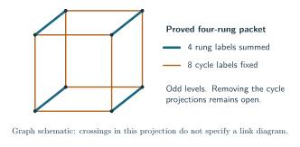

# Methods and research approaches

The manuscript develops completed arguments under their stated hypotheses. This chapter also explains approaches whose general applications remain unresolved. Its purpose is to make the calculation behind each approach intelligible before sending the reader to a technical note.

There are three different conclusions to distinguish. An **identity** rewrites the same finite quantity exactly. An **estimate** bounds its size, perhaps only from above. A **volume theorem** proves a limit for the original invariant and identifies the number in that limit with the volume of the specified knot complement. A useful identity or a sharp upper bound can be a completed result without being a volume theorem.

Throughout, \(K\) is a fixed knot, \(N\ge2\) is the quantum level, and \(K_N(K)\) is the reduced Kashaev invariant; the unknot has value one. We use
\[
 q_N=e^{\pi i/N},\qquad \zeta_N=q_N^2=e^{2\pi i/N}.
\]
Both roots occur in the literature. A formula written with \(q_N\) must not be compared with a formula written with \(\zeta_N\) without translating that convention. All diagrams and twist numbers are fixed before \(N\) tends to infinity. The [notation chapter](notation.md) gives the conventions used in the detailed calculations.

The starting references are Kashaev's [triangulated construction](https://arxiv.org/abs/hep-th/9411147), its [R-matrix formulation](https://arxiv.org/abs/q-alg/9504020), and the [volume proposal](https://arxiv.org/abs/q-alg/9601025). The [Murakami–Murakami paper](https://arxiv.org/abs/math/9905075) relates it to the colored Jones formulation. The finite invariant used here is specified directly; that relation is not a replacement for the source calculations.

## The estimate and the geometric identification

Suppose an exact calculation splits the invariant into
\[
 K_N(K)=G_N+R_N.
\]
Here \(G_N\) is a specified contribution, including its original scalar factors, and \(R_N\) is everything else. Neither term is automatically a topological invariant on its own.

A typical completed argument proves
\[
 G_N=a_N e^{NS},\qquad
 \frac{\log|a_N|}{N}\longrightarrow0,\qquad
 |R_N|\le e^{N(\operatorname{Re}S-\eta)+o(N)}
\]
for a fixed \(\eta>0\), with \(a_N\ne0\) for sufficiently large \(N\). The complex number \(S\) is the critical value of the action in that calculation. Dividing by \(G_N\) shows that \(R_N/G_N\to0\), and hence
\[
 \lim_{N\to\infty}\frac{2\pi}{N}\log|K_N(K)|
       =2\pi\operatorname{Re}S.
\]
There is still a geometric assertion to prove:
\[
                 2\pi\operatorname{Re}S
                    =\operatorname{Vol}(S^3\setminus K).
\]
A formal critical point alone proves none of these three estimates. A positive comparison sum alone does not prove that \(a_N\) is nonzero. A representation of the knot group alone need not be the complete hyperbolic representation.

For the covered Conway constructions and decorated planar diagrams, the manuscript supplies all these steps. For an unchanged matched simple sphere with the stated Morse presentation and markings, the [geometric contribution theorem](../../notes/actual_morse_geometric_contribution.md) supplies the contribution and its actual filled volume; the general signed remainder estimate remains open. This is why that partial theorem is included without being advertised as a full volume theorem.

## Exact polynomials and shared face variables

A **crossing circle** is an auxiliary component bounding a disk pierced by two strands. Removing twists and inserting these circles gives an augmented diagram. After cutting its finite tensor calculation along the projection regions, assign one commuting variable \(L_f\) to each face \(f\). The same face has the same variable at every incident crossing region.

Put \(d=N-1\). For the complete-color source identities in this section take \(N\ge3\). A local operator \(p(\Omega)\), where \(\Omega\) is the specified pair Casimir matrix and \(p\) is a polynomial, gives a homogeneous polynomial
\[
 H_p(x,b,c,y)
   =\sum_{i+k+\ell+t=d}a_p(i,k,\ell,t)b^ix^ky^\ell c^t .
\]
The four variables label the four ordered faces adjoining that region. The coefficient \(a_p\) is the corresponding finite matrix coefficient after the stated change to face coordinates. A box carrying a linear map is sometimes called a *coupon* in tensor-diagram notation; here it means precisely this local operator.

For the marked spherical construction with \(r\) crossing regions, there are \(r\) ordinary faces and two protected faces \(u,v\). Its shared polynomial is
\[
 S_N(\boldsymbol\sigma)
  =\left[\prod_{f\ne u,v}L_f^d\right]
        \left.\prod_{e=1}^{r}H_e(\boldsymbol L;\sigma_e)
        \right|_{L_u=L_v=0}.
\]
The brackets mean coefficient extraction. The parameter \(\sigma_e\) is the spectral variable of crossing region \(e\). The two zero substitutions encode the original marked cut; they are not optional boundary conditions. The [finite source proof](../../notes/actual_homogeneous_casimir_face_source.md) and its [general Morse version](../../notes/research_matched_sphere_morse_source.md) establish this identity with the scalar and endpoint conventions.

The terms **central**, **left**, and **right** describe supports of this local polynomial. With \(h=\lfloor d/2\rfloor\), central retains monomials for which both middle-face exponents \(i,t\) are at most \(h\). The left piece has \(t>h\), overloading face \(c\); the right piece has \(i>h\), overloading face \(b\). Since \(i+t\le d\), both exponents cannot exceed \(h\). Expanding the product of these local choices splits \(S_N\) into its all-central part and its complement. These are sectors of one prescribed calculation, not new knot invariants. The [geometric contribution theorem](../../notes/actual_morse_geometric_contribution.md) estimates the original filling functional applied to the all-central sector; a full-invariant theorem must also control the complementary sectors.

For a simple illustration of why the variables must remain shared,
\[
 [z^2](a+bz)(c+dz)=bd.
\]
Replacing the two factors by separate maxima over their \(z\)-degrees would ignore the common target degree. In a knot diagram there are many such simultaneous constraints. The shared coefficient retains them before any asymptotic estimate.

Repeated spectral roots require derivatives as well as values. If \(J=cI+U\) with \(U^2=0\), then
\[
                         p(J)=p(c)I+p'(c)U.
\]
Thus knowing only \(p(c)\) does not determine the operator. This elementary example explains **Hermite data**: values and the derivatives prescribed by the multiplicities of the spectral roots. Derivatives in a spectral variable and derivatives in the generic quantum parameter are different data. Every use of a “normal term” in the notes must specify which derivative it means.

The [finite filling estimate](../../notes/actual_uniform_filling_supremum_bound.md) bounds the next operation, inserting a fixed signed crossing power \(n\). For the original linear functional \(\mathcal L_N^n\) and a polynomial \(H\) of degree at most \(N-1\),
\[
 |\mathcal L_N^n H|
       \le (1+|n|/2)\sup_{\sigma\in[-2,2]}|H(\sigma)|.
\]
Its proof uses the exact values and derivatives at the spectral nodes. Applying it after the shared coefficient extraction adds no exponential cost at fixed twists. It does not estimate the supremum on its right.

There is a useful distinction between vanishing values and a vanishing functional. Write
\(\chi_N(z)=2T_N(z/2)+2\), where \(T_N(\cos\theta)=\cos(N\theta)\).
If \(H\) vanishes at every root of \(\chi_N\), including the odd-level simple root \(-2\), the same theorem gives
\[
 |\mathcal L_N^n H|\le\frac{N-1}{N}\|H\|_{[-2,2]}.
\]
The crossing-power factor disappears from this bound, but the derivatives of \(H\) at double roots can still contribute. For the shared difference
\(\mathcal D_N=S_{N,\mathrm{full}}-S_{N,\mathrm{central}}\), the degree is at most \(N-1\) in each spectral variable and values vanish on the product of the spectral node sets. This is weaker than vanishing whenever any single variable is a node. Expanding the full functional in all variables cancels exactly its term with no derivatives and yields
\[
 \left|\left(\bigotimes_{e=1}^{r}\mathcal L_N^{n_e}\right)\mathcal D_N\right|
 \le
 \left\{\prod_e(1+|n_e|/2)
       -\prod_e(1/N+|n_e|/2)\right\}
             \|\mathcal D_N\|_{[-2,2]^r}.
\]
The tensor product means that the functionals act successively on their respective spectral variables. This exact saving preserves the shared targets and both level parities. It leaves the size of the between-node polynomial as the remaining problem. The earlier [Fourier–Hermite Gram estimate](../../notes/actual_filling_fourier_hermite_gram.md) also has a level-independent filling cost, in a different positive Hilbert norm; the two estimates should not be identified.

## Positive sums, factorial asymptotics, and angle optimization

The simplest variational argument applies to a positive sum. Suppose \(\mathcal X_N\) is a finite index set with \(|\mathcal X_N|\le N^c\), and the weights \(w_N(x)>0\) satisfy a uniform logarithmic estimate
\[
                \log w_N(x)=N F(x/N)+o(N).
\]
Here \(c\) is fixed and \(F\) is a continuous action on the limiting admissible set. The elementary inequalities
\[
 \max_x w_N(x)\le\sum_xw_N(x)
                     \le|\mathcal X_N|\max_xw_N(x)
\]
give the exponential rate once admissible integer points approach a maximizer at every sufficiently large level. That last condition is an actual support question. A sequence of numerically favorable levels does not establish it.

Quantum factorials lead to integrals of logarithms of sine functions. The basic example is
\[
 \frac1N\log\prod_{j=1}^{\lfloor Nt\rfloor}
       2\sin\frac{\pi j}{N}
 \longrightarrow \int_0^t\log(2\sin\pi x)\,dx
       =-\frac{\Lambda(\pi t)}{\pi},
 \qquad 0<t<1,
\]
where
\[
             \Lambda(\theta)=-\int_0^\theta
                         \log|2\sin s|\,ds
\]
is the Lobachevsky function. Near \(t=0,1\), the logarithmic singularities require endpoint estimates; uniformity there is not a consequence of a smooth Riemann-sum rule.

This positive-sum argument is a discrete Laplace principle. It is distinct from both majorization and a Tauberian theorem, even though all three exploit positivity or convexity. The [positive Conway variational proof](../../notes/actual_positive_conway_variational_limit.md) establishes the support and factorial estimates for its stated expressions. The [geometric realization](../../notes/actual_positive_conway_hyperbolic_volume.md) is a further argument. Positivity by itself neither constructs a knot complement nor proves invariance under changes of triangulation. A proposed positive tetrahedral model must also satisfy the appropriate local move identities with its full peripheral factors retained.

An **angle structure** on an ideal triangulation assigns positive dihedral angles to its tetrahedra. In each tetrahedron the three angles at a vertex sum to \(\pi\); around each manifold edge the incident angles sum to \(2\pi\). Opposite tetrahedron edges have equal angles. These are linear conditions, so the allowed assignments form a relatively open convex polytope, when it is nonempty.

For one positively oriented ideal tetrahedron with angle triple \((\alpha,\beta,\gamma)\), its volume is
\[
 V(\alpha,\beta,\gamma)
       =\Lambda(\alpha)+\Lambda(\beta)+\Lambda(\gamma),
 \qquad \alpha+\beta+\gamma=\pi.
\]
The total volume is strictly concave on the positive angle domain. This is the concavity used in the Casson–Rivin variational approach; the volume is not described as a convex function to be minimized. Stationarity in all allowed directions supplies the remaining length and gluing conditions. The peripheral equations and the actual face identifications still have to be retained. The [marked positive gluing proof](../../notes/general_marked_positive_gluing_certificate.md) carries out these steps for its stated triangulation certificate.

For one tetrahedron this concavity can be checked directly. Use
\(\alpha,\beta\) as coordinates and put \(\gamma=\pi-\alpha-\beta\).
The negative Hessian of its volume is
\[
 -\nabla^2V=
 \begin{pmatrix}
 \cot\alpha+\cot\gamma&\cot\gamma\\
 \cot\gamma&\cot\beta+\cot\gamma
 \end{pmatrix}.
\]
Its first diagonal entry is
\(\sin\beta/(\sin\alpha\sin\gamma)>0\), and its determinant is one,
using
\(\cot\alpha\cot\beta+\cot\beta\cot\gamma+\cot\gamma\cot\alpha=1\).
It is therefore positive definite. This calculation also explains why
one cannot assume that every individual cotangent is positive: one
angle may exceed \(\pi/2\), while the constrained Hessian still has
the required sign. Summing these quadratic forms and restricting to
the allowed linear variations gives strict concavity for the entire
positive angle structure.

One can see how the equations enter by differentiating:
\[
 dV(\dot{\boldsymbol\alpha})
   =-\sum_{\text{tetrahedron angle slots }a}
             \log(2\sin\alpha_a)\,\dot\alpha_a .
\]
An allowed variation \(\dot{\boldsymbol\alpha}\) satisfies the homogeneous versions of the tetrahedron and edge equations. Requiring this derivative to vanish for every such variation is a coupled condition. Maximizing each tetrahedron separately would instead assign it three angles \(\pi/3\); those independent choices need not satisfy the edge equations of the given triangulation. This explains why adding local maximum volumes is not the variational problem used in the proof.

There are two logically different tasks here. One must find an interior critical point, and one must show that the cells and face pairings describe the intended manifold. Strict concavity proves uniqueness once those tasks have been met. It does not prove that every chosen triangulation has a positive solution. The [geometry chapter](geometry.md) explains the actual cells, cusp markings, and smooth fillings used in this project.

For the precise standard criterion on an orientable manifold with torus boundary, see [Futer and Guéritaud, *From angled triangulations to hyperbolic structures*, Definition 3.1 and Theorem 1.2](https://arxiv.org/pdf/1004.0440). [Rivin's 1994 paper](https://annals.math.princeton.edu/1994/139-3/p02) gives the earlier variational setting. The marked gluing proof linked above establishes the version used by this source rather than inferring it from the appearance of a dilogarithm.

## Weighted Cauchy and the cost of joining pieces

Let \(\mathcal I_N\) be the original finite index set, and write a scalar evaluation as \(Z_N=\sum_{\alpha\in\mathcal I_N}a_\alpha\). For any specified positive weights \(w_\alpha\),
\[
 |Z_N|^2
 \le
 \left(\sum_\alpha w_\alpha\right)
 \left(\sum_\alpha\frac{|a_\alpha|^2}{w_\alpha}\right).
\]
This is Cauchy–Schwarz applied to the vectors
\((\sqrt{w_\alpha})_\alpha\) and
\((a_\alpha/\sqrt{w_\alpha})_\alpha\). A useful choice of weights must make both factors estimable for the original contraction.

Weights can redistribute a cost, but cannot recover a phase discarded by the inequality. Indeed the infimum of the displayed right-hand side over positive weights is \((\sum_\alpha|a_\alpha|)^2\), attained by \(w_\alpha=|a_\alpha|\) when no entry vanishes and approached otherwise. For \(a_1=1,a_2=-1\), the exact sum is zero while even this optimized bound is four. The application therefore needs structural information about the joined source, not just an optimized positive weight for every separate term.

The matrix form allows a further possibility: its off-diagonal entries can retain interference between different coefficients. If \(G\) is a positive definite Hermitian matrix, \(v\) is the source vector, and \(b\) is the row implementing the original closure, then
\[
                   |bv|^2
                \le (bG^{-1}b^*)(v^*Gv).
\]
The star denotes conjugate transpose. The first factor is the cost of the marked closure in the dual norm; the second is the source energy. Calling \(G\) a convenient inner product does not bound either cost.

For a chain \(v_{j+1}=A_jv_j\), a concrete sufficient estimate is
\[
 A_j^*G_{j+1}A_j\le e^{2\varepsilon_j}G_j,\qquad G_j>0 .
\]
The matrix inequality means that its right-hand side minus its left-hand side is positive semidefinite. Iteration and the closure estimate give
\[
 |b\,v_m|^2\le
 (bG_m^{-1}b^*)\,e^{2\sum_j\varepsilon_j}\,(v_0^*G_0v_0).
\]
Thus a useful varying norm must control the actual transport between successive norms and both endpoints. Making an intermediate matrix small by a change of basis can enlarge these endpoint factors. For a network, the analogous check must keep every shared boundary index and its measure.

When two pieces share a boundary label \(j\), the contraction still has one common sum over \(j\). If its original measure is a positive number \(\theta_N(j)\), a useful exact form is
\[
 Z_{\mathrm{joined}}
      =\sum_j\frac{Z_A(j)Z_B(j)}{\theta_N(j)}.
\]
Set \(F_A(j)=Z_A(j)/\sqrt{\theta_N(j)}\), and define \(F_B\) likewise. Cauchy bounds the square of the joined value by
\((\sum_j|F_A(j)|^2)(\sum_j|F_B(j)|^2)\).
It gives no lower bound on their overlap: the two vectors can be orthogonal.

The [whole-support boundary estimate](../../notes/actual_whole_support_boundary_gram_envelope.md) and [exact joining identity](../../notes/actual_nc_three_port_source_sewing.md) establish useful local inputs. For a reflected double, the two halves can be genuine complex conjugates in the specified pairing, giving a positive sum of squares. The [reflection-double theorem](../../notes/actual_planar_three_port_reflection_double.md) proves precisely that identity. Its internal half-evaluations still contain their original phases. The general problem is to transport the estimates through the whole diagram and prove that the required contribution survives.

### Moment matrices: positivity with interference retained

A **moment** of a positive probability measure \(\mu\) on the real line is
\(m_j=\int t^j\,d\mu(t)\), when that integral is finite. For a
nonnegative integer \(r\), if the moments through degree \(2r\) exist, the matrix
\[
 H=(m_{i+j})_{0\le i,j\le r}
\]
is positive semidefinite. Indeed, for \(p(t)=\sum_{j=0}^r a_jt^j\),
\[
 a^*Ha=\int|p(t)|^2\,d\mu(t)\ge0.
\]
This is a *Gram matrix*: its entries are the inner products of the
monomials \(1,t,\ldots,t^r\). Its entries with \(i\ne j\) are the
cross terms in the squared polynomial. They need not be discarded
when applying Cauchy.

For example, take the uniform probability measure on \([0,1]\) and
\(p(t)=1-2t\). Then
\[
 H=\begin{pmatrix}1&1/2\\1/2&1/3\end{pmatrix},
 \qquad \int_0^1p(t)\,dt=0,\qquad
 \int_0^1|p(t)|^2\,dt=\frac13.
\]
Keeping only the diagonal of \(H\) would instead give
\(1+4/3=7/3\). The full positive form retains some cancellation, but
Cauchy's bound \(0\le1/3\) still does not compute the zero expectation.
This distinction matters at exponential scale.

The source has an exact example. For \(N\ge3\), put
\(d=N-1\), \(M=\lfloor N/2\rfloor-1\), and \(\theta=\pi/N\).
The notes call the following one-sided polynomial a *protected cap*:
two of its four face variables are the protected zeros, and \(A,C\)
are the remaining ordinary variables. At spectral value \(2\), it is
\[
 H_{\mathrm{cap}}(A,C;2)=
 \sum_{j=0}^{M}(-1)^jU_jA^{d-j}C^j,\qquad
 U_j=\csc^2(\theta/2)
       \prod_{r=1}^{j}
       \frac{\sin^2(r\theta)}{\sin^2((r+1/2)\theta)}.
\]
The product formula defines \(U_j\) for \(0\le j\le d\), with the empty
product equal to one. The polynomial uses only \(0\le j\le M\),
its original one-sided support. The
[positive cap-moment theorem](../../notes/research_flat_cap_positive_moment_form.md)
constructs a probability measure \(\mu_N\) satisfying
\[
 \int t^j\,d\mu_N(t)=\frac{U_j}{U_0}\quad(0\le j\le d).
\]
Thus, for arbitrary coefficients \(a_j\) and
\(p(t)=\sum_{j=0}^{M}a_jt^j\),
\[
 \sum_{j=0}^{M}(-1)^jU_ja_j
      =U_0\int p(-t)\,d\mu_N(t),\qquad
 \left|\sum_{j=0}^{M}(-1)^jU_ja_j\right|^2
      \le U_0^2\int|p(-t)|^2\,d\mu_N(t).
\]
The degree check is \(2M\le d\). The measure has unbounded support,
so a bound for \(p\) on \([0,1]\) cannot replace the integral.
The [cap-moment norm obstruction](../../notes/research_cap_moment_cauchy_norm_obstruction.md)
shows that the resulting Cauchy upper bound can exceed the original
positive endpoint comparison exponentially, even with the original two-piece
degree constraint imposed. It does not show that the signed
expectation exceeds that comparison. A positive norm exists;
the required source estimate can still fail for that norm.

At even level \(N=2m\), the same moment theorem also gives an exact
\(m\)-point **Gaussian quadrature**: an integral of any polynomial of
degree at most \(2m-1=d\) is a positive weighted sum of its values at
\(m\) positive nodes. Its symmetric tridiagonal matrix has entries
\(\int t\,p_i(t)p_j(t)\,d\mu_N(t)\), where \(0\le i,j<m\) and
\(p_i\) is the orthonormal polynomial of degree \(i\). The nodes
are its eigenvalues. “Orthonormal” means that the integrals of
products of distinct basis polynomials are zero and the integral of
each squared polynomial is one. This finite evaluation is useful
computationally; it is not an estimate of its summands. The standard matrix construction
is explained by [Golub and Welsch, *Calculation of Gauss Quadrature
Rules*, §§1–2](https://www.ams.org/journals/mcom/1969-23-106/S0025-5718-69-99647-1/S0025-5718-69-99647-1.pdf).
The source note separately proves that its particular moments and
degree cutoff permit that construction.

### Cancellation after collecting every neighbor of a face

An estimate can retain more cancellation by combining an entire
shared sum before applying a norm. For the cap just displayed,
collect **every** other factor incident to \(A\), assume these
factors are central, and write their product at spectral value
\(-2\), after removing its fixed common sign, as
\[
 P_N(A,\boldsymbol Y)=\sum_{j\ge0}p_{N,j}(\boldsymbol Y)A^j.
\]
The vector \(\boldsymbol Y\) comprises the remaining ordinary face
variables, including \(C\); protected variables stay zero and variables
shared by neighbors are still identified.
This collection is the *whole \(A\)-star*. The one prescribed degree
on \(A\) gives
\[
 B_N(\boldsymbol Y)
   =[A^d]H_{\mathrm{cap}}P_N
   =\sum_{j=0}^{M}(-1)^jU_jC^jp_{N,j}(\boldsymbol Y).
\]
The index \(j\) is the **total** degree from all neighbors. Assigning
a separate cutoff to each neighbor would change the source.
In this original marked diagram, \(A,C\) are also endpoints of a
strand edge. The triangle on the other side of that edge belongs to
one of the central neighboring factors. This incidence supplies the
angular estimate used below; the argument is not a statement about
an arbitrary polynomial product with positive coefficients.

Here is the scope of the proved
[whole-star cancellation theorem](../../notes/research_cap_cross_shared_star_spectral_gap.md).
Fix positive radii \(\rho_f\) for the ordinary faces, with
\(\rho_A=\rho_C\), and put
\(P_N^+(a)=P_N(a,\boldsymbol\rho_Y)\). Assume the following limit is
locally uniform for real \(t\) and differentiable at zero:
\[
 F(t)=\lim_{N\to\infty}\frac1N\log P_N^+(\rho_Ce^t)
 \quad\text{satisfies}\quad 0<F'(0)<\frac12.
\]
The derivative is the limiting total \(A\)-degree divided by \(N\)
under these positive weights. The theorem gives a fixed \(\eta>0\)
such that, at every sufficiently large level of either parity,
\[
 \sup_{|Y_f|=\rho_f}|B_N(\boldsymbol Y)|
             \le e^{-\eta N}P_N^+(\rho_C).
\]
The linked theorem also treats its specified complex spectral
neighborhood. The derivative condition and the assumption that every
other \(A\)-incident factor is central are substantive hypotheses.

At the displayed fixed spectra, the moment proof explains the
mechanism. For \(t\) near one, evaluating the neighboring product
at \(A=-Ct\) forces a phase difference near \(\pi\) across the actual
adjacent triangle, and its cofactor has a strict angular loss. Small
\(t\) lowers the positive weighted action. Large \(t\) is controlled
without integrating the full neighboring product, which may have
too high a degree: for any fixed \(\delta>0\),
\[
 \int_{t\ge1+\delta}t^M\,d\mu_N(t)
 \le (1+\delta)^{-(d-M)}\int t^d\,d\mu_N(t),
 \qquad
 \int t^d\,d\mu_N(t)=N^2\sin^2\frac{\pi}{2N}\le\frac{\pi^2}{4}.
\]
The total-degree cutoff and \(F'(0)<1/2\) also control the omitted
high-degree terms near one. Both features are needed; the alternating
sign alone is not a proof of exponential cancellation.

This gives a strict improvement relative to the displayed weighted
star value. Attaching the unchanged exterior still requires a bound
for that exterior on the **same** shared radii and targets. The combined
weighted value has not in general been shown to lie at or below the
geometric rate. The local cancellation theorem therefore does not
settle the general signed remainder or the volume conjecture.

### Coefficient estimates use shared radii

A second use of Cauchy's name concerns *coefficient estimates*. For a polynomial \(P(\boldsymbol L)\) with nonnegative coefficients, a target exponent vector \(\boldsymbol t\), and positive radii \(\boldsymbol\rho\),
\[
 [\boldsymbol L^{\boldsymbol t}]P
       \le P(\boldsymbol\rho)\boldsymbol\rho^{-\boldsymbol t},
 \qquad
 \boldsymbol\rho^{\boldsymbol t}=\prod_f\rho_f^{t_f}.
\]
The inequality follows by retaining one term of the positive evaluation. Minimizing the right-hand side is often called a capacity bound. There must still be one radius for each shared face, with all its incident factors evaluated there. For signed coefficients, the analogous elementary bound uses the polynomial obtained by taking absolute values of the coefficients, not \(|P(\boldsymbol\rho)|\). For instance \(P(z)=1-z\) vanishes at \(z=1\) although its coefficient of \(z\) has modulus one. The [complete-source capacity obstruction](../../notes/actual_complete_source_cauchy_capacity_gap.md) shows that even optimizing all positive shared radii can overestimate the geometric rate in its stated source class. That obstruction concerns this comparison method, not the knot invariant itself.

For a worked positive example, take \(P(z)=(1+z)^m\) and a target
\(0<k<m\). The bound is
\[
 {m\choose k}\le\frac{(1+\rho)^m}{\rho^k}.
\]
Differentiation with respect to \(\log\rho\) gives
\(m\rho/(1+\rho)-k\). Its zero is
\(\rho=k/(m-k)\), so the optimized bound is
\[
 {m\choose k}\le
       \left(\frac{m}{k}\right)^k
       \left(\frac{m}{m-k}\right)^{m-k}.
\]
At \(m=2,k=1\), it gives \(2\le4\), not an exact evaluation.
The stationarity equation has balanced the expected degree with
the target degree. In the face source there is one such equation
for each ordinary face, coupled through all the factors containing
that face. This is why a local optimum at every box is not yet a
shared coefficient estimate.

## Refining the coefficient estimate by genuine sectors

A single positive comparison can be too coarse even when a more detailed finite comparison succeeds. The [sector-cover theorem for certified marked plats](../../notes/general_actual_sector_cover_filling_volume.md) and its [general Morse formulation](../../notes/general_morse_sector_cover_volume.md) make this precise for their stated original sources. They use the actual central, left and right polynomials, not arbitrary pieces of an upper-bound formula.

For nonnegative weights \(w_1,w_2,w_3\), not all zero, define the [source-normalized triangle potential](../../notes/actual_triangle_entropy_algebraic_balance.md) by
\[
\begin{aligned}
 Q(w_1,w_2,w_3)
 &=\max_{\substack{\alpha_j\ge0\\
                   \alpha_1+\alpha_2+\alpha_3=1/2}}
       \sum_{j=1}^{3}\bigl(f(\alpha_j)+\alpha_j\log w_j\bigr),\\
 f(t)&=\frac{\Lambda(\pi t)+\Lambda(\pi/2-\pi t)}{\pi},
       \qquad 0\le t\le\tfrac12 .
\end{aligned}
\]
For an ordered face quartet \((x,b,c,y)\), the three weights in \(Q(x,b,y)\) are \(w_1=x,w_2=b,w_3=y\). If a weight is zero, restrict its \(\alpha_j\) to zero and assign its product \(\alpha_j\log w_j\) the value zero. The linked proof identifies this maximum with the limiting logarithm, divided by \(N\), of the original positive half-degree triangle polynomial. Thus this is a real function of face weights, not the root \(Q_N=q_N^2\), and no additive normalization is free: \(Q(x,0,0)=\tfrac12\log x\) for \(x>0\).
The local bounds on the entire real spectral interval have rates
\[
\begin{aligned}
 A_C&=Q(x,b,y)+Q(x,c,y),\\
 A_L&=\max\{\log c,\ Q(x,b,y)+\tfrac12\log c\},\\
 A_R&=\max\{\log b,\ Q(x,c,y)+\tfrac12\log b\}.
\end{aligned}
\]
If the overloaded middle coordinate is protected, its one-sided polynomial is exactly zero and that label is omitted. A protected zero never becomes a small positive weight. These are bounds uniform in the phases on the face coefficient torus; they do not assert coefficientwise positivity of the one-sided polynomial.

A branch \(B\) allows a specified subset \(S_{B,e}\) of genuine labels at each crossing region. For example, one branch can require left at region 1, allow central or right at region 2, and allow all labels elsewhere. It has the shared cost
\[
 G_B(\boldsymbol L)
   =\sum_e\max_{a\in S_{B,e}}A_{e,a}(\boldsymbol L)
                 -\sum_{f\ \mathrm{ordinary}}\log L_f.
\]
The target \(d=N-1\) accounts for the last sum at the leading exponential scale. Every face still has just one weight within this branch. Different branches may use different full vectors of weights.

More generally a branch can be any specified finite set \(B\) of
genuine label strings. Its cost is
\[
 G_B(\boldsymbol L)
    =\max_{\boldsymbol s\in B}\sum_e A_{e,s_e}(\boldsymbol L)
                   -\sum_{f\ \mathrm{ordinary}}\log L_f.
\]
The preceding sum of local maxima is the special case where
all combinations of the allowed local labels belong to \(B\).
For example, a two-region branch containing only
\((L,C)\) and \((C,R)\) has the maximum of
\(A_{1,L}+A_{2,C}\) and \(A_{1,C}+A_{2,R}\).
Taking separate local maxima would also allow \((L,R)\),
which is not in that branch and can have a larger bound.
Retaining such correlations refines an estimate without changing
the original source labels.

Choose finitely many branches covering every noncentral label string. If each has one fixed positive shared vector with \(G_B<\Phi_D\), where \(2\pi\Phi_D\) is the complete augmented volume, their finitely many strict gaps give a common bound on the full complementary polynomial. The original filling estimate transfers that bound to the complementary scalar. For independently sufficiently long fixed twists, the nonzero all-central contribution has a rate closer to \(\Phi_D\) than this remainder does; multiplying that rate by \(2\pi\) gives the actual filled volume. When the original endpoint pairing gives a knot, this comparison proves its full volume limit under the certificate hypotheses.

An **anchored** test requires one specified left or right region and allows all labels at every other region. Refining that test splits its allowed strings into smaller branches. The [certificate-separation example](../../notes/actual_shared_radius_certificate_separation.md) proves that all positive weights fail one anchored test on a fixed original source, while forty refined branches pass. It refutes universal applicability of the anchored test, not the volume conjecture or the possibility of a finer certificate.

Existence of a successful finite cover is a separate condition on
the chosen envelopes and diagram. Refinement does not prove it:
even a branch containing a single genuine string still requires
one shared weight vector giving the stated strict inequality.

There is an exact obstruction at this last level. The
[54-region example](../../notes/actual_singleton_sector_envelope_obstruction.md)
has one left region and central at all other regions. For this fixed
string \(\boldsymbol s\), every positive shared vector satisfies
\[
          G_{\{\boldsymbol s\}}(\boldsymbol L)>\Phi_D+\frac15.
\]
The proof assigns rational angle loads to the original triangles
so that their face totals match every original coefficient target.
The logarithmic weights then cancel, leaving an entropy lower
bound valid for every shared vector. A separate rational trial
vector bounds the complete action from above. The shared sector
is also nonzero at every sufficiently large even level, so it
cannot simply be discarded as an unsupported label choice.
Any branch containing this string has at least its envelope
cost. Subdivision by genuine labels therefore cannot make these
particular envelopes a universal criterion. This conclusion gives
no lower bound for the signed coefficient or filled invariant;
cancellation and stronger estimates remain possible.

This is a finite cover of a set of sector choices. It is unrelated to a finite covering space of a knot complement. The theorem also does not split the two scalar expressions inside \(A_L\) into separate physical sectors: both expressions bound the same left polynomial.

### Why weak balance can still give a strict gap

There is a sufficient condition that constructs the shared weights
directly. Let \(w_f^*>0\) be the ordinary curvatures of the complete
marked packing, with the protected weights zero. At every region
put \(X_e=Q(x,b,y)+Q(x,c,y)\), evaluated at these weights.
The [weak-balance theorem](../../notes/general_weak_balance_volume.md)
assumes
\[
 X_e\ge\log w_b^*\quad(w_b^*>0),\qquad
 X_e\ge\log w_c^*\quad(w_c^*>0).
\]
Equality is allowed. These inequalities are a geometric hypothesis,
not a consequence of the definition of a matched sphere.

The proof changes only the coefficient-estimate weights:
\[
                    w_f(t)=(w_f^*)^{1-t},\qquad 0<t<1.
\]
The protected weights stay zero. This new vector need not be a
circle packing. It is a permitted torus of positive moduli for
the same original coefficient.

Here is why a strict margin appears. Put
\(\xi_f=\log w_f^*\), and let \(Q_\triangle(\boldsymbol\xi)\) denote the
triangle potential evaluated at the exponentials of its ordinary
coordinates, with its protected coordinates zero. The complete
shared action is
\[
 \mathcal P(\boldsymbol\xi)
     =\sum_{\text{original triangles }\triangle}Q_\triangle(\boldsymbol\xi)
                         -\sum_{f\ \mathrm{ordinary}}\xi_f,
 \qquad
 \nabla\mathcal P(\boldsymbol\xi)=0,\qquad
 \mathcal P(\boldsymbol\xi)=\Phi_D.
\]
For the maximizing normalized angles \(\alpha_{\triangle,f}\), its
triangle entropy is
\[
 E_\triangle=Q_\triangle-\sum_f\alpha_{\triangle,f}\xi_f
                         =\sum_f f(\alpha_{\triangle,f}).
\]
It is positive when the triangle has at least two ordinary
corners. Every surviving left or right label has such a triangle
containing its overloaded middle. Let \(h_*>0\) be the minimum
of those entropies. If no one-sided label survives the protected
specialization, the complementary polynomial is zero and this
minimum is unnecessary.

The exact triangle Hessian and the complete stationary equations
give a bound on the cost of changing every shared weight:
\[
 \mathcal P((1-t)\boldsymbol\xi)-\Phi_D
       \le \frac{t^2}{2}\mathcal E,\qquad
 \mathcal E=
 \frac1{2\pi}\sum_{\substack{\{f,g\}\text{ a white edge}\\
                              f,g\ \mathrm{ordinary}}}
                           (\xi_f-\xi_g)^2 .
\]
Meanwhile each one-sided region gains at least \(t h_*\)
relative to its central bound. This is proved for both expressions
inside its maximum. Thus every noncentral string has a bound at most
\[
                 \Phi_D-t h_*+\frac{t^2}{2}\mathcal E.
\]
For this fixed diagram, the linear gain exceeds the quadratic
cost when \(t\) is sufficiently small. The entropy and Hessian
calculation, rather than a claim of strictness at the original
packing, deals with the equality cases.

The same proof allows a measured failure of weak balance. If
\(\epsilon_*\) is the maximum positive part of
\(\log w_z^*-X_e\) over surviving overloaded middles \(z\), a
sufficient inequality is
\[
 t h_*-(1-t)\epsilon_*-\frac{t^2}{2}\mathcal E>0.
\]
These criteria yield the complementary-source gap. The finite
filling norm and the nonzero Morse geometric contribution then
give the full knot-volume theorem for the stated original
pairing and sufficiently long fixed signed fillings. A large
value of \(\mathcal E\), or failure of this inequality, proves
no failure of the invariant: it only leaves this particular
shared-weight test inconclusive.

## What Fourier transformation preserves

For a vector \(c=(c_0,\ldots,c_{N-1})\), define its unitary discrete Fourier transform by
\[
 \widehat c_k=\frac1{\sqrt N}
       \sum_{j=0}^{N-1}c_j e^{-2\pi i jk/N},
       \qquad 0\le k<N.
\]
The finite identity
\[
 \sum_{k=0}^{N-1}e^{2\pi i k(j-\ell)/N}
       =N\,\mathbf1_{\{j=\ell\}}
\]
implies Parseval's identity
\[
                       \sum_k|\widehat c_k|^2
                            =\sum_j|c_j|^2.
\]
Here \(\mathbf1\) is the indicator of the stated condition. This is an exact norm identity. It does not say that one Fourier coefficient equals the norm or that the phases of several contributions agree.

For example, for even \(N\), the vector \(c_j=(-1)^j\) has energy \(N\), but its ordinary sum is zero: its Fourier energy lies at frequency \(N/2\), not at frequency zero. A Fourier transform can make the location of cancellation visible without making that cancellation disappear.

For background on finite-group transforms and their normalization, see [Terras, *Fourier Analysis on Finite Groups and Applications*](https://doi.org/10.1017/CBO9780511626265).

In the actual color transform, put \(c_0=K_N(K)\) and \(c_j=C_j(q_N)\) for \(1\le j<N\), where \(C_j\) is the original reduced, zero-framed ordinary-color evaluation. The [ordinary-color calculation](../../notes/ordinary_color_plancherel_bound_audit.md) identifies an energy
\[
 E_N=|K_N(K)|^2+R_N^{\mathrm{ord}},
       \qquad 1\le R_N^{\mathrm{ord}}\le C N^B,
\]
with constants \(C,B\) depending on the fixed presentation. The superscript distinguishes this ordinary-color remainder from the earlier geometric remainder \(R_N\). The identification and polynomial bound are additional source statements; they are not part of abstract Parseval. If \(\log E_N/N\to\lambda>0\), then the Kashaev volume rate is \(\pi\lambda\).

The last implication uses subtraction of the known remainder:
\[
 \frac{|K_N(K)|^2}{E_N}
       =1-\frac{R_N^{\mathrm{ord}}}{E_N}
       =1-o(1).
\]
An exponential positive energy dominates a polynomial remainder.
Taking the logarithm then halves the energy rate. If the remainder
had an uncontrolled exponential size instead, Parseval alone would
not justify this step.

In particular \(C_1=1\), explaining the lower bound on \(R_N^{\mathrm{ord}}\). The ordinary-color bound uses the actual reduced root evaluation and its finite unitary realization, including the normalization cost.

More explicitly, for a fixed braid with \(b\) strands and one knot component, the source proof gives
\[
 |C_j(q_N)|\le [j]^{\,b-1},\qquad
 [j]=\frac{\sin(\pi j/N)}{\sin(\pi/N)},\qquad 1\le j<N,
\]
and therefore
\[
 1\le R_N^{\mathrm{ord}}
       \le (N-1)(N/2)^{2b-2}.
\]
The reduction divides the ordinary quantum trace by its nonzero dimension \([j]\). At \(j=N\), that dimension is zero, so this argument gives no polynomial bound for \(K_N\). It also does not bound derivatives of the unreduced ADO state at an ordinary color. These distinctions are what make an exponentially growing complete-color value compatible with the polynomial ordinary-color remainder.

The word *energy* is also used for a single magnetic column and for a Fourier sum on the matching graph. Those are different quantities. A column energy controls that column's entries. A graph energy retains common flow and charge constraints. Only the ordinary-color identity above isolates \(|K_N|^2\) with a proved polynomial remainder. The [mechanism chapter](mechanism.md#weighted-cauchy-needs-the-right-energy) spells out the other two constructions.

The face-source approach also uses finite cosine polynomials in auxiliary color parameters. Reflection of the allowed frequencies, the odd zero-frequency term, and the actual color-to-frequency map must be specified before invoking Fourier orthogonality. The [shared-cycle Fourier construction](../../notes/actual_matching_graph_shared_cycle_fourier_compiler.md) retains the flow equations, congruences, and original marked charge. Its [positive partition bound](../../notes/actual_matching_graph_positive_fourier_partition.md) is an upper estimate. Discarding the remaining coefficient phases changes the quantity being estimated.

## Two different meanings of the Karamata suggestion

**Majorization.** For real vectors \(u,v\in\mathbb R^m\), let \(u^\downarrow,v^\downarrow\) denote their coordinates in decreasing order. The relation \(u\prec v\) means
\[
 \sum_{i=1}^k u_i^\downarrow\le
       \sum_{i=1}^k v_i^\downarrow\quad(1\le k<m),
       \qquad \sum_i u_i=\sum_i v_i.
\]
For convex \(f\), it implies \(\sum_i f(u_i)\le\sum_i f(v_i)\). For concave \(f\), the inequality is reversed. This is the majorization form of Karamata's inequality.

For example, \((1,1)\prec(2,0)\), so \(2e\le e^2+1\). The equal-total condition is essential. This comparison controls sums of a convex function; it does not identify which coordinate carries the original quantum state.

For invertible matrices \(A_0,\ldots,A_{m-1}\) of the same size \(d\times d\), let \(s_1(A)\ge\cdots\ge s_d(A)>0\) be the singular values, the square roots of the eigenvalues of \(A^*A\). If \(P=A_{m-1}\cdots A_0\), then
\[
 \sum_{i=1}^r\log s_i(P)
 \le\sum_{j=0}^{m-1}\sum_{i=1}^r\log s_i(A_j),
 \qquad 1\le r\le d,
\]
with equality at \(r=d\). To see the inequality, apply the operator-norm product inequality to the \(r\)-th exterior power: its norm is the product of the largest \(r\) singular values. At \(r=d\), multiplicativity of the determinant gives equality. Karamata can now be applied to the resulting logarithmic vectors.

Here the exterior power \(\bigwedge^r A\) acts on alternating
products of vectors by
\[
 (\bigwedge\nolimits^r A)(v_1\wedge\cdots\wedge v_r)
                  =Av_1\wedge\cdots\wedge Av_r.
\]
In orthonormal singular-vector bases its diagonal entries are
the products of \(r\) distinct singular values of \(A\).
The largest such product is therefore its operator norm.
This also explains why the \(r=d\) case is the absolute determinant.

This estimate uses the largest available directions at every step. It does not force an evolving state to follow one marked eigenvalue branch. The [regulator-majorization note](../../notes/regulator_majorization_and_source_energy.md) gives a stronger *conditional* transport criterion. Its elementary model is a doubly stochastic matrix \(C\): its entries are nonnegative and every row and column sums to one. For a real vector \(r\),
\[
 \sum_{i,k}C_{ik}(r_i-r_k)^2
                  =2r\mathbin{\cdot}(r-Cr).
\]
If \(Cr=r\), mixing can occur only between equal entries of \(r\). Preserving just the total sum of \(r\) is much weaker. The operator version requires a positive transport preserving identity, trace, and the specified regulator observable, together with the actual action factorization and endpoint costs. Those additional properties have not been established for the general knot connection.

The standard majorization definitions are developed in [Marshall, Olkin, and Arnold, *Inequalities: Theory of Majorization and Its Applications*](https://link.springer.com/book/10.1007/978-0-387-68276-1). The matrix product result goes back to [Horn, *On the singular values of a product of completely continuous operators*](https://doi.org/10.1073/pnas.36.7.374). [Tao, Jeong, and Gowda](https://userpages.umbc.edu/~gowda/papers/trGOW20-02.pdf) discuss that matrix statement before developing its Jordan-algebra analogues.

**Tauberian reasoning.** This is a different use of Karamata's name. For the positive energies \(E_N\) above, form
\[
                      Z(s)=\sum_{N\ge2}E_Ne^{-sN}.
\]
The boundary of convergence gives \(\limsup_N N^{-1}\log E_N\). Under a separately proved power singularity
\[
 Z(\lambda+t)\sim C t^{-\alpha}
       \quad(t\downarrow0),\qquad C,\alpha>0,
\]
a positive-measure Tauberian argument gives a cumulative law
\[
 \sum_{2\le N\le x}e^{-\lambda N}E_N
       \sim \frac{C x^\alpha}{\Gamma(\alpha+1)}.
\]
Here \(\Gamma(a)=\int_0^\infty u^{a-1}e^{-u}\,du\) for \(a>0\)
is the [gamma function](https://dlmf.nist.gov/5.2#E1).
The conclusion concerns a sum over levels,
not each individual level.

For example, the positive sequence \(E_N=e^{\lambda N}\) for even \(N\) and \(E_N=1\) for odd \(N\) has the corresponding cumulative exponential rate but no individual-level limit. This is an elementary sequence example, not a knot counterexample. The [Tauberian criterion](../../notes/actual_fourier_energy_tauberian_criterion.md) states a sufficient comparison between nearby levels and proves the implication. Neither that comparison nor the sharp Laplace singularity has been proved for the unrestricted knot source. The completed pretzel argument obtains its estimates directly and does not assume these missing Tauberian hypotheses.

For the positive-measure statement, see [Michael Taylor, *Karamata's Tauberian Theorem*, §1](https://mtaylor.web.unc.edu/wp-content/uploads/sites/16915/2020/07/karamata.pdf). The linked local criterion gives a direct moment proof of the power-law case and explains the additional hypothesis needed at individual quantum levels.

## Complex critical points and the contribution of the original contour

An oscillatory integral or finite sum can have several complex critical points. If its phase is \(F(z)\), a critical point solves \(\nabla F(z)=0\). It is **nondegenerate** when the Hessian matrix \(\partial^2F/\partial z_i\partial z_j\) is invertible. A local Gaussian calculation then involves its determinant. The determinant's square root must follow the chosen contour and branch.

The main issue is not just finding such a point. One must move the original contour to a neighborhood of it without losing boundary contributions, prove that the resulting coefficient is nonzero, and bound the complement. In the filling calculation, Fourier expansion produces integer indices \(\ell_e\), often called charges, in addition to the color variables. The original sum contains all those charges. A calculation for \(\ell_e=1\) alone does not establish the full asymptotic.

The [whole geometric-period proof](../../notes/actual_morse_cross_filling_period.md) treats the large charges on the entire original intervals, retaining their endpoint currents. The remaining finite charges are compared on fixed complex neighborhoods. The phases, derivatives at repeated roots, and signs of independently chosen twists remain in the formula. For the covered full-invariant theorems, a further estimate controls the terms outside this geometric sector.

The same distinction matters for slowly varying recurrences. Distinct instantaneous eigenvalues do not alone exclude exponentially significant transfer between branches. A small off-diagonal entry may be magnified after conjugation by exponential action weights. The [transport counterexamples and bounds](../../notes/actual_local_analytic_transport_action_barrier.md) explain the precise missing estimate. Thus neither diagonalizing each matrix separately nor naming a dominant classical branch is a substitute for controlling their ordered product.

Local stationary-phase methods are treated in [Hörmander, *The Analysis of Linear Partial Differential Operators I*](https://link.springer.com/book/10.1007/978-3-642-61497-2). A related root-of-unity asymptotic problem is [Garoufalidis and Zagier's Nahm-sum analysis](https://arxiv.org/abs/1812.07690). Its fixed-root radial limit and hypotheses differ from the growing-order roots and finite knot sums here; no identification of those objects is assumed.

## Quantum recurrences, the A-polynomial, and the selected solution

The classical \(A\)-polynomial records peripheral eigenvalue pairs of representations of the knot group, after the chosen convention about reducible factors. Write \(M,L\in\mathbb C^\times\) for the meridian and longitude eigenvalues. A branch of
\[
                              A(M,L)=0
\]
specifies a possible longitude as the meridian varies. It does not select the quantum invariant.

The classical reference is [Cooper, Culler, Gillet, Long, and Shalen, *Plane curves associated to character varieties of 3-manifolds*](https://homepages.math.uic.edu/~culler/papers/PlaneCurves/curves.pdf). The peripheral basis and the choice between eigenvalues and squared eigenvalues are part of the definition.

Concretely, a representation assigns a determinant-one complex
\(2\times2\) matrix to each knot-group element and preserves
multiplication. Conjugating all matrices changes their frame but
not the representation's character, the function taking a group
element to the trace of its matrix. The meridian and longitude
commute, so their matrices have a common eigenline. The selected
eigenvalues on that line give \(M,L\). Eliminating the internal
matrix coordinates gives algebraic equations in these two
variables. The geometric branch is the one containing the
holonomy of the actual complete hyperbolic knot exterior, with
its chosen lift and peripheral marking.

A quantum recurrence acts on a specified sequence or function. For example, on a color sequence \(f_j\), one may set
\[
 (\widehat M f)_j=q^j f_j,\qquad
 (\widehat L f)_j=f_{j+1},
 \qquad \widehat L\widehat M=q\,\widehat M\widehat L.
\]
This is an illustrative convention; squared meridian conventions replace \(q\) by \(q^2\). The operator, its coefficient ring, and its action must be stated together. A nonzero equation \(\widehat A f=0\) generally has several solutions. Finite initial data, normalization, and behavior at singular steps select the one representing the original invariant.

Even the elementary recurrence
\[
 f_{j+2}-\tfrac52 f_{j+1}+f_j=0
\]
has solutions \(f_j=a\,2^j+b\,2^{-j}\). Their exponential growth depends on whether the initial data make \(a\) vanish. For the quantum recurrence, a coefficient of the forward shift can itself vanish at a specialized root. One must then continue the entire original expression through that step; dividing by the vanishing coefficient or resetting the solution changes the problem.

There is also a distinction between a fixed-level equation and an equation for the whole family. On functions of \(M\), put \(Tf(M)=f(q_NM)\). Since \(q_N^{2N}=1\), every such function satisfies \((T^{2N}-1)f=0\). This identity contains no information about which knot is being evaluated. A genuine all-level annihilator has a fixed finite order and coefficients specified before \(N\) is chosen.

This is the meaning of a **pointed recurrence** in the guide: the recurrence is accompanied by the data selecting its solution. The [pointed quantum A theorem](../../notes/actual_conway_pointed_quantum_a_volume.md) retains those data, including derivatives at singular steps, for its covered family. Expressing an already proved limit through that recurrence is different from proving that an arbitrary quantization of the classical \(A\)-polynomial has the same limit.

Even a nonvanishing scalar change must be recorded. If
\(F(M)=G(M)f(M)\), then \(PF=0\) becomes
\[
 (G^{-1}PG)f=0,\qquad
 G^{-1}PG=\sum_j a_j(q,M)
                  \frac{G(q^jM)}{G(M)}T^j.
\]
This is the precise meaning of a scalar gauge change for this
operator. At a root, a level-dependent gauge can change a sign
that survives in the classical equation. For example,
\(G_N(M)=M^N\) satisfies \(G_N(q_NM)=-G_N(M)\).
The constant function satisfies \(Tf=f\), whereas
\(F_N(M)=M^N\) satisfies \(TF_N=-F_N\). This elementary example
is not a knot invariant; it shows why an omitted scalar can
interchange \(L-1\) and \(L+1\). The reduced/full-state conversion
in the actual proof retains its meridian factors and shift signs.

Prior recurrence results include [Garoufalidis and Lê on colored-Jones q-holonomicity](https://arxiv.org/abs/math/0309214) and [Brown, Dimofte, Garoufalidis, and Geer on the ADO family](https://arxiv.org/abs/2005.08176). The latter's Theorem 4.4 retains an explicit framing and variable substitution. [Wilf and Zeilberger's multisum theory](https://sites.math.rutgers.edu/~zeilberg/mamarim/mamarimhtml/multiwz.html) provides the general creative-telescoping background. The local finite-source proof retains the actual boundary and root-normal data. These references do not supply a general identification of the classical geometric component. The proposed characteristic/deformation comparison is formulated in [Garoufalidis's 2004 paper](https://arxiv.org/abs/math/0306230).

Here *q-holonomic* describes a finiteness property of a module of q-difference equations; in the present one-variable application it supplies a nonzero finite-order recurrence. Creative telescoping eliminates internal summation indices. Its basic mechanism is an identity
\[
 P\,a(j,k)=B(j,k+1)-B(j,k).
\]
Summing over a fixed finite interval \(k=r,\ldots,s\) leaves \(B(j,s+1)-B(j,r)\). These boundary terms vanish only when the actual summand or certificate makes them vanish. If the support depends on \(j\), shifting \(j\) also changes the summation endpoints. The [finite-source annihilator proof](../../notes/finite_sum_annihilator.md) retains those finite boundaries before specialization.

The external results have different roles: Garoufalidis–Lê prove q-holonomicity from the colored-Jones state sum; Brown–Dimofte–Garoufalidis–Geer prove a level-independent ADO family statement in Theorem 4.3 and the specified comparison with colored-Jones recurrences in Theorem 4.4. Their §1.1 also explains why level-dependent periodic recurrences are insufficient. These are recurrence results, not volume or classical-factor conclusions for an arbitrary source.

The [geometric-characteristic theorem](../../notes/actual_strict_tree_geometric_characteristic.md) proves a factor statement under its full asymptotic hypotheses: the selected geometric irreducible factor divides the first nonzero classical symbol of every genuine all-level annihilator. It does not identify every factor, multiplicity, or the complete annihilator ideal. The [moving-meridian argument](../../notes/actual_main_meridian_filled_volume.md) supplies the actual state on its specified shrinking meridian neighborhood. The domain and derivative control are essential when substituting an asymptotic expansion into a recurrence.

To define that symbol, clear the operator's rational denominators and remove the common power of \(q-1\), then take the first nonzero coefficient as \(q\to1\); at this point the shift and multiplication variables commute. The exact changes between reduced and full states must be carried through before making this comparison. The [filtered expansion](../../notes/actual_main_meridian_filtered_characteristic.md) and its [directed-criterion extension](../../notes/actual_all_circle_directed_all_orders.md) provide more than a cusp tangent: they control every finite expansion order on the shifted parameter regions required by the operator, with a polynomial degree bound selecting the whole longitude germ. The factor is a selected complex irreducible component. Over rational coefficients, the theorem uses the rational polynomials vanishing on that component; their irreducible generator may split into several components over \(\mathbb C\). This conclusion is weaker than equality with the full classical A-polynomial or with a quantum operator ideal.

Here is the role of that degree bound. Write \(M=q_N^s\) and
\[
 H_N(s)=\frac{\sin\pi s}{N\sin(\pi s/N)},\qquad H_N(0)=1.
\]
For the covered reduced ADO state \(F_N\), with \(F_N(1)=K_N(K)\),
the normalized logarithm has the expansion
\[
 \log\frac{F_N(q_N^s)}{K_N(K)H_N(s)}
       \sim\sum_{r\ge1}N^{-r}p_r(s),
                 \qquad \deg p_r\le r+1 .
\]
“Every order” means that truncation at any prescribed finite order
has a proved uniform remainder on the stated compact sets; it does
not claim convergence of the infinite series. The coefficients of
\(s^{r+1}\) recover the successive Taylor coefficients of one
critical action. Any stated parity dependence of lower coefficients
is retained; the selected leading action is common. The exact recurrence needs the same expansion
at \(s,s+1,\ldots,s+\operatorname{ord}P\), which is why the
translated complex parameter regions are part of the theorem.
Only after this compatibility step can the full selected
longitude germ be substituted into the classical symbol.

A finite cusp jet cannot replace this argument. For fixed
\(a,c\in\mathbb C\), the distinct algebraic curves
\(L=-1+a(M-1)\) and
\(L=-1+a(M-1)+c(M-1)^{k+1}\), with \(k\ge1\) and \(c\ne0\),
agree through order \(k\) at \(M=1\). Equality of a prescribed
finite collection of derivatives therefore does not identify
the whole curve. These are illustrative curves, not asserted
knot A-polynomials.

## Torsors, logarithms, and the absolute volume

A **torsor** for a group \(G\) is a nonempty space on which \(G\) acts freely and transitively: every two points differ by a unique group element, but there is no preferred origin. For example, the two square roots of a nonzero complex number form a torsor for \(\mu_2=\{1,-1\}\). Choices of logarithm differ by \(2\pi i\mathbb Z\). Horosphere decorations of a fixed positive cusped structure have one positive scale freedom per cusp.

These examples are related bookkeeping problems, but they are not interchangeable torsors. The notes specify which group acts, what the points are, and which marked data choose a section. Passing to a cover can make a square root single-valued. It does not automatically choose the original quantum period or justify descent of its normalization.

For torsors in algebraic families, one must also specify the base and the topology in which local sections exist; see [Stacks Project, §39.11](https://stacks.math.columbia.edu/tag/0497). The elementary examples above have explicit fibers and actions.

The [algebraic approaches chapter](algebraic.md) explains the proposed Hilbert 90 and Koszul constructions, the precise role of cyclotomic data, Regge symmetry and nilpotent group transport, and descent from covering spaces. It also keeps the early positive factorial model and its failed exact move test separate from its valid asymptotic calculation.

For an oriented ideal tetrahedron with shape \(z\in\mathbb C\setminus\{0,1\}\), the signed volume is its Bloch–Wigner dilogarithm
\[
 D(z)=\operatorname{Im}\operatorname{Li}_2(z)
                  +\arg(1-z)\log|z|,
\]
under its continuous single-valued interpretation. The dilogarithm initially satisfies \(\operatorname{Li}_2(z)=\sum_{n\ge1}z^n/n^2\) for \(|z|<1\), with analytic continuation elsewhere. A **regulator** here is the map taking the algebraic tetrahedral data, with their relations and markings, to the corresponding volume or complex period.

The volume is positive for the positive orientation \(\operatorname{Im}z>0\). [Neumann's extended Bloch-group paper](https://arxiv.org/abs/math/0307092) explains how logarithmic lifts enter the complex regulator. The ordinary Bloch–Wigner volume and that lifted complex quantity must be distinguished.

Algebraic gluing equations can make the selected shapes algebraic. That does not make their dilogarithm values algebraic numbers. Nor does algebraicity select an integration cycle for a quantum sum. To identify an action with volume, the proofs retain the actual shapes and based peripheral words, compare their differentials, and fix the additive constant at a known complete structure.

A **period** is the integral of a specified differential form
over a specified cycle. A relative cycle may have boundary in
a prescribed boundary set, so its endpoints are part of the
data. The elementary identity
\(\int_a^b df=f(b)-f(a)\) shows why an exact differential need
not integrate to zero on such a cycle. Likewise, deforming a
contour across a pole can change the value by a residue.
The [rational-period construction](../../notes/rational_period_pushforward.md)
retains the original contour, translates it with its orientation,
and uses common cutoffs around the new poles before taking the
alternating sum. Specifying its algebraic integrand alone would
leave out those data. Choosing a logarithm or a square-root
sheet solves another part of the marking problem; it does not
by itself select this relative cycle or bound its period.

For a filled auxiliary cusp, let \(U,V\) be the logarithms of the similarity multipliers of its primitive meridian and longitude. Equivalently, these are twice the selected eigenvalue logarithms, with the eigenvalues divided by their complete central signs before taking logarithms. In the convention used by the general Morse theorem, filling the primitive slope \(\mu+p\lambda\) imposes
\[
                              U+pV=-2\pi i.
\]
The integer \(p\) is a fixed surgery coefficient. The specified logarithm is stronger data than the exponentiated equality \(e^{U+pV}=1\). Smooth metric completion, rather than the exponentiated equation alone, identifies the resulting hyperbolic manifold. The [regulator and completion proof](../../notes/general_source_regulator_hyperbolic_equality.md) gives this argument in detail.

The standard peripheral deformation and volume-potential framework is [Neumann and Zagier, *Volumes of hyperbolic three-manifolds*](https://people.mpim-bonn.mpg.de/zagier/files/doi/10.1016/0040-9383(85)90004-7/fulltext.pdf). The signs, primitive periods, and eigenvalue-versus-ratio convention in the displayed filling equation come from the local marked proof, not from an unrecorded change of that reference's coordinates.

The [A-structure and torsor route](../library.html#torsors) retains this algebraic information and the selected period. Its general unresolved question is a source-preserving norm and survival theorem. An algebraic branch, a chosen logarithm, and a calibrated classical volume are substantial inputs, but they do not by themselves estimate the quantum invariant.

## Local recoupling, exceptional factors, and shared cores

Changing the order in which representation factors are paired is called **recoupling**. Its matrix coefficients are quantum \(6j\), or Racah, coefficients. A \(q\)-Hahn polynomial is one of the finite orthogonal-polynomial expressions that appears after the specified index changes. The scalar formula must be used with its original row and column normalization; multiplying by a nonconstant factorial factor changes its exponential action.

The [local Racah calculation](../../notes/actual_general_four_port_single_racah_kernel.md) gives an exact kernel, and the [local volume theorem](../../notes/actual_four_port_hyperideal_angle_volume.md) identifies the action in its supported domain. A **hyperideal** vertex lies outside hyperbolic space in the projective model, with the incident edges crossing hyperbolic space; its polar plane supplies the truncation. These local tetrahedra are comparison cells. Their existence alone does not identify a glued knot complement.

The local \(6j\)-volume relation is established literature: see [Costantino, *6j-symbols, hyperbolic structures and the Volume Conjecture*](https://arxiv.org/abs/math/0611399) and [Costantino and Murakami's non-integral representation model](https://arxiv.org/abs/1005.4277). The [coverage comparison](../../notes/literature_hyperideal_racah_volume_coverage.md) records the root substitutions, supported angle ranges, and different regularizations. No novelty is claimed for the general local-volume mechanism.

For the general right-angled source, a common choice of frame cannot put all local factors in the same strict selected domain. The [frame obstruction](../../notes/actual_right_angled_selected_framing_obstruction.md) and [localization theorem](../../notes/actual_augmented_plat_selected_factor_localization.md) locate the exceptional pair and control the other factors under their stated hypotheses. Regrouping that pair gives an exact larger block. Its full operator norm and the remaining coherent contraction still have to be controlled. A favorable scalar coefficient is not a bound for that entire block.

### The cube: four channels summed, eight still fixed

The cube calculations test a different issue: a network can contain a
geometric region shared by several local pieces. The graph here is
literally a cube, with eight trivalent vertices and twelve edges.
Write its two four-cycles as \(t_0t_1t_2t_3t_0\) and
\(b_0b_1b_2b_3b_0\); the four remaining edges join \(t_i\) to \(b_i\).
These joining edges are called the *rungs*. The source retains the
original cyclic order at each vertex and its exposed marked strand.
The graph alone does not authorize changing those orders or replacing
the marked contraction by an ordinary matrix trace.

Take an odd level \(N=2m+1\ge3\), and set \(d=N-1=2m\).
The internal Casimir channels are indexed by \(j=0,\ldots,m\).
They are intermediate representation labels, distinct from the
auxiliary circle colors, which remain the complete color \(N\).
The channel \(j=m\) is the isolated Steinberg channel. In the
Casimir coordinate of this calculation it is the simple node
\(c_m=-2\); the other channels correspond to double nodes.

What does fixing a channel mean at a double node? Let \(E_j\) be the
projector onto the corresponding local summand of the full Casimir
algebra, retaining both the value and first-derivative coordinates
at every double node. If \(L_N\) is the complete-circle operator,
its \(j\)-th sector is \(L_j=L_NE_j\). Replacing \(L_N\) by \(L_j\)
is the projection used here. It does not discard the derivative
coordinate or turn the root algebra into a list of distinct
eigenvalues. Summing \(L_j\) over all \(j\) restores \(L_N\).

The [four-rung theorem](../../notes/actual_cube_four_rung_positive_source.md)
fixes \(j=m\) on all eight cycle edges and sums \(j_0,j_1,j_2,j_3\)
independently from \(0\) to \(m\) on the rungs. Let
\(Z_{\boldsymbol j}\) be the original marked contraction for this
tuple, with zero rung twists and with any common cycle-twist phase
removed. The exact positive Newton calculation proves
\[
 Z_{\boldsymbol j}>0
       \ \Longleftrightarrow\ j_0+j_1+j_2+j_3\ge d,
 \qquad
 Z_{\boldsymbol j}=0
       \quad\text{otherwise}.
\]
Every local vertex already has incident labels \(m,m,j_r\),
whose sum is at least \(d\). The additional condition on the four
rungs is therefore a constraint from the whole contraction.
Checking the local vertex supports would miss it.

Put \(Z_{\mathrm{St}}=Z_{(m,m,m,m)}\), and let
\(Z_{\mathrm{four}}=\sum_{j_0,\ldots,j_3=0}^m Z_{\boldsymbol j}\).
The proved finite comparison is
\[
 0\le Z_{\boldsymbol j}\le16Z_{\mathrm{St}},
 \qquad
 Z_{\mathrm{St}}\le Z_{\mathrm{four}}
                 \le16(m+1)^4Z_{\mathrm{St}}.
\]
It follows from positive coefficients after the actual cup-and-cap
turn and the full source contraction. It is not an assumption that
each root projector is positive in a Hermitian inner product.
Some of the intermediate rung maps are nonzero maps whose squares
vanish; the calculation retains them before proving positivity of
the final scalar. The same proof gives a strict relative exponential
loss when any \(m-j_r\) is at least a fixed positive multiple of
\(N\).

The polynomial factor \(16(m+1)^4\) disappears after taking
\((2\pi/N)\log\). Thus the
[central Newton period](../../notes/actual_positive_newton_cuboctahedral_period.md)
and the finite comparison give
\[
 \lim_{\substack{N\to\infty\\N\ \mathrm{odd}}}
       \frac{2\pi}{N}\log Z_{\mathrm{four}}
       =16v_8+2\operatorname{Vol}(Q_{\mathrm{cube}}).
\]
Here \(v_8\) is the volume of a regular ideal octahedron.
\(Q_{\mathrm{cube}}\) is the ideal right-angled cuboctahedron:
its twelve vertices correspond to the cube edges, its eight
triangular faces to the cube vertices, and its six square faces
to the cube faces. This is the *shared core*. In the actual
geometric decomposition, one attaches eight regular ideal
octahedra to one copy of this core and then uses two copies of
the resulting ball. The labeled face identifications produce
the original augmented cube link complement. Its volume is
therefore exactly the displayed
\(16v_8+2\operatorname{Vol}(Q_{\mathrm{cube}})\), not merely the
sum of twelve independently optimized edge contributions. The
[shared-core construction](../../notes/actual_nc_graph_rectified_core_geometry.md)
checks those face identifications and completeness.

There are two substantial limits to this conclusion. First, it
keeps all eight cycle projections, and it treats only odd levels.
The finite comparison does not control the eight omitted sums.
Second, nonzero rung twists introduce different phases into
different summands. With \(q=e^{\pi i/N}\), the sector phase of
a signed crossing power \(e\) is
\[
 \omega_j^e,\qquad
 \omega_j=q^{d^2/2}(-1)^j q^{j(j+1)}.
\]
Cycle twists have a common phase because all their channels
are fixed at \(m\); rung twists generally do not. The positivity
argument above therefore proves the stated zero-rung-twist
packet, not noncancellation of an arbitrary twisted rung sum.
The volume is that of the complement with its crossing circles
retained. Neither removal of all projections nor a full filled-knot
volume limit follows from this result.

## Which approaches are retained, and where to read them

The table covers the organized research routes. Each route includes its exact results, examples, and limitations; the [archive](../archive.html) also preserves earlier versions and unsuccessful constructions. Historical claims should be read with their corrections and dates, not promoted to current theorems.

| Approach | What the argument does | Current place in the project |
|---|---|---|
| [Tangle trees and planar decoration](../library.html#equality) | Exact composition, strict estimates on shared variables, and a nonzero filling contribution. | Full volume theorems for the stated constructions and twist conditions. |
| [Moving the main meridian](../library.html#moving-meridian) | Controls the actual reduced state on microscopic meridian neighborhoods and computes its correction. | Completed for the stated tree classes and domains; broader resonant continuation is separate. |
| [Finite source and transport](../library.html#source) | Preserves matrix entries, spectral derivatives, endpoint terms, and shared coefficient constraints. | Exact identities and several bounds; an identity alone is not a volume theorem. |
| [Angle optimization and geometry](../library.html#geometry) | Constructs cells, gluing, peripheral holonomy, and smooth ends. | Actual volume identification under the stated geometric hypotheses. |
| [A-structures and torsors](../library.html#torsors) | Retains the selected solution, algebraic branch, logarithms, and regulator normalization. | Pointed and selected-factor theorems in covered families; general period estimates remain open. |
| [Algebraic proposals and their tests](algebraic.md) | Examines exact move identities, transport equations, finite complexes, root data, and descent. | Exact constructions and explicit obstructions; each proposed volume consequence requires its stated additional comparison. |
| [Global maxima of the signed source](../library.html#sharp-source) | Keeps the common degree constraints while estimating possible competing regions. | Partial bounds and classifications; the unrestricted signed remainder comparison is open. |
| [Fourier, Cauchy, and energy](../library.html#fourier) | Exact norm identities and weighted inequalities, with original boundary costs. | Completed local estimates and special-family arguments; no general lower bound follows from positivity. |
| [Cube and shared-core calculations](../library.html#cube) | Tests joining formulas and the extra geometry carried by a non-tree core. | Proved projected statements; the full unprojected cube limit is not asserted. |
| [Obstructions, transport, and alternative criteria](../library.html#frontier) | Records counterexamples to shortcuts, cross-level conditions, finite-cover questions, and remaining source estimates. | Research tools and precise open questions, rather than additional claimed knot families. |

Finite covering spaces also occur in algebraic and transport proposals. Hyperbolic volume multiplies by the degree of a finite covering map between complete hyperbolic manifolds. The original invariant has no automatic matching covering formula. The peripheral eigenvalue map and selected state would have to be transported and descended explicitly. Such a cover is a possible construction tool, not an established reduction of the general conjecture; it is distinct from the proved finite-sector criterion above.

## Literature and what is borrowed from it

The following references identify the origin and established scope of the methods. The linked repository proofs state the actual versions used here. Historical attribution, an external theorem, a local proof, and a proposed extension are different kinds of evidence.

The citations beside the methods identify the relevant statement and its role. For a first reading, the following sequence is useful:

1. **Invariant and volume question:** Kashaev's triangulated and R-matrix constructions, followed by the volume paper and Murakami–Murakami for the colored Jones relation.
2. **Geometric optimization:** Rivin's variational paper and Futer–Guéritaud for angle structures, allowed tangent directions, and the precise critical-point criterion.
3. **Norm estimates:** Terras for finite Fourier analysis; Marshall–Olkin–Arnold and Horn for majorization and product singular values. Weighted Cauchy and finite Parseval are proved explicitly above.
4. **Cross-level asymptotics:** Taylor's Tauberian notes. Compare the cumulative conclusion with the additional source-transport condition in the local criterion.
5. **Recurrences:** Wilf–Zeilberger for multisum elimination, then the colored-Jones and ADO papers for the objects and conventions concerned. Keep the classical A-curve and the proposed characteristic comparison separate.
6. **Regulators and peripheral geometry:** Neumann–Zagier for the local deformation potential, Neumann for logarithmic regulator data, and the explicit torsor definitions for any claimed group action.
7. **Local asymptotics versus a whole knot period:** Costantino's \(6j\)-volume result and the Nahm-sum comparison illustrate related problems with different normalizations and limiting regimes. The complete-source estimates and contour arguments remain the additional work in this project.

The [comparison of volume statements](results.md#comparing-the-result-with-other-volume-statements)
separately records which invariant and knot or link family occur in
related results. In particular, a theorem for a local recoupling
coefficient, a partially projected source, or a different three-manifold
invariant should not be read as the same assertion as a full Kashaev
limit for the original knot.

The literature search is a coverage and attribution check. It does not turn an external paper into an unchecked proof input, or turn a local calculation into a theorem about an arbitrary knot. The manuscript states the actual hypotheses and supplies the arguments used for its conclusions.
