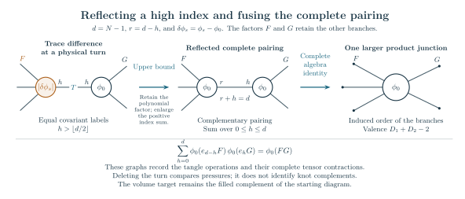
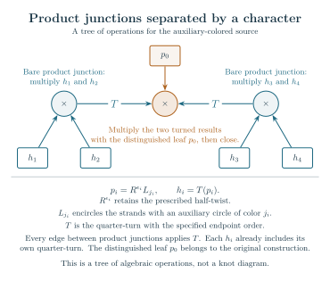

# Volume equalities: the families and the hypotheses

The results on this page compare a finite quantum invariant with the volume of the knot or link complement that the diagram actually constructs. For a knot $K$, the principal conclusion is

$$
\lim_{N\to\infty}\frac{2\pi}{N}\log|K_N(K)|
=\operatorname{Vol}(S^3\setminus K).
$$

Here \(K_N\) is the reduced Kashaev invariant at
\(q_N=e^{\pi i/N}\), with the unknot normalized to one and the framing
convention fixed in the theorem. The knot is held fixed while the
positive integer level \(N\) grows. The statements below include both even and odd levels unless a smaller scope is explicitly stated.

The planar construction below begins with a triangulated sphere and adds specified tangles to its planar diagram. Separate results give explicit twist and degree bounds for ordered tangle trees, as well as net-twist reductions preserving an existing knot. These hypotheses differ. Each section states the knot it constructs, the estimates it uses, and which parameters are held fixed.

For the basic diagram, color and filling conventions, begin with
[the first-reading chapter](starting.md). Three kinds of conclusions
occur below. A **full filled-invariant theorem** proves the displayed
limit for the resulting knot. An **augmented-link theorem** leaves its
crossing circles present and computes that larger complement's rate.
A **selected-contribution theorem** evaluates only the specified part
of an exact finite formula. The latter can be a completed theorem even
when the remaining part of the invariant has not been bounded.
The local identities and conditional estimates near the end of this
chapter are stated with those smaller conclusions.

## Decorating a planar diagram

The [planar decoration theorem](../../notes/actual_balanced_terminal_fan_volume.md)
starts from a more general diagram than a tree of tangle operations.
Its input can be given entirely by finite combinatorial data: take a
simple triangulation of the sphere with at least four vertices, and pair
its triangles across selected edges so that each triangle belongs to
exactly one pair. “Simple” means that there are no loops or repeated
edges. The cyclic orders belong to the sphere embedding.

Each paired pair of triangles specifies a crossing-circle tangle.
Contracting the pair gives a four-ended box; the other edges specify
the connections between boxes. Drawing the prescribed strands and
placing an auxiliary circle around each pair constructs an actual link
in the three-sphere. The proof gives a parity choice for the crossings
that makes the main strands one knot.

The theorem then adds finitely many terminal tangles on both sides of
each original box. Each side receives an even number, and the added
pieces have odd crossing parity. These insertions preserve the chosen
endpoint pairing and create no internal closed component. They usually
change the knot itself.

**Conclusion.** For each such decorated diagram there is a finite
threshold \(T\). Choose every original and added filling integer
\(p_e\) independently with \(|p_e|>T\), retaining the chosen half twist
\(\epsilon_e\), so that the signed number of crossings is
\(n_e=\epsilon_e-2p_e\). The resulting knot is hyperbolic and satisfies
the volume limit at the top of this page. Both signs and arbitrarily
different magnitudes are allowed. The diagram, decoration, and all
integers are fixed before \(N\) tends to infinity.

This covers arbitrarily large planar arrangements without a tree
hypothesis. It does not cover the unchanged core knot, arbitrary short
powers at the original boxes, or a diagram growing with \(N\). The
threshold may depend on the decorated diagram.

### How the number of added tangles is chosen

The proof first constructs the complete circle packing of the original
sphere by maximizing a strictly concave angle function. Normalize the
two circles beside the marked strand to parallel lines. Their curvatures
are zero; every other circle has positive curvature.

At one crossing circle, the two triangles have vertices
\((x,b,y)\) and \((x,c,y)\). Here the letters denote the curvatures of
the corresponding circles. The edge \(xy\) is the selected pairing edge,
and \(b,c\) are its opposite vertices. Put
\[
 A=x+y>0,\qquad P=xy.
\]
Inserting a circle in the first triangular gap replaces \(b\), as
seen from the retained crossing circle, by
\[
 b_1=b+A+2\sqrt{Ab+P}.
\]
The original circles remain in place. The new circle has curvature
\(b_1\); the new matching edge joins it to the old circle \(b\).

After \(j\) insertions on this side,
\[
 b_j=b+2j\sqrt{Ab+P}+j^2A.
\]
There is the same formula for \(c_k\) on the other side. Choose even
nonnegative \(j,k\) so that
\[
 U=\frac{\sqrt{Ab+P}}A+j,\qquad
 V=\frac{\sqrt{Ac+P}}A+k,\qquad
 U,V\ge4,\quad |U-V|\le1.
\]
Such a choice always exists: even increments let the two numbers be
brought within one, after which adding the same even increment makes
both large enough. Repeating this finite procedure at every original
crossing circle gives the required decoration.

### Why this proves an equality for the full invariant

The exact finite evaluation is a coefficient of a product of local
polynomials. All factors use the same face variables and the original
marked coefficient. The proof divides each local polynomial into three
explicit sums. One gives the geometric contribution. The two others
must be bounded on the entire spectral interval, including its
endpoints.

The required weight is explicit. For nonnegative curvatures
\(w=(w_1,w_2,w_3)=(x,b,y)\), with at least two positive entries, set
\[
 \Delta_w=\sqrt{w_1w_2+w_2w_3+w_3w_1},\qquad
 \alpha_i=\arctan(w_i/\Delta_w),
 \qquad
 \Lambda(t)=-\int_0^t\log|2\sin u|\,du.
\]
The angles satisfy \(\sum_i\alpha_i=\pi/2\). The
source-normalized triangle action is
\[
 F(w_1,w_2,w_3)=\frac1\pi\sum_{w_i>0}
 \left\{\Lambda(\alpha_i)+
        \Lambda\!\left(\frac\pi2-\alpha_i\right)
        +\alpha_i\log w_i\right\}.
\]
If only one weight \(w_i\) is positive, define
\(F(w)=\tfrac12\log w_i\). A triangle with all weights zero does not
occur at a crossing region in this marked simple-sphere construction.
This is the function denoted \(Q(w)=Q_b(0)\) in the
[triangle-action theorem](../../notes/actual_triangle_entropy_algebraic_balance.md),
§1, with the explicit evaluation in the
[shared-radius theorem](../../notes/general_anchored_shared_radius_filling_volume.md),
§5. It is the limiting logarithmic growth, divided by \(N\), of the
positive triangle polynomial evaluated at these weights. In particular
\(F(tw)=F(w)+\tfrac12\log t\); its additive constant is fixed by the
finite source.

The name *triangle action* refers to this weighted source expression,
not to a separately inserted component of the link. At a crossing
circle the condition needed for the two one-sided sums is
\[
 F(x,b,y)+F(x,c,y)>\log b,\qquad
 F(x,b,y)+F(x,c,y)>\log c,
\]
with a condition omitted when its middle curvature is zero. At a zero
middle the corresponding finite sum vanishes exactly.

The two-sided construction proves these strict inequalities at every
retained crossing circle. Every newly added circle satisfies them as
well. Because the packing is shared by the entire diagram, the local
losses combine into a bound for the original coefficient, including all
its coupled summation variables. The complete Fourier calculation
then retains all charges and boundary terms and proves a nonzero
geometric leading term. The remainder is exponentially smaller for
sufficiently long fixed twists.

The value of that leading term is identified geometrically. Its
peripheral equations use the actual crossing disks and their primitive
meridians. The unit Fourier charge gives angular period \(2\pi\), so
each auxiliary end completes to a smooth solid torus on the prescribed
filling slope. The main cusp remains complete. The regulator’s
boundary correction cancels the filling terms, leaving precisely
\(\operatorname{Vol}(S^3\setminus K)\).

The finite checks replay the recurrence, rational gap bound, oriented
triangle subdivision, parity extension, and endpoint pairing. The
written proof supplies the uniform estimates and metric completion;
those conclusions are not inferred from numerical examples.

## One twist threshold for arbitrarily many tangles

For the ordered circle-tree construction below, with at least one
edge, the
[directed subtree theorem](../../notes/actual_all_circle_directed_volume.md)
gives a sufficient twist threshold independent of the number of
pieces, their nesting depth, and the vertex degrees:
\[
                         |n_v|\ge2^{27}
\]
at every vertex. Here \(n_v\) is the signed number of half-twists
in the braid at vertex \(v\). Its sign is arbitrary. The original
strand pairing must form one knot and must have no extra component
closed inside an intermediate tangle.

Under these conditions the original knot complement is hyperbolic
and its reduced Kashaev invariant has the volume limit at the top
of this page, through both even and odd levels. The theorem also
gives the normalized meridian profile for
\(M=e^{\pi i s/N}\) on every fixed parameter disk \(|s|\le R<1\).
Thus the meridian itself moves on a scale \(1/N\); the full formula
appears [below](#the-volume-limit-while-the-meridian-varies). Fix the whole tree and every twist integer before
letting \(N\) tend to infinity. The theorem does not allow the
diagram or its powers to grow with the quantum level.

Let \(d_v\) count the tree edges incident to \(v\). A more flexible
consequence permits the choice
\[
              \boxed{|n_v|\ge2^{27}\quad\text{or}\quad d_v\ge2^{28}}
\]
independently at each vertex. Vertices meeting the degree bound
may carry any fixed signed power, including zero. These are
conservative sufficient constants. The full theorem states a
finite criterion with separate bounds at each subtree, and can
certify additional diagrams outside the displayed alternatives.

This also gives a precise construction with arbitrary prescribed
short powers. Begin with a fixed ordered circle-tree core whose
original strand pairing closes to a knot and has no internal
closed component. Keep every core power. At an actual product
slot beside each core braid, insert a consecutive even stack of
\(B\ge2^{28}\) terminal pieces. Give every added piece an odd
power of magnitude at least \(2^{27}+1\). A turned odd braid has
diagonal endpoint pairing; an even stack has the pairing of two
straight strands. Thus the insertion preserves the original
component count. Every core vertex meets the degree bound and
every added leaf meets the twist bound.

The resulting knot has the proved volume limit. Its knot type
generally differs from that of the core: preserving endpoint
pairing is not an isotopy deleting the new tangles. The number
attached at each core vertex need not increase with the number
of core vertices, but the entire enlarged construction is fixed before
the limit is taken.

Here is why a local criterion can suffice. Evaluate a subtree
while leaving its attaching angle \(u\) free. Its exact finite
evaluation is an even trigonometric polynomial \(M_{v,N}(u)\)
of degree at most \(N-1\), regardless of the subtree's size.
The proof establishes \(M_{v,N}(0)\ne0\), then bounds the ratio
\(M_{v,N}(u)/M_{v,N}(0)\) on real angles and a complex rectangle.
The denominator is the subtree's own exact value, including
all phases. At the next vertex the error is compared with the
new filling contribution at that vertex.

The triangles abbreviate subtrees. The angle \(u\) is retained,
while the trace acts on \(t\). The proof keeps high indices,
derivatives at repeated spectral points, and the boundary terms
of the finite Fourier transform. Separate decay bounds may be
assigned to different outgoing subtrees. The final vertex needs
no outgoing bound, since there is no further attaching variable.
Choosing that vertex changes only the order of a finite tensor
contraction; it does not change the physical tangle or its framing.

The selected critical point solves the same equations as the
positive deformation of the original octahedral pieces. The
primitive filling periods produce cone angle \(2\pi\), hence a
smooth metric on the original knot complement. The volume
constant is fixed at the complete augmented link. Both this
geometric identification and noncancellation in the finite
invariant are part of the theorem.

The earlier [local criterion](../../notes/actual_all_circle_local_message_volume.md),
\(\max_v d_v/(d_v^2+n_v^2)\le2^{-120}\), remains a valid included
result. The summed condition below is a useful alternative and
can give a smaller numerical bound for an individual diagram.
None of these tests includes every short-twist knot.

## An explicit bound that also permits some short twists

There is a numerical criterion for a second, precisely specified
construction. Take any finite ordered tree with at least one edge.
At each vertex place an integer two-strand braid. Stack the turned
child tangles on their prescribed sides of that braid, and use a
terminal vertex for the cylindrical closure. The order and turns are
part of the diagram. Following all strands must give one knot, without
an additional component closed inside a tangle.

To describe its geometry, replace each integer braid by a crossing
circle and retain its parity as a half twist. Every junction in this
tree has such a circle. Let \(d_v\) be its number of incident tree
edges and \(n_v\) its signed number of half-twists. The
[quantitative theorem](../../notes/actual_all_circle_quantitative_volume.md)
proves that

\[
 \sum_v\frac{d_v}{d_v^2+n_v^2}\le2^{-25}
\]

implies hyperbolicity and the Kashaev volume limit for the original
knot complement. The whole tree and all integers are fixed before
\(N\) tends to infinity. Both parities of \(N\) are included. The same
theorem gives the uniform meridian profile on \(M=e^{\pi i s/N}\),
\(|s|\le R<1\), with the first correction determined by the preferred
cusp shape.

This bound has two useful consequences. If the tree has \(E\) edges,
then \(|n_v|\ge8192\sqrt E\) at every vertex suffices. Short powers are
also possible: start with any ordered tree on \(m\) vertices, with any
fixed powers, and attach \(B\) terminal circles to each vertex. If the
added powers have magnitudes at least \(B\), the sum is less than
\(2m/B\). Hence \(B\ge2^{26}m\) suffices, provided the resulting strand
pairing is a knot. These very large constants make the result explicit;
they are not proposed as sharp thresholds. Attaching terminal
circles generally changes the knot; this statement concerns
the resulting diagram. The preceding even-stack construction
gives a separate way to preserve a chosen core's endpoint pairing.

A product junction without a braid can be represented by the identity
braid \(R^0\). Adding its crossing circle changes the augmented link;
filling it on the specified zero-twist slope recovers the original
diagram. Its contribution to the criterion is \(1/d_v\). This can
help at a high-degree junction, but does not give a free way to remove
the numerical hypothesis.

The volume identification is proved under the same inequality. The
actual augmented exterior has two octahedra per tree edge. Their
positive deformations keep the original primitive filling curves;
the final cone angle is exactly \(2\pi\), so the filled metric is
smooth. The boundary-corrected action equals its volume, with the
constant fixed at the complete augmented link. The finite-sum proof
then supplies the nonzero contribution and bounds every competing
region. Neither of these two arguments is left as a hypothesis.

This theorem does not cover arbitrary short-twist arborescent knots.
The following long-net-twist theorem covers other presentations and
allows junctions without crossing circles without the displayed
degree condition.

## Arbitrarily many tangles with sufficiently long net twists

Fix an ordered construction from two-strand twist boxes, quarter-turns and stacking, followed by the cylindrical closure of a product of two boxes. Each original twist box has its own integer $n_i$. The number of boxes and the depth of their nesting may be arbitrary, but remain fixed in the theorem.

The [net-twist theorem](../../notes/actual_conway_net_twist_volume.md) gives a finite reduction of this construction. It partitions the original boxes into disjoint groups $B_1,\ldots,B_s$ and assigns each surviving box the sum

$$
W_j=\sum_{i\in B_j}n_i.
$$

The groups depend on the written construction, before the integers are chosen. Moving a twist box past another tangle can rotate that tangle through a half-turn. The reduction records these rotations. Thus the ordered output may depend on the parities of the integers, although the groups and their sums do not.

The output is either a strict presentation of the kind described in the next section, or the closure of a single two-strand braid. The second possibility gives a torus link or knot and is excluded from the hyperbolic conclusion. In the first case, there is a finite threshold $B$ depending on the original construction such that

$$
|W_j|>B\qquad(1\le j\le s)
$$

implies the volume equality above whenever the actual closed link is a knot. The reduction and the type of its output are determined before taking a quantum limit. The twist integers are then fixed, and $N$ tends to infinity through all integer levels. The threshold is uniform over the finitely many parity choices; the magnitudes of the different sums need not be comparable.

For example, let $h(c)$ be a quarter-turned box with $c$ half-twists, and consider

$$
C\bigl(R^a h(c)R^b h(d)\bigr).
$$

Here $R^a$ and $R^b$ are integral braid boxes in the same stack. They can be brought together and replaced by $R^{a+b}$. The standard rational box $h(c)$ is preserved by the half-turn needed during this move. The reduced closing expression has one integral box and the two ordinary boxes $h(c),h(d)$, so it passes the strict test. Its size conditions concern $|a+b|$, $|c|$ and $|d|$. Replacing $a,b$ by $a+2m,b-2m$ leaves the knot and the sum $a+b$ unchanged, even though both written magnitudes can become arbitrarily large. This is why the theorem uses net twists.

The knot condition concerns all strands, including any circles already closed inside an intermediate box. Checking only the pairing of its four exposed endpoints can miss such a component. The proof retains the component count. A one-component closed link has no internal closed circle, because that circle would remain separate from the component formed by closing the remaining arcs.

The reduction is an ambient isotopy of the filled link. It therefore preserves the reduced invariant at every level and identifies the knot exteriors. Applying the strict theorem to the output supplies a complete hyperbolic metric; pulling that metric back to the original exterior gives exactly the volume in the equality. The argument compares the filled knots. Their auxiliary augmented links need not be the same.

This gives a theorem for arbitrary fixed ordered cylindrical compositions with sufficiently long net twists, subject to the knot condition and the elementary exception. It does not prove the conjecture for every short-twist arborescent knot. The following extension handles cap closures and exact cancellations explicitly.

## Cap closures and exact cancellations

A cap closure joins the two upper endpoints to each other and the two lower endpoints to each other. Write it as $D(E)=C(TE)$. Unlike a cylindrical closure, a cap closure of a stack can split along a sphere meeting the link in two points:

$$
D(FG)=D(F)\mathbin{\#}D(G).
$$

The two pieces are joined along the components containing the cut arcs. If the input is a knot, both pieces must be knots. A zero twist can expose this operation: the quarter-turn of the zero braid is a cup and a cap, so $C(h(0)Q)=D(Q)$.

The [arbitrary-closure theorem](../../notes/actual_conway_arbitrary_closure_volume.md) repeatedly makes these cuts, combines twists, and removes zero sums. It retains all components and all labels. Its terminal factors are strict presentations, two-strand torus braid closures, or explicit unknots. Every surviving strict weight is still a sum of a disjoint group of original integers. The groups can now change when a sum vanishes. There are only finitely many possibilities for a fixed expression, so one threshold covers them all.

Suppose the original knot is hyperbolic and every surviving strict weight exceeds this threshold in absolute value. Then there is exactly one strict factor, and all other factors are unknots. To see why, take a meridian in each nontrivial factor. Both a hyperbolic factor and a torus-knot factor contain another commuting element outside the cyclic meridian subgroup. Two such factors would produce two elements which commute with the common meridian but not with each other. In a complete hyperbolic knot group this is impossible: the centralizer of a nontrivial parabolic consists of commuting translations. A sole torus factor is excluded by its nontrivial center.

Removing the unknot summands now gives an actual isotopy to the long strict knot. This proves the volume equality for the original complement, as well as the same pointed quantum A-period and Gram limits. It is a broader test for presentations of already covered knot types; the analytic theorem for the strict factor is unchanged.

An optional sufficient condition is especially simple. For every nonempty set $B$ of original boxes, require

$$
\sum_{i\in B}n_i=0
\quad\text{or}\quad
\left|\sum_{i\in B}n_i\right|>B_E.
$$

Then every hyperbolic knot from the chosen expression satisfies the volume equality. In particular, for a fixed integer vector $a$, take $n_i=t a_i$. Every nonzero subset sum has magnitude at least $|t|$, so the conclusion applies to the hyperbolic knots obtained when $|t|>B_E$. The integer $t$ is fixed before $N$ grows. A given ray need not contain hyperbolic knots: the terminal factors determine that topological question.

One can also avoid assuming hyperbolicity in advance. Under the longness condition and the one-component test, the input is hyperbolic exactly when the reduction contains one strict factor and all others are unknots. The elementary factors are explicit: $D(R^s)$ is always an unknot, and the knot $C(R^s)$ is an unknot exactly for $s=\pm1$. The proof supplies a finite criterion; it does not supply numerical values for the analytic thresholds.

## Every strict Conway composition tree

Begin with two strands carrying $n_i$ signed half-twists, denoted by $R^{n_i}$. Turn the box through a quarter-turn $T$ to obtain the basic piece $h_i(n_i)=T(R^{n_i})$. The subscript distinguishes the pieces; their integers are independent. Ordered multiplication $FG$ stacks two boxes, and $C(FG)$ is the prescribed cylindrical closure of their remaining endpoints. The endpoint order, the turns and the closing convention are part of the presentation.

The [strict-tree theorem](../../notes/actual_conway_all_strict_tree_long_twist_volume.md) applies to any fixed expression of this form that passes a finite recursive test. The labels in the test describe possible normalized output states of an open box:

| Label | Interval of strict output states |
| --- | --- |
| L | $(0,1/2)$ |
| H | $(1/2,1)$ |
| A | $(0,1)$ |

An output state is the limiting value of an internal Newton index
divided by \(N\). Its interval describes the strictly feasible
geometric states at the exposed boundary of the box. These indices
are summed in the invariant; they are not crossing numbers. Every basic piece starts with label L. A quarter-turn exchanges L and H and leaves A unchanged. At a stack, LL, LA and AA give A, while HL and HA give H; either input order is allowed. HH has no strict state. At the final closure the pair must be AA, AL, AH or LH, in either order. The compiler proves that these rules are equivalent to strict feasibility of the state constraints, rather than merely necessary tests.

For example, each stack of two basic pieces has label A, and closing two such stacks passes. Closing only $h_1h_2$ has root pair LL and fails. A failed test says that this theorem does not apply to that presentation; it is not a counterexample to the volume conjecture.

For every passing presentation $\tau$, there is a finite threshold $B(\tau)$. Choose integers with $|n_i|>B(\tau)$, with either sign and with no restriction on their relative sizes. Follow the strands to check that the resulting endpoint pairing has one component and no internal closed component. Then the resulting knot is hyperbolic and has the volume limit above. The entire presentation and every twist integer are fixed before $N$ tends to infinity. The threshold may depend on the whole tree.

The proof uses auxiliary circles around the twist regions. Filling these circles inserts the chosen twists. All auxiliary circles are filled in the knot conclusion; the knot cusp remains unfilled. Thus the right side is the knot complement volume, not the complete augmented-link volume and not the volume of a closed three-manifold.

The estimate for a general tree must preserve cancellation across large internal components. The [positive probe bound](../../notes/actual_conway_unflagged_core_probe_bound.md) controls such a component without changing its coefficient targets. The [spectral propagation theorem](../../notes/actual_conway_mixed_core_spectral_propagation.md) carries strict losses in the physical color variables through it. The [geometric comparison](../../notes/actual_conway_unflagged_probe_geometry.md) identifies the exponential constants with the action of the original cells. These estimates restore the full signed source from its nonzero local geometric contribution.

The [pointed quantum A-period corollary](../../notes/actual_conway_pointed_quantum_a_volume.md) gives an operator formulation of the same result. A genuine recurrence for the ADO invariant, together with finite initial data, selects the knot's solution. At singular steps it retains a bounded number of derivatives in the quantum parameter. The resulting signed scalar period is exactly the Kashaev invariant and therefore has the same volume limit. This is a statement about that selected scalar, not about a matrix norm or a sum of absolute values.

The same corollary applies to the net-twist theorem: the normalized presentation constructs the same knot and hence the same selected invariant. No equality of two presentation-dependent recurrence operators is required.

## A meridian profile and cusp shape for the figure-eight knot

The complete value is one member of a polynomial family. Fix
$q_N=e^{\pi i/N}$ and let $f_N(Y)$ be the reduced ADO invariant of
the figure-eight knot, where $Y=M^2$ is the squared meridian
eigenvalue. Then $f_N(1)=K_N(4_1)$. Moving to $Y=e^{z/N}$ keeps the
meridian close to completeness while allowing any fixed complex $z$.
The [profile theorem](../../notes/actual_paired_factor_meridian_profile.md)
proves

$$
\frac{f_N(e^{z/N})}{K_N(4_1)}
\longrightarrow \frac{2\sinh(z/2)}z
$$

uniformly on compact sets, with every fixed derivative. The value
at $z=0$ is understood by continuity.

To remove the ordinary-color values, let $P_N^{\mathrm{ord}}$ be
their unique interpolating polynomial of degree at most $N-2$, and put

$$
R_N(Y)=\frac{f_N(Y)-P_N^{\mathrm{ord}}(Y)}
                  {1+Y+\cdots+Y^{N-1}},\qquad
\rho_N(z)=e^{(N-1)z/(2N)}
          \frac{N R_N(e^{z/N})}{K_N(4_1)}.
$$

The quotient $R_N$ is a Laurent polynomial. Its profile satisfies
$\rho_N=1+O(N^{-1})$ on every fixed compact set, including the
ordinary-color resonances $z=2\pi i k$. Moreover,

$$
N(\rho_N(z)-1)\longrightarrow\frac{\tau}{8\pi i}z^2,
\qquad \tau=2\sqrt3\,i.
$$

The number $\tau$ is the oriented cusp shape for the preferred
meridian and longitude of the figure-eight complement. The proof
computes it from those two group elements and matches it with the
coefficient obtained independently from the finite sum.
It also gives the uniform volume limit
$(2\pi/N)\log|R_N(e^{z/N})|\to\operatorname{Vol}(S^3\setminus4_1)$
on every such compact set.

The passage through ordinary-color resonances in this form is a result
for the figure-eight knot. The Conway theorem below gives a moving-meridian
profile and a preferred-cusp correction on a smaller disk, before those resonances.

## The volume limit while the meridian varies

The reduced ADO invariant is a Laurent polynomial in a meridian parameter, with Kashaev's invariant as its value at completeness. Write this polynomial as $F_N(M)$, in the zero-framing convention with unknot value one. Thus $F_N(1)=K_N(K)$. The [moving-meridian theorem](../../notes/actual_main_meridian_filled_volume.md) proves a uniform volume limit and a nonzero profile for **every fixed strict Conway tree** with independently sufficiently long signed twists.

The strictness test is the one defined above. There is no further restriction on the size, valence or adjacency of its multiplication junctions. To describe the proof, group consecutive multiplications with no quarter-turn between them into one junction. A junction carrying an original crossing-circle operator is a circle junction; one with no such operator is bare. A connected group of bare junctions can have any fixed finite tree shape. A product with many branches is treated as a whole product, with its actual turns and branch order retained.

The [general component comparison](../../notes/actual_main_meridian_general_component_comparison.md) controls the cancellations in each such group. The quantum calculation uses a finite polynomial basis with indices $0,\ldots,N-1$. Moving the meridian changes some multiplication traces. The proof first separates each trace into its complete value and its difference from that value. It estimates the entire difference, rather than taking the absolute value of every local crossing term.

An index is called high when it exceeds $\lfloor(N-1)/2\rfloor$. With one high index $h$, the [Fourier estimate](../../notes/actual_main_meridian_high_fourier_reflection.md) bounds the trace difference by a complete tensor with that index reflected to $N-1-h$. The reflected pairing joins the two neighboring products into one larger product in a positive comparison tree. A [coupled pressure inequality](../../notes/actual_main_meridian_component_pressure.md) shows that deleting these turns cannot increase the maximum exponential rate. It retains the correlations between every remaining branch. With several high indices, a separate half-label comparison gives a boundary state of the same positive calculation. Strict Fourier and boundary estimates then make the total correction exponentially smaller than the original leading rate.

Here $d=N-1$, $h$ is a high summation index, and $r=d-h$. The letter $h$ in this figure is an index, not a twist number or a basic tangle. The symbols $\phi_s$ and $\phi_0$ denote the moving and complete polynomial traces; $F$ and $G$ retain the other branches. The first arrow is an upper bound for their difference. In the middle, the two indices are complementary, so summing them gives the exact complete-algebra identity shown below the drawing. The five exposed arms illustrate the branches left after this fusion, in their induced order.

This is a tree of quantum operations, not a knot diagram. The comparison does not assert that deleting a turn preserves a knot. The invariant keeps the original deformed edge factors, colors and framing, and the geometric conclusion still concerns the original knot complement.

Earlier proofs covered separated bare junctions, arbitrary trivalent components, and components satisfying a path inequality. Those remain included cases, with their original proofs in the [source-bound note](../../notes/actual_main_meridian_source_bounds.md), [trivalent extension](../../notes/actual_main_meridian_trivalent_filled_volume.md), and [path estimate](../../notes/actual_main_meridian_component_extension.md). They are no longer additional conditions on the moving-meridian theorem.

The unfilled vertices in this earlier illustration each have three incident branches; the filled vertices carry original crossing-circle operators. The general theorem also permits larger bare junctions and arbitrary adjacency between them. It uses the actual reduced operation tree, without replacing a physical turn by an artificial edge.

Restore the twists by filling all auxiliary crossing circles. There is a threshold depending on the fixed presentation such that every choice of signed crossing powers \(n_i\) above that threshold in absolute value gives the following conclusion, provided the resulting diagram is a knot. The powers have their prescribed parities, may have either sign, and need not have comparable sizes. Fix them before taking the limit.

Put \(q_N=e^{\pi i/N}\) and let \(M=q_N^s\). For every fixed \(R<1\),

\[
\sup_{|s|\le R}
\left|
 \frac{2\pi}{N}\log|F_N(q_N^s)|
 -\operatorname{Vol}(S^3\setminus K)
\right|\longrightarrow0.
\]

Both even and odd levels are included. This is uniform at every meridian in the indicated disk, and the invariant is nonzero there for all sufficiently large levels. The disk has radius of order \(1/N\) in the \(M\)-coordinate. The twist threshold does not depend on \(R\), although the required starting level may.

The proof gives more than logarithmic growth. The original crossing and framing factors have an exact combined value:
\[
 A_N(s)=q_N^{a(D)s^2/2},\qquad
 a(D)=-w(D)-\sum_i n_i.
\]
Here \(w(D)\) is the oriented writhe, and each \(n_i\) is the signed crossing power in its original braid box. The [scalar calculation](../../notes/actual_main_meridian_exact_scalar.md) derives this from the finite tangle operations. Then

\[
\frac{F_N(q_N^s)}{F_N(1)A_N(s)}
 =\frac{\sin\pi s}{N\sin(\pi s/N)}
       \bigl(1+O(N^{-1})\bigr),
\]

with the value one assigned to the sine quotient at \(s=0\). Since \(A_N(s)\) tends uniformly to one, the reduced ratio \(F_N(q_N^s)/F_N(1)\) itself tends to \(\sin(\pi s)/(\pi s)\). The scalar still contributes to the first correction below.

The main analytic issue is cancellation after the twists are restored. The proof expresses the actual crossing powers by Fourier integrals and compares all Fourier indices at a common critical point. This matters when the twist sizes are very different: a small error controlled for one crossing cannot simply be compared with the total change in volume. The joint comparison proves that the first Fourier term has a nonzero coefficient and that all remaining terms have a smaller exponential rate. Thus it supplies the lower bound as well as the upper bound.

The geometric calculation then identifies the critical action with the marked Dehn-filling action of the original augmented complement. The peripheral equation uses the primitive filling curve, with one full angular turn. The resulting solid tori fill the auxiliary crossing-circle cusps; the knot cusp remains complete and unfilled. The volume in the formula is therefore the volume of the actual knot complement.

The first correction records the shape of the knot cusp. A horospherical cross-section is a Euclidean torus. Choose its coordinate so that the meridian translates by one, and write \(\tau_K\) for the translation of the preferred longitude, the curve with zero linking number with the knot. With
\[
 H_N(s)=\frac{\sin\pi s}{N\sin(\pi s/N)},
\]
the result is
\[
 \frac{F_N(q_N^s)}{F_N(1)H_N(s)}
 =1+\frac{\pi i s^2\tau_K}{2N}+O(N^{-2}).
\]
The [geometric proof](../../notes/actual_main_meridian_preferred_cusp.md) computes this longitude from the original face identifications and corrects its marking after surgery on the crossing circles. It does not infer the cusp shape from the asymptotic formula. The full modified-trace invariant has exactly the displayed normalized profile because its modified dimension cancels \(H_N\).

The [full geometric longitude identity](../../notes/actual_strict_tree_geometric_characteristic.md) and this asymptotic apply to the same strict-tree class under the stated long-twist hypotheses. They identify the selected classical geometric factor even with arbitrary bare junctions. Passage through $s=\pm1$, the first ordinary-color resonances, remains open for the general strict-tree profile. The construction and twists cannot grow with $N$. Short surviving twists need a separate sufficient theorem, such as the numerical circle-tree criteria above.

The [intrinsic transfer under tangle reduction](../../notes/actual_main_meridian_filled_volume.md#net-twists-and-other-conway-closures) gives the same uniform volume limit, nonvanishing and preferred-cusp expansion for the net-twist and arbitrary-closure presentations described earlier. For a cylindrical input, its reduction must give a strict knot with sufficiently long surviving net twists. For either cylindrical or cap closure with zero sums, the input must satisfy the closure theorem: a hyperbolic input with sufficiently long surviving strict weights reduces to one strict knot factor and unknot factors. The reduction is an actual ambient isotopy after those unknot factors are removed.

This transfers the whole Laurent family $F_N(M)$ with its transported orientation and zero framing, not just the complete value $F_N(1)$. The meridian and preferred zero-linking longitude are transported as well, so the knot volume and $\tau_K$ agree. A single threshold covers the finitely many parity and zero-sum outcomes of a fixed input expression. The presentation-dependent scalar $A_N(s)$ can be computed on the strict representative; no equality of the two auxiliary augmented complements or their raw scalar ledgers is needed.

## Source growth near the complete main meridian

Before filling the crossing circles, the [general component comparison](../../notes/actual_main_meridian_general_component_comparison.md) also extends the [source-growth theorem](../../notes/actual_main_meridian_source_bounds.md) to every fixed strict Conway tree. The auxiliary colors can vary independently over their entire finite ranges. Bare product junctions may be adjacent and may have any allowed fixed valence; the original strictness and component conditions remain.

Let $Y^\epsilon$ be the augmented complement with all crossing circles unfilled, and let $\mathcal F_{N,\mathbf j}^{\epsilon}(M)$ be its reduced quantum scalar with colors $\mathbf j=(j_1,\ldots,j_H)$, $1\le j_i\le N$, and the specified retained half-twists. For $M=q_N^s$, $q_N=e^{\pi i/N}$, and every fixed $0\le R<1$,

\[
\lim_{N\to\infty}\frac{2\pi}{N}
 \log\sup_{\substack{|s|\le R\\\mathbf j\in\{1,\ldots,N\}^{H}}}
 \bigl|\mathcal F_{N,\mathbf j}^{\epsilon}(q_N^s)\bigr|
 =\operatorname{Vol}(Y^\epsilon).
\]

Both parities are included. The upper bound controls every color tuple and every meridian in the disk, with the original strand orientations and framing retained. The matching lower bound uses the nonzero complete value $s=0$, $j_i=N$. Thus the supremum is essential: this statement is not a lower bound at each displaced meridian. For two original pieces, the theorem retains the knot-producing half-twist patterns and their pure-leaf condition.

The [auxiliary-color gap theorem](../../notes/actual_main_meridian_auxiliary_color_gap.md), with the same general component comparison, gives a strict exponential loss if any original color stays a fixed proportion below completeness. If $j_i\le(1-\delta)N$ for some $i$, with fixed $0<\delta<1$, the whole scalar is bounded by \(\exp N(F_0-\gamma)\), where \(F_0=\operatorname{Vol}(Y^\epsilon)/(2\pi)\) and \(\gamma>0\). The estimate is uniform in the other colors and both parities for \(|s|\le R<1/2\). The smaller radius belongs to this color-loss estimate; the source-growth bound holds for \(R<1\).

This drawing illustrates the earlier separated-junction case. Each outer pair is multiplied, its result is turned, and the two results are multiplied with the operator at the middle junction. The current theorem also permits adjacent bare junctions. The full-component comparison supplies the estimate needed there, while retaining the actual constants of the neighboring branches.

These estimates concern the source before the crossing circles are filled. Their volume is the augmented volume. The filled-knot theorem additionally needs the exact crossing-power trace, the complex asymptotic of the original finite wire sum, and the joint comparison of Fourier indices. Those steps give the generally smaller volume of the filled knot complement.

## An exact calculation for oriented tangles at a varying meridian

There is also a general finite result, independent of any
large-twist assumption. The [oriented tangle theorem](../../notes/actual_main_meridian_newton_compiler.md)
expresses every fixed Conway construction using its actual strand
colors, turns, products and primitive closing trace. It retains the
dual color on a reversed strand and all repeated-root information.
The Newton coordinate changes and their inverses have polynomial
bounds in \(N\) when the displacement \(s\), defined by \(M=q_N^s\),
stays in a fixed compact set.

The [quarter-turn theorem](../../notes/actual_main_meridian_turn_comparison.md)
now computes the physical turn itself, with the dual strand colors
and the braiding that identifies their two orders retained. In fixed
polynomial coordinates it sends the input Newton coefficient with
index \(n\) to index \(N-1-n\), multiplied by
\[
\frac{W_n(s)}{H_N(s)},\qquad
W_n(s)=\prod_{r=1}^n
 \left(1-\frac{\sin^2(\pi s/N)}{\sin^2(\pi r/N)}\right),
\qquad H_N(s)=\frac{\sin(\pi s)}{N\sin(\pi s/N)},
\]
with one additional scalar \(1\) or \(q_N^{\pm s^2/2}\), determined
by the strand orientations. The factors and their inverses are
uniformly bounded for every fixed \(|s|\le R<1\). On
\(|s|\le1/16\), the norm recording all Casimir-node values and
repeated-node first derivatives is comparable to that of the
complete turn of the same input, with factors at most \(CN^7\).
The proof includes the repeated channels and the normalization of
the actual evaluation and coevaluation maps.

The accompanying [multiplication theorem](../../notes/actual_main_meridian_newton_multiplication.md)
gives every coefficient explicitly. It includes the products with
\(i+j\ge N\), where \(i,j\) are Newton basis indices. These products
vanish at completeness but generally become nonzero when \(s\)
moves. Their signs and interior exponential rates are determined
by the formula. Their nonzero first derivatives come entirely from
the moving basis: in fixed polynomial coordinates multiplication
has zero first derivative at completeness. In those coordinates,
multiplication by the Casimir changes by a single matrix entry.

These local identities are inputs to the source-growth theorem just stated. The general component proof keeps the signed whole-junction traces, separates their differences from the complete tensors, and compares the resulting entire trees while retaining the original geometric constants. A turn norm by itself would not supply this whole-sum comparison, and polynomial control of node derivatives does not automatically preserve angular localization. The
[operator criterion](../../notes/actual_main_meridian_finite_matrix_criterion.md)
provides another precise sufficient condition: uniform bounds for
the reconstruction frame and a lower singular-value bound for a
linear system of bounded size. Under those conditions, an already
proved complete volume limit extends uniformly to a small
microscopic meridian disk. The conditions have not yet been proved
for a general Conway family.

## Included tree families and the manuscript

The [weighted-tree theorem](../../notes/actual_conway_weighted_tree_long_twist_volume.md) supplies an explicit construction with one independent integer per vertex, arbitrary fixed branching, and chains of vertices. Its literal closure is specified in the theorem. If $H$ is the number of basic pieces and $v_{\mathrm{oct}}$ the volume of a regular ideal octahedron, its complete augmented exterior has volume $2v_{\mathrm{oct}}(H-1)$. The knot volume is the separately calibrated value after filling; it is not replaced by that complete volume.

The [manuscript](manuscript.md) treats an earlier included family. Start with two-piece stacks, then allow turns, stacks of constructed boxes, and the attachment of one basic piece on either side. The technical name “completed box” refers to this recursive class. Close a stack of two such boxes. The paper gives the detailed proof for that class; the strict-tree theorem extends it to all expressions passing the test above.

Isolated closures $C(h_1\cdots h_s)$ with $s\ge3$ and the proved root-star constructions are included in the later results. The isolated two-piece closure $C(h_1h_2)$ is not added as a limiting case: it fails the strict root test. The [prior-source comparison](../../notes/actual_conway_root_star_prior_source_coverage.md) records overlap between root-star formulas, earlier Fourier cancellation, and the all-odd belt calculation. A scalar source identity alone is not a statement that two tangle diagrams are isotopic.

## An explicit full-invariant family at every width $k\geq2$

A $2k$-strand plat is a braid whose top and bottom endpoints are paired in the standard way. The [one-end layer theorem](../../notes/general_one_end_layer_long_filling_volume.md) gives a family with $3k-3$ twist regions for each fixed $k\ge2$. In standard braid notation, where $\sigma_j$ crosses strands $j$ and $j+1$, the word is

$$
\left(\prod_{j=1}^{k-1}\sigma_{2j}^{\alpha_j}\right)
\left(\prod_{j=1}^{k-1}\sigma_{2j+1}^{\beta_j}\right)
\left(\prod_{j=1}^{k-1}\sigma_{2j}^{\gamma_j}\right).
$$

Choose the first-layer exponents odd and the other two layers even. The endpoint pairing then gives a knot. For each fixed width and retained half-twist sign pattern, independently sufficiently large fixed full-twist magnitudes give the full Kashaev volume limit. Both level parities are included, and the twist magnitudes need not be comparable.

There is also a subfamily whose minimal bridge number is exactly $k$. Require every box exponent to be divisible by three, while retaining the odd/even pattern above. The [Fox-coloring certificate](../../notes/actual_fox_coloring_exact_plat_bridge.md) gives $3^k$ colorings, whereas a knot with $b$ bridges has at most $3^b$. This extra congruence proves the bridge lower bound; it is not needed for the volume theorem.

The geometric estimate is uniform in each fixed width. The circle-packing contact parameters satisfy

$$
(1+z_{j-1})(1-z_j^2)(1+z_{j+1})=1,
\qquad z_0=0,\quad z_{k-1}=1,
$$

at the interior indices $1\le j\le k-2$. A convex comparison argument and the exact seed $(2/3,4/5,2/3)$ give the required curvature bounds. The cases $k=2,3$ use their explicit small packings. The [zero-middle balance lemma](../../notes/actual_zero_middle_nine_quarter_balance.md) converts the bound $9/4$ into the source estimate needed for filling. This proves a family at each bridge number, not all knots of that bridge number. The [earlier reduced-layer family](../../notes/general_reduced_layer_long_filling_volume.md) remains a separate special case.

## Independent tangle depth at every initial bridge gap

The [simultaneous bridge-gap theorem](../../notes/general_simultaneous_bridge_gap_filling_volume.md) permits an independent fixed depth $m_j\ge0$ at each first-layer bridge gap. In the theorem's zero-based slot convention, replace slot $2j-1$ by the alternating word

$$
(2j-1,2j)^{m_j}(2j-1),\qquad 1\le j\le k-1.
$$

The other two layers keep their order. The resulting diagram has

$$R=3k-3+2\sum_{j=1}^{k-1}m_j$$

twist regions. Each gets an independent sufficiently long fixed signed twist. Taking the new exponents even preserves the original knot parity; other parity choices are allowed when the endpoint permutation gives a knot. The threshold can depend on the entire depth vector. The mod-three condition again supplies the exact bridge number.

The inserted circles occupy disjoint empty gaps in the original packing. If the bounding curvatures are $A\le B$, the chain has $\sqrt{C_n}=\sqrt B+n\sqrt A$. The old disks stay fixed, and the same $9/4$ estimate proves balance at the new crossing regions. This explains why the construction works for arbitrary fixed depths, rather than only for a computed list of examples.

## Arbitrarily many twist regions at each fixed width

The [marked unit-chain theorem](../../notes/general_marked_unit_chain_filling_volume.md) is another extension operation. Its input is a balanced core whose first box is in zero-based slot 1, with no slot 0, and with the first cap marked. Prepending $(1,2)^m$ adds $2m$ boxes with independent even signed exponents. These boxes use the first four strands and preserve the knot parity.

Geometrically, the operation inserts unit disks into an empty region between the marked lines while leaving every old disk fixed. The new crossing regions satisfy balance, and the changed first region has a larger margin. Applied to the preceding core, this gives $3k-3+2m$ twist regions for every fixed $k\ge2$ and $m\ge0$. The threshold may depend on both parameters. This is a closure rule for the stated cores, not a theorem about arbitrary multilayer plats.

## A full filling theorem with a finite geometric hypothesis

For more general plats, a useful sufficient test is available from the complete circle packing. The diagram must carry the labeled convex ideal right-angled geometry used by its crossing-disk cut; “ideal” means that the vertices lie at infinity. The simple-white condition in the technical theorem is a finite condition on the diagram's white-face cellulation.

At a crossing region, denote the four face curvatures by $(x,b,c,y)$ and put $A=x+y>0$. Curvature is the reciprocal radius, with the marked line faces assigned zero. The [algebraic balance lemma](../../notes/actual_triangle_entropy_algebraic_balance.md) shows that

$$ (A+b)(A+c)\ge\max\{b^2,c^2\} $$

at every region is sufficient for the [complete-radius filling theorem](../../notes/general_complete_radius_balance_filling_volume.md). The stronger test $|b-c|\le x+y$ is often easier. Every region must use the same complete packing; choosing unrelated local radii would not establish the hypothesis.

The sharper form uses
\(Q_b(0)=F(x,b,y)\) and \(Q_c(0)=F(x,c,y)\), with \(F\) defined
[above](#why-this-proves-an-equality-for-the-full-invariant).
It compares their sum with \(\log b\) and \(\log c\) for positive
middle curvatures. It is this sharper test, proved by the zero-middle lemma, that covers the explicit every-width family; the simpler product inequality can fail there.

The proof first evaluates the [entire central filling sector](../../notes/general_all_cross_long_filling_volume.md), called the cross sector in the source decomposition. It then uses the [one-sided spectral estimate](../../notes/actual_global_left_weighted_spectral_envelope.md) to bound the complementary left and right sectors below it. All Fourier charges and endpoint terms are retained. Thus every passing fixed diagram has the full volume limit for independently sufficiently long signed twists. Universal validity of the geometric test is not asserted.

## The geometric contribution for an unchanged planar core

For a fixed diagram specified by a simple matched sphere, the
[general Morse theorem](../../notes/actual_morse_cross_filling_period.md)
evaluates the entire central recurrence-path contribution. Cups and
caps may occur between crossing regions; no flat-plat sweep or added
terminal tangle is assumed. Write \(I^{\mathrm C}_{N,\boldsymbol n}\)
for this specified part of the original finite evaluation. For
independently sufficiently long fixed signed powers of a knot-producing
parity, it is nonzero at all sufficiently large levels and satisfies
\[
 \lim_{N\to\infty}\frac{2\pi}{N}
       \log|I^{\mathrm C}_{N,\boldsymbol n}|
       =\operatorname{Vol}(S^3\setminus K_{\boldsymbol p}).
\]
The [geometric companion](../../notes/actual_morse_geometric_contribution.md)
constructs the labeled positive cells and follows the original primitive
filling curves to identify this volume. All Fourier charges and both
level parities are included in the asymptotic.

This is a theorem about a contribution, not a new invariant.
A full-invariant conclusion for an unchanged core still requires a
strict bound on its complementary polynomial. The balance and finite
shared-radius tests above and below are sufficient ways to provide
such a bound in their stated classes.

## A global source upper bound and the classification of its maxima

The remaining general-plat problem can be formulated on a finite-dimensional space of shared face loads. A *source* here means the exact finite polynomial or tensor expression for the invariant before its indices are summed. Each crossing-region factor supplies total normalized degree one; each ordinary face demands one, while the two marked faces demand zero. These shared constraints define a compact polytope $\mathcal P_D$ for the fixed diagram $D$.

At region \(e\), write
\(q_e=(q_{x_e},q_{b_e},q_{c_e},q_{y_e})\) for its nonnegative
normalized exponents; their sum is one. The letter \(q_e\) here is a
load vector, distinct from the root of unity \(q_N\). The spectral
coordinate \(\delta_e\) means \(\sigma_e=-2\cos(2\pi\delta_e)\).
The [closed-domain majorant](../../notes/research_global_sharp_coefficient_limsup_majorant.md)
assigns a continuous upper exponential rate \(H_{\delta_e}(q_e)\)
to that local coefficient. With \(R\) crossing regions, define the
number \(M_D\) by

$$M_D=\max_{q\in\mathcal P_D,\;\boldsymbol\delta\in[0,1/2]^R}
\sum_e H_{\delta_e}(q_e).$$

Here \(M_D\) is a rate bound, not a meridian coordinate. The shared
polynomial \(S_N\) is obtained by taking all ordinary face targets
\(N-1\) and both protected targets zero in the product of local
resolvent numerators. It satisfies
\(\sup_{\boldsymbol\delta}|S_N(\boldsymbol\delta)|
 \le e^{N(M_D+o(1))}\), uniformly through both parities and closed
degree boundaries. This is an upper bound, not a matching lower asymptotic.

On a diagram satisfying the geometric certificate, [boundary activation](../../notes/research_full_fiber_sharp_boundary_activation.md) and [stationary classification](../../notes/research_full_fiber_sharp_stationary_classification.md) restrict the possible maxima. The central, or cross, sector has both middle loads at most $1/2$. The left and right sectors overload one middle face. The remaining exceptional cap configurations meet the two marked zero faces. Common positive face weights are recovered at a maximum, and there are at most two such caps.

The [seam theorem](../../notes/research_sharp_cross_degree_domination_and_seam_gap.md) controls the boundary between these sectors. Let $\Phi_D$ be the complete geometric rate and let $a_D>0$ be the smallest deficit of a geometric middle load from $1/2$. Every seam-only flow has rate at most $\Phi_D-\gamma_D$, where $\gamma_D=\pi a_D^2/2$. A fixed seam neighborhood has the same kind of absolute gap, and its whole filling period is exponentially smaller than the nonzero cross period for sufficiently long fixed fillings.

Thus a competing non-cross maximum of value at least $\Phi_D$ must have a uniform positive overload. The [odd-cycle theorem](../../notes/research_stationary_noncross_main_cycle_obstruction.md) forces an incompatible phase cycle at such a region. This excludes a fully phase-coherent non-cross maximum, but does not quantify enough cancellation to prove a general volume bound. The [flat-cap example](../../notes/research_flat_cap_no_local_exponential_angular_gap.md) shows why a universal local exponential angular loss is false. Neither $M_D\le\Phi_D$ nor a general filling theorem follows from this classification alone.

## Phase cancellation on regular source windows

A *window* restricts the starting and ending rows of a local finite transfer. The [regular-window theorem](../../notes/research_regular_spectral_window_phase_exclusion.md) proves a strict exponential loss from phase mismatch when the weights are positive and the relevant maxima stay in the interior. The [positive two-state transfer](../../notes/research_positive_eta_word_transfer.md), [four-state identity](../../notes/research_original_one_sided_four_state_transfer.md), and [analytic switching estimate](../../notes/research_analytic_switching_suppression.md) retain the exact boundary terms needed for this conclusion. The direct diagonal path is present in the full source and is excluded only in the specified disjoint windows.

There are separate proofs when [one outer face](../../notes/research_protected_outer_window_phase_exclusion.md) or [one middle face](../../notes/research_protected_middle_window_phase_exclusion.md) is marked and has weight zero. These do not extend to two zero weights or pole-touching maxima. The [mixed-window theorem](../../notes/research_mixed_cross_window_cycle_packing.md) also allows complete cross factors, whose positive endpoint majorant has only logarithmic polynomial cost.

The [fractional cycle-packing criterion](../../notes/research_regular_window_cycle_packing.md) combines compatible local losses on the shared incidence graph. It gives a loss $e^{-\kappa N}$, with $\kappa>0$, relative to the specified positive majorant. To obtain a volume theorem one must still show that the majorant's rate minus $\kappa$ is below $\Phi_D$, and cover all source windows. A positive loss relative to an oversized upper bound is not by itself an absolute volume bound.

## From coefficient Cauchy to a shared volume inequality

The [one-sided energy theorem](../../notes/actual_one_sided_relative_spectral_energy.md) bounds every one-sided coefficient, uniformly over real spectra, degree boundaries and both parities. If $p_N(q)$ is the positive endpoint coefficient, its weighted Cauchy estimate controls the rate of $|a_N(q;\sigma)|^2/p_N(q)$ by a complete-triangle entropy. The proof uses a folded angle with the same distribution as the original angle and keeps all unused rows and the odd derivative reference.

The [shared-flow criterion](../../notes/general_endpoint_conditioned_source_energy.md) combines this energy bound $g$ with the endpoint entropy $h$ and an earlier envelope $h_{\mathrm{env}}$. It uses $h_{\mathrm{sharp}}=\min\{h_{\mathrm{env}},(h+g)/2\}$ on each common feasible flow. If the maximum of the sum of these bounds over the closed non-cross set is strictly below $\Phi_D$, the full long-filling theorem follows. This is a sufficient finite-dimensional condition, not a proved universal inequality. The [protected-outer result](../../notes/actual_protected_outer_spectral_energy.md) identifies the sharp local energy there; the unresolved issue is the global comparison with the original shared demands.

## A general finite cover of the source sectors

Fix a marked plat with the labeled geometric hypotheses of the finite-sector
cover theorem. A sector specifies which of the three disjoint recurrence-path
pieces is used at each crossing region. The full complement consists
of all sectors containing at least one one-sided piece. A finite cover
groups these actual sectors into finitely many branches; it does not
introduce a new decomposition of the knot.

For a branch, choose one positive weight \(L_f\) for every ordinary
face and keep the protected weights zero. If \(B_e(L)\) is a valid
weighted exponential bound for the allowed local pieces at region
\(e\), coefficient extraction gives the shared upper rate
\[
              \sum_e B_e(L)-\sum_{f\ \mathrm{ordinary}}\log L_f.
\]
The subtraction is the cost of the original face targets. The
[finite-sector cover theorem](../../notes/general_actual_sector_cover_filling_volume.md)
proves the full limit when every branch has a whole shared vector
making this rate strictly less than
\(\Phi_D=\operatorname{Vol}(Y_D)/(2\pi)\). Different branches may
use different vectors, but a face must use the same value at all its
occurrences within one bound. Since the cover is finite, its positive
gaps have a positive minimum.

The [anchored criterion](../../notes/general_anchored_shared_radius_filling_volume.md)
is a simpler instance: specify one surviving one-sided region, use its
sharper estimate, and allow every local piece at the other regions.
At most twice the number of crossing regions need be tested.
A finite cover can refine those branches when the anchored bounds
are too large.

The extension is strict for a specified seventeen-region marked plat. An exact rational flow makes every anchored bound exceed the geometric rate by more than $0.025$, whereas forty refined branches give a gap greater than $0.04$ below it. The [separation theorem and verifier](../../notes/actual_shared_radius_certificate_separation.md) establish both statements. A five-region example with word $(1,3,2,1,3)$ separately fails balance but passes six anchored witnesses. These compare certificates on fixed presentations; they do not classify all alternative presentations of the same knots.

The [undivided-capacity theorem](../../notes/actual_complete_source_cauchy_capacity_gap.md) explains why optimizing a single positive coefficient torus can lose an exponential factor even when the coefficient itself has the correct rate. The remaining general sector question is whether every relevant non-cross string has a strict optimized shared bound below $\Phi_D$. Pure endpoints and the [fixed-triangle boundary gap](../../notes/actual_fixed_triangle_boundary_capacity_gap.md) do not settle fractional mixtures.

## Complete signed augmented links at arbitrary width

An augmented link retains the auxiliary crossing circles rather than filling them. The [signed augmented-source theorem](../../notes/general_signed_augmented_source_volume.md) applies to every fixed connected augmented plat with a labeled convex ideal right-angled polyhedron $Q_D$ realizing its actual cut and face pairings. It allows any fixed retained half-twist pattern $\epsilon_i\in\{0,1,-1\}$ and proves

$$\lim_{N\to\infty}\frac{2\pi}{N}\log|A_{D,N}^{\boldsymbol\epsilon}|
=2\operatorname{Vol}(Q_D)=\operatorname{Vol}(Y_D^{\boldsymbol\epsilon}).$$

Here $A_{D,N}^{\boldsymbol\epsilon}$ is the marked complete-circle source and $Y_D^{\boldsymbol\epsilon}$ the augmented exterior. “Complete-circle” means that every
auxiliary representation color equals the level \(N\); the auxiliary
circles are still components of the link. The manifold in this
formula therefore differs from the knot exterior obtained after
filling them. The proof uses one shared radius per face, a nonzero coefficient saddle, and an explicit summation of the half-twist phases. The [untwisted proof](../../notes/general_untwisted_augmented_source_volume.md) is a shorter introduction to the positive part of this argument. The theorem requires its geometric certificate; it does not supply one for every plat. The [coverage comparison](../../notes/general_untwisted_augmented_source_literature_coverage.md) explains earlier overlaps and the parallel-belt parity obstruction.

## Earlier Conway, pretzel, belt and cap results

The [arbitrary-width seed construction](../../notes/actual_conway_arbitrary_width_seeds.md) began with stacks $A_s=h_1\cdots h_s$, $s\ge3$, and then allowed turns and stacks of already constructed boxes. The [signed Conway filling theorem](../../notes/actual_odd_conway_long_filling_volume.md) proves the volume limit for its specified closures and any subset of independently long auxiliary fillings. Its parity construction supplies knot-producing choices when all auxiliary circles are filled. That earlier theorem excluded the minimal isolated three-piece closure; the later isolated theorem and strict-tree result now include it. This is a change in coverage, not a change in the hypotheses of the older proof.

For the retained-circle diagrams, the [positive Conway theorem](../../notes/actual_positive_conway_hyperbolic_volume.md) constructs the complete complement and identifies the entire positive source rate with its volume. The [coverage comparison](../../notes/positive_conway_literature_coverage.md) records antecedents. The [pure long-filling theorem](../../notes/actual_conway_long_filling_source_limit.md) permits any subset of long auxiliary fillings, but its pure seed diagrams retain internal main components. Full twists cannot join those components; the signed version changes the pairing and requires its own source estimate.

The earlier [long-pretzel width theorem](../../notes/actual_pretzel_all_width_extension.md) and [source-to-volume proof](../../notes/actual_long_pretzel_casson_rivin_equality.md) cover fixed odd widths at least nine and the specified two-component even widths at least ten. Their particular alias estimate does not cover widths three, five and seven. This is a limitation of that proof, not a statement that every smaller presentation lies outside all later results.

The [signed octahedral belt-stack theorem](../../notes/actual_long_filled_octahedral_belt_stack_volume.md) treats every fixed nonempty stack with its prescribed outer crossing power and arbitrary fixed signs. Any subset of auxiliary circles can be filled along independently sufficiently long signed slopes. After all fillings, odd outer power gives knots and even outer power gives two-component links. The [marked theta calculation](../../notes/actual_marked_theta_link_and_angle_geometry.md) supplies a complete augmented-link equality $4v_8$, where $v_8=v_{\mathrm{oct}}$, with a separate sixteen-tetrahedron geometric certificate. Its complete statement alone is not a theorem about arbitrary fillings or arbitrary graphs.

## General identities with a smaller conclusion

Several approaches begin with the local algebra at a crossing-circle edge. The [generating-action theorem](../../notes/actual_matching_edge_polynomial_geometric_action.md), [continuant period](../../notes/actual_matching_edge_continuant_operator_period.md), and [rectangle bound](../../notes/actual_matching_circle_rectangle_bound.md) identify a finite operator, its local character relation and the range of certified geometric targets. A local character relation still needs a contributing global period before it gives the volume of a knot.

For arbitrary fixed plat width, the [complete compiler](../../notes/actual_augmented_plat_phase_compiler.md), [mixed-color compiler](../../notes/actual_mixed_augmented_plat_compiler.md), and [entire Fourier core](../../notes/actual_augmented_plat_entire_core_color_packet.md) retain the finite phases and derivative terms. The [matching geometry](../../notes/general_augmented_plat_matching_geometry.md) supplies the complete complement under a positive labeled realization. The [general plat target](../../notes/general_augmented_plat_long_twist_target.md) states the further source estimate needed for unrestricted coverage.

Recoupling means changing the order in which local representation factors are paired. The [positive scalar formula](../../notes/actual_matching_edge_racah_positive_scalar.md), [marked block identity](../../notes/actual_matching_edge_marked_four_port_block.md), and [completed-projector formula](../../notes/actual_matching_edge_completed_projector_block.md) fix the normalization of those changes and preserve their first normal derivatives. The [native-energy bound](../../notes/actual_matching_edge_native_projector_energy.md) controls the resulting projectors by explicit magnetic energies, which can themselves grow exponentially. The [Fourier energy profile](../../notes/actual_matching_edge_magnetic_energy_profile.md) gives boundary rate $5v_3/\pi$, with $v_3$ the regular ideal tetrahedron volume; the [shrinking-fold theorem](../../notes/actual_matching_edge_shrinking_fold_native_energy.md) extends it to every sequence approaching the fold. These are local costs, not a volume estimate for their full contraction.

The [shared-cycle formula](../../notes/actual_matching_graph_shared_cycle_fourier_compiler.md) preserves bounded integer flows and the marked Fourier charge. Its [positive local coefficient theorem](../../notes/actual_q_hahn_fourier_coefficient_variational.md) gives an interior variational rate. The [positive Fourier partition](../../notes/actual_matching_graph_positive_fourier_partition.md) yields a Cauchy upper bound with shared constraints, but a sharp geometric rate and matching lower bound for that approach remain open. The [radial-frame obstruction](../../notes/actual_positive_fourier_radial_geometric_obstruction.md) explains one failed geometric interpretation.

The [single-Racah recoupling formula](../../notes/actual_general_four_port_single_racah_kernel.md) is an exact local identity. For its supported folded colors, the [hyperideal-volume theorem](../../notes/actual_four_port_hyperideal_angle_volume.md) identifies the metric-normalized scalar rate as the extended tetrahedron volume divided by $\pi$, uniformly through the stated boundary limits. The normalization matters: the bare factorial sum has a different action. This local volume relation is not asserted to be new.

Finally, the [positive Conway variational theorem](../../notes/actual_positive_conway_variational_limit.md) evaluates the whole positive source as twice the maximum of a concave ideal-tetrahedron volume functional on its exact support polytope. Its cylindrical factors have the geometric interpretation described above. Cap products instead have their exhibited connected-sum decomposition and additive limits; they are not assigned one complete hyperbolic metric.

## Cube sectors are kept separate

The cube calculation tests how local geometric contributions behave under sewing. The central odd-level sector and the four-rung sum have the stated geometric rate. In the latter, four rung labels are summed while eight cycle labels remain fixed. The [four-rung theorem](../../notes/actual_cube_four_rung_positive_source.md) and [projected-chain theorem](../../notes/actual_three_port_cauchy_transport_and_cube_kernel.md) retain these restrictions.

Removing the cycle restrictions, controlling the full cube invariant and treating its even-level growth remain open in this route. Numerical cube calculations do not establish dominance or cancellation control. The [frontier chapter](frontier.md) explains how these alternatives relate to the current general questions without treating them as missing steps in the strict-tree theorem.

## The full expansion for the directed criterion

The [directed all-orders theorem](../../notes/actual_all_circle_directed_all_orders.md)
extends the meridian expansion to every directed circle-tree certificate,
including the alternative \(|n_v|\ge2^{27}\) or \(d_v\ge2^{28}\) at each
vertex. It proves every finite order uniformly on fixed compact subsets
of the nonreal translated charts needed by a fixed recurrence.

With \(q_N=e^{\pi i/N}\), \(M=q_N^s\), and
\(H_N(s)=\sin(\pi s)/(N\sin(\pi s/N))\), its first correction is
\[
 \frac{F_N(q_N^s)}{F_N(1)H_N(s)}
 =1+\frac{\pi i\,\tau_K s^2}{2N}+O(N^{-2}).
\]
Here \(F_N\) is the actual zero-framed reduced state and \(\tau_K\) is
the preferred cusp shape of the same knot complement. The proof keeps
the exact crossing and framing scalars. Normalization removes a constant
term, and evenness removes a possible linear term.

The complete expansion, rather than this first correction alone, supplies
the operator consequence described next. It does not give a fixed-\(M\)
asymptotic away from completeness or a uniform continuation through
ordinary-color resonances.

## A classical characteristic selected by the full expansion

The [filtered characteristic theorem](../../notes/actual_main_meridian_filtered_characteristic.md)
applies to the proved strict long-filling sources and the
circle-tree sources under the summed condition, the local bound
\(2^{-120}\), or any directed certificate by the extension above.
An annihilator is a fixed, nonzero finite difference operator that
kills the actual reduced sequence at all sufficiently large levels.
Its multiplication and shift operators do not commute. After
classical specialization, the first nonzero coefficient gives a
commutative polynomial in meridian and longitude variables: its
classical symbol. Given such an annihilator, the theorem proves
that the full microscopic expansion selects an analytic curve
in this polynomial's zero set.
The selected factor is reciprocal and has an explicit rational
peripheral expression. Its tangent is the preferred cusp shape.

The [strict-tree geometric longitude theorem](../../notes/actual_strict_tree_geometric_characteristic.md)
identifies the entire selected curve for every covered strict
long-filling presentation, with no restriction on the valence or
adjacency of bare product junctions. The earlier summed
circle-tree theorem and the local theorem with bound
\(2^{-120}\) supply the required geometric theorem and full expansion;
the directed all-orders extension establishes the same conclusion
for every directed certificate. If \(n_v\) are the original crossing powers and \(w(D)\) is their oriented
writhe, the preferred longitude is
\[
 L(M)=-M^{-w(D)-\sum_v n_v}
       \prod_{e\in\mathcal E_T}
       \frac{M^2-X_e(M)}{1-M^2X_e(M)}.
\]
Here \(\mathcal E_T\) is the original set of physical quarter-turn
edges, and \(X_e=e^{2\pi ix_e}\) comes from the corresponding
stationary index \(x_e\). The branch is selected by the original
marked filling path. This condition matters: algebraic
elimination alone retains other representations.

To pass from circle trees to a bare product junction, the proof
inserts a literal zero-crossing box and a circle around it.
Meridian filling removes that circle and restores the original
framed collar, including its ordered based puncture loops.
Eliminating the added angular variable gives exactly the old
product action. The full stationary system stays regular even
at the possible half-edge fold. This identifies the actual
representation germ of the original knot, rather than inferring
geometry from an equality of scalar traces.

The proof first constructs the nonparabolic representations of the
pieces and joins them along their labeled twice-punctured disks.
It retains the changes of puncture eigenlines caused by a half twist.
Compare the squared preferred-longitude eigenvalue with the square of
the displayed edge product. The boundary pairing shows that their ratio
has zero derivative when the auxiliary variables vary at fixed \(M\).
The edge equations have no additional algebraic constants over
\(\mathbb C(M)\), so this ratio is a rational function of \(M\).
For every \(M\ne0\), auxiliary parameters can be chosen so that the
representation and all edge factors are finite and nonzero. The ratio
therefore has no zeros or poles on \(\mathbb C^*\), leaving only a
constant times an integer power of \(M\). The marked complete cusp
fixes that constant and exponent, and the Seifert-surface calculation
fixes the remaining sign.

Combining this result with the full quantum expansion proves that the
selected complex geometric irreducible factor divides the first
nonzero classical symbol of every genuine all-level annihilator
of the reduced invariant in these covered classes. The full and
reduced normalizations have different gauge factors, which the
proof keeps before removing common factors.

The intrinsic conclusion also transfers to net-twist and arbitrary
closure inputs that are carried by the stated marked ambient
isotopies to a covered strict knot. The entire zero-framed family
and preferred peripheral curves agree under that isotopy. The
presentation-dependent edge factors are computed on the strict
output; they are not asserted to match term by term in the input.
No equality with the full A-polynomial, no factor multiplicity,
and no identification of the entire recurrence ideal is claimed.
Ordinary resonances and knots outside the covered classes remain
separate questions.

## Comparing the result with other volume statements

The phrase “volume conjecture” is used for several different sequences
of quantum invariants. A comparison must specify the invariant, the
manifold, the allowed levels, and whether the diagram has been changed.
The following papers provide relevant coverage. They are not additional
proof assumptions for the theorems in this manuscript.

**Whitehead chains.** In
[van der Veen's paper, §1 and the main theorem](https://arxiv.org/pdf/math/0611181),
the link \(W_{a,b,c,d}\) is obtained by composing signed twist tangles,
\(b\ge1\) belt tangles, \(c\ge0\) clasps and \(d\ge0\) mirror clasps.
The theorem concerns the normalized colored Jones evaluation at
\(e^{2\pi i/N}\). Its distinction between levels is essential:
the stated asymptotic holds through all levels when \(b=1\); for
\(b\ge2\), it holds on odd levels and the even-level evaluations
vanish. Thus a claim for all integer levels cannot be inferred merely
from membership in a broadly named family of chain links.

**Turaev–Viro invariants.** Write \(TV_r(X,q)\) for the
Turaev–Viro state-sum invariant of a compact three-manifold \(X\),
at integer level \(r\) and the specified root \(q\). Its definition
sums representation labels on a triangulation. It is a different
quantity from the single reduced knot evaluation \(K_N(K)\).
In the convention stated in
[Ibarra, McQuire and Purcell, Conjecture 1.1](https://arxiv.org/pdf/2506.09296),
the proposed limit is
\[
 \lim_{\substack{r\to\infty\\r\ \mathrm{odd}}}
       \frac{2\pi}{r}\log
       \left|TV_r\bigl(X,e^{2\pi i/r}\bigr)\right|
       =\operatorname{Vol}(X).
\]
For a link exterior, the volume on the right means the volume of
its complete hyperbolic interior. Identifying two such interiors
geometrically does not identify a Turaev–Viro state sum with a
particular Kashaev evaluation.

Three nearby statements illustrate the distinction:

| Reference | Object and stated scope |
| --- | --- |
| [Kumar, *Fundamental shadow links realized as links in \(S^3\)*](https://arxiv.org/abs/2005.11447v3) | Constructs infinite families of links in the three-sphere whose complements satisfy the Turaev–Viro volume statement, using homeomorphisms with fundamental shadow-link exteriors. |
| [Ibarra–McQuire–Purcell, *Augmented links, shadow links, and the TV volume conjecture*](https://arxiv.org/abs/2506.09296v1) | Gives a geometric comparison of octahedral fully augmented exteriors with shadow-link exteriors and a Turaev–Viro verification in the no-half-twist case. “Octahedral” is a restriction on the decomposition, not a synonym for every fully augmented link. |
| [Shen, *The Chen–Yang volume conjecture for long integral fillings of fundamental shadow links*, version 3](https://arxiv.org/abs/2609.11839v3) | States a volume theorem for the \(SO(3)\) Turaev–Viro invariants of sufficiently long fixed integral fillings, through odd levels, with independent signs and magnitudes. |

The last paper is a September 2026 preprint; this comparison records
its stated scope, without importing its proof. The knot theorems in
this repository instead retain the original reduced Kashaev scalar,
its marked closure, and both level parities. Any proposed deduction
from one of these neighboring results must supply the exact relation
between those quantities and preserve the same peripheral filling.
The comparison makes no claim that the listed papers exhaust the
literature or that the constructions here are disjoint from theirs.
