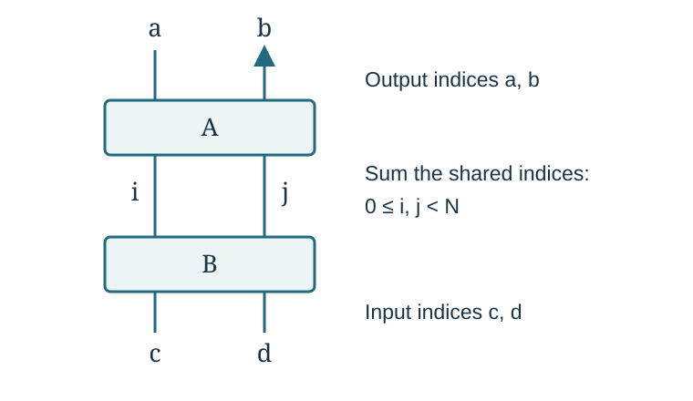

# From a knot diagram to a volume limit

This chapter introduces the objects used in the guide. It explains what
is being constructed, what is being summed, and what a volume theorem
must prove. The [results chapter](results.md) then states the families
covered by the arguments. The [methods chapter](methods.md) develops the
estimates and the alternative approaches.

## Knots, complements, and tangles

**Definition (knot and exterior).** A knot \(K\) is a smoothly embedded
circle in the three-sphere \(S^3\), considered up to ambient isotopy.
An ambient isotopy moves the circle continuously through embeddings;
it does not let one strand pass through another. Removing the interior
of a small solid-torus neighborhood of \(K\) gives its compact exterior
\(X_K\). Its boundary is a torus. The interior of \(X_K\) is homeomorphic
to \(S^3\setminus K\), the knot complement.

A link has several circle components. Its exterior has one boundary
torus for each component. This distinction matters whenever a tangle
construction is closed: a well-defined scalar for a link does not make
that link a knot.

**Definition (hyperbolic knot).** A knot is hyperbolic when
\(S^3\setminus K\) admits a complete metric of constant curvature
\(-1\) and finite volume. The notation
\(\operatorname{Vol}(S^3\setminus K)\) means the volume of this metric.
The metric has an end, or cusp, corresponding to the removed knot.
The knot itself is not a subset of hyperbolic space whose volume is
being measured.

**Definition (two-string tangle).** Take two disjoint arcs properly
embedded in a three-ball, with their four endpoints at four specified
points on its boundary. Properly embedded means that only the endpoints
meet the boundary. Such a pair is a two-string tangle. We draw the ball
as a box with two upper and two lower endpoints. The endpoint positions
and their order are part of the description.

Stacking two boxes joins the lower endpoints of the upper box to the
upper endpoints of the lower box. A quarter-turn rotates a box and its
endpoints into the new input and output positions. A closure joins the
four remaining endpoints by specified arcs outside the box. Different
closures can give different links.

A rational tangle is obtained from the trivial pair of arcs by a finite
sequence of twists of adjacent boundary endpoints. Conway's algebraic,
or arborescent, constructions compose rational tangles along a tree of
such operations. In this project “algebraic knot” has this tangle
meaning. A convenient reference for the basic conventions and rational
tangle classification is
[Kauffman and Lambropoulou, *On the classification of rational tangles*](https://arxiv.org/abs/math/0311499).
The repository's particular stacking, turning, and closing conventions
are specified in Chapter 1 of the manuscript.

Following the arcs gives a finite test for the number of components.
This test must count circles already closed inside an intermediate box
as well as components formed by the final closure. The knot hypotheses
in the theorems refer to that full test.

## Half twists, full twists, and auxiliary circles

Write \(R\) for the chosen positive crossing of two strands, including
the interchange of their endpoints. The tangle \(R^n\) has signed
half-twist count \(n\in\mathbb Z\). Its inverse crossing is \(R^{-1}\).
Two successive crossings form a full twist. Thus changing \(n\) by
an even integer preserves the endpoint permutation; changing its parity
interchanges the two endpoints.

This is why the theorems separate the parity pattern from the long
twist parameters. A parity pattern can ensure that the strands form
one knot. Increasing the number of full twists then preserves that
pairing, although it generally changes the knot type.

A **crossing circle** is an auxiliary circle bounding a disk pierced
by the two strands in a twist region. To augment a diagram, remove its
full twists, keep the specified residual half twist, and add the
crossing circle. Do this at every designated region. The result is an
augmented link with auxiliary components as well as the main strands.

**Definition (Dehn filling).** On one boundary torus of a link
exterior, choose a primitive closed curve, called a slope. Glue in a
solid torus so that this curve bounds a meridian disk of the solid
torus. This operation is Dehn filling. “Primitive” means that the
curve represents an indivisible element of the integral first homology
of the boundary torus.

**Definition (meridian and longitude).** The meridian of a link
component is an essential simple closed curve on its boundary torus
that bounds a disk in the removed tubular neighborhood. Essential
means that it does not contract to a point within the boundary torus.
A longitude runs once parallel
to the component. In the three-sphere, the preferred longitude is
the parallel curve with linking number zero with that component.
After orientations are chosen, the meridian and preferred longitude
give a basis of the torus's first integral homology. A slope is then
specified by a coprime integer pair in this basis; reversing both
integers leaves the unoriented slope unchanged.

For a crossing circle, choose the meridian \(\mu_e\) and disk longitude
\(\lambda_e\) with the orientations used in the proof. The subscript
\(e\) labels the twist region. In the manuscript's convention,
filling the slope \(\mu_e+p_e\lambda_e\) restores the signed count
\[
                    n_e=\epsilon_e-2p_e,
\]
where \(p_e\in\mathbb Z\) and the retained half twist
\(\epsilon_e\in\{-1,0,1\}\) is fixed in advance. The minus sign records
the chosen disk orientation; it is not a universal sign convention
for every diagram.

Only these auxiliary tori are filled in the knot-volume theorems.
The main knot cusp remains complete and unfilled. There are therefore
two different volumes during the argument:
\[
 \operatorname{Vol}(Y_D)
 \quad\text{and}\quad
 \operatorname{Vol}(S^3\setminus K_{\boldsymbol p}).
\]
Here \(D\) is the fixed augmented diagram, \(Y_D\) is its link
complement, and \(K_{\boldsymbol p}\) is the knot after the auxiliary
fillings. The geometric proof must reach the second volume.

## What the finite invariant contains

At level \(N\ge2\), put
\[
 q_N=e^{\pi i/N},\qquad Q_N=q_N^2=e^{2\pi i/N}.
\]
In the finite representation used here a main strand carries an
\(N\)-dimensional complex vector space \(V_N\), with a chosen basis
\(v_0,\ldots,v_{N-1}\). A crossing acts on \(V_N\otimes V_N\).
A cup creates two endpoints, a cap joins them, and each internal wire
means summation over its basis index. These maps, the closing
correction, the framing, and the reduced normalization together
specify the scalar \(K_N(K)\).

The word **color** specifies a representation carried by a strand or
auxiliary circle. Complete color in this guide means the
\(N\)-dimensional representation. An internal basis index is not a
second color.

Here is the elementary matrix rule behind a stacked tangle. If \(A\)
and \(B\) act on \(V_N\otimes V_N\), write
\[
 A(v_i\otimes v_j)
      =\sum_{a,b=0}^{N-1}A^{ab}_{ij}\,v_a\otimes v_b.
\]
Then \(B\) followed by \(A\) has entries
\[
             (AB)^{ab}_{cd}
                =\sum_{i,j=0}^{N-1}A^{ab}_{ij}B^{ij}_{cd}.
\]
The four indices \(a,b,c,d\) remain on the outside. The two internal
indices \(i,j\) are summed, with the same values used in both factors.

The actual crossing matrices, cup and cap entries, and closing
functional appear in Chapter 2 of the manuscript. Kashaev's
[original matrix construction](https://arxiv.org/abs/q-alg/9504020)
is the starting definition. The normalization comparison in Appendix A
is a separate finite calculation. An arbitrary choice of local matrices
does not define a knot invariant merely because it has an interesting
large-\(N\) limit.

The **source** of a calculation means this specified finite expression:
its local maps, summation ranges, closure, and all scalar factors.
An exact source identity rewrites that expression without changing its
value. The guide uses “source” in this concrete sense.

## Why polynomial coefficients appear

Polynomials can record the entries of a finite tensor contraction.
For instance, fix a nonnegative integer \(d\) and write
\[
 A(z)=\sum_{j=0}^{d}a_jz^j,\qquad
 B(z)=\sum_{j=0}^{d}b_jz^j,
\]
then
\[
                   [z^d]A(z)B(z)
                       =\sum_{j=0}^{d}a_jb_{d-j}.
\]
The notation \([z^d]\) asks for the coefficient of \(z^d\).
It enforces one shared constraint on the two indices.

In the face description of a knot diagram, each projection region
has one variable \(L_f\). The subscript \(f\) labels the region.
Every local factor touching that region uses that same variable.
A product of local polynomials followed by a specified coefficient
extraction then enforces all face constraints at once. In the marked
construction two designated face variables are set to zero; these
are the **protected faces**. Their zero exponents come from the
original cut, not from a later choice of an estimate.

For positive real numbers \(r_1,\ldots,r_s\), the elementary
multivariable Cauchy formula gives
\[
 |[z_1^{k_1}\cdots z_s^{k_s}]P|
 \le
 \frac{\displaystyle\sup_{|z_f|=r_f}|P(z_1,\ldots,z_s)|}
      {\displaystyle\prod_{f=1}^{s}r_f^{k_f}}.
\]
Here \(P\) is a polynomial and the \(k_f\) are nonnegative integer
target exponents. To see the formula, integrate
\(P(r_1e^{i\theta_1},\ldots,r_se^{i\theta_s})
 e^{-i\sum_f k_f\theta_f}\) over all \(\theta_f\in[0,2\pi]\),
divide by \((2\pi)^s\prod_f r_f^{k_f}\), and use Fourier
orthogonality. Taking the absolute value gives the inequality.

Each occurrence of a face must have the same radius in this integral.
That requirement is what the phrase “shared radii” means. When the
geometric construction interprets \(L_f\) as a circle curvature,
its circle radius is \(1/L_f\). The integration radius \(r_f\) is
a weight in a coefficient estimate; the two meanings of “radius”
should not be confused.

## What has to converge

Kashaev's volume question asks for the exponential rate of the
**whole scalar**:
\[
 \lim_{N\to\infty}\frac{2\pi}{N}\log|K_N(K)|
       =\operatorname{Vol}(S^3\setminus K).
\]
Its formulation comes from
[Kashaev's volume paper](https://arxiv.org/abs/q-alg/9601025).
The
[Murakami–Murakami relation to colored Jones polynomials](https://arxiv.org/abs/math/9905075)
gives another formulation of the invariant. It does not by itself
prove the volume limit for a new knot.

The quantifiers in a long-twist theorem have the following order:

1. Choose one permitted finite diagram and any finite decoration
   required by the theorem.
2. Find a threshold \(T\) for that diagram.
3. Choose every filling integer \(p_e\), with \(|p_e|>T\), and fix
   these integers permanently.
4. Let \(N\) tend to infinity for the resulting fixed knot.

Allowing arbitrarily many tangles means that step 1 permits diagrams
of arbitrarily large finite size. It does not let the number of
tangles increase during step 4. A degree-and-twist criterion may give
an explicit \(T\); an existence theorem need not do so.

To understand the analytic issue, consider
\[
          Z_N=e^N+\bigl(-e^N+1\bigr)=1.
\]
Both summands have exponential size, but their sum does not.
Thus finding a critical point with the expected volume, or bounding
a positive sum of absolute values, is only part of an argument.

A successful decomposition writes \(K_N=G_N+R_N\), where \(G_N\)
is a specified contribution and \(R_N\) is the remaining sum. For
example, let \(S\in\mathbb C\) and suppose
\[
 G_N=a_Ne^{NS},\qquad
 \frac{\log|a_N|}{N}\longrightarrow0,\qquad
 |R_N|\le e^{N(\operatorname{Re}S-\eta)+o(N)},\quad\eta>0.
\]
The amplitude \(a_N\) is nonzero for sufficiently large \(N\).
The notation \(o(N)\) denotes an error whose ratio to \(N\) tends
to zero. These assumptions imply \(R_N/G_N\to0\), so the full
scalar has rate \(2\pi\operatorname{Re}S\). A separate geometric
argument must show that this number is the volume of the intended
knot complement.

This explains the different conclusions found in the guide:

| Result | What it establishes |
| --- | --- |
| Finite identity | Two expressions evaluate to the same number at each level. |
| Upper estimate | The specified quantity cannot grow faster than the stated rate. |
| Nonzero geometric contribution | One specified part has the stated nonzero asymptotic. |
| Full volume equality | The entire invariant has the rate of the actual hyperbolic knot complement. |

The manuscript includes completed arguments at these different levels
of strength. In particular, its geometric-contribution theorem for an
unchanged matched spherical diagram remains a partial result.
The [methods chapter](methods.md) explains which techniques supply
each step, and the [results chapter](results.md) records the exact
hypotheses under which all steps have been completed.
