# Figure gallery

## The requirements of a volume proof

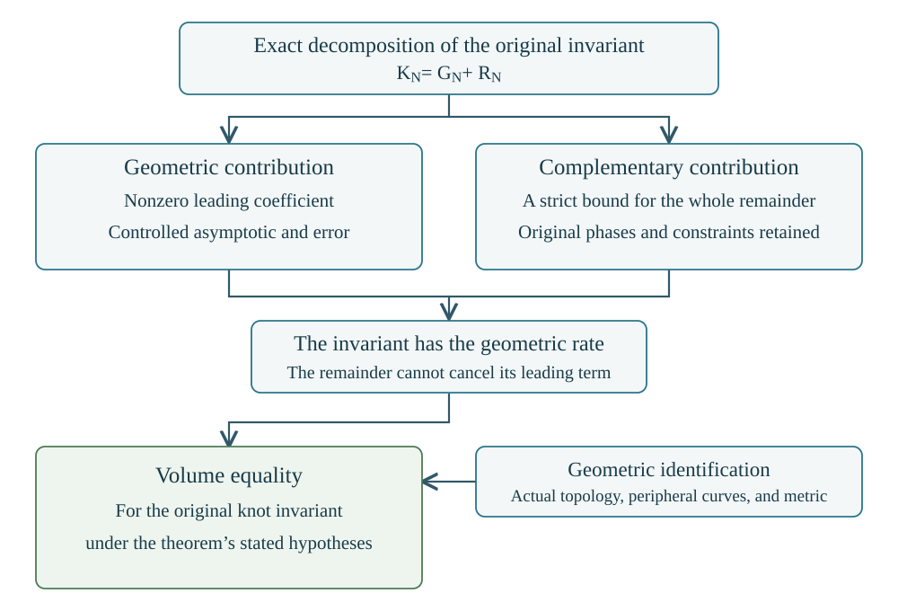

Here \(K_N\) is the original invariant, \(G_N\) is the selected contribution,
and \(R_N\) is the remaining signed sum. The two analytic estimates determine
the growth rate of \(K_N\). The geometric argument identifies that rate with
the volume of the actual knot complement. The arrows record logical
dependencies; they do not assert that all these steps hold for every knot.
The [methods chapter](chapters/methods.md) defines the quantities and proves
the elementary implication.

[Editable SVG](figures/methods-proof-map.svg)

## Adding terminal tangles on both sides

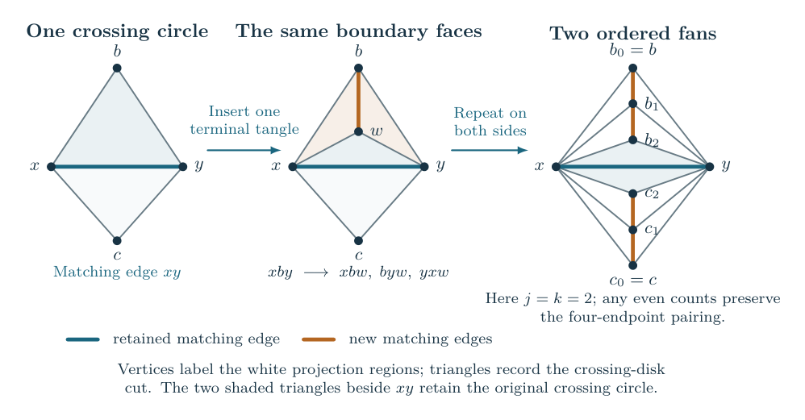

The vertices in this diagram label white projection regions. They also
label circles in the complete packing; the drawing itself records their
adjacencies, not their radii. The two triangles beside the blue edge
\(xy\) specify the original crossing circle. Insert a new vertex \(w\)
in the triangle \(xby\). The new triangles have cyclic orders
\(xbw\), \(byw\), and \(yxw\). Pair the first two across the amber edge
\(bw\); the old blue edge and its crossing circle remain.

In the final panel, \(b_0=b\) and \(c_0=c\) are the original opposite
vertices. The vertices \(b_1,b_2\) and \(c_1,c_2\) are the two successively
inserted circles on each side. The blue triangles nearest \(xy\) belong
to the retained crossing circle, and each amber edge specifies an added
crossing circle. The general construction uses any suitable even counts
\(j,k\), chosen by the curvature recurrence in the
[results chapter](chapters/results.md#decorating-a-planar-diagram).
Giving the new tangles odd crossing parity makes an even stack preserve
the four outside endpoint connections.

[SVG](figures/balanced-terminal-fans.svg) ·
[PDF](figures/balanced-terminal-fans.pdf) ·
[TikZ source](figures/balanced-terminal-fans.tex)

The drawings below explain the constructions used in the guide. Some show actual circle configurations in the boundary plane of hyperbolic space. Others show only incidence, algebraic composition, or the sequence of a proof. Each caption states which kind of drawing it is, defines the important labels, and explains the result for which it is used.

The volume theorem applies to the stated ordered Conway compositions with sufficiently long net twists and to several separately certified plat families. A remaining question attached to a local method is not an unresolved step in those theorems. The diagrams below explain the proved constructions and their remaining scope.

## Evaluating one subtree and keeping its attaching variable

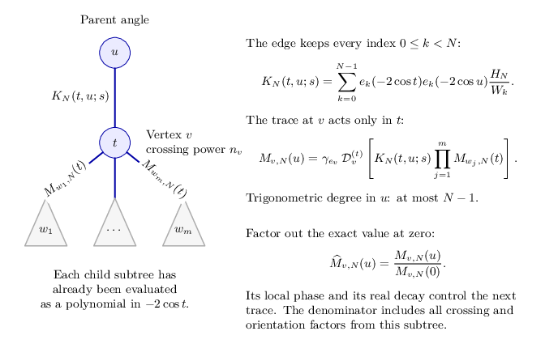

The triangles stand for child subtrees of the construction tree,
not for ideal tetrahedra. Their evaluations are the displayed
functions \(M_{w_j,N}(t)\). Multiply these functions by the full
kernel on the parent edge, then take the crossing trace at vertex
\(v\). This leaves the parent angle \(u\) free and gives
\(M_{v,N}(u)\).

Only the edge kernel contains \(u\), so the result has trigonometric
degree at most \(N-1\), however many vertices lie below \(v\).
The [local volume proof](../notes/actual_all_circle_local_message_volume.md)
shows that its value at \(u=0\) is nonzero. Dividing by that exact
value keeps the child's completed contribution outside the next
estimate. The crossing and orientation factors remain in this
denominator; they are not discarded.

[Vector drawing](figures/tree-boundary-message.svg) ·
[PDF](figures/tree-boundary-message.pdf) ·
[TikZ source](figures/tree-boundary-message.tex)

## Attaching an octahedron in the original tangle cut

The blue triangle on the left is a boundary face of the existing
projection half. The blue triangle on the right is glued to it with
the opposite boundary orientation. Equal labels specify the vertex
identifications. The new vertex \(O_w\) belongs to the inserted child
crossing circle, while \(O_v\) belongs to its parent. The other three
crossing-disk triangles are listed in the
[decomposition proof](../notes/actual_all_circle_octahedral_decomposition.md).
The same attachment is made in the other projection half.

This is the local attachment used in the induction over the tree. The [geometric chapter](chapters/geometry.md#the-geometric-proof-for-the-explicit-degree-and-twist-bound)
explains the positive hyperbolic realization and the filling path.
Download the [vector PDF](figures/octahedral-page-attachment.pdf) or
the [TikZ source](figures/octahedral-page-attachment.tex).

## Established results and remaining scope

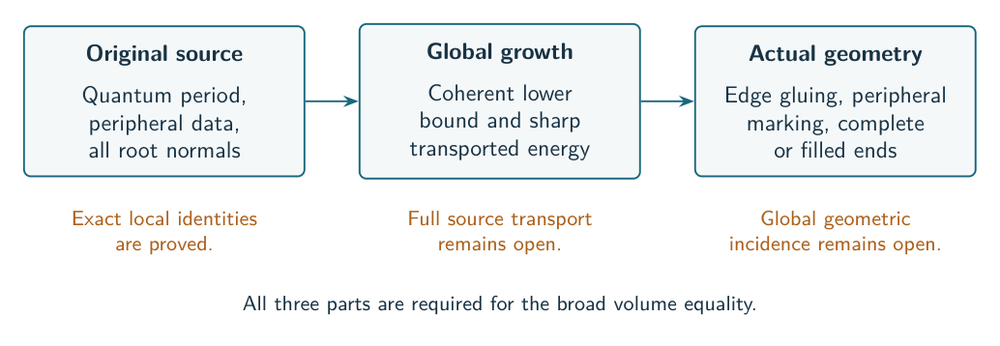

Fix an ordered Conway composition with the prescribed cylindrical closure. Reduce it by the explicit twist slides and combinations, excluding an elementary two-strand braid output. Then choose sufficiently long net twists for which the actual closed diagram is a knot. The reduction identifies this knot with one covered by the strict-tree estimates. The three upper boxes describe the proved argument for that knot: reduce the tangle by exact isotopies, control the whole signed quantum sum while keeping a nonzero geometric contribution, and identify its growth with the volume of the actual knot complement. Only the auxiliary crossing-circle cusps are filled; the knot cusp remains unfilled.

The lower blue box gives two other exact formulations of the same invariant: a selected period of a quantum difference operator and a positive ratio of Gram determinants. These also have the stated volume limits. The amber box concerns arbitrary short net twists, more general knot families, and extension of the selected geometric-factor theorem beyond trees of crossing circles. The geometric factor is identified for the covered trees; the full recurrence ideal remains a separate question. It does not leave the full-sum estimate open for the covered class. See the [results chapter](chapters/results.md) for the precise hypotheses.

[SVG](figures/research-map.svg) · [PDF](figures/research-map.pdf) · [TikZ source](figures/research-map.tex)

## Varying the figure-eight meridian near completeness

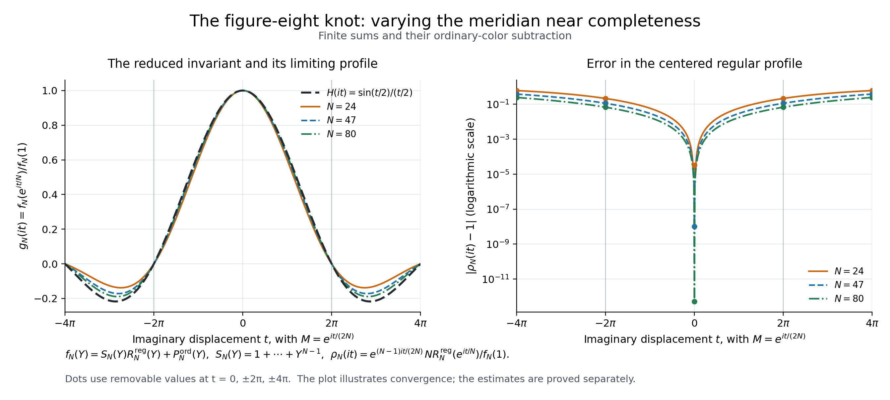

Keep the quantum parameter at \(q_N=e^{\pi i/N}\) and write the
meridian eigenvalue as \(M=e^{it/(2N)}\). The left panel plots the
reduced invariant divided by its complete value at levels
\(N=24,47,80\). Its limiting curve is \(2\sin(t/2)/t\), with value
one at zero.

The right panel shows the error after subtracting the polynomial
interpolating the ordinary colors, dividing by
\(1+Y+\cdots+Y^{N-1}\), and applying the centering displayed below
the axes. Here \(Y=M^2\). At the marked nonzero multiples of
\(2\pi\), numerator and denominator both vanish; the dots use the
removable derivative values. The logarithmic vertical scale makes
the small errors visible.

The [profile theorem](../notes/actual_paired_factor_meridian_profile.md)
proves convergence on every fixed complex compact set, including
these points, and identifies the first correction with the
preferred cusp shape \(2\sqrt3\,i\). Its proof uses the positive
finite figure-eight sum. A separate criterion states the estimate
needed to extend the argument to signed sums for other knots.

[Vector figure](figures/figure-eight-meridian-profile.svg) ·
[PDF](figures/figure-eight-meridian-profile.pdf) ·
[Reproduction script](../experiments/plot_figure_eight_meridian_profile.py)

## Products of tangle polynomials as the meridian varies

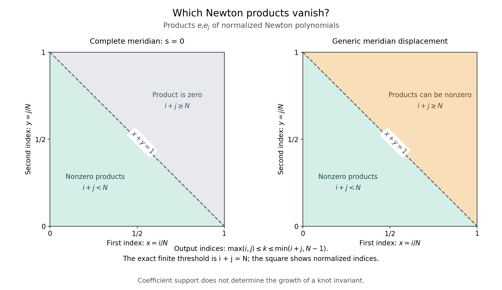

A two-strand tangle operator is expressed in the normalized Newton
basis \(e_0,\ldots,e_{N-1}\) of its Casimir polynomial algebra.
Joining two boxes requires multiplying their polynomials. Here
\(i,j\) are the indices of two basis elements; the axes show
\(x=i/N\) and \(y=j/N\). At the complete meridian \(s=0\),
the product \(e_i e_j\) is zero whenever \(i+j\ge N\).
For a generic displacement \(M=q_N^s\), those products become
nonzero. The [multiplication theorem](../notes/actual_main_meridian_newton_multiplication.md)
gives every coefficient and explains the special displacements
where some coefficients vanish again.

This is a picture of multiplication in a specified basis. The basis
also changes with \(s\); its motion accounts for the nonzero first
derivatives of the new coefficients. Keeping the complete basis
fixed makes the first derivative of multiplication zero.
Neither description by itself estimates the knot invariant, which
also requires turns, summation over shared indices, and closure.

[Vector figure](figures/moving-newton-products.svg) ·
[PDF](figures/moving-newton-products.pdf) ·
[Reproduction script](../experiments/audit_main_meridian_newton_algebra.py)

## Reflecting an index and combining two product junctions

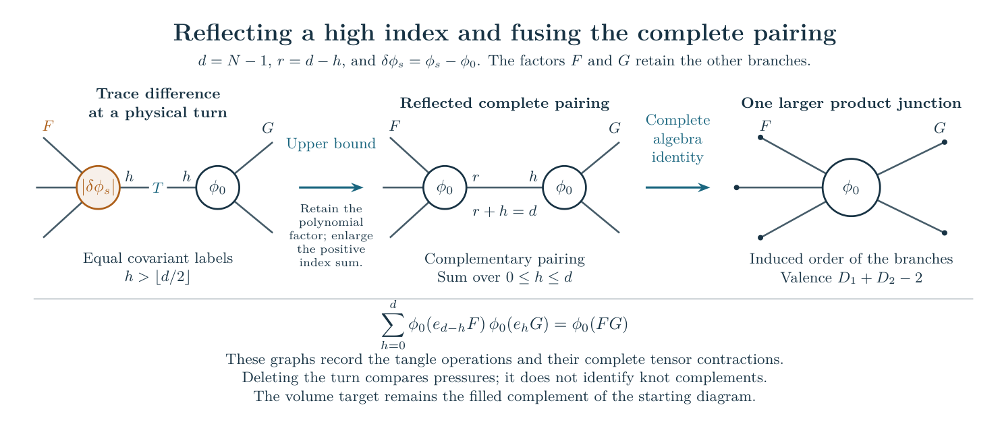

The vertices represent multiplication and trace operations on tangle polynomials. In the left panel, a physical quarter-turn joins two equal indices \(h\). The left trace is the difference \(\delta\phi_s=\phi_s-\phi_0\) between its moving-meridian and complete values. The [Fourier estimate](../notes/actual_main_meridian_high_fourier_reflection.md) bounds this difference after replacing \(h\) at that endpoint by \(r=N-1-h\). All other branches, denoted collectively by \(F\) and \(G\), remain attached.

The middle panel therefore has complementary labels \(r+h=N-1\). Summing this positive complete pairing gives exactly the single trace \(\phi_0(FG)\), shown on the right. The three branches from the first junction and two from the second give the five displayed branches. Their order is inherited from the original ordered products.

The first arrow is an upper estimate; the second is an algebra identity. Deleting the turn in this comparison can change the represented link. The [pressure theorem](../notes/actual_main_meridian_component_pressure.md) proves that the new positive maximum is no larger than the original one, and a strict Fourier estimate controls the case of equal maxima. The invariant and the hyperbolic volume in the final theorem still belong to the original diagram. This comparison is what allows the [general component proof](../notes/actual_main_meridian_general_component_comparison.md) to treat junctions of arbitrary valence.

[SVG](figures/main-meridian-reflected-turn-fusion.svg) · [PDF](figures/main-meridian-reflected-turn-fusion.pdf) · [TikZ source](figures/main-meridian-reflected-turn-fusion.tex)

## A separated example of the product tree

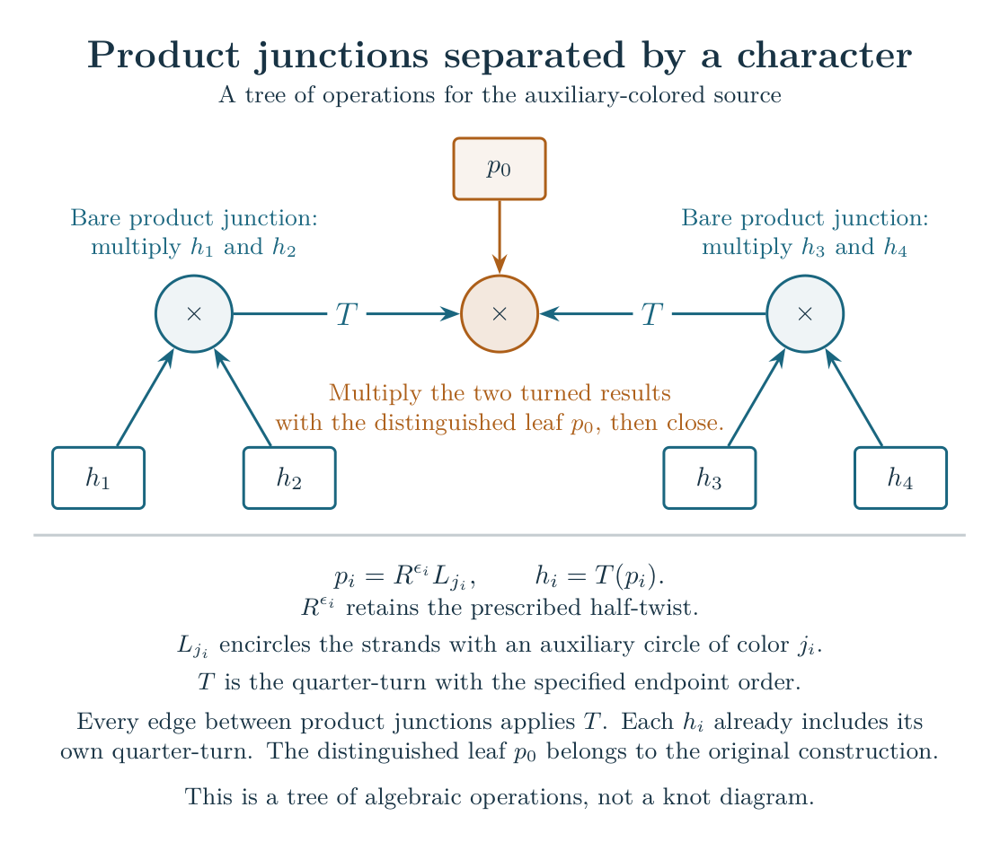

The four lower boxes represent the tangle operators \(h_1,\ldots,h_4\).
The left junction multiplies \(h_1h_2\), and the right junction multiplies
\(h_3h_4\). Apply the indicated quarter-turn \(T\) to each result,
multiply them with the original operator \(p_0\), and take the prescribed
closing trace. The formulas below the drawing define each leaf and
retain its half-twist and auxiliary-circle color.

This is a simple instance of the general theorem above. The two outer junctions carry no unturned crossing-circle operator;
the central junction does. The [source growth theorem](../notes/actual_main_meridian_source_bounds.md)
allows any fixed finite tree with this separation property: whenever
two product junctions are adjacent, at least one carries such an
original operator. Their degrees and the size of the tree may be
arbitrary. The largest source value over the allowed colors and a
small neighborhood of the complete main meridian has exponential
growth equal to the volume of the augmented complement. The
crossing circles remain unfilled in this statement.

[Vector figure](figures/separated-product-junctions.svg) ·
[PDF](figures/separated-product-junctions.pdf) ·
[TikZ source](figures/separated-product-junctions.tex)

## The operations that build the knot diagram

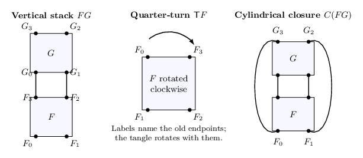

Each box contains a tangle whose internal strands have been suppressed. The black dots are its four ordered boundary endpoints. In the left panel, the product \(FG\) joins the two upper endpoints of \(F\) to the two lower endpoints of \(G\) in the displayed order. In the middle panel, the entire tangle rotates clockwise, carrying its endpoint labels with it. This is a geometric operation, not a renaming of an internal summation index.

The right panel adds the two exterior arcs defining the cylindrical closure \(C(FG)\). These arcs determine the final endpoint pairing and hence whether the result is a knot or a link. The picture introduces the [manuscript's construction](chapters/manuscript.md); the theorem then imposes its explicit recursive and knot-pairing conditions.

[PDF](../manuscript/build/figures/tangle-construction.pdf) · [TikZ source](../manuscript/figures/tangle-construction.tex)

## Moving a twist box and combining signed twists

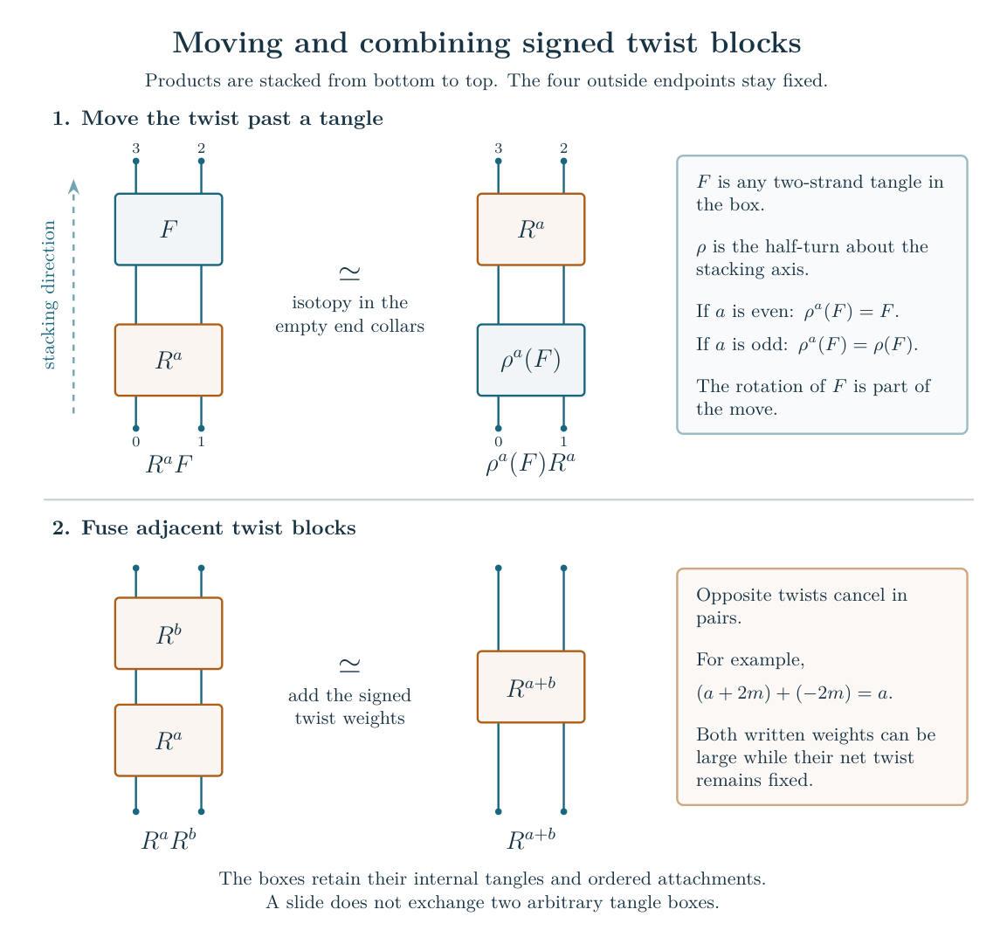

Products are read from bottom to top. In the upper row, moving the integral box $R^a$ past $F$ replaces $F$ by $\rho^a(F)$, where $\rho$ is the half-turn about the stacking axis. An even $a$ leaves $F$ unchanged; an odd $a$ retains that half-turn. The four outside endpoints stay fixed. Rotating the inner tangle and interpolating through the empty end collars gives the isotopy proved in the [net-twist theorem](../notes/actual_conway_net_twist_volume.md).

The lower row combines adjacent integral boxes: their signed weights add. Each surviving twist in the general reduction is the sum over a disjoint group of original boxes. The example $(a+2m)+(-2m)=a$ explains why large original magnitudes alone cannot supply the theorem's size condition. The condition is imposed on the final sums. The marked point and any ribbon framing are transported through the moves.

[SVG](figures/net-twist-reduction.svg) · [PDF](figures/net-twist-reduction.pdf) · [TikZ source](figures/net-twist-reduction.tex)

## Splitting a cap-closed stack

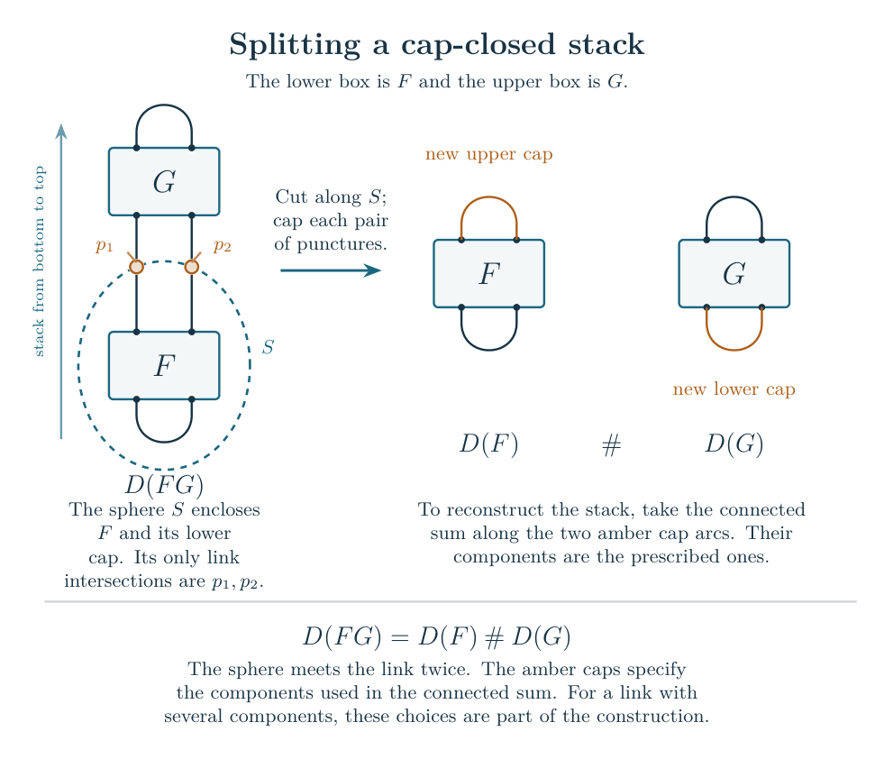

The product places $F$ below $G$. The sphere $S$ encloses $F$ and its lower cap; its only intersections with the link are the two marked points. Cutting along $S$ and capping on each side gives $D(F)$ and $D(G)$. The amber arcs specify how to reconstruct the original stack by a connected sum. When a factor is a link with several components, these specified arcs determine which components are joined.

The [closure theorem](../notes/actual_conway_arbitrary_closure_volume.md) uses this operation after removing exact zero twist sums and when processing an initial cap closure. For a hyperbolic input with long surviving strict weights, the decomposition contains one strict factor and otherwise only unknots.

[Vector figure](figures/conway-cap-splitting.svg) · [PDF](figures/conway-cap-splitting.pdf) · [TikZ source](figures/conway-cap-splitting.tex)

## The leaf pyramid and multiplication prism

A twist-region leaf contributes the pyramid on the left. Its vertices \(O,C_0,C_1,C_2,C_3\) lie at infinity in hyperbolic space. The two amber triangles retain the actual crossing-disk pairing. Its blue quadrilateral is a gluing face, with a specified cyclic order of its four vertices.

Multiplying two tangles contributes the prism on the right. Its faces \(F_x,F_y,F_z\) are the two input gluing faces and the output gluing face. The variables \(x,y,z\) are scaled quantum indices. The functions \(g\) and \(m\) are the corresponding limiting logarithmic weights, so the single-cell volumes are \(\pi g(x)\) and \(\pi m(x,y,z)\). Stationarity under the shared-index constraints makes the ordered quadrilateral shapes agree across each attachment. The drawing shows the faces and edges of the two ideal hyperbolic cells. The [geometry chapter](chapters/geometry.md#how-the-cells-and-the-diagram-are-identified) explains how the labeled cells recover the actual complement.

## Constructing the prism in the boundary plane

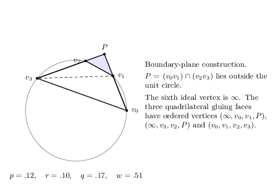

This is a boundary-plane construction rather than a three-dimensional perspective drawing. The four points \(v_0,v_1,v_2,v_3\) lie on the unit circle. The lines through \(v_0v_1\) and \(v_2v_3\) meet at \(P\), outside the circle. Together with infinity, they are the six ideal vertices of the prism. The positive parameters satisfy \(p+q+2r+w=1\); the consecutive half-arc fractions are \(p,r,q,r+w\). The displayed numerical values select a strict cell.

The three quadrilateral gluing faces have the ordered vertices printed on the right. Listing the vertices is essential: it specifies the actual face map used to attach two cells. An abstract quadrilateral with the same shape would not determine which corners are joined. The [manuscript](chapters/manuscript.md) derives these shapes and relates them to derivatives of the quantum action.

[PDF](../manuscript/build/figures/prism-boundary.pdf) · [TikZ source](../manuscript/figures/prism-boundary.tex)

## A local tetrahedron and its metric

The labels \(a,b,c,d,e,f\) distinguish the six original edges. The blue triangles cut off the hyperideal vertices: they are the polar truncation faces. Their appearance in the plane records incidence only. The hyperbolic metric is determined by the Lorentzian Gram matrix of the outward face normals.

For an edge carrying integer label \(j_e\), the theorem uses the half-shifted coordinate \(a_e=(j_e+1/2)/N\) and dihedral angle \(\alpha_e=\pi-2\pi a_e\). The normalized local quantum action equals the volume of the tetrahedron with these angles. This is a local geometric theorem. To obtain a knot complement, one must also prove the actual face identifications, edge equations and peripheral conditions. See the [local volume argument](chapters/geometry.md#a-local-tetrahedron-is-a-genuine-geometric-result).

## A change of representation pairing

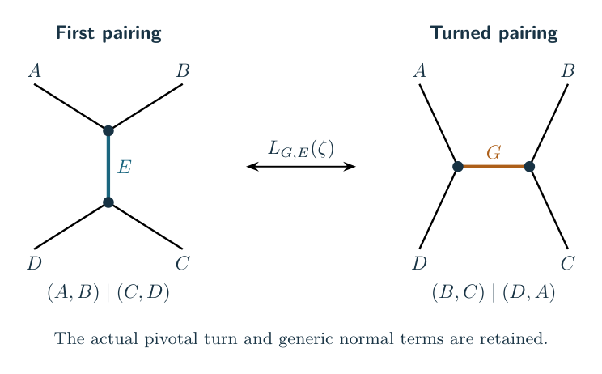

The four external representation labels \(A,B,C,D\) stay fixed. In the left basis, \(A,B\) are paired first and the intermediate representation has label \(E\). In the right basis, the pairing changes and the intermediate label is \(G\). The coefficient \(L_{G,E}(\zeta)\) is the actual finite change-of-basis entry at generic quantum parameter \(\zeta\).

This operation lets one rewrite a quantum contraction in a basis adapted to a different cut of the diagram. Its normalization includes the physical turn and the derivatives needed when spectral labels collide at a root of unity. Bounds for this one matrix entry must still be combined with the shared internal sums. The [mechanism chapter](chapters/mechanism.md#exact-recoupling-exposes-a-local-geometric-scalar) explains that distinction.

## The domain of the local complex formula

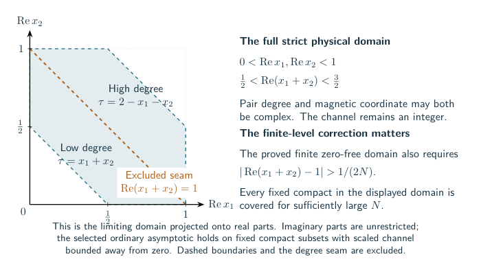

The axes are the real parts of two scaled wire coordinates \(x_1,x_2\). Their sum determines the pair degree: \(\tau=x_1+x_2\) below the diagonal seam and \(\tau=2-x_1-x_2\) above it. The internal channel remains an integer. The blue region is the projection of the limiting complex domain; it is not a restriction that the imaginary parts vanish.

The dashed outer boundaries and the seam \(\operatorname{Re}(x_1+x_2)=1\) are excluded. At finite level, the zero-free theorem also removes a band of width \(1/(2N)\) on each side of that seam. Thus a fixed compact subset away from the seam is covered for all sufficiently large \(N\). On those compacts, the [local packet theorem](../notes/actual_q_hahn_full_physical_complex_packet.md) gives the selected complex action and a nonzero relative amplitude. It does not by itself select a global integration contour.

## Why two factors can be exceptional

The polyhedron here is built from face normals, not from the ideal vertices of the knot complement. Under the stated geometric strip conditions, the two framing flags determine a line through its interior. A generic line crosses exactly two facets. The corresponding two local factors fail the strict physical support inequalities used by the ordinary complex formula.

The [localization theorem](../notes/actual_augmented_plat_selected_factor_localization.md) places all the other ordinary factors on that formula's selected branch. The two exceptional facets can be prescribed, including the pair adjacent to a crossing-circle edge. This identifies where a different local treatment is needed; it does not estimate that treatment merely by counting the facets. The complete-color contraction has a separate theorem, and deformed colors and generic derivatives retain their own requirements.

## Removing two redundant framing directions

Vertices of this graph represent white faces of the original diagram. Edges represent incidences carried by its strands. The amber vertices \(u,v\) are the two constant-prefix faces. After subtracting the common potential on the connected blue part, the remaining free potentials are \(P_u,P_v\).

The marked strand \(e_0\) and its neighbor \(e_1\) detect these two variations by the displayed integer matrix. Its determinant has absolute value one. Fixing those two strand indices therefore removes the redundant directions without introducing an unnoticed sublattice factor. The [transverse-rank theorem](../notes/actual_original_boundary_transverse_rank.md) uses this fact to obtain a nondegenerate Hessian on the remaining variables. This is a coordinate statement; the global coefficient saddle and the complete signed contraction have additional proofs.

## The cusp rectangle fixes the Gaussian normalization

A horosphere cuts one rectangle from each of the two polyhedral copies. Its width is \(W\) and its height is \(H\). In the original tangent-circle coordinates, \(x,y\) are the two outer curvatures and \(b,c\) the two middle curvatures; curvature means reciprocal radius. The formulas under the drawing compute \(W,H\) from those same face variables.

Gluing the rectangles gives a primitive meridian of length \(H\) and longitude of length \(2W\), with the orientations shown. This factor of two produces \(C=\pi H/W\). A retained half twist \(\epsilon\) changes the Gaussian parameter to \(Z=C-\pi i\epsilon\), and the primitive cusp shape is \(2\pi i/Z\). The [reflection-and-cusp theorem](../notes/actual_external_circle_reflection_and_cusp.md) matches this geometry to the complete-circle Fourier transform on the scale \(h=z\sqrt N\), where \(h\) is the color deficit. That mesoscopic calculation is one input; estimates for all physical colors and a fixed-color filling neighborhood are separate steps.

## Two marked faces determine one shared strip

The blue lines \(u,v\) are the two marked faces, normalized to heights zero and \(H\). The finite circles have radii \(r_1,r_2\). Their main-strand incidences remain tangent, while the matching incidences open at angles \(\psi_i=2\pi\delta_i\). The points \(p_\pm,q_\pm\) record the selected boundary fixed points; at the complete tangency each pair coincides.

The common width \(H\) matters. Solving each crossing region in its own strip would not produce a single geometric representation. The [marked circle-pattern theorem](../notes/actual_marked_deformed_circle_pattern.md) solves all center and radius equations together and proves local uniqueness near the complete pattern. It also retains the selected fixed-point branches through their collision. The drawing illustrates that shared construction, rather than imposing an extra symmetry on all diagrams.

## The actual collar around a crossing disk

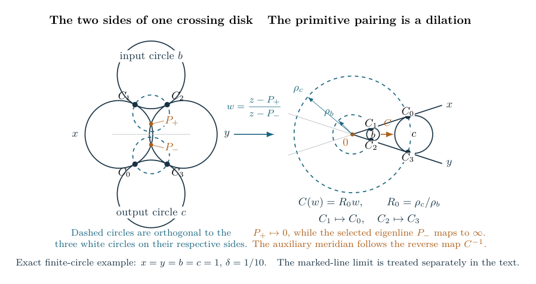

On the left, \(x,y\) are the outer circles and \(b,c\) the input and output circles. The points \(C_0,C_1,C_2,C_3\) are the ordered contacts used by the original disk pairing. The outer circles intersect at the selected eigenpoints \(P_+,P_-\). Each dashed circle is orthogonal to the three white circles on its side. The coordinate \(w=(z-P_+)/(z-P_-)\) sends them to zero and infinity.

In that coordinate, the dashed circles become concentric, with radii \(\rho_b,\rho_c\), and the actual pairing is the dilation \(C(w)=R_0w\), where \(R_0=\rho_c/\rho_b\). It sends \(C_1\) to \(C_0\) and \(C_2\) to \(C_3\). The auxiliary meridian traverses the reverse map, so its holonomy is \(C^{-1}\). This direction and the primitive curve cannot be recovered from an unlabeled cusp shape alone. The [collar proof](../notes/actual_deformed_circle_primitive_collar.md) treats the marked-line limit and the retained half-twist shear as well.

[SVG](figures/deformed-circle-collar.svg) · [PDF](figures/deformed-circle-collar.pdf) · [TikZ source](figures/deformed-circle-collar.tex)

## A polynomial encoding each crossing-circle factor

The box \(f(\Omega)\) is the actual local operator, written as a function of the pair Casimir matrix \(\Omega\). The surrounding variables \(x,b,c,y\) name its four incident faces. Its polynomial \(H_f\) has total degree \(d=N-1\), with nonnegative exponents. The coefficients may be complex and retain the original repeated-node derivatives.

When local polynomials are multiplied, every shared face uses one shared variable. The marked scalar is the coefficient with exponent \(d\) on each ordinary face and zero on the two marked faces \(u,v\). The total available degree is already exhausted by those targets, which excludes spurious Fourier aliases in this extraction. The [homogeneous formula](../notes/actual_homogeneous_casimir_face_source.md) is exact at every level; a volume limit additionally needs geometry and estimates for this coefficient.

## Classifying maxima of a general coefficient bound

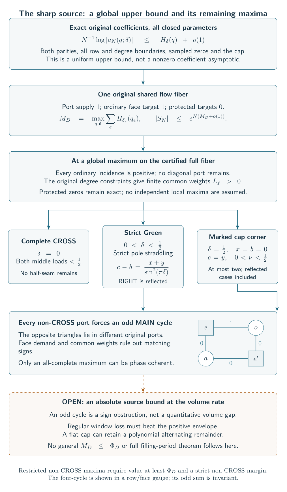

A local coefficient has normalized face degrees \(q\) and spectral parameter \(\delta\). Its exponential upper rate is \(H_\delta(q)\). The diagram first joins these rates while keeping every face demand shared; the resulting maximum is \(M_D\). The central cross region, the two one-sided regions, and the marked cap corner are different portions of the same degree constraints.

In the small cycle, squares denote crossing regions and circles denote faces. An edge labeled zero asks for equal phases; an edge labeled one asks for phases differing by \(\pi\). An odd sum around the cycle is inconsistent. The [stationary classification](../notes/research_full_fiber_sharp_stationary_classification.md) and [odd-cycle argument](../notes/research_stationary_noncross_main_cycle_obstruction.md) therefore locate a source of cancellation. They do not quantify enough loss to replace an upper rate larger than the geometric rate \(\Phi_D\). The lower box states that remaining problem for this general-plat method; the strict-tree volume theorem is already proved by another argument.

## Following every term through a switch

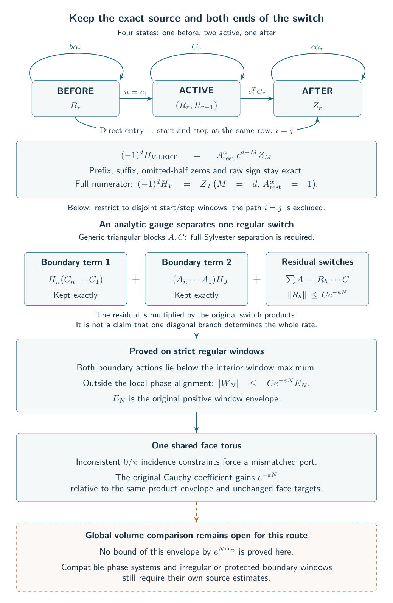

The row number is \(r\). Before entering the active recurrence, a path contributes to \(B_r\); while active it uses the pair \((R_r,R_{r-1})\); after leaving it contributes to \(Z_r\). The direct arrow is essential: it represents a path that starts and stops at the same row. The [four-state identity](../notes/research_original_one_sided_four_state_transfer.md) retains that path, all prefix and suffix factors, and the raw sign.

On disjoint regular start and stop windows, a carefully chosen analytic change of basis leaves an exponentially small residual. It also leaves the two displayed boundary terms. Those terms and the multiplying transfer products must still be estimated. The [window theorem](../notes/research_regular_spectral_window_phase_exclusion.md) does this on its stated domain and gives a loss when shared phases cannot align. That loss is relative to the same positive envelope; comparing the envelope with the actual geometric volume is a further condition in this route.

## A color neighborhood and its complement

For auxiliary color \(n_i\), put \(h_i=N-n_i\). The axes show \(h_1/N,h_2/N\), so the origin is complete color. The blue square represents a neighborhood of size \(\delta(D)\) for the fixed diagram \(D\), not a universal numerical width. Within the stated untwisted hypotheses, the full quantum sum agrees with its geometric core up to an exponentially small relative error. Shared-radius certificates give signed versions, and the purple axis illustrates a sufficient local test when one color varies.

Near the opposite corner, a complete-circle term has an alias that the original small-color term cancels. Estimating only the former would change the problem. The [external-color discussion](chapters/frontier.md#the-external-color-route-and-its-exact-cancellations) explains why this general-plat corridor is not itself a bound on the whole cube. Whole-cube control has already been established for the strict Conway class and the separately certified families.

## A scalar polynomial inside an operator period

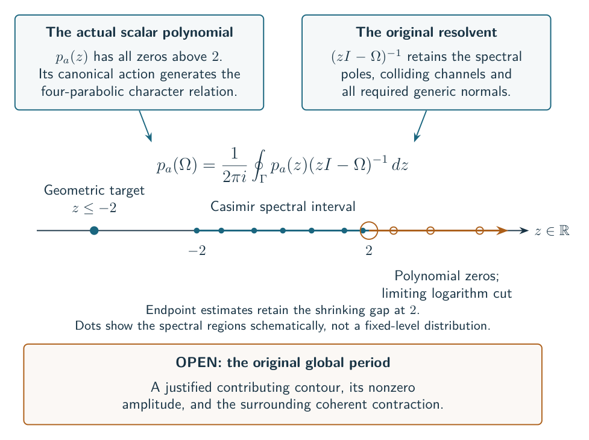

The polynomial \(p_a(z)\) has zeros above two. The matrix \(\Omega\) has its physical spectral nodes in \([-2,2]\), while the marked geometric trace lies at \(z\le-2\). The contour \(\Gamma\) in the displayed formula encloses the matrix spectrum. Integrating \(p_a(z)(zI-\Omega)^{-1}\) gives the full operator \(p_a(\Omega)\), including the information at repeated eigenvalues.

This is why a large-degree polynomial cannot simply be replaced by its scalar value at a geometric trace inside a network. The resolvent still carries the surrounding contraction and its derivative terms. Local endpoint packets and the entire central cross-sector filling period are proved; finite shared-radius conditions can then control the remainder. The [current scope](chapters/frontier.md#the-external-color-route-and-its-exact-cancellations) concerns extending such full-period estimates to unrestricted plats, not reopening the volume theorems for the covered classes.

## The exact support wall and complex continuation

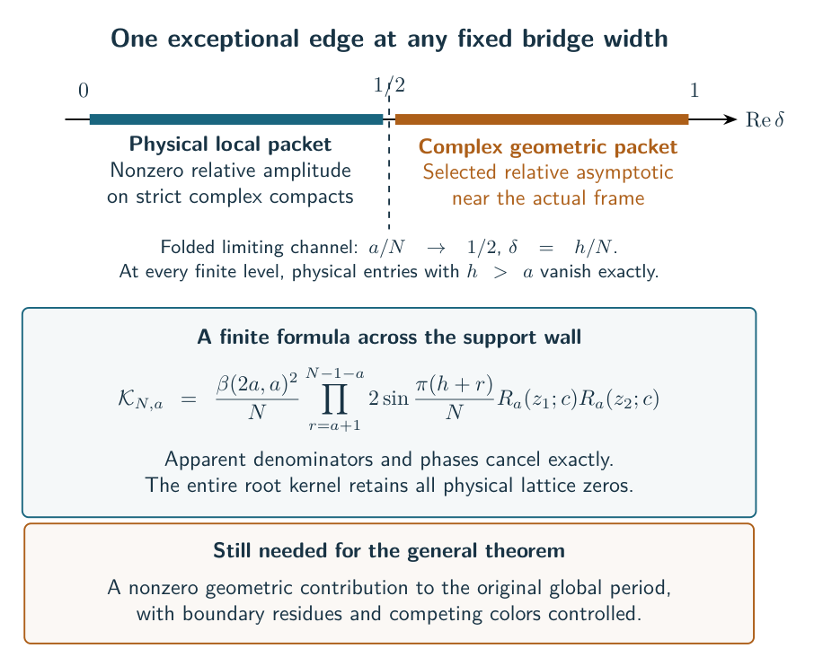

The coordinate is \(\delta=h/N\), with folded channel \(a/N\to1/2\). At each finite level, entries with integer \(h>a\) vanish exactly. The blue interval indicates the domain of the ordinary physical formula. The amber interval indicates where the exceptional geometric calculation requires a different analytic expression; it is not a claim that forbidden physical entries become nonzero.

The displayed finite kernel removes apparent poles and retains all lattice zeros. The [deficient-degree packet](../notes/actual_q_hahn_joint_deficient_degree_packet.md) controls its selected continuation near the actual geometric frame, where the magnetic coordinates are complex. The axis is a limiting schematic, not the exact finite cutoff. This local continuation alone does not control a global contour or its boundary residues. Complete-source and covered-family results use the additional global arguments stated in their theorems.

## Twisting as a local dynamical law

The outer face variables \(x,y\) are fixed, and the middle variables evolve as twists are added. The combinations \(A=x+y\) and \(P=xy\) enter the displayed recurrence. Generically, adjoining a root \(\lambda\) of \(\lambda^2+\sigma\lambda+1=0\) gives a coordinate \(a\) that changes by \(a\mapsto\lambda^n a\) under \(n\) signed twists. The norm-one condition relates the two conjugate spectral branches.

At the parabolic fiber \(\sigma=-2\), the appropriate coordinate is instead \(t=b-z\), which changes additively by \(2nA\). The lower box is the exact quantum counterpart, retaining its scalar factor and repeated-node data. The [crossing theorem](../notes/actual_crossing_casimir_torus.md) specifies the excluded divisors and the other singular fibers. It gives local transport, not an unrestricted global volume estimate obtained by taking absolute values of each factor.

[PDF](figures/casimir-twist-transport.pdf) · [SVG](figures/casimir-twist-transport.svg) · [TikZ source](figures/casimir-twist-transport.tex)

## Primitive filling curves and the square-root choice

The left rectangle is a fundamental domain for a torus. Opposite sides are identified. The amber segments then join into one curve in the primitive class \(\mu+2\lambda\), where \(\mu,\lambda\) are the marked meridian and longitude. The drawing records the slope, not a numerical cusp shape.

On the right, \(M=e^U\) and \(L=e^V\) are auxiliary peripheral multipliers. Choosing \(\ell=e^{V/2}\) selects one local sheet of \(\ell^2=L\); the other is \(-\ell\). A half twist acts by an integral monomial transformation on this cover and changes the action by the displayed quadratic term. The technical name torsor records that the two choices differ by a sign without a globally prescribed choice in the unmarked data. The original quantum formula selects the branch tending to one. The [marked filling argument](chapters/geometry.md#half-twists-preserve-the-marked-action-through-a-shear) retains that choice and the primitive equation \(U+pV=-2\pi i\).

## What the cube calculation sums

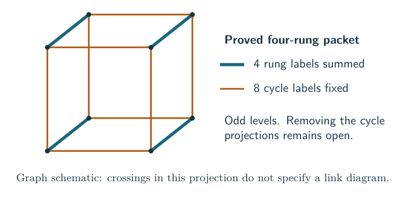

Each edge label is an intermediate representation index in the quantum calculation. The proved odd-level packet sums all four blue rung indices while holding the eight orange cycle indices fixed. Crossings in this planar projection do not specify overcrossings or undercrossings of a link diagram.

The distinction matters because a theorem about this projected sum need not survive an additional signed sum over the orange labels. The [cube results](chapters/results.md#cube-sectors-are-kept-separate) retain that restriction. The drawing shows exactly which calculation is established and which further contraction remains to be controlled in that approach.

## From shared-radius tests to the full invariant

The face variables in this method are shared across the original diagram. The complete endpoint has the actual augmented volume, and the entire central cross-sector Fourier period has a nonzero contribution with the correctly filled volume. The remaining terms occupy other degree sectors. For each branch \(B\) in a finite cover of those sectors, one chooses a single positive face-weight vector \(L^B\) and proves the bound \(G_B(L^B)<\Phi_D\), where \(\Phi_D\) is the complete geometric rate.

The [sector-cover theorem](../notes/general_actual_sector_cover_filling_volume.md) shows that these finitely many inequalities suppress the full remainder. The twist weights are fixed before \(N\) grows, and the threshold depends on the fixed diagram. Concrete families satisfy the tests at every fixed bridge width. Universal success of this particular certificate is not asserted. The strict Conway-tree theorem supplies a different complete argument for its own class.

## An exact packing seed for larger bridge width

The labels in this drawing denote curvatures, meaning reciprocal radii. The distinct mirror disks \(a_1,b_1\) both have curvature one, and the distinct mirror disks \(a_2,b_2\) both have curvature four. The symbol \(a_3=b_3\) denotes one shared axis disk of curvature nine, not two coincident disks. The upper line is \(a_0=b_0\), and the lower line is \(u\); both lines have curvature zero. The orange chain has curvatures \(9/4,45/16,45/4\).

The lower panel uses contact heights \(y_j\) and the ratios \(z_j=\sqrt{1-y_j/y_{j-1}}\). Their exact recurrence permits a convex comparison with translated copies of this seed. The [reduced-layer theorem](../notes/general_reduced_layer_long_filling_volume.md) obtains the needed curvature bound for all fixed widths at least four. A [one-end extension](../notes/general_one_end_layer_long_filling_volume.md), with separate small-width packings, covers widths two and three as well. These are specified families satisfying the full-volume certificate; the packing is not a universal model for every plat of that width.

## Adding a chain in an empty marked strip

The old disk \(a\) and the old core remain fixed. Every amber disk has radius one and is tangent to the same two lines \(u,v\). The shown case has two insertion steps. In the original braid-slot notation, a chain of length \(m\) adds the prefix \((1,2)^m\), hence \(2m\) new twist regions with independent even signed exponents.

The [unit-chain theorem](../notes/general_marked_unit_chain_filling_volume.md) proves that the original source identities and the geometric balance survive this insertion under the stated first-cap marking and slot conditions. It permits every fixed chain length; the required twist threshold may depend on that length. The construction uses the indicated empty gap on the first four strands, not arbitrary stacking across the full braid width.

[SVG](figures/marked-unit-chain-extension.svg) · [PDF](figures/marked-unit-chain-extension.pdf) · [TikZ source](figures/marked-unit-chain-extension.tex)

## Independent chains in the initial bridge gaps

Only part of the old disk of curvature \(A=1\) is visible. The other old disk has curvature \(B=4\), and the blue line \(u\) has curvature zero. A chain inserted into their empty triangular gap obeys the exact rule \(\sqrt{C_n}=\sqrt B+n\sqrt A\), giving the displayed curvatures nine and sixteen. The square-root relation controls every fixed chain length without moving either boundary disk.

The [simultaneous construction](../notes/general_simultaneous_bridge_gap_filling_volume.md) performs this operation separately in each original initial bridge gap. The gaps have disjoint interiors, while any shared old boundary disk remains unchanged. The resulting diagram has \(3k-3+2\sum_jm_j\) independently weighted twist regions. Both the bridge width \(k\) and the depths \(m_j\) are fixed before the quantum limit is taken.

[SVG](figures/each-bridge-gap-chain.svg) · [PDF](figures/each-bridge-gap-chain.pdf) · [TikZ source](figures/each-bridge-gap-chain.tex)

## A finer certificate can succeed on the same diagram

The diagram and invariant do not change between the panels. The first test fixes one right-sided degree sector and estimates every other region without retaining its sector label. An exact feasible flow proves that no choice of radii can make that coarse bound less than the geometric rate \(\Phi_D\).

The refinement keeps genuine sector labels at four specified regions. Fifteen nonempty right-sided choices and twenty-five remaining anchors give forty branches covering every unwanted sector string. Each branch has one shared rational radius vector, and explicit interval bounds leave a gap greater than \(0.04\). The [separation theorem](../notes/actual_shared_radius_certificate_separation.md) therefore proves a full filled-volume result for this example while disproving necessity of the simpler test. It neither changes the knot nor proves that every diagram admits such a cover.

[SVG](figures/sector-certificate-separation.svg) · [PDF](figures/sector-certificate-separation.pdf) · [TikZ source](figures/sector-certificate-separation.tex)

## A local spectral rearrangement and its possible global use

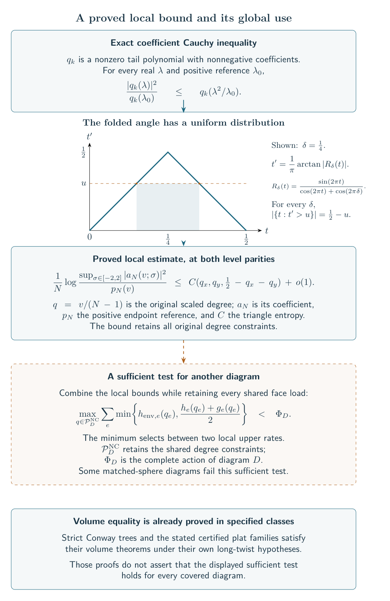

The horizontal variable \(t\) runs from zero to one half. For the displayed parameter \(\delta=1/4\), the transformed angle \(t'\) rises and falls as a tent map. The shaded interval is the set where \(t'>u\); its length is \(1/2-u\). The [rearrangement proof](../notes/actual_one_sided_relative_spectral_energy.md) establishes the same distribution for every spectral parameter. Together with the exact coefficient Cauchy inequality at the top, it gives the stated local triangle-entropy bound at both level parities.

The amber box asks for a further inequality after all local rates have been joined on the original shared face constraints. That displayed minimum-envelope criterion is sufficient, but is not proved for arbitrary diagrams. The bottom box records the logically separate fact that strict Conway trees and the specified certified plat families already have volume equalities under their own hypotheses. Those theorems do not assert that this particular sufficient inequality holds for every diagram they cover.

[SVG](figures/spectral-energy-rearrangement.svg) · [PDF](figures/spectral-energy-rearrangement.pdf) · [TikZ source](figures/spectral-energy-rearrangement.tex)

## A weighted Conway tree records composition order

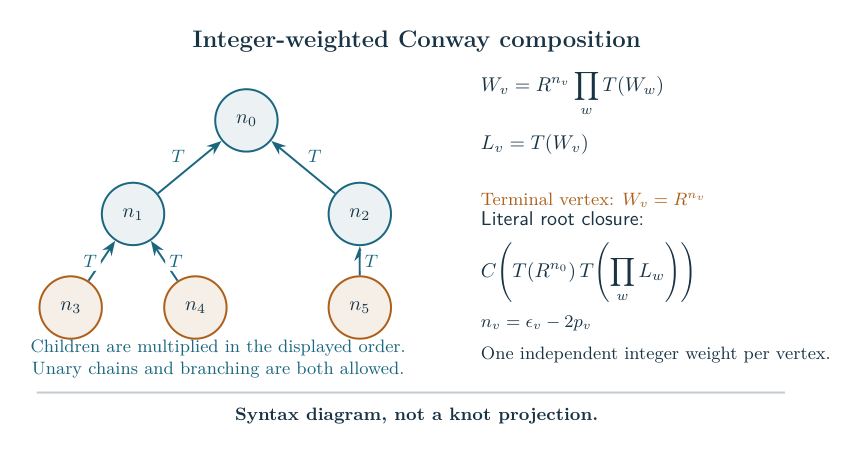

A vertex carries the integer weight \(n_v\) of an actual twist operator \(R^{n_v}\). Its children are turned and multiplied in the displayed order, giving \(W_v=R^{n_v}\prod_wT(W_w)\). A terminal vertex has no children. The diagram allows both branching and chains with one child; it is an algebraic record of the tangle construction, not a projection of the resulting knot.

The literal root closure on the right is part of the definition. Writing \(n_v=\epsilon_v-2p_v\) separates the retained half twist from the signed auxiliary filling parameter. The [weighted-tree theorem](../notes/actual_conway_weighted_tree_long_twist_volume.md) fixes the tree and a knot-producing parity choice, then allows all independent weights beyond its long-twist threshold. It retains the original closure even when a different scalar expression is useful for an estimate.

[SVG](figures/weighted-conway-tree.svg) · [PDF](figures/weighted-conway-tree.pdf) · [TikZ source](figures/weighted-conway-tree.tex)

## A positive probe estimates a mixed composition

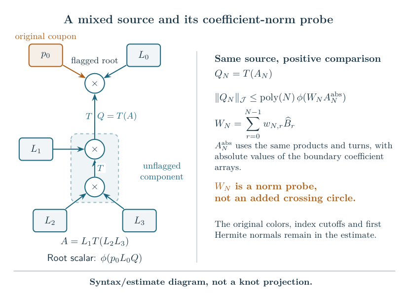

The amber box \(p_0\) is an actual character coupon. The boxes \(L_i\) are polynomial operators supplied by attached subtrees; the multiplication nodes and turns \(T\) retain their composition order. The shaded connected region has no character coupon of its own. Its output is \(Q=T(A)\), with \(A=L_1T(L_2L_3)\) in this example.

The norm \(\|Q_N\|_{\mathcal J}\) records values and first derivatives at the spectral nodes, including repeated ones. The comparison replaces boundary coefficient arrays by their absolute values and closes the resulting expression against the positive polynomial \(W_N\). This polynomial is a device for proving an upper bound, not an additional crossing circle in the knot. The [probe theorem](../notes/actual_conway_unflagged_core_probe_bound.md) controls it at the component's actual geometric action, and the subsequent propagation theorem carries the bound through further operations. This supplies the mixed-composition step in the [strict-tree volume proof](../notes/actual_conway_all_strict_tree_long_twist_volume.md).

[SVG](figures/mixed-conway-probe.svg) · [PDF](figures/mixed-conway-probe.pdf) · [TikZ source](figures/mixed-conway-probe.tex)

## The preferred longitude after filling crossing circles

The blue vector is the image of the augmented longitude on the filled knot cusp. To obtain the preferred longitude, add \(\sum_i p_i\ell_i^2\) meridians, where \(p_i\) is the filling coefficient and \(\ell_i\) is the linking number with crossing circle \(i\). The drawing uses one coefficient \(p=1\) and \(|\ell|=2\), so the orange vector differs by four meridians. The [longitude proof](../notes/actual_main_meridian_preferred_cusp.md) derives this correction in the homology of the actual filled complement.

[Vector drawing](figures/main-cusp-longitude-shear.svg) · [PDF](figures/main-cusp-longitude-shear.pdf) · [TikZ source](figures/main-cusp-longitude-shear.tex)

## Connected trees of trivalent product junctions

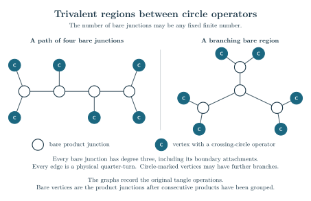

The open vertices are product junctions without a crossing-circle operator. Each has three incident branches, counting the attachments to the filled vertices. These graphs record tangle operations: consecutive unturned products have already been grouped, and every displayed edge is a physical quarter-turn. A fixed tree of any size is allowed by the [trivalent meridian theorem](../notes/actual_main_meridian_trivalent_filled_volume.md). This is a retained special case: the [general component theorem](../notes/actual_main_meridian_general_component_comparison.md) now also permits arbitrary higher-valence junctions and arbitrary mixtures of these valences.

[Vector drawing](figures/trivalent-bare-components.svg) · [PDF](figures/trivalent-bare-components.pdf) · [TikZ source](figures/trivalent-bare-components.tex)
