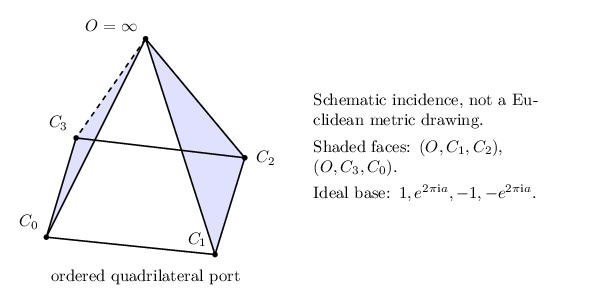

The manuscript and illustrations
================================

:download:`Download the complete PDF <../../manuscript/build/main.pdf>`.

The manuscript is an authored exposition rather than an index of research notes. It presents the theorem and conventions, the physical finite invariant, the full Hermite–Newton algebra, exact support and lattice arguments, the ideal-cell construction, the rational alias certificates, the selected complex packet, the marked peripheral deformation, and the full filling transform. Technical appendices give the finite identities and analytic error estimates used by the main argument.

The native TikZ diagrams distinguish incidence schematics from metric coordinates. The leaf and prism constructions are specified by their actual ideal vertices and ordered face maps in the text. No drawing is used to infer an unproved knot identification.

Source files are in ``manuscript/``. Build from the repository root with:

.. code-block:: sh

   python3 tools/build_manuscript.py
   python3 tools/build_sphinx.py

The generated PDF has a source hash manifest in ``manuscript/build/build-manifest.json``. These commands typeset the proof; they do not rerun the certificate suite.

Native figure sources
---------------------

   The leaf illustration is an incidence schematic. The manuscript specifies its ideal coordinates and distinguishes leaf cap angles from completed cap angles.

Download the reusable TikZ drawings:

* :download:`Proof architecture <../../manuscript/figures/proof-architecture.tex>`
* :download:`Leaf pyramid <../../manuscript/figures/leaf-pyramid.tex>`
* :download:`Prism boundary construction <../../manuscript/figures/prism-boundary.tex>`
* :download:`Attachment tangent induction <../../manuscript/figures/attachment-tangents.tex>`

Each source is a native TikZ picture used by the paper. The manuscript builder also produces separate PDF and PNG assets in ``manuscript/build/figures``.
