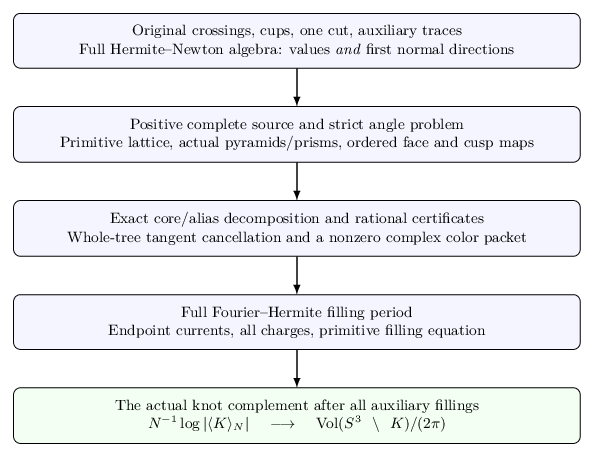

The mathematical argument
=========================

The compositional class
-----------------------

Write :math:`h` for the turned crossing-circle tangle, :math:`T` for its literal ordered quarter-turn, and multiplication for the original stack of four-port boxes. Completed expressions obey

.. math::

   E::=hh\mid T(E)\mid E_1E_2\mid hE\mid Eh.

The main closed class is :math:`C(FG)` with both children completed. Each leaf is distinct and carries its own auxiliary color. After auxiliary filling the leaf is the rational tangle :math:`T(R^{\epsilon-2p})`. The algebraic-link membership follows from these actual operations; a scalar identity is not treated as a tangle isotopy.

   The finite source and the marked geometry meet in the full filling argument.

Finite source and strict geometry
---------------------------------

At level :math:`N`, the pair algebra is the full repeated-root algebra

.. math::

   \mathcal H_N=\mathbb C[z]/(2T_N(z/2)+2).

The Newton basis retains the first normal direction at every double Casimir root. Its turn reverses coordinates and its multiplication has positive coefficients on exactly
:math:`i+j\le N-1` and :math:`\max(i,j)\le r\le i+j`. The complete source is therefore a positive finite partition with shared labels.

Strict feasibility and an entropy barrier give a unique complete maximizer and a negative reduced Hessian. Explicit ideal pyramids and triangular prisms realize the local actions. Their ordered quadrilateral cross ratios are the exponentials of the action derivatives, so stationarity gives the prescribed face isometries. The closed bowtie cut, pointwise edge words and canonical horospheres identify a complete metric on the augmented-link complement.

.. figure:: ../../manuscript/build/figures/prism-boundary.png
   :alt: Unit-circle boundary vertices and the intersection P defining the ideal triangular prism.
   :width: 90%

   Exact boundary-plane construction of a strict multiplication prism. The sixth ideal vertex is infinity.

Aliases and the complex packet
-------------------------------

The mixed color has an exact core plus signed alias decomposition. Two finite rational certificates control a whole two-leaf block and a single leaf attached to a completed child. Their supporting planes apply to the entire Newton product domain, including alias indices above one half. Output tangents cancel on the original tree constraints.

The selected high-index recurrence is anchored by its finite source. Exponentially accurate interpolation and a finite lattice contour give a separately even complex color packet with nonzero amplitude and the precise power :math:`N^{3/2}`. Integer offsets from :math:`d=N-1` remain in that amplitude.

.. figure:: ../../manuscript/build/figures/attachment-tangents.png
   :alt: A new leaf and the completed child tangent enter the same Newton gate, preserving inherited and new alias losses.
   :width: 90%

   The child keeps its original output tangent; the gate compensates the new leaf alias.

The full filling period
-----------------------

The Fourier–Hermite interpolation of the original twist includes both values and first derivatives. Its combined kernel is a total derivative. Endpoint zeros remove zero charge exactly, and the two vertical endpoint currents must be paired to estimate the infinite tail. Minimal nonzero signed charges add; independently long slopes need no common sign or size comparison.

The critical equation is the primitive geometric equation :math:`U+pV=-2\pi i`. The absolute regulator and complete volume anchor identify the selected action with the knot complement volume after all auxiliary fillings.
