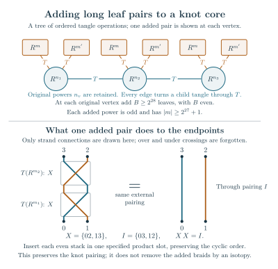

# Volume limits from the degree and twist at each circle

Start with a fixed finite ordered tree of two-strand integer braids, with
at least one edge and one crossing circle at every vertex. Turn each child tangle through its
specified quarter-turn before stacking it at the parent, and use the
original cylindrical closure. The
[literal construction and strand test](actual_all_circle_quantitative_volume.md#the-knot-construction)
retain the endpoint frames and require one closed main knot, with no
component closed inside an intermediate tangle.

Write \(d_v\) for the degree of vertex \(v\), and \(n_v\) for its signed
number of half-twists. A sufficient condition for the volume limit is
\[
 \boxed{\qquad d_v\ge2^{28}\quad\text{or}\quad |n_v|\ge2^{27}
                       \qquad\text{at every vertex}.\qquad}
\]
The alternative can be chosen separately at each vertex. High-degree
vertices may retain any fixed signed powers, including zero and small
nonzero powers. If the strand test gives a knot \(K\), its original
complement is hyperbolic and
\[
 \lim_{N\to\infty}\frac{2\pi}{N}\log|K_N(K)|
                       =\operatorname{Vol}(S^3\setminus K).
\]
Both level parities are included. The tree, powers and degrees are fixed
before \(N\) tends to infinity. The constants are coarse sufficient
bounds; they make no claim about the shortest possible twists.

The more general criterion below assigns a real-decay bound to each
subtree polynomial. Dividing by that polynomial's exact value at zero
retains its complex scalar and isolates the contribution of the next
trace. Different edges may use different bounds. The final vertex has
no outgoing polynomial, so it need not pay the extra loss needed to
send one to a parent. This distinction also gives a short-power star
outside both the earlier summed and uniform local tests.

Section 8 explains how to retain arbitrarily many prescribed short
powers: add an even stack of sufficiently long terminal tangles at every
vertex of a fixed ordered knot core. Their endpoint pairing preserves
the knot condition, although the resulting knot type can change. The
proof estimates the actual finite invariant throughout; it does not
assume that a proposed global critical point dominates.

## 1. The directed criterion

Put
\[
 a_0=\frac1{2\pi},\qquad k_0=2^{-16},\qquad
 R_0=\frac18,\qquad b_0=2^{-11},\qquad
 r_0=\frac1{16},\qquad t_0=2^{-14},\qquad
 \chi=1-\cos r_0.
 \tag{1}
\]
The parent-variable rectangle is
\[
 \mathcal R=\{u:|\Re u|\le R_0,\ |\Im u|\le b_0\}.
 \tag{2}
\]
Choose any vertex as root and direct all edges toward it. For every
nonroot vertex choose a number
\[
                    0<c_v<k_0,
 \qquad
 \delta_v=\min\left\{\frac{b_0}2,
               \frac{c_v\chi}{4(1+c_v)}\right\}.
 \tag{3}
\]
These are parameters of the criterion. They can differ at every edge.
They are not asymptotic quantities to be inferred from the invariant.

Write \(q_v=1\) at a nonroot vertex and \(q_v=0\) at the root. If \(\mathrm{Ch}(v)\) is the
set of children, define
\[
\begin{aligned}
 a_v&=\frac{d_v}{2\pi},& b_v&=\frac{n_v}{2\pi},&
 D_v&=a_v-i b_v,\\
 A_v&=\frac2{\pi^2}
       \left(q_vk_0+\frac12\sum_{w\in\mathrm{Ch}(v)}c_w\right),&
 B_v&=16q_v+|\mathrm{Ch}(v)|,&
 C_v&=B_v+\frac{b_v^2}{4A_v}.
\end{aligned}
 \tag{4}
\]
There is at least one incidence at every vertex, so \(A_v,B_v\) are positive.
Let
\[
 \delta_v^{\mathrm{in}}
      =\min\bigl(\{b_0\}\cup
                     \{\delta_w:w\in\mathrm{Ch}(v)\}\bigr)
 \tag{5}
\]
and set
\[
 y_v=\min\left\{
 \frac{\delta_v^{\mathrm{in}}}2,
 \frac{t_0|D_v|}{4C_v},
 \frac{A_v\pi^2}{8(\pi|b_v|+t_0|D_v|)},
 \sqrt{\frac{A_v\pi^2}{8B_v}}
 \right\}.
 \tag{6}
\]
Finally define two action quantities
\[
 \beta_v=\frac{210}{361}\frac{a_v}{|D_v|^2},
 \qquad
 \eta_v=\min\left\{
 \frac12t_0|D_v|y_v,
 \frac12A_v\pi^2,
 A_vr_0^2,
 \frac18a_vr_0^2
 \right\}.
 \tag{7}
\]
The criterion consists of the strict inequalities
\[
 \boxed{\quad t_0|D_v|\ge2,\qquad
                 \beta_v<\frac{\eta_v}{2}\quad
                      \text{at every vertex},\quad}
 \tag{8}
\]
and, only at nonroot vertices,
\[
 \boxed{\qquad
       \beta_v<(k_0-c_v)\chi.\qquad}
 \tag{9}
\]
It is a finite elementary test in the degrees, signed powers, root and
positive numbers \(c_v\). It uses no value of an unknown quantum invariant
and no assumed dominance of a global saddle. Its quantities are local:
\(A_v\) and the available strip depend on the child budgets, while the exact
child scalar will be divided out rather than estimated.

Use the original reduced-state normalization
\(q_N=e^{\pi i/N}\), \(M=-q_Nx=q_N^s\), and \(F_N(1)=K_N\).
The raw highest-weight parameter \(x\) here is distinct from a normalized
wire coordinate. The [pointing theorem](kashaev_ado_pointing.md) fixes this
ADO invariant and its zero framing.

**Theorem.** If (3), (8), and (9) hold, the actual reduced state has
\[
 \frac{F_N(q_N^s)}{F_N(1)A_N(s)H_N(s)}
                  =1+O_{\mathcal T,\mathbf n,R}(N^{-1}),
             \qquad |s|\le R<1,
 \tag{10}
\]
where
\[
 H_N(s)=\frac{\sin\pi s}{N\sin(\pi s/N)},\qquad
 A_N(s)=q_N^{a(D)s^2/2},\qquad a(D)=-w(D)-\sum_vn_v.
 \tag{11}
\]
Its complete values are nonzero for all sufficiently large levels and
\[
 \lim_{N\to\infty}\frac{2\pi}{N}\log|K_N(K)|
                      =\operatorname{Vol}(S^3\setminus K).
 \tag{12}
\]
Both level parities and the original normal channels are retained.
The proof identifies the same original filled critical value as the
marked geometric completion. It does not use a sum of independent
subtree volumes.

## 2. An actual conditional kernel on a rectangle

The fixed Newton polynomials are
\[
 \begin{gathered}
 d=N-1,\qquad c_j=2\cos((2j+1)\pi/N),\qquad
 S_k=\prod_{r=1}^k2\sin(\pi r/N),\\
 e_k(z)=S_k^{-2}\prod_{j<k}(c_j-z),\qquad 0\le k<N.
 \end{gathered}
 \tag{N1}
\]
Let \(\mathcal T_N(2\cos\theta)=2\cos(N\theta)\), and put
\(P_\sigma(z)=\mathcal T_N(z)+2\cos(2\pi\sigma)\). The normalized
polynomial trace is
\[
 \phi_\sigma(F)=(-1)^dN^2[z^d]\operatorname{rem}_{P_\sigma}F,
 \qquad \phi_\sigma(e_i e_j)=\mathbf1_{i+j=d}.
 \tag{N2}
\]
The remainder has degree less than \(N\). This is the full polynomial
functional, including its derivative values when roots coalesce.
The [typed turn theorem](actual_main_meridian_turn_comparison.md)
retains the paired factors
\[
 W_k(s)=\prod_{r=1}^k
     \left(1-\frac{\sin^2(\pi s/N)}{\sin^2(\pi r/N)}\right).
 \tag{N3}
\]
After lowering the pairing (N2), a physical turn gives the equal-index
weight \(\gamma_e(s)H_N(s)/W_k(s)\). The factor \(\gamma_e\) is the
original scalar prescribed by that edge's orientation type. It stays in
the exact scalar ledger.

For the edge action write
\[
 \begin{gathered}
 J(x)=\int_0^x\log(2\sin\pi v)\,dv,\qquad
 g(x)=J(2x)-4J(x),\qquad G_0=g(1/4),\\
 b(x,t)=\int_0^x\log(2\cos(2\pi v)+2\cos t)\,dv-2J(x),\\
 \psi(t,u)=\operatorname{stat}_x[b(x,t)+b(x,u)],
                       \qquad\psi(0,0)=2G_0.
 \end{gathered}
 \tag{N4}
\]
The logarithms and stationary branch are continued from
\(x=1/4,t=u=0\). The finite factorial interpolation, the actual edge
contour and this phase are proved in
[the all-circle finite-sum theorem](actual_all_circle_curvature_filling_limit.md).
Its polynomial estimates use
[the full Newton bounds](all_circle_uniform_newton_bounds.md).
Use the exact full kernel
\[
 K_N(t,u;s)=\sum_{k=0}^{N-1}
       e_k(-2\cos t)e_k(-2\cos u)\frac{H_N(s)}{W_k(s)}.
 \tag{13}
\]
The definitions of \(e_k,W_k\) and the fixed anti-diagonal trace metric are
unchanged. It is a polynomial of degree at most \(N-1\) in each of
\(-2\cos t\) and \(-2\cos u\), hence has trigonometric degree at most
\(N-1\) in either angle.
The paired factors and their inverses are bounded for fixed \(|s|\le R<1\).
Every inequality below permits a polynomial factor in N.

The [full-kernel real estimate](actual_all_circle_local_message_volume.md#two-full-kernel-bounds) is
\[
 |K_N(t,u;s)|\le C_RN^{A_R}
   e^{N\{2G_0-k_0[(1-\cos t)+(1-\cos u)]\}},
                 \qquad t,u\in[-\pi,\pi].
 \tag{14}
\]
The new estimate needed here is
\[
 |K_N(t+iy,u;s)|\le C_RN^{A_R}
 e^{N\{\Re\psi(0,u)-k_0(1-\cos t)+16y^2\}},
 \quad u\in\mathcal R,\quad t\in[-\pi,\pi],\quad |y|\le b_0.
 \tag{15}
\]
Thus the parent compact is a long, thin rectangle, rather than the old
disk of radius \(2^{-12}\). The constant term is the actual conditional phase
\(\psi(0,u)\), not its upper bound \(2G_0+O(|u|^2)\).

Here is a proof from the original finite kernel. Split the indices into
\(I=[1/5,3/10]\) and its complement. The complementary full polynomial
has the established single-edge loss \(\eta_K=\pi/200\), including high
indices and their complete derivatives. Its ellipse bound is
\[
 C_RN^{A_R}
       e^{N\{2G_0-\eta_K+|y|+|\Im u|\}}.
 \tag{16}
\]
The exact edge phase has, on the radius 1/4 bidisk,
\[
 |\psi_{tt}+a_0|\le a_0/50,
 \quad |\psi_{uu}+a_0|\le a_0/50,
 \quad |\psi_{tu}|\le a_0/50,
 \quad \psi_t(0,u)=\psi_u(t,0)=0.
 \tag{17}
\]
In particular \(|\psi(0,u)-2G_0|\le |u|^2/10\). Hence (16) is smaller
than (15): the sum \(b_0+b_0+(R_0^2+b_0^2)/10+2k_0\) is less
than \(\eta_K/2\). All these constants are independent of the tree.

For the retained indices write \(u=a+ib\). Their factors at \(a\) are positive.
If \(r_j=\cos(2\pi(j+1/2)/N)\), then \(r_j>-1/3\) and
\(r_j+\cos a>253/384\). Along \(|a|\le1/8,\ |b|\le2^{-11}\), the denominator
\(r_j+\cos(a+ib)\) has modulus greater than \(3/5\), and
\[
 \left|\frac{d^2}{du^2}\log(r_j+\cos u)\right|
 =\left|\frac{-r_j\cos u-1}{(r_j+\cos u)^2}\right|<9.
 \tag{18}
\]
The first derivative at real a is real. Integrating vertically therefore
gives the actual finite-product estimate
\[
 |e_k(-2\cos(a+ib))|
       \le e_k(-2\cos a)e^{5Nb^2},\qquad k/N\in I.
 \tag{19}
\]
At the other end retain the original product bound
\[
 |e_k(-2\cos(t+iy))|
   \le e^2e_k(-2)e^{N[-\alpha\sin^2(t/2)+11y^2]},
                       \qquad \alpha>1/250.
 \tag{20}
\]
The positive retained sum at \((0,a)\) is bounded by a polynomial times
\(\exp(N\psi(0,a))\), uniformly for real \(|a|\le1/8\). This is the original
one-edge positive Laplace estimate: its unique critical wire is
\[
 \tan^2(\pi x)=\frac1{1+\tan^2(a/2)},
 \tag{21}
\]
which stays in the interior of \(I\). Its second derivative stays negative
on this fixed real compact. Equations (19)–(20), and the second bound
in (17), consequently give
\[
 |K_{N,I}(t+iy,u;s)|\le C_RN^{A_R}
 e^{N\{\Re\psi(0,u)-\alpha\sin^2(t/2)+11y^2+6b^2\}}.
 \tag{22}
\]
For \(|t|\ge1/8\),
\[
 6b_0^2<\frac{\alpha}{2}\sin^2(1/16),\qquad
                         2k_0<\alpha/2.
 \tag{23}
\]
For example \(\sin(1/16)>1/(8\pi)\), \(\pi^2<10\) and \(\alpha>1/250\) already
prove the first inequality. This proves (15) in this range.

For \(|t|\le1/8\), the [canonical wire contour](actual_all_circle_curvature_filling_limit.md) gives the exact
nonzero edge asymptotic on the 1/4 bidisk. Both \(u\) and \(t+iy\) lie strictly
inside that disk. Integrating the first bound of (17) gives (15) there.
The original lattice currents and (16) are exponentially smaller.
In particular the full kernel, uniformly on this smaller rectangle
product, retains
\[
 K_N(t,u;s)=N^{-3/2}a_e(t,u)e^{N\psi(t,u)}
                         (1+O_R(N^{-1})),
 \tag{24}
\]
with the original nonzero holomorphic leading amplitude and midpoint
normalization. The outside physical edge gamma is not included in \(a_e\).

## 3. The exact recursion may be rooted anywhere

Lower the fixed Frobenius pairing at every vertex of the original closed
source. Every physical turn then identifies equal Newton indices and
retains its factor \(\gamma_e H_N/W_k\). The resulting finite scalar is a
sum over the original edge indices of a product of the original vertex
trace tensors. Choosing a root merely specifies the order of these
finite contractions. It does not move a cut through a tangle, commute
open operators or change a framing.

Consequently the [exact recursions](actual_all_circle_local_message_volume.md#the-full-finite-kernel-and-exact-recursion)
hold for any chosen root:
\[
 M_{v,N}(u)=\gamma_{e_v}(s)\,
 \mathcal D_{n_v,\sigma_v,N}^{(t)}
 \left[K_N(t,u;s)\prod_{w\in\mathrm{Ch}(v)}M_{w,N}(t)\right]
 \tag{25}
\]
at a nonroot vertex, and
\[
 Z_N=\mathcal D_{n_o,\sigma_o,N}^{(t)}
                  \left[\prod_{w\in\mathrm{Ch}(o)}M_{w,N}(t)\right]
 \tag{26}
\]
at the root. The [original global closing, framing and reference factors](actual_main_meridian_exact_scalar.md),
and the original single reduced cut \(H_N\), remain outside (26). Edge
gammas are counted once. The exact normal value \(\sigma_v=0\) and the moving
values \(\pm s\) retain their actual orientation types.

Each message is an even trigonometric polynomial of degree at most \(N-1\)
in \(u\), regardless of the subtree. There is no discarded-source error in
(25)–(26).

## 4. The phase class and the variable envelopes

The inductive analytic class is
\[
 h_v(0)=h'_v(0)=0,\qquad h_v(-u)=h_v(u),\qquad
 |h_v''(u)+a_0|\le a_0/20,\quad u\in\mathcal R.
 \tag{27}
\]
The leading normalized amplitude \(\alpha_v(u)/\alpha_v(0)\) is holomorphic
and nonzero on a neighborhood of the required smaller compact. Exact
subtree constants are retained:
\[
 \frac{M_{v,N}(u)}{M_{v,N}(0)}
 =\frac{\alpha_v(u)}{\alpha_v(0)}e^{Nh_v(u)}(1+O(N^{-1})),
                     \quad u\in\mathcal R.
 \tag{28}
\]
As usual a slightly smaller rectangle can be used for fixed derivative
estimates; the strict margins permit an initially slightly larger one.

The global assertions attached to \(c_v\) are
\[
 \left|\frac{M_{v,N}(t)}{M_{v,N}(0)}\right|
          \le CN^A e^{-Nc_v(1-\cos t)},
                         \quad t\in[-\pi,\pi],
 \tag{29}
\]
\[
 \left|\frac{M_{v,N}(t+iy)}{M_{v,N}(0)}\right|
 \le CN^A e^{N[-(c_v/2)(1-\cos t)+y^2]},
                      \quad |y|\le\delta_v.
 \tag{30}
\]
The real sup norm, full canonical polynomial norm and complete derivative
norm differ by polynomial factors at the required fixed multiples of N.
No estimate drops the repeated-root normal data.

For completeness, (30) follows from (28)–(29) and exact degree. The
Poisson estimate for a Laurent polynomial of degree less than \(N\) is
\[
 |M_{v,N}(t+iy)/M_{v,N}(0)|
 \le CN^A e^{N[-c_v(1-\cos t)+(1+c_v)|y|]}.
 \tag{31}
\]
For \(|t|\ge r_0\) use (3). For \(|t|<r_0\) use the rectangle expansion and
\[
 \Re h_v(t+iy)\le
       -\frac{19a_0}{40}t^2+\frac{21a_0}{40}y^2.
 \tag{32}
\]
Both arguments give (30), without a conjectured quadratic estimate for
an individual high Newton basis element.

Assume the children satisfy (27)–(30). At a nonroot vertex set
\[
 A_v^{\mathrm{loc}}(t,u)=\psi(t,u)+\sum_wh_w(t),
 \quad
 C_{v,\ell}(u)=\operatorname{stat}_t
       \{A_v^{\mathrm{loc}}(t,u)+ib_vt^2/2-i\ell t\}.
 \tag{33}
\]
At the root omit \(\psi\) and \(u\). There are \(d_v\) incidences in \(t\). Hence
\[
 A_v^{\mathrm{loc}}(t,u)=\psi(0,u)-a_vt^2/2+E_v(t,u),
       \quad |E_{v,tt}|,\ |E_{v,t}/t|\le a_v/20.
 \tag{34}
\]
The root constant in this formula is zero. For \(0\le\ell\le L_v=\lfloor t_0|D_v|\rfloor\)
the equation \(D_vt=-i\ell+E_{v,t}\) contracts in \(|t|\le b_0\). Indeed
\(t_0+b_0/20<b_0\). The actual solutions lie in the smaller disk
\(|t|\le t_0/(19/20)\), leaving room for the translated contours.

The same elementary calculation as in the original proof gives
\[
 \frac{380}{441}\frac{\ell a_v}{|D_v|^2}
 \le-\Im t_{v,\ell}\le
 \frac{420}{361}\frac{\ell a_v}{|D_v|^2},
 \tag{35}
\]
also for complex parent \(u\). No child phase is asserted to be real on
the real axis. Its nonlinear derivative is \(t\) times a function bounded
by \(a_v/20\), so the real part of the denominator remains positive.

The normalized phase \(h_v=C_{v,1}(u)-C_{v,1}(0)\) satisfies
\[
 h'_v=\psi_u(t_{v,1},u),\qquad
 h''_v=\psi_{uu}
       -\frac{\psi_{ut}^2}{A_{v,tt}^{\mathrm{loc}}+ib_v}.
 \tag{36}
\]
Using (17) and \(|A_{v,tt}^{\mathrm{loc}}+ib_v|\ge(19/20)|D_v|\ge(19/20)a_0\) proves (27),
since \(1/50+20/(19\cdot2500)<1/20\). This is uniform on the rectangle.
Charge ordering and the current-vertex drop are
\[
 \Re C_{v,\ell}(u)\le\Re C_{v,1}(u)
  -\frac{190}{441}\frac{a_v}{|D_v|^2}(\ell^2-1),
 \quad
 0\le\Re\psi(0,u)-\Re C_{v,1}(u)\le\beta_v.
 \tag{37}
\]
At the root again replace \(\psi(0,u)\) by zero.

## 5. Actual trace tails with the directed budgets

Divide every child by its exact nonzero value \(M_{w,N}(0)\). The induction
uses those complex constants exactly; it never estimates them by their
complete-source magnitudes. Equations (15) and (30) imply
\[
 |\text{normalized trace input}(t+iy,u)|
 \le CN^A
   e^{N[\Re\psi(0,u)-A_vt^2+B_vy^2]},
                      \quad |y|\le\delta_v^{\mathrm{in}}.
 \tag{38}
\]
The root constant is zero. The factor \(2/\pi^2\) in (4) is exactly the
inequality \(1-\cos t\ge2t^2/\pi^2\) on the original interval.

The [exact finite translated-grid trace](actual_main_meridian_direct_crossing_trace.md), with its endpoint currents,
has charge coefficients
\[
 c_{\ell,N}(\sigma)=(-1)^{(N-1)(\ell-1)}
               U_{\ell-1}(\cos2\pi\sigma),\qquad c_{1,N}=1.
 \tag{39}
\]
For \(\ell>L_v\), moving the single-grid rectangle by \(y_v\) costs, after
maximizing the chirp term in the real variable, at most \(C_v y_v^2\).
Since \(\ell>L_v\) implies \(\ell>t_0|D_v|\), (6) gives a tail loss at least
\[
 t_0|D_v|y_v-C_vy_v^2\ge\frac12t_0|D_v|y_v.
 \tag{40}
\]
Successive charges have the additional factor \(\exp(-Ny_v)\). The exact
fixed-compact growth of (39) is absorbed for all sufficiently large N.
This starting level may depend on the fixed vertex.

At an original endpoint \(\pm\pi\), the chirp and finite-charge connectors cost
at most
\[
 (\pi|b_v|+t_0|D_v|)y_v+B_vy_v^2
                            \le A_v\pi^2/4.
 \tag{41}
\]
Thus their loss is at least \(A_v\pi^2/2\). This includes the original
zero-mode current. Nothing is inferred by dropping the endpoint terms
of the nonperiodic chirp.

For a retained charge, restrict its real integral to \([-r_0,r_0]\).
Its complement loses \(A_vr_0^2\) by (38). Translate the retained interval
to \(\Im t_{v,\ell}\). Its endpoints remain in the analytic rectangle. The
original local Young inequality, now on this larger real interval,
is
\[
\begin{aligned}
 \Re\{A_v^{\mathrm{loc}}(t-iz,u)+ib_v(t-iz)^2/2-i\ell(t-iz)\}
 &\le\Re\psi(0,u)-a_vt^2/8\\
 &\quad+\left[\frac{21}{40}a_v+
                 \frac{2b_v^2}{(14/5)a_v}\right]z^2-\ell z.
\end{aligned}
 \tag{42}
\]
For \(0\le z\le-\Im t_{v,\ell}\), the last line after its quadratic term is
at most \(-\ell z/8\), since \((420/361)\max(21/40,5/7)=300/361<7/8\).
Every such connector therefore loses at least \(a_vr_0^2/8\).
The translated horizontal saddle has negative real quadratic part
at most \(-(19/20)a_v\). The physical sine factor is nonzero at \(t_{v,\ell}\).

Equations (40)–(42) prove an absolute conditional error bounded by
\(CN^A\exp N[\Re\psi(0,u)-\eta_v]\). Nonminimal charges are their saddle
terms plus this absolute error; no relative approximation is asserted
at a much lower nonminimal action. Conditions (8) and (37) put the
whole conditional error strictly below the first charge. Equation
(39) gives its nonzero coefficient for both parities. This establishes
(28) and nonvanishing of the exact \(M_{v,N}(0)\).

For the child inputs, their exact analytic logarithms differ from the
limiting phases by \(O(N^{-1})\), with fixed derivatives on the required
smaller compact. The finite product of those corrections is retained
in the amplitude, or moves the saddle by \(O(N^{-1})\). As the tree is fixed,
it spends no new exponential budget. The leading amplitude is a product
of nonzero edge, child and Gaussian factors. All N-dependent physical
crossing and carrier phases remain in \(M_{v,N}(0)\); its normalized leading
amplitude does not conceal such phases.

The full physical trace and the first-charge approximation are
holomorphic in the formal meridian variables. As in the original
proof, first take parameter circles avoiding collisions and then apply
the maximum principle to their whole difference. This covers every
actual \(\sigma_v=0,\pm s\), including normal limits. No isolated divided
current is declared removable without its companions.

## 6. Regenerating the outgoing real bound

The [canonical polynomial bounds](actual_main_meridian_source_bounds.md), equations (D9)–(D14), retain the full source. For real \(u\), (14),
the polynomial real sup bounds of the normalized children, the actual
fixed-power crossing polynomial, Chebyshev folding in the correct
quotient, and the full top-coefficient functional give
\[
 |M_{v,N}(u)|\le CN^A
       \left|\prod_wM_{w,N}(0)\right|
                  e^{N[2G_0-k_0(1-\cos u)]}.
 \tag{43}
\]
This retains repeated-root derivatives and all fixed normals. Dividing
by the nonzero first-charge value at zero costs at most \(\beta_v\). For
\(|u|\ge r_0\), (9) absorbs that cost and yields (29). For \(|u|<r_0\), (28)
and (32) give the stronger estimate, since \(c_v<k_0\ll19a_0/20\).
Equation (30) follows by Section 4. Thus the induction closes with
the selected directed budgets, rather than a common decay constant.

There is no outgoing real bound at the final root. Imposing (9) there
would be an unnecessary restriction. Its only normalization comparison
is the conditional trace estimate (8).

## 7. Original action, geometry, and scope

Restore the exact subtree constants successively. Stationary
elimination in (33) gives the original joint equations
\[
 \sum_{e\sim v}\psi_{e,\tau_v}
                      +\frac{in_v\tau_v}{2\pi}=i.
 \tag{44}
\]
The constants telescope to the original critical value
\[
 \mathcal C(\mathbf1)=\operatorname{stat}_{\boldsymbol\tau}
 \left[\sum_e\psi_e+
       \frac{i}{4\pi}\sum_vn_v\tau_v^2-i\sum_v\tau_v\right].
 \tag{45}
\]
Back-substitute from the final root: its first-charge angle belongs to
the rectangle, so each child's selected parent value does also, and
the same statement continues down the finite tree. Every restored angle
has modulus at most \(1/[(19/20)|D_v|]\). Thus the vector satisfying
(44) lies inside the full simultaneous small-angular uniqueness
polydisk, not just the conditional disks used during elimination.
The existing contraction identifies it with the same branch as the
marked positive charge path. Indeed
(8) implies
\[
 \sqrt{d_v^2+n_v^2}=2\pi|D_v|\ge 2\pi\,2^{15}>630.
 \tag{46}
\]
The [vertexwise geometric theorem](actual_all_circle_vertexwise_geometry.md) applies with no sum condition.
Its original ordered two-octahedron cut, odd seam, primitive periods and
calibrated action identify \(2\pi\Re\mathcal C(\mathbf1)\) with the volume of the actual
filled knot complement. This is a geometric input, not a deduction
from the quantum saddle alone.

There are \(|E|\) edge Gaussians \(N^{-3/2}\) and \(|V|\) trace Gaussians \(N^{3/2}\);
\(|V|=|E|+1\) leaves the original \(N^{3/2}\) power with nonzero amplitude.
The exact first Fourier coefficient is one. The retained edge insertion
has leading value one, and the scalar ledger remains precisely (11).
This proves (10)–(12), with the original peripheral and framing factors.

The criterion allows different strip and real-decay budgets and a
different choice of final vertex. It is not the assertion that arbitrary
capped short-twist islands can be substituted as black-box messages.
Such an island requires a multi-boundary version of the conditional
normalization proved here for an actual edge. The pointwise source
estimates on the older tiny disk alone do not supply that extension.

## 8. A uniform twist corollary, with no degree sampling

The directed criterion has the following simple consequence:
\[
           |n_v|\ge2^{27}\quad\text{at every vertex}
             \quad\Longrightarrow\quad\text{(10)--(12)}.
 \tag{47}
\]
This sufficient constant is independent of the number of vertices,
their degrees and the choice of root. Here is a proof covering all
degrees simultaneously. Choose \(c_v=k_0/2\) at every nonroot vertex
and write \(\delta\) for their common value in (3). The elementary
cosine estimate gives
\[
 \chi\ge\frac{r_0^2}{2}-\frac{r_0^4}{24}
       =2^{-9}\frac{3071}{3072}>2^{-10},\qquad
                          \delta>2^{-30}.
 \tag{48}
\]
At any vertex, including the root, put
\(\mathcal R_v=\sqrt{d_v^2+n_v^2}\). Then
\[
 A_v\ge\frac{k_0d_v}{2\pi^2},\qquad B_v\le16d_v,
 \qquad C_v\le\frac{\mathcal R_v^2}{8k_0d_v}.
 \tag{49}
\]
For the last inequality use \(16\le1/(8k_0)\). Each of the four
branches of the minimum in (6) consequently has the following lower
bound, respectively:
\[
 \frac\delta2,\qquad
 \frac{t_0k_0d_v}{\pi\mathcal R_v},\qquad
 \frac{k_0d_v}{16\mathcal R_v},\qquad 2^{-12}.
 \tag{50}
\]
The second displayed quantity is smaller than the third and fourth.
For the third bound, use
\(\pi|b_v|+t_0|D_v|\le\mathcal R_v(1+t_0/\pi)/2\).
Thus every branch of (7), not just its tail branch, is bounded below by
\[
 \eta_v\ge\min\left\{
       \frac{t_0\mathcal R_v\delta}{8\pi},
       \frac{t_0^2 k_0d_v}{4\pi^2}\right\}.
 \tag{51}
\]
Indeed the second entry here is smaller than each of the other three
entries in (7), by their explicit values and \(t_0\ll r_0\).
On the other hand
\[
 \beta_v=\frac{420\pi}{361}\frac{d_v}{\mathcal R_v^2}
                       <\frac{4d_v}{\mathcal R_v^2}.
 \tag{52}
\]
For comparison with half the first entry of (51), it suffices that
\(\mathcal R_v^2>64\pi/(t_0\delta)\), since \(d_v\le\mathcal R_v\).
The right side is less than \(2^{52}\), using \(\pi<4\) and (48).
For comparison with half the second entry it suffices that
\(\mathcal R_v^2>32\pi^2/(t_0^2k_0)\), whose right side is less
than \(2^{53}\), since \(\pi^2<10\). Both inequalities follow
strictly from \(\mathcal R_v^2\ge n_v^2\ge2^{54}\).
The charge-cut condition in (8) follows as well.

For the outgoing patch, the sharper elementary estimate is
\[
 \beta_v\le\frac{210\pi}{361|n_v|}
 \le\frac{330}{361}\,2^{-26}
 <\frac{3071}{3072}\,2^{-26}
 \le\frac{k_0}2\chi.
 \tag{53}
\]
Here \(\pi<22/7\),
\(d_v/(d_v^2+n_v^2)\le1/(2|n_v|)\), and the displayed rational
comparison prove (9) for every degree. This completes the corollary
without a numerical scan or a threshold depending on the tree.

The same proof gives a mixed condition, chosen independently at each
vertex:
\[
 \boxed{\qquad
       d_v\ge2^{28}\quad\text{or}\quad |n_v|\ge2^{27}
               \qquad\text{for every }v.\qquad}
 \tag{53a}
\]
Under the degree alternative, \(\mathcal R_v^2\ge d_v^2\ge2^{56}\)
proves the same two tail comparisons, while
\[
 \beta_v\le\frac{420\pi}{361d_v}
             \le\frac{330}{361}\,2^{-26}
                    <\frac{k_0}2\chi
 \tag{53b}
\]
is the same outgoing patch bound. Neither alternative needs to hold
uniformly over all vertices. In particular, the high-degree vertices
may retain any fixed signed powers, including zero and small nonzero
powers. No sum over the number of such vertices occurs.

Here is a precise extension construction illustrating that freedom.
Start with any fixed ordered circle-tree core whose original endpoint
pairing closes to a knot and has no internal closed component. Retain
all its fixed signed powers. At every core vertex choose one of its
actual product slots next to its crossing box and insert a consecutive
stack of an even number \(B\ge2^{28}\) of new terminal pieces. Every
new leaf has a fixed odd power satisfying
\[
                           |n_{\mathrm{leaf}}|\ge2^{27}+1.
 \tag{53c}
\]
The physical quarter-turn of an odd two-strand braid has diagonal
pairing \(X=\{02,13\}\); this pairing is invariant under the
quarter-turn. An even ordered stack of these leaves has the through
pairing \(I=\{03,12\}\) and creates no internal circle. Inserting it
in the specified slot therefore preserves the original local endpoint
pairing in that actual frame. This is a pairing calculation, not an
isotopy removing the new tangles. At the original closing box the same
insertion takes place inside its local ball. An added terminal leaf may
then be chosen as the recursive root using the original closed-collar
move with its induced frame reversal and factor order retained.

Thus the resulting diagram is again a knot, while its knot type may
change. Each old vertex now satisfies the degree alternative and each
new leaf satisfies the twist alternative in (53a). The resulting actual
knot complement is hyperbolic and satisfies (10)–(12). The number and
arrangement of prescribed short-power vertices are arbitrary but fixed;
the number \(B\) does not depend on their total count.

The upper drawing is a tree of tangle operations, not a knot projection.
Only one added pair is drawn at each original vertex. The construction
inserts \(B/2\) consecutive pairs in one specified product slot, retaining
the original cyclic order; \(B\ge2^{28}\) is even. Each added leaf has odd
\(|m|\ge2^{27}+1\), and every tree edge applies the physical quarter-turn
\(T\). The lower drawing forgets crossings and shows the literal endpoint
pairings: two diagonal pairings compose to the through pairing.
It does not claim that the new braids can be removed by an isotopy.

## 9. A star beyond both previous quantitative tests

Consider an ordered star rooted at its central vertex, of odd degree
\(d=30{,}000{,}001\). Set its power to 2 and every terminal power to the fixed
odd integer \(2^{60}+1\). Choose \(c_v=k_0/2\) on every leaf.

The knot pairing can be checked in the original terminal-root syntax,
even though the finite contraction is evaluated from the center. Label
the boundary points lower left, lower right, upper right, upper left
by \(0,1,2,3\). The even and odd braid pairings are respectively
\[
 I=\{03,12\},\qquad X=\{02,13\};\qquad
 T(I)=H=\{01,23\},\quad T(X)=X.
 \tag{54a}
\]
At a terminal root there are \(d-1\) other leaves. Their turned odd
braids have pairing \(X\); their ordered product has pairing \(I\)
because \(d-1\) is even. The central power \(2\) preserves it. Its
actual quarter-turn has pairing \(H\), and stacking the root's odd
braid against \(H\) still gives \(H\), with no internal closed arc.
Cylindrical closure joins \(03\) and \(12\), so it closes \(H\)
into one component. All intermediate products before that last stack
are two through-strand braids. There is no hidden internal component.

The criterion can be verified by rational enclosures without expanding this large
tree. All leaves have the same data. The center has approximately
\[
 \beta_o=1.219\,10^{-7},\qquad
 \eta_o=2.713\,10^{-7},\qquad
       \frac{\beta_o}{\eta_o/2}<0.9.
 \tag{54}
\]
Every leaf has a much smaller ratio. The root does not satisfy the
nonroot patch inequality for any \(c>0\), because \(\beta_o>k_0\chi\).
Nevertheless its exact final trace satisfies (8). Thus that outgoing
patch must not be charged to a root that sends no message.

Moreover
\[
 \sum_v\frac{d_v}{d_v^2+n_v^2}
       >\frac{30,000,001}{30,000,001^2+4}>2^{-25},
 \tag{55}
\]
and its maximum is far above \(2^{-120}\). The example therefore lies beyond
both published quantitative alternatives. Its size and all its powers
are fixed; it is not an N-growing family. The constant sizes are coarse,
and no optimality assertion is intended.

Here are rational enclosures proving the inequalities rather than
inferring them from those decimal values. Put
\[
 \pi_- =3,\quad \pi_+=22/7,\quad c=k_0/2,\quad
 \chi_-=r_0^2/2-r_0^4/24,\quad
 \delta_- =\frac{c\chi_-}{4(1+c)}.
 \tag{56}
\]
At the central vertex use the conservative height
\(y_* =\delta_-/2\). It is at most each branch of (6). For example,
with
\[
 D_- =\frac d{2\pi_+},\quad D_+=\frac{d+1}{2\pi_-},\quad
 A_- =\frac{dc}{\pi_+^2},\quad
 C_+=d+\frac{\pi_-^{-2}}{4A_-},
 \tag{57}
\]
the three non-strip comparisons are
\[
 y_*<\frac{t_0D_-}{4C_+},\qquad
 y_*<\frac{dc}{8(1+t_0D_+)},\qquad y_*^2<\frac c8.
 \tag{58}
\]
The strip comparison follows from \(\delta\ge\delta_-\).
Every quantity in (56)–(58) is rational. Direct cross-multiplication
also gives
\[
 \frac{2[420\pi_+d/(361(d^2+4))]}
             {t_0D_-y_*/2}<\frac9{10},
 \qquad
 2\frac{420\pi_+d}{361(d^2+4)}
 <\min\left\{\frac{dc}{2},\ A_-r_0^2,
                          \frac{D_-r_0^2}{8}\right\}.
 \tag{59}
\]
These compare the upper bound for twice the first-charge drop with
all four lower bounds for \(\eta_o\). The charge cutoff is greater
than two.

For a leaf with \(n=2^{60}+1\), take
\(y_*=t_0k_0/(2n)\). The same direct rational comparisons, using
\(D_-=n/(2\pi_+)\), \(D_+=(n+1)/(2\pi_-)\),
\(A_-=2k_0/\pi_+^2\), and
\(C_+=16+[n/(2\pi_-)]^2/(4A_-)\), put this height below each
branch of (6). They give a lower bound greater than \(2^{-49}\)
for every entry of (7), while \(\beta_v<2^{-117}\).
The outgoing patch follows from
\(\beta_v<(k_0/2)\chi_-\). This proves the leaf inequalities.

## 10. Reproducing the finite arithmetic and pairings

From the repository root run:

    python3 experiments/audit_actual_all_circle_directed_volume.py

The [script](../experiments/audit_actual_all_circle_directed_volume.py)
writes [its results](../experiments/actual_all_circle_directed_volume_results.json).
An optional --output selects a different JSON file. It uses exact rational
arithmetic for the constant inequalities, the all-degree corollaries and
the star enclosures. It also constructs the literal four-endpoint
pairings and checks the composition and closure identities used above.

Those are finite checks, not numerical evidence for the asymptotic
theorem. The proof of the full invariant estimates is the conditional
kernel and trace induction in sections 2–7. The earlier
[exact tree-message reproduction](../experiments/audit_all_circle_local_message_recursion.py)
independently compares canonical quotient contractions with root-grid and
complete first-normal traces; the present argument retains those same
finite identities.
