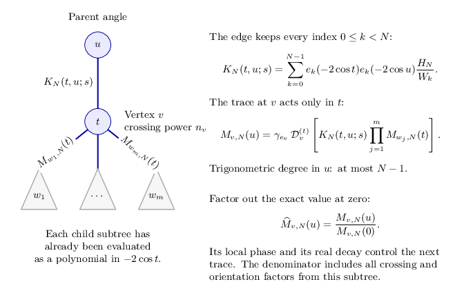

# A vertex-dependent condition for the knot-volume limit

The [local tree proof](actual_all_circle_local_message_volume.md) evaluates
each subtree as a polynomial in its parent angle. The condition below
uses the same exact polynomial and contours, but retains the degree
of the current vertex when comparing the error with its leading term.
It also allows any vertex to be evaluated last. That vertex has no
parent, so it needs no estimate for an outgoing polynomial.

The comparison separates two requirements: controlling the error in
the current trace, and bounding the normalized polynomial that will
be passed to the next trace. Keeping their different dependence on
\(d_v\) gives a less restrictive sufficient condition.

## Statement

Keep the [ordered tangle construction and strand test](actual_all_circle_quantitative_volume.md#the-knot-construction):
one original crossing circle at every vertex, at least one edge, and
one main knot component with no circle closed inside a tangle.
Let \(d_v\ge1\) be the degree and \(n_v\in\mathbb Z\) the fixed signed
crossing power. Put
\[
 R_v^2=d_v^2+n_v^2,\qquad
 a_v=\frac{d_v}{2\pi},\qquad
 D_v=\frac{d_v-in_v}{2\pi},\qquad
 \kappa_v=\frac{d_v}{R_v^2}.
\]
Choose any vertex \(r_*\) as the order-of-evaluation root. Assume
\[
 R_v^2\ge2^{82}\quad\text{for every }v,\qquad
 \kappa_v\le2^{-47}\quad\text{for }v\ne r_*.             \tag{1}
\]
Then the original knot complement is hyperbolic and
\[
 \lim_{N\to\infty}\frac{2\pi}{N}\log|K_N(K)|
                     =\operatorname{Vol}(S^3\setminus K).
\]
The limit includes both level parities and composite levels. The
whole diagram and its powers are fixed before \(N\).

There is also the same microscopic meridian profile. Let \(F_N(M)\)
be the zero-framed reduced ADO invariant, normalized by
\(F_N(1)=K_N(K)\), and put
\[
 q_N=e^{\pi i/N},\quad
 H_N(s)=\frac{\sin\pi s}{N\sin(\pi s/N)},\quad
 A_N(s)=q_N^{a(D)s^2/2},\quad a(D)=-w(D)-\sum_v n_v.
\]
For every fixed \(R<1\), uniformly on \(|s|\le R\),
\[
 \frac{F_N(q_N^s)}{F_N(1)A_N(s)H_N(s)}=1+O(N^{-1}),\qquad
 \frac{2\pi}{N}\log|F_N(q_N^s)|
       \longrightarrow\operatorname{Vol}(S^3\setminus K).
\]
The constants and the starting level may depend on the entire fixed
knot and on \(R\). No uniformity over diagrams growing with \(N\)
is asserted.

Every fixed signed assignment with \(|n_v|\ge2^{46}\) satisfies (1),
independently of the number, degrees and depth of the tree. Short or
zero powers are also allowed when (1) itself holds. The earlier
[summed criterion](actual_all_circle_quantitative_volume.md) remains a
separate sufficient alternative; it often gives a smaller numerical
threshold for a particular tree.

## 1. Re-rooting the exact finite contraction

The full edge-index expansion of the original network is, apart from
its unchanged closing, framing, opposite-order reference and reduced-cut scalars,
\[
 \sum_{\{0\le k_e<N\}}
 \left[\prod_e\gamma_e(s)\frac{H_N(s)}{W_{k_e}(s)}\right]
 \prod_v\mathcal D_{n_v,\sigma_v,N}
                  \left[\prod_{e\ni v}e_{k_e}(-2\cos t_v)\right].
 \tag{1a}
\]
Every coefficient, typed parameter and peripheral scalar in this
formula is the original one. All sums are finite. Applying finite
linearity in a different order gives the message recursion rooted
at any specified vertex \(r_*\). This changes no tangle product,
endpoint frame or topological closing map. It only changes which
finite sum is evaluated last. At the root there is no parent angle
and no outgoing polynomial to bound on the real circle.

Unless stated otherwise, numbered estimates cited from the earlier argument
refer to the [local tree proof](actual_all_circle_local_message_volume.md).

## 2. What does not use the old numerical hypothesis

The exact polynomial recursion, its degree at most \(N-1\) in the
parent angle, the real and conditional complex bounds on the full
edge kernel, and the closed class of normalized phase derivatives
are unchanged. In the source note these are Sections 2–4 and
(6)–(25). They only need the selected charge saddles to lie in the
fixed analytic disk and \(L_v=\lfloor2^{-16}|D_v|\rfloor\ge1\).
The first condition in (1), together with \(2\pi<8\), gives
\[
 |D_v|=\frac{R_v}{2\pi}>2^{38}.                           \tag{2}
\]
It therefore supplies these requirements with room to spare.

The original argument gives, for every complex parent parameter
\(|u|\le2^{-12}\), the first-charge drop
\[
 0\le\Delta_v(u):=\Re\psi(0,u)-\Re C_{v,1}(u)
 \le\frac{210}{361}\frac{a_v}{|D_v|^2}
 <\min\{2^{-76}a_v,\;4\kappa_v\}.                       \tag{3}
\]
The second bound is used only at a nonroot vertex. The two upper bounds serve different purposes. The first compares
to the current trace's errors; the second regenerates the outgoing
real envelope of a single edge. There is no sum of descendant drops.

## 3. The conditional errors retain the vertex degree

Keep the source note's constants
\[
 r=2^{-12},\quad c_K=2^{-16},\quad c=2^{-18},\quad
 \rho=2^{-14},\quad t_0=2^{-16},\quad
 y_0=2^{-56},\quad A_0=2^{-41}.
\]
Its exact normalized input satisfies
\[
 |\text{input}_v(t+iy,u)|
 \le C N^A\exp N\{\Re\psi(0,u)-2^{-20}a_vt^2
                                      +128a_vy^2\}.       \tag{4}
\]
At the root the constant \(\psi(0,u)\) is absent. The constants
\(C,A\) may depend on the fixed subtree.

The high Fourier charges are shifted by
\(y_v=A_0t_0a_v/|D_v|\le2^{-57}<y_0\). The calculation (38)–(39)
in the source note gives the absolute loss
\[
 \frac12 A_0t_0^2a_v=2^{-74}a_v.                          \tag{5}
\]
For each retained charge the real integral outside
\([-\rho,\rho]\) loses at least
\[
                         2^{-20}a_v\rho^2=2^{-48}a_v.     \tag{6}
\]
The two translated finite-interval connectors lose at least
\[
                         a_v\rho^2/8=2^{-31}a_v.          \tag{7}
\]
The original endpoint current has loss at least half of
\(2^{-20}\pi^2a_v\), also greater than (5). The exact zero-mode
current is part of that endpoint estimate. Thus the full original
trace, with its derivative channels and all Fourier aliases, has
conditional errors bounded by
\[
 C N^A\exp N\{\Re\psi(0,u)-\eta_v\},\qquad
                         \eta_v=2^{-75}a_v.              \tag{8}
\]
The smaller loss in (8) leaves a fixed margin below (5). Polynomial
prefactors and the finite retained charge count do not change it;
the starting level may depend on the fixed subtree and powers.
The infinite Fourier tail is bounded by the same geometric series
as in the original trace proof, with its exact coefficient growth.

The full edge kernel's local expansion is holomorphic and relative
on the small bidisk. In particular its error is retained in the
nonzero analytic amplitude there, and does not supply another
absolute error at the augmented action. The same holds for the
normalized child messages. Their exact logarithms differ from their
limiting phases by \(O(N^{-1})\), with derivative bounds on a smaller
fixed disk. This distinction is essential when using (8).

By (3), \(\Delta_v<\eta_v/2\). Hence every conditional error is
exponentially smaller than the first-charge contribution. Charge
ordering, the nonzero first coefficient \(c_{1,N}=1\), and the
nondegenerate local saddle are precisely those of the source note.
They prove the outgoing relative expansion and eventual nonvanishing.
The reflected-mode coefficient and the main-parameter collision
continuation are unchanged.

## 4. Regenerating the real envelope

At a nonroot vertex, before dividing by the newly proved nonzero value at the origin,
the exact polynomial trace bound is
\[
 |M_{v,N}(u)|\le C N^A\left|\prod_wM_{w,N}(0)\right|
             e^{N\{2G_0-c_K(1-\cos u)\}}.               \tag{9}
\]
It uses the full polynomial crossing and Chebyshev folding, not a
pointwise bound at repeated grid values. At \(u=0\), the selected
exponent is \(2G_0-\Delta_v(0)\).

For \(|u|\ge r/2\), use \(1-\cos x\ge x^2/3\) for
\(0\le x\le1\). Since \(r/2=2^{-13}\),
\[
 (c_K-c)(1-\cos(r/2))
 \ge (3\cdot2^{-18})\frac{2^{-26}}3=2^{-44}.             \tag{10}
\]
On the other hand, (1) and (3) give
\[
                         \Delta_v(0)<4\kappa_v
                                      \le2^{-45}.       \tag{11}
\]
Thus dividing (9) by the exact value \(M_{v,N}(0)\) gives the
same real envelope \(C N^A e^{-Nc(1-\cos u)}\). On the remaining
interval \(|u|<r/2\), the already proved local relative expansion
and phase Hessian give its stronger Gaussian bound. The exact
degree bound and the original Poisson argument then regenerate the
same narrow-strip envelope. The induction therefore closes with
unchanged constants at every depth. The last root trace uses the same
conditional saddle and tail argument but needs no outgoing real
envelope; it therefore uses (2) alone, without a separate restriction
on \(\kappa_{r_*}\).

## 5. Geometry and the final action

The normalized subtree constants telescope as in Section 7 of the
[local tree proof](actual_all_circle_local_message_volume.md). The
resulting critical equations are the original joint first-charge
system, with its primitive filling marks. The bound (2) gives along
the charge path \(0\le c\le1\)
\[
 |\tau_v(c)|\le\frac{c}{(1-1/50)|D_v|}<10^{-2},
 \qquad \Im\tau_v(c)<0\quad(c>0).                       \tag{12}
\]
The same weighted simultaneous contraction proves uniqueness and
nondegeneracy. The [ordered octahedral decomposition](actual_all_circle_octahedral_decomposition.md)
and its [primitive geometric completion](actual_all_circle_quantitative_volume.md) thus
identify the selected action with the volume of the original
knot complement. Only the auxiliary circles have been filled; the
main knot cusp stays unfilled. No new scalar-to-volume inference is
made here: the full marked completion theorem applies to the same
explicit path.

The leading amplitude, \(N^{3/2}\) power, exact main-meridian gauge
and first insertion are unchanged. Consequently the whole invariant
has the claimed volume limit and the same microscopic profile.

Finally,
\[
 \frac{d}{d^2+n^2}\le\frac1{2|n|}
\]
for \(n\ne0\). If \(|n_v|\ge2^{46}\), this is at most \(2^{-47}\),
and \(d_v^2+n_v^2\ge2^{92}>2^{82}\). This proves the universal
integer threshold in the statement. It replaces a sufficient
constant, without claiming an optimal threshold or allowing the
chosen diagram to grow with \(N\).
