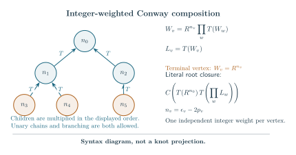

# Rigid spines and the geometry of fully flagged Conway trees

1 November 2026. Internally reviewed structural and complete-geometry
theorem. This note uses the [strict-output compiler](actual_conway_single_leaf_source_composition.md),
the [general complete-mask geometry](actual_conway_general_strict_mask_geometry.md)
and the [original marked filling calibration](actual_conway_general_mask_marked_filling.md).
Its source normal form retains every independent original color and
normal coordinate. A rigid classical profile is not a scalar quantum
coupon, a source-neutral operation or a tangle isotopy.

The [reduced-hub source theorem](actual_conway_reduced_hub_source_normal_form.md)
gives the exact finite algebraic interface. The separate
[decorated-character estimate](actual_conway_decorated_character_spectral_closure.md)
supplies its signed analytic closure; no such estimate is deduced here
from the geometry alone.

## 1. The exact rigid-spine decomposition

The strict types are
\[
L=(0,1/2),\qquad H=(1/2,1),\qquad A=(0,1),
\]
with \(LL,LA,AA\to A\), \(HL,HA\to H\), and \(HH\) empty;
orders can be reversed. Turns exchange \(L,H\) and preserve \(A\).
Consequently:

- A product with output \(H\) has exactly one \(H\) child. Its other
  child has type \(L\) or \(A\).
- No product has output \(L\).
- Starting at any \(L/H\) root, follow its turn child, or the unique
  \(H\) child at a product. This reaches exactly one original leaf \(h_*\).

Call this path the *rigid spine* and its off-path subtrees
\(Q_1,\ldots,Q_m\) its satellites. Every satellite has type \(L\) or
\(A\). Each product on the spine has type \(H\), so turns between
successive product vertices have even parity. The original full
pair-algebra turn satisfies \(T^2=I\). Thus the actual full coupons obey
\[
\begin{aligned}
E_H&=(Th_*)\prod_{j=1}^m Q_j,\\
E_L&=T\!\left[(Th_*)\prod_{j=1}^m Q_j\right].
\end{aligned}
\tag{1}
\]
Here \(E_H,E_L\) name expressions of the indicated types; the equality
retains their values and first normals at all repeated source roots.

Every physical leaf can independently be
\(h_i=T(R^{\epsilon_i}L_{j_i})\). The product order can be kept as
inherited; associativity and commutativity are identities in the original
pair algebra. The unreduced framed expression remains the topology.
In particular, (1) does not remove a pair of physical turns from that
topology.

Nor does it make \(E_H\) a scalar multiple of \(Th_*\), or \(E_L\) a
scalar multiple of \(h_*\). An exact \(N=3\) check gives
\[
h=10-z,\qquad Th=z^2-1,\qquad h\,Th=10z^2-2z-8.
\]
In the full algebra \(\mathbb C[z]/((z-1)^2(z+2))\), the ratio on
the paired-node normal at \(z=1\) is \(9\), whereas the ratio at the
simple node \(z=-2\) is \(12\).

## 2. Every satellite has an intrinsic \(X=1\) state

Write \(f_Q(b)\) for the original positive optimized profile. Set
\[
B=\cot(\pi b),\qquad \kappa=e^{-f_Q'(b)},\qquad
X^2=\frac{1+B^2}{1+\kappa},\qquad Y^2=\kappa X^2.
\]
Then \(X,Y>0\) and \(X^2+Y^2-B^2=1\). The proved port types are
\[
L:(B,B,1),\qquad H:(-Y,1,Y),\qquad A:-Y<B<X.
\]
At a strict product the children have common \(X\), and
\[
B_o=\frac{B_1B_2+X^2-1}{B_1+B_2},\qquad
Y_o=\frac{Y_1Y_2}{B_1+B_2},\qquad B_1+B_2>0.
\tag{2}
\]

Every \(H\) product therefore has common \(X=1\). Its satellite is
evaluated at an output \(\beta_Q\) satisfying
\[
B_Q=Y_Q=b_Q>0,\qquad X_Q=1,\qquad
f_Q'(\beta_Q)+g'(\beta_Q)=0,\qquad
g'(\beta)=2\log\cot(\pi\beta).
\tag{3}
\]
This state depends only on \(Q\), not on the \(H\) output or the other
satellites. Indeed, the strict closed positive source \(C(hT(Q))\)
maximizes \(g(\beta)+f_Q(\beta)\) on \(0\le\beta\le1/2\).
The original root/compiler and entropy-barrier theorem gives a unique
strict optimizer, since \(Q\) has type \(L\) or \(A\). Its equation
is (3). Alternatively, on the positive-\(B\) part of either type, strict
concavity makes \(\kappa\) increasing while \(1+B^2\) decreases.
Thus \(X_Q\) decreases strictly there. The strict closure supplies
existence of the unique \(X=1\) state.

For \(Q:L\), one has \(\beta_Q=1/4\) and \(b_Q=1\).
For \(Q:A\), the strict inequality \(B_Q<X_Q\) gives
\[
\frac14<\beta_Q<\frac12,\qquad 0<b_Q<1.
\tag{4}
\]
Define the absolute closed satellite action
\[
\Omega_Q=\max_{0\le\beta\le1/2}
       \bigl[g(\beta)+f_Q(\beta)\bigr]
       =g(\beta_Q)+f_Q(\beta_Q).
\tag{5}
\]
This is the complete action of the literal source \(C(hT(Q))\), with
its own additional bare leaf. The complete-mask theorem identifies
\(2\pi\Omega_Q\) with that augmented exterior's volume. This identifies
a scalar constant; it neither decomposes the original exterior
topologically nor factors its signed source into satellite sources.

## 3. Harmonic parameter addition and absolute profile constants

At one \(H\) product, write the input, satellite and output as
\((-u,1,u)\), \((b,1,b)\) and \((-v,1,v)\). Equation (2) gives
\[
v=\frac{ub}{b-u},\qquad 0<u<b,\qquad
\frac1u=\frac1v+\frac1b.
\tag{6}
\]
Let \(u_0\) be the cotangent of the distinguished physical leaf, and
let \(v\) be the final \(H\) port's \(Y\)-coordinate, equivalently the
final \(L\) port's \(X\)-coordinate. Iteration gives
\[
\frac1{u_0}=\frac1v+\sum_{j=1}^m\frac1{b_{Q_j}}.
\tag{7}
\]
The response map is represented on \(u\) by
\[
\begin{pmatrix}1&0\\-1/b&1\end{pmatrix}.
\]
It translates \(1/u\) by \(-1/b\), so successive response maps commute
and their translation parameters add. This is a stationary port
parameter calculation. Without an original-word computation it is
not a physical peripheral-holonomy identification. Its positive action
increment below also prevents volume neutrality.

For any \(v,b>0\), (6) gives \(0<u<b\), the original unsquared strict
\(H\)-product branch. The profile theorem identifies it with the
unique original optimizer, rather than a new squared-equation branch.

At a strict closed complete configuration the proved bounds \(X,Y\le1\)
give \(v\le1\). Since \(b_Q\le1\), a spine with \(m\) satellites obeys
\[
\cot(\pi a_*)=u_0\le\frac1{m+1},\qquad
a_*\ge\frac{\arctan(m+1)}{\pi}.
\tag{8}
\]
The inequality is strict if \(v<1\) or any satellite has type \(A\).
Long rigid spines therefore force their distinguished physical leaf
toward index \(1/2\). Every leaf still satisfies \(a\ge1/4\).

The absolute constants also add exactly. Suppose an input has
\(f_H(x)=g(1-x)+c_H\). Its output has the derivative of \(g(1-z)\).
To determine the additive constant, take \(z\to1\) along its connected
\(H\) branch. Then \(v=-\cot(\pi z)\to+\infty\), \(u\to b_Q\),
and \(x\to1-\beta_Q\). The original gate reaches
\(x+\beta_Q=z=1\). Its continuous action is zero: all three volume
atoms in \(\pi m\) degenerate, equivalently its final gate coefficient
is one. Hence
\[
c_{\mathrm{out}}
 =c_H+f_Q(\beta_Q)+g(\beta_Q)
 =c_H+\Omega_Q.
\tag{9}
\]
There is no arbitrary integration constant. Turns preserve it and
\(c_h=0\), so both cases in (1) have
\[
c_E=\sum_{j=1}^m\Omega_{Q_j}.
\tag{10}
\]
For \(Q:L\), \(f_Q=g+c_Q\) gives
\(\Omega_Q=2G_0+c_Q\), where
\(G_0=g(1/4)=2G/\pi\) and \(G\) is Catalan's constant.
For \(Q:A\), \(\Omega_Q\) remains the complete root-leaf action (5);
this is not a finite scalar coupon replacement.

## 4. The \(A\)-core skeleton and the remaining source boundary

After maximal rigid \(L\) subtrees are treated as typed leaves, an
\(A\) subtree has the completed grammar
\[
A::=LL\mid T(A)\mid AA\mid LA\mid AL.
\tag{11}
\]
This is a combinatorial and classical decomposition. Each effective
\(L\) profile is \(g\) plus its fixed constant, so the usual completed
optimization applies and adds those constants. The original signed
coupons remain the full turned products (1). Replacing a physical
alias inside a module by an alias of its effective profile requires
a separate full-source estimate.

There is an exact boundary separation. If an \(L\) module is an input
of a retained product in a closed configuration, its \(X\) is at least
\(1/2\). For an \(H\) neighbor, common \(X=1\). Otherwise let the other
port be \((B,X,Y)\). The \(L\) port is \((X,X,1)\), and
\(Y_{\mathrm{out}}\le1\) gives
\[
1+B^2-X^2\le(B+X)^2,\qquad
1\le2X(B+X)\le4X^2.
\]
The last inequality is strict for an \(A\) neighbor, giving \(X>1/2\).
An effective \(L\) boundary below \(1/2\) can therefore occur only at
the final complementary root. Its distinguished physical leaf may
nevertheless have cotangent below \(1/2\), by (7).
This separates the completed \(A\)-core parameter range from the rigid
module regime. It does not remove amplitudes, currents or independent
colors.

## 5. Fully flagged hubs: complete action and physical leaf ports

Assume a finite reduced Frobenius tree whose internal vertices, called
hubs, have valence \(d_v\ge3\). Internal edges carry \(T\); ordinary
external leaves carry \(h_i\); exactly one external leaf at each hub
is flagged \(Th_i\). The graph is a tree.
The [reduced-hub theorem](actual_conway_reduced_hub_source_normal_form.md)
provides its exact source interface, rather than an isotopy assertion.

Root at a hub and expose its flagged leaf as \(h_0\) in
\(C(h_0T(\prod Q))\). Every nonroot hub has the module
\[
L_v=T\!\left[(Th_v)\prod_{\text{satellites }Q}Q\right],
\tag{12}
\]
where a satellite is an ordinary \(h_i\) or another \(L\) module.
A nonroot hub has \(d_v-2\) satellites; the root has
\(d_{\mathrm{root}}-1\). All modules are type \(L\), so this literal
tree is strict. The existing mask theorem applies to its actual
topology.

Every root satellite has \(b_Q=1\). Its full closure gives
\(\cot(\pi a_{\mathrm{root}})=1/(d_{\mathrm{root}}-1)\).
Every child \(L\) module then has incoming \(X=1\), so (7) gives
\[
\cot(\pi a_v)=\frac1{d_v-1}
\quad\text{for every flagged physical leaf}.
\tag{13}
\]
Every unflagged physical leaf has cotangent \(1\), hence index \(1/4\).
These are original physical leaf labels, although a flagged leaf
becomes unturned in the Frobenius scalar. All retained gate labels
are the strict unsquared values from (2) and (6).

By (9), a nonroot hub contributes \(2G_0(d_v-2)\) in addition to its
descendants' constants, and the root contributes
\(2G_0(d_{\mathrm{root}}-1)\). If \(H\) is the number of physical
leaves, the tree identity gives
\[
\sum_v(d_v-2)=H-2,\qquad
F_0=2G_0(H-1),\qquad
\operatorname{Vol}(Y)=2\pi F_0=2v_{\mathrm{oct}}(H-1),
\quad v_{\mathrm{oct}}=4G.
\tag{14}
\]
This is the actual complete volume of the stated literal realization.
It does not assert that its source cells individually are regular
octahedra or supply a new topological octahedron decomposition.

Knot patterns come from the original pairing compiler. At each physical
leaf there are choices \(U,X\); turn exchanges \(I,U\) and fixes \(X\).
Only \(U\cdot U\) creates an internal circle. The
[proved two-choice induction](actual_conway_general_mask_marked_filling.md),
§7, supplies a loop-free root pairing with one component.
Thus knot patterns exist, but any fixed sign pattern must still pass
that actual pairing check. Full twists preserve it. The original
primitive slopes and knot-complement calibration are those of the
marked-mask theorem.

## 6. Literal integer-weighted Conway-tree dictionary

Choose a finite ordered rooted tree with \(H\ge2\) weighted vertices.
Give each vertex its own integer crossing weight \(n_v\). For each
nonroot vertex define the actual turned tangle recursively by
\[
L_v=T\!\left(R^{n_v}\prod_{w\ \mathrm{child\ of}\ v}L_w\right).
\tag{15}
\]
An empty product gives the terminal \(L_v=T(R^{n_v})\).
Equivalently \(L_v=T(W_v)\), with
\(W_v=R^{n_v}\prod_w T(W_w)\). Thus the formula includes branching
and unary continued-fraction chains, in their inherited ordered frames.
The root closure is prescribed literally as
\[
C\!\left(T(R^{n_0})\,\
         T\!\left(\prod_{w\ \mathrm{child\ of}\ 0}L_w\right)\right).
\tag{16}
\]
No assertion that (16) is a different conventional numerator closure
is needed.

For the augmented source restore
\[
P_v=R^{\epsilon_v}L_{j_v},\qquad h_v=T(P_v),\qquad
L_v=T\!\left(P_v\prod_wL_w\right),\qquad
n_v=\epsilon_v-2p_v.
\tag{17}
\]
Here \(p_v\in\mathbb Z\) is the original filling slope coefficient;
\(P_v\) is the original coupon. Each weighted vertex supplies exactly one
original physical circle/color. Consequently \(H\) in (14) is also
the number of weighted vertices.

With at least two root children, every nonterminal nonroot vertex is a
flagged hub of valence \(2+\#\{\text{children}\}\); the root hub has
valence \(1+\#\{\text{children}\}\). Terminal weighted vertices are
unflagged leaves. Hence (12) is exactly the canonical source expression
of this weighted tree. A nonroot vertex may have one child; it still
has valence three.

The one-child root is also allowed, but its degree-two source must be
handled explicitly. If its unique child is terminal, the source is
\(\phi(P_0T(P_1))\), the strict two-leaf \(LH\) case.
If that child has descendants, write \(E=\prod_wL_w\); then
\[
\phi\!\left(P_0\,T(P_1E)\right)
   =\phi\!\left((TP_0)\,P_1E\right).
\tag{18}
\]
This is exact self-adjointness of the original turn for the full
Frobenius pairing. The right side has a flagged root \(P_1\), an
ordinary leaf \(TP_0\), and the original descendants. It proves the
source reduction and action count, not an isotopy re-rooting.
The literal left-side presentation is itself strict by the \(LH\)
root rule, and retains its own original mask geometry and peripheral
words. Its pure complete source rate, hence its complete geometric
action, agrees by (18). In the two-leaf case the direct profile is
\(2g(a)\), with maximum \(2G_0\), so (14) holds there too.
Fixed sign patterns still require the original loop-free
one-component test; the two-odd two-leaf pattern is not a knot.

[Reproducible TikZ source](../book/figures/weighted-conway-tree.tex),
[PDF](../book/figures/weighted-conway-tree.pdf), and
[PNG](../book/figures/weighted-conway-tree.png).

After every auxiliary component is filled, (17) gives the actual
crossing powers once. A one-component main pairing yields a **knot
complement**; its knot cusp is unfilled. The finite choices
\(\epsilon_v\in\{0,\pm1\}\) allow a common diagram threshold on
independently large \(|n_v|\) whenever the separate analytic filling
theorem supplies thresholds on \(|p_v|\).
This dictionary alone is not that invariant-limit theorem.

## 7. Coverage and the separate signed estimate

The [older belt construction](actual_balanced_octahedral_belt_stack_volume.md)
restricts its gluing graph to a cycle along one retained belt and
explicitly requires a separate tensor argument for branched multi-belt
graphs. The [root-star coverage audit](actual_conway_root_star_prior_source_coverage.md)
establishes exact source overlap of one-hub examples with nonzero
inner half twists. Neither result alone proves a branched-hub estimate.

Formula (14) calibrates the complete action of the present source tree.
It makes no claim of a new unmarked knot family or a literature-wide
coverage classification. In particular, arbitrary Conway diagrams need
not have a fully flagged reduced hub tree.

The quantum induction retains the actual unturned
\(R^\epsilon L_j\) immediately before each turn, all independent
colors and every normal direction. The separate
[decorated-character closure](actual_conway_decorated_character_spectral_closure.md)
proves estimates for this operator. They do not follow from the harmonic
response (7), the constant identity (10), or the complete value (14).
An unflagged hub requires a different operator, with no original
character at that vertex; adding a new circle would change the source.

## Internal proof review

The primary agent and both independent collaborators fully reviewed the
rigid-spine, intrinsic-state, absolute-constant and fully flagged
geometric derivation. The source collaborator separately checked the
exact reduced-hub tensor identity and positive complete kernel; its
all-parity action agrees with (14). The weighted-tree dictionary records
the exact authorized literal recursion and separates the one-child
root's source identity from topology. No numerical experiment or
topological re-rooting claim is part of this proof.
