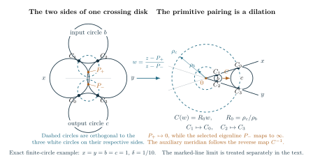

# Pairing the sides of a crossing disk: the meridian and its half twists

Consider one auxiliary crossing circle in an augmented link diagram. Its disk is pierced by two main strands. Cutting along that disk exposes two shaded triangular faces. To reconstruct the link exterior, one must specify the map that pairs those faces, including which contact point goes to which. This map also determines the auxiliary meridian used in a later filling. The word *collar* refers to the small neighborhood through which the strands pass from one cut side to the other; the calculation concerns the map induced on its two triangular sides.

The local circle pattern gives an explicit way to calculate this pairing. In the upper-half-space model, a circle on the boundary sphere bounds a hyperbolic plane. The white planes come from the projection regions, and the shaded planes come from the cut crossing disk. Two outer white circles, labelled \(x\) and \(y\), are shared by the input triangle \((x,b,y)\) and the output triangle \((x,c,y)\). The letters are the curvatures of the circles, so a finite circle of curvature \(f>0\) has radius \(1/f\). A marked straight line has curvature zero. The input and output labels record the actual order of the main strands; they are not interchangeable.

The result proved below is local. The pairing is a dilation after a specified Möbius change of coordinates, and its scale factor is exactly the ratio supplied by the finite source calculation. We also determine the selected eigenline, the primitive meridian, and the change caused by a retained positive or negative half twist. Assembling these maps into the representation of a whole link group and integrating its volume are separate steps.

**Figure 1.** On the left, the four white circles and the two dashed circles are drawn from the exact finite-circle model \(x=y=b=c=1\), \(\delta=1/10\). Each dashed circle is orthogonal to the three white circles on its side. The Möbius coordinate on the arrow sends the outer intersection points to \(0\) and \(\infty\). On the right, the dashed circles are concentric and the two middle circles lie in the same wedge. The map \(C(w)=R_0w\) sends \(C_1\) to \(C_0\) and \(C_2\) to \(C_3\). The auxiliary meridian follows the inverse map. This is one local finite-circle configuration; Section 5 treats marked straight lines and the necessary side signs. The [TikZ source](../book/figures/deformed-circle-collar.tex), [PDF](../book/figures/deformed-circle-collar.pdf), and [PNG](../book/figures/deformed-circle-collar.png) are available.

## 1. The ordered circles, contacts, and algebraic parameters

Use the labeled pattern constructed in [the marked circle-pattern theorem](actual_marked_deformed_circle_pattern.md). At the complete point, the relevant white circles are tangent. The parameter \(\delta\) deforms this configuration; completeness is \(\delta=0\). In the spectral convention of the coupled source, \(\delta=1/2-\mu\). Put

$$
\begin{aligned}
 s&=\sin(\pi\delta),& c_0&=\cos(\pi\delta),\\
 A&=x+y,& D&=A^2-4xy s^2,\\
 T_b&=\sqrt{bA+xy+b^2s^2},&
 B_b&=A+2bs^2,& E_b&=B_b+2sT_b,
\end{aligned}
$$

and define \(T_c,B_c,E_c\) by replacing \(b\) with \(c\). The roots are positive at complete positive data and are continued on the nearby selected branch. Direct multiplication gives

$$
 E_b(\delta)E_b(-\delta)=D,
 \qquad R_0=\frac{E_bE_c}{D}. \tag{1}
$$

The quantities \(E_b,E_c\) and \(R_0\) are also the continuant roots and channel ratio in [the coupled source equations](actual_whole_source_coupled_face_difference_system.md), with input \(b\), output \(c\), and the stated polynomial normalization. The geometric calculation below identifies their meaning rather than choosing a sidepairing from the scalar ratio alone.

Write \(\mathcal R_f\) for reflection in white circle \(f\). Products of two such reflections are orientation-preserving Möbius maps. With products acting from right to left, the [white-prefix convention](actual_right_angled_selected_framing_obstruction.md), Section 3, is

$$
\begin{aligned}
 A_{\mathrm{in}}&=\mathcal R_b\mathcal R_x,&
 B_{\mathrm{in}}&=\mathcal R_y\mathcal R_b,&
 P&=B_{\mathrm{in}}A_{\mathrm{in}}=\mathcal R_y\mathcal R_x,\\
 A_{\mathrm{out}}&=\mathcal R_c\mathcal R_x,&
 B_{\mathrm{out}}&=\mathcal R_y\mathcal R_c.
\end{aligned}\tag{2}
$$

The four contact points are

$$
\begin{aligned}
 C_1&=x\cap b,& C_2&=b\cap y,\\
 C_0&=x\cap c,& C_3&=c\cap y.
\end{aligned}
$$

Here each intersection denotes the specified tangency point. The untwisted crossing disk pairs the input side with the output side by \(C_1\mapsto C_0\) and \(C_2\mapsto C_3\). This is the labeling in [the cut quotient](general_augmented_plat_matching_geometry.md), Section 4. Both the order in (2) and these contacts are needed: reversing the outer product exchanges its two eigenlines and inverts the ratio later attached to the selected one.

## 2. Computing the circles orthogonal to the two triangles

First assume all four curvatures are positive, take small real \(\delta>0\), and put the outer centers at \(0,L\) on the real axis. Write \(r_f=1/f\) for a radius. The distance between the outer centers satisfies

$$
 L^2=(r_x+r_y)^2-4r_xr_y s^2=\frac{D}{x^2y^2}.
$$

The two outer circles intersect at \(P_+=u+iv\) and \(P_-=u-iv\), where

$$
 u=\frac{L^2+r_x^2-r_y^2}{2L},
 \qquad v=\frac{2r_xr_y s c_0}{L}
        =\frac{2s c_0}{\sqrt D}. \tag{3}
$$

Choose the input middle circle above the outer center line and the output middle circle below it, as in Figure 1. Tangency to the two outer circles determines their centers:

$$
\begin{aligned}
 p_b&=u+\frac{r_b(r_x-r_y)}L,&
 q_b&=\frac{2c_0T_b}{b\sqrt D}>0,\\
 p_c&=u+\frac{r_c(r_x-r_y)}L,&
 q_c&=-\frac{2c_0T_c}{c\sqrt D}<0.
\end{aligned}
$$

The signs here are part of this oriented model. They cannot be inferred merely from the positivity of the radii. Section 5 explains how to preserve the correct signs in a common regularization of a marked-line pattern.

The circle orthogonal to the input white circles has center \(u+it_b\) and squared radius \(t_b^2-v^2\). To obtain its center, subtract the equations expressing orthogonality to the outer and middle circles. This gives

$$
 t_b=\frac{r_x(r_x+r_b)-up_b}{q_b}
     =\frac{c_0B_b}{\sqrt D\,T_b}. \tag{4}
$$

For the output side the same calculation gives \(t_c=-c_0B_c/(\sqrt D\,T_c)\). The identity \(B_b^2-4s^2T_b^2=D\), and its output counterpart, verify the squared radii. These orthogonal circles are the boundary circles of the shaded hyperbolic planes.

Now use the Möbius coordinate

$$
                 w=\frac{z-P_+}{z-P_-}.
$$

Both outer circles pass through \(P_+,P_-\), so they become straight lines through \(0\) and \(\infty\). If a shaded circle has center \(u+it\) and squared radius \(t^2-v^2\), substitution of its circle equation gives the constant value \(|w|^2=(t-v)/(t+v)\). Thus the shaded circles become concentric, with positive radii

$$
\begin{aligned}
 \rho_b^2&=\frac{B_b-2sT_b}{B_b+2sT_b}=\frac{D}{E_b^2},\\
 \rho_c^2&=\frac{B_c+2sT_c}{B_c-2sT_c}=\frac{E_c^2}{D},\\
 \frac{\rho_c}{\rho_b}&=\frac{E_bE_c}{D}=R_0.
\end{aligned}\tag{5}
$$

This computation explains why a scale ratio appears in the source. The remaining question is which scale map realizes the actual corner pairing.

## 3. The pairing, its eigenline, and its complete limit

The transformed middle circles occupy the same wedge between the two outer lines. This requires a check because an orthogonal circle alone does not choose a wedge. As \(\delta\) tends to zero, \(P_+\) and \(P_-\) approach the outer tangency. Away from that tangency, \(w\) tends to \(1\). Both finite middle circles are separated from the tangency, so their images lie near \(1\) in the same wedge for small positive \(\delta\).

A circle tangent to both sides of a fixed wedge has its center on the angle bisector. Its center distance and radius are fixed positive multiples of the radius of its concentric orthogonal circle. Therefore the positive dilation

$$
                         C_w(w)=R_0w. \tag{6}
$$

maps the input middle circle to the output middle circle and pairs the two shaded circles. It preserves each outer line and sends the corresponding contacts exactly as required. A negative dilation would use the opposite wedge. The reverse path through the disk uses \(C_w^{-1}\).

This also determines the primitive factor. Reflection in \(|w|=\rho\) is \(w\mapsto\rho^2/\overline w\). Composing the two shaded reflections would have scale factor \(R_0^2\), whereas the disk sidepairing (6) has scale factor \(R_0\). The primitive path is a single sidepairing, not that doubled reflection word.

We next identify the eigenline selected by the original order (2). A determinant-one lift of the outer product is

$$
 P=\frac1{r_xr_y}
 \begin{pmatrix}
 r_y^2-L^2&Lr_x^2\\
 -L&r_x^2
 \end{pmatrix}. \tag{7}
$$

Its trace is \(-2\cos(2\pi\delta)\). At the fixed point \(P_-\), its eigenvalue is

$$
                         J=-e^{-2\pi i\delta}.
$$

Indeed, applying the lower row of (7) to \((P_-,1)^{\mathsf t}\) gives \((-LP_-+r_x^2)/(r_xr_y)=-\cos(2\pi\delta)+i\sin(2\pi\delta)\). The eigenvalue at \(P_+\) is \(J^{-1}\). A *selected eigenflag* here means this chosen fixed point, continued from the marked complete configuration; it is not an extra scalar chosen after solving the source equation.

The coordinate \(w\) sends the \(J\)-eigenline \(P_-\) to infinity. On that eigenline the ratio of the two eigenvalues of (6) is \(R_0\). Returning to the original coordinate gives the projective matrix

$$
 C=I+\frac{R_0-1}{J-J^{-1}}(P-J^{-1}I). \tag{8}
$$

It has eigenvalues \(R_0,1\) and determinant \(R_0\). Because it preserves the outer circles and takes \(b\) to \(c\), it satisfies the two ordered transport relations

$$
 C A_{\mathrm{in}}C^{-1}=A_{\mathrm{out}},
 \qquad C B_{\mathrm{in}}C^{-1}=B_{\mathrm{out}}. \tag{9}
$$

Thus the identification uses the complete maps and the actual contacts, not only their traces. The formulas have been proved in a real configuration with specified branches and then extend as holomorphic identities nearby.

At \(\delta=0\), the displayed quotient in (8) has a removable singularity. Define the real complete coefficient

$$
 C_{\mathrm{sc}}=\frac{\pi\bigl(T_b(0)+T_c(0)\bigr)}{x+y}.
$$

Then \(R_0=1+2C_{\mathrm{sc}}\delta+O(\delta^2)\) and \(J-J^{-1}=4\pi i\delta+O(\delta^3)\), so

$$
                   C=I+\frac{C_{\mathrm{sc}}}{2\pi i}(P+I)
                   \qquad(\delta=0). \tag{10}
$$

Although the limiting eigenvalue ratio is one, this is the nontrivial parabolic map determined by the complete cusp rectangle. Keeping the matrix limit is essential.

## 4. The auxiliary meridian and a retained half twist

A meridian is a loop going once around the auxiliary crossing circle. The disk longitude is the other specified primitive curve on its cusp torus. To fix their orientation, use the actual threading word \([2,1,1,2]\): the entries record the adjacent crossings in the three-strand picture consisting of the two main strands and the auxiliary strand. The [local critical-character calculation](actual_augmented_plat_local_critical_character_map.md), Section 4, follows this word and identifies the pure transport with \(C_{\mathrm{aux}}^{-1}\), with disk longitude \(P=BA\).

Consequently the auxiliary meridian follows the inverse of the sidepairing just computed. Normalize (8) to determinant one by dividing by \(\sqrt{R_0}\), with the square root equal to one at completeness. Its eigenvalue on the selected line is then \(M_{\mathrm{aux}}=R_0^{-1/2}\).

The actual positive main crossing acts on the ordered pair by the Hurwitz move \((A,B)\mapsto(A^{-1}BA,A)\). It is simultaneous conjugation by \(P^{-1}-I\), whose eigenvalue ratio on the selected line is \(-J^{-1}\). With a retained sign \(\epsilon\in\{0,1,-1\}\), the resulting convention is

$$
                    M_{\mathrm{aux}}^{-2}=R_0(-J)^\epsilon.
                    \tag{11}
$$

The square root is fixed by the original complete meridian lift. Reversing the collar path or the selected eigenline would reverse the associated logarithms and must be recorded explicitly.

Take the logarithms that vanish at completeness. The similarity logarithm is twice the eigenvalue logarithm, so the primitive coordinates are

$$
\begin{aligned}
 U_{\mathrm{aux}}&=2\operatorname{Log}M_{\mathrm{aux}}
            =-\operatorname{Log}R_0-\epsilon\operatorname{Log}(-J),\\
 V_{\mathrm{long}}&=2\operatorname{Log}(-J)=-4\pi i\delta.
\end{aligned}\tag{12}
$$

Differentiating at zero gives \(dV_{\mathrm{long}}/dU_{\mathrm{aux}}=2\pi i/(C_{\mathrm{sc}}-\pi i\epsilon)\), the modulus of the primitive cusp rectangle. Here it is a consequence of the ordered calculation, not a replacement for the calculation of the curves.

## 5. Passing to the common marked-line pattern

The marked pattern may contain two white straight lines. In the normalization of [the marked reconstruction](actual_marked_deformed_circle_pattern.md), they bound the strip \(0<\operatorname{Im}z<1\). The chosen line flags and the strip width are geometric data. They remain necessary when a scalar source root degenerates and ceases to distinguish the relevant eigenline.

To reduce the line case to finite circles, use one Möbius map for the entire finite pattern:

$$
                    g_t(z)=\frac{z}{1-tz+it/2},
                    \qquad t\in\mathbb R,\quad t\longrightarrow0.
                    \tag{13}
$$

Its pole \(1/t+i/2\) lies between the two marked halfplanes and outside every finite white disk for small \(t\). Thus their transformed outward disks are bounded, with positive radii. Both marked curvatures are positive and of order \(t^2\), while each other curvature tends to its original positive value. The same map transports all contacts, sidepairings and flags, and tends to the identity. Using unrelated local conjugations would not give this common limit.

There is a sign issue even though all the transformed radii are positive. The input and output middle centers need not lie on opposite sides of their outer center line after a Möbius transformation. Write \(\sigma_f=\operatorname{sign}(q_f)\) for the side of a middle center. Repeating the radius calculation with those actual signs gives

$$
 \rho_f=\left(\frac{\sqrt D}{E_f}\right)^{\sigma_f},
 \qquad
 R_{\mathrm{signed}}=
 \left(\frac{E_b}{\sqrt D}\right)^{\sigma_b}
 \left(\frac{E_c}{\sqrt D}\right)^{-\sigma_c}.
 \tag{13a}
$$

At every finite regularization parameter this signed formula must be used. Formula (5) is its special case \(\sigma_b=1,\sigma_c=-1\), not an unsigned rule valid in every compactified picture.

We now calibrate the signs from the actual marked diagram. At completeness the transformed disks are bounded and disjoint. A straight edge joining two tangent centers lies in the union of those disks, so the center triangles have the same planar cyclic order as the original pattern. All bounded triangles have one consistent orientation; the outer triangle has the opposite orientation. The pole of (13) lies far along the strip. A gap containing only one marked line has bounded horizontal extent, whereas the two unbounded gaps contain both marked lines. The exceptional outer triangle is therefore one of the latter.

The common edge of the two marked faces is a main edge, not a matching edge. In a triangle containing both marked lines, one middle curvature and one outer curvature vanish in the limit, so the corresponding \(T_f\) is zero and \(E_f/\sqrt D\) tends to one. This is the boundary case sometimes denoted \(200\) or \(002\) in the source coordinates. Its vanishing term contributes no side-sign ambiguity.

For the nonvanishing terms the sign is fixed by the complete collar word. The translation calculation in [the channel-Hessian note](actual_augmented_plat_channel_hessian.md), Section 3, together with the cusp rectangle in [the reflection construction](actual_external_circle_reflection_and_cusp.md), Section 4, gives

$$
 C_{\mathrm{complete}}=I-\frac{i}{2c_{\mathrm{geom}}}(P+I),
 \qquad
 c_{\mathrm{geom}}=\frac{x+y}{T_b(0)+T_c(0)}>0.
 \tag{13b}
$$

All quantities in (13b) refer to the marked-strip limit after \(t\to0\). They are not the unsigned curvatures of an arbitrary finite regularization. First conjugate the signed finite-circle map back to the marked strip. Its limiting coefficient of \(P+I\) is

$$
             -\frac{i\,[\sigma_bT_b(0)-\sigma_cT_c(0)]}{2(x+y)}.
$$

Comparison with (13b) forces \(\sigma_b=1\) whenever the limiting \(T_b(0)>0\), and \(\sigma_c=-1\) whenever \(T_c(0)>0\). A zero limiting term requires no sign choice. Reversing the projection copy or the collar path changes the ordered word and its calibration together.

These signs persist for small real \(\delta\). The squared height of a nondegenerate finite center triangle is

$$
                    \frac{4\cos^2(\pi\delta)T_f^2}{f^2D}>0,
$$

so its center cannot cross the outer center line during that deformation. The exceptional triangle containing both marked lines has \(T_f=0\) in the line limit for every \(\delta\). Hence the signed ratio (13a) converges to \(R_0\) in (1) on the marked branch.

Finally, the maps themselves have a regular limit, not just their ratios. The three labeled points \(C_1,C_2\) and the selected matching fixed point are distinct at completeness, as are their prescribed images \(C_0,C_3\) and that fixed point. Three distinct source and target points determine a unique Möbius map, holomorphic in their coordinates; homogeneous coordinates handle a point at infinity. Conjugating the signed finite-circle map by \(g_t^{-1}\) therefore gives the same regular limit as this three-point construction. It is (8), with the ordered transport relations (9).

No matching edge has both outer faces equal to the marked faces: their common edge is a main edge, and the white sphere is simplicial. Thus \(A=x+y\) stays positive at every matching edge, including a triangle containing two lines. The functions \(D,E_b,E_c,R_0\) have nonzero holomorphic limits near \(\delta=0\). When \(T_b=0\), set \(E_b=A\) exactly; the missing eigenflag has already been supplied by the marked line geometry. The regular three-point map then extends all these identities to small complex \(\delta\).

## 6. The local conclusion and its use

For the marked deformed pattern, the crossing-disk sidepairing is the map (8), with the prescribed contacts and selected eigenline. Its scale ratio is \(E_bE_c/D\), its primitive meridian follows the inverse path, and a retained half twist changes the logarithms exactly as in (11)–(12). The complete parabolic limit is (10), including the marked-line boundary cases.

These formulas provide the local input for assembling the link representation and its peripheral marking. They do not by themselves prove the relations of the whole link group, identify an absolute volume regulator, or estimate the full filled quantum invariant. Those arguments must use the maps with the same labels, branches and framings.

The [calculation script](../experiments/audit_actual_deformed_circle_primitive_collar.py) and its [saved output](../experiments/actual_deformed_circle_primitive_collar_results.json) check the radius identities, ordered products, contact images, primitive-versus-double-reflection factors, half-twist words and common circle regularizations. In particular, it includes regularizations that reverse a center triangle and therefore require (13a). These computations are checks of the displayed formulas; the local geometric proof is given above.
