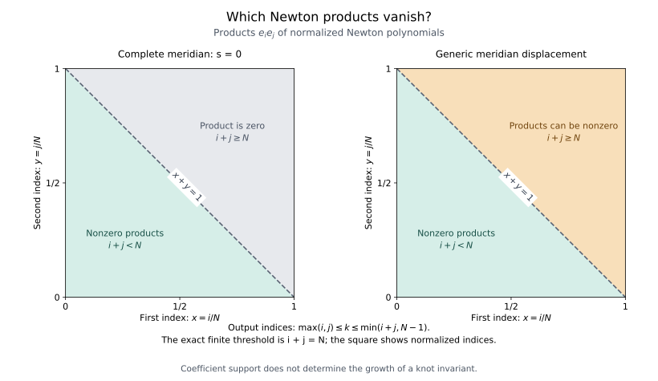

# Newton products when the main meridian changes

1 November 2026. Joining two tangle boxes requires multiplying their Casimir polynomials. At the complete color, many of the resulting coefficients vanish exactly. Varying the main knot meridian can make them nonzero, even on the microscopic scale used in the meridian profile. This note establishes an exact multiplication rule in the actual equal-color Casimir polynomial algebra. The [oriented compiler](actual_main_meridian_newton_compiler.md) supplies the physical turns and closing trace separately. The multiplication rule alone gives no bound for a knot invariant.

## 1. Definitions and the exact formula

Fix \(N\ge2\), set \(\theta=\pi/N\), \(q=e^{i\theta}\), \(\rho=q-q^{-1}\), and write
\[
 [a]=\frac{\sin(a\theta)}{\sin\theta},\qquad
 [r]!=\prod_{u=1}^r[u],\qquad
 S_r=\prod_{u=1}^r2\sin(u\theta),\quad S_0=1.
\tag{1}
\]
The argument \(a\) in a bracket may be complex. Factorials are used only at integers in \(0,\ldots,N-1\), so their denominators below never vanish. The symbol \(S_r\) is the \(s_r\) of the original Newton normalization; a capital letter distinguishes it from the meridian displacement \(s\).

Let \(Y=q^{2s}\), and use the nodes and monic Chebyshev polynomial
\[
\begin{aligned}
 c_j(s)&=q^{2j+1}Y^{-1}+Yq^{-2j-1}
       =2\cos((2j+1-2s)\theta),\\
 \mathcal T_N(v+v^{-1})&=v^N+v^{-N},\\
 P_s(\omega)&=\mathcal T_N(\omega)+Y^N+Y^{-N}.
\end{aligned}
\tag{2}
\]
These are the equal-color nodes of [the actual meridian Casimir source](meridian_casimir_source.md), §1. The Newton polynomials are
\[
 B_r(s,\omega)=\prod_{j=0}^{r-1}(c_j(s)-\omega),\qquad
 e_r(s,\omega)=\frac{B_r(s,\omega)}{S_r^2},
 \quad 0\le r<N.
\tag{3}
\]
The polynomials \(e_r\) form a basis at every complex \(s\), including repeated nodes. Their degrees and nonzero leading coefficients give this statement without any eigenvalue separation.

The product of all node factors gives
\[
 B_N=(-1)^N P_s.
\tag{4}
\]
Thus the following formulas hold in \(\mathbb C[\omega]/(P_s)\), for all complex \(s\), with every repeated-root direction retained:
\[
 B_iB_j=\sum_{k=\max(i,j)}^{\min(i+j,N-1)}
 A_{ijk}(s)B_k,
\tag{5}
\]
where
\[
 \boxed{\;
 A_{ijk}(s)=
 (-\rho^2)^{i+j-k}
 \frac{[i]![j]!}
 {[k-i]![k-j]![i+j-k]!}
 \prod_{r=k+1}^{i+j}[r-2s].
 \;}
\tag{6}
\]
In normalized coordinates,
\[
 e_ie_j=\sum_{k=\max(i,j)}^{\min(i+j,N-1)}
 \mu_{ijk}(s)e_k,
\tag{7}
\]
with
\[
 \boxed{\;
 \mu_{ijk}(s)=
 \frac{S_k^2}
 {S_iS_jS_{k-i}S_{k-j}S_{i+j-k}}
 \prod_{r=k+1}^{i+j}2\sin((r-2s)\theta).
 \;}
\tag{8}
\]
Every product with no factors is one. In particular, no factorial at \(i+j\ge N\) is introduced or canceled.

The associated change of factorial basis is classical: see Ismail and Stanton, [*Expansions in the Askey–Wilson Polynomials*, equation (2.4), PDF page 7](https://www-users.cse.umn.edu/~stant001/PAPERS/AF-Ismail-Stanton.pdf#page=7). The companion note gives that connection formula and its root-of-unity proof. Here the required statement is multiplication in the specified quotient, with the normalization in (3) and all factors crossing the index \(N\) retained.

The horizontal coordinate is \(x=i/N\), and the vertical coordinate is \(y=j/N\). At completeness, \(e_ie_j\) vanishes when \(i+j\ge N\). Under a generic displacement \(s\), coefficients in that region can be nonzero; their finite output indices still satisfy \(\max(i,j)\le k\le\min(i+j,N-1)\). The line \(x+y=1\) is the exact finite threshold \(i+j=N\). The diagram describes coefficient support, not growth of a contracted knot invariant.

## 2. Proof by the Newton recurrence

The elementary node difference is
\[
 c_i(s)-c_k(s)
 =4\sin((k-i)\theta)\sin((k+i+1-2s)\theta)
 =(-\rho^2)[k-i][k+i+1-2s].
\tag{9}
\]
Since \((c_i-\omega)B_k=B_{k+1}+(c_i-c_k)B_k\), multiplication by the next factor of \(B_i\) requires
\[
 A_{i+1,j,k}
 =A_{i,j,k-1}
   +(-\rho^2)[k-i][k+i+1-2s]A_{i,j,k}.
\tag{10}
\]
The term \(B_N\) is zero in the quotient. Thus (10) is also the exact recurrence at the top retained index \(k=N-1\); there is no wrap-around contribution.

The required scalar identity is
\[
 [i+1][i+j+1-2s]
 =[k-j][k-2s]
  +[k+i+1-2s][i+j+1-k].
\tag{11}
\]
For a direct verification, multiply by \(\sin^2\theta\). In the difference of the first two sine products, the difference angles are both \((2s-j)\theta\). The product-to-sum formula leaves
\[
 \frac{\cos((2k-j-2s)\theta)
             -\cos((2i+j+2-2s)\theta)}2,
\]
which is the final sine product in (11).

Substitution of (6) in (10), followed by factorial cancellation and (11), proves the recurrence at the interior indices. One may do the cancellation first for generic \(s\), then clear the shifted factors. Both resulting sides are entire trigonometric polynomials in \(s\), so the identity holds at their zeros as well. Equivalently, multiply the recurrence by the common nonzero integer factorial denominator before using (11).

At the lower and upper support endpoints, the vanished \([k-i]\) factor and the empty product give the recurrence directly. The initial condition \(B_0B_j=B_j\) is exact. Induction through \(0\le i<N\) proves (5)–(6). Finally,
\[
 S_r=(2\sin\theta)^r[r]!,\qquad
 -\rho^2=(2\sin\theta)^2
\]
convert \(A_{ijk}S_k^2/(S_i^2S_j^2)\) into (8), with all powers of \(2\sin\theta\) canceled. This verifies the proposed normalization and sign.

For instance, \(B_1^2=B_2+(c_0-c_1)B_1\) gives
\[
 \mu_{111}(s)=\frac{\sin((2-2s)\theta)}{\sin\theta}.
\tag{12}
\]
This checks the shift \(2s\), rather than \(s\), and the sign in (8).

At \(s=0\), if \(i+j<N\), (8) reduces to
\[
 \mu_{ijk}(0)=
 \frac{S_{i+j}S_k}
 {S_iS_jS_{k-i}S_{k-j}S_{i+j-k}},
\tag{13}
\]
the existing positive complete-source multiplication coefficient. If \(i+j\ge N\), the retained product in (8) contains its zero at \(r=N\), so every coefficient is zero. This agrees with the complete-color divisibility \(B_iB_j=0\bmod P_0\). For generic \(s\), these same terms no longer vanish.

## 3. An exact factorization for the opened sector

Assume \(i+j\ge N\), and put
\[
 h=i+j-N,\qquad
 \nu_{ijk}=
 \frac{S_kS_h}
 {S_iS_jS_{k-i}S_{k-j}S_{i+j-k}}.
\tag{14}
\]
All these numbers are positive. For \(0\le n<N\), define the entire shifted sine product
\[
 \mathcal A_{N,n}(a)
   =\prod_{r=1}^{n}
       \frac{\sin(\pi(r+a)/N)}{\sin(\pi r/N)}.
\tag{15}
\]
Reflecting the factors below \(N\), retaining the factor at \(N\), and changing the signs above \(N\) gives the exact identity
\[
\begin{aligned}
 \prod_{r=k+1}^{N+h}2\sin\frac{\pi(r-2s)}N
 ={}&(-1)^h\frac{NS_h}{S_k}\,
        2\sin\frac{2\pi s}{N}\\
 &\times\mathcal A_{N,N-k-1}(2s)
          \mathcal A_{N,h}(-2s).
\end{aligned}
\tag{16}
\]
Here \(S_{N-k-1}=N/S_k\) uses the complete sine product. The factor at \(r=N\) is \(+2\sin(2\pi s/N)\), not its negative. Hence
\[
 \mu_{ijk}(s)=
 (-1)^h\,2N\sin\frac{2\pi s}{N}\,
 \nu_{ijk}\,
 \mathcal A_{N,N-k-1}(2s)\mathcal A_{N,h}(-2s).
\tag{17}
\]
This is an identity of entire functions, including \(s=0\).

The first derivative has a particularly simple exact form, requiring no bulk assumption:
\[
 \boxed{\;
 \partial_s\mu_{ijk}(0)=4\pi(-1)^h\nu_{ijk}.
 \;}
\tag{18}
\]
Both shifted products equal one at zero, and the derivative of \(2N\sin(2\pi s/N)\) there is \(4\pi\). Thus every admissible opened coefficient has a nonzero first derivative at completeness. These are derivatives of the coefficient array in the moving Newton basis; no assertion about the contraction of those derivatives in a knot source follows.

### The first derivative depends on the chosen basis

The nonzero derivative in (18) is not an intrinsic first-order change of the quotient multiplication. To see this, identify all the degree-\(<N\) polynomial vector spaces by keeping the complete basis \(e_r(0,\omega)\) fixed. Put
\[
\Delta_s=Y^N+Y^{-N}-2=2\cos(2\pi s)-2.
\tag{18a}
\]
For any two degree-\(<N\) polynomials, divide their product once:
\[
fg=P_0Q+R,\qquad \deg R<N,\qquad \deg Q\le N-2.
\]
Reduction modulo \(P_s=P_0+\Delta_s\) gives the exact fixed-coordinate product
\[
\mathsf M_s(f,g)=R-\Delta_sQ.
\tag{18b}
\]
There is no further reduction, because \(Q\) already has degree less than \(N\). In particular, \(\mathsf M'_0=0\).

The connection matrix in [the oriented compiler](actual_main_meridian_newton_compiler.md) describes the moving coordinates:
\[
e_n(s)=\sum_{k=0}^n C_{nk}(s)e_k(0).
\]
For \(m=n-k>0\), its derivative is exactly
\[
C'_{nk}(0)=
\frac{(-1)^{m+1}\pi}{N\sin(\pi m/N)},\qquad C'_{nn}(0)=0.
\tag{18c}
\]
Indeed the connection coefficient contains exactly one vanishing factor \(1-Y\). Differentiate it and cancel the remaining root factorials. The result before the last simplification is
\[
(-1)^{m+1}\frac{2\pi i}{N}
             \frac{q^{-m}}{1-q^{-2m}},
\]
which equals (18c). Thus the derivative matrix is triangular and constant along each diagonal. Since \(\sin(\pi m/N)\ge2\min(m,N-m)/N\), both its absolute row sums and its absolute column sums are \(O(\log N)\). Its coefficient \(\ell^2\)-operator norm is therefore \(O(\log N)\).

Let \(D\) be the linear operator defined by
\(D e_n(0)=\sum_k C'_{nk}(0)e_k(0)\), and let \(\widetilde{\mathsf M}_s\) be multiplication written with moving coefficient labels. Differentiating the change of coordinates gives
\[
\widetilde{\mathsf M}'_0(f,g)
=\mathsf M_0(Df,g)+\mathsf M_0(f,Dg)-D\mathsf M_0(f,g).
\tag{18d}
\]
This accounts for (18) as a basis-change effect. At nonzero fixed \(s\), (18b) still contains the genuine order-one factor \(\Delta_s\). The first-order coordinate observation neither removes those sectors for general \(s\) nor bounds their signed contraction.

There is a further precise statement for the generator \(\omega\). In the fixed complete basis, let \(A_s\) be its multiplication matrix and let \(\mathbf e_r\) denote the \(r\)-th coefficient vector. At \(s=0\),
\[
(A_0)_{rr}=c_r(0),\qquad
(A_0)_{r+1,r}=-4\sin^2(\pi(r+1)/N).
\]
All other entries vanish. Since
\(B_N(0)=(-1)^NP_0\equiv(-1)^{N+1}\Delta_s\pmod{P_s}\)
and \(S_d=N\), only the last column changes:
\[
A_s=A_0+\frac{(-1)^N\Delta_s}{N^2}
                  \mathbf e_0\mathbf e_d^{\,T}.
\tag{18e}
\]
Thus \(\|A_s-A_0\|_{\ell^2\to\ell^2}=|\Delta_s|/N^2=O_R(N^{-2})\) on every bounded \(s\)-disk. This bound concerns the abstract coefficient norm of the single multiplication generator. It does not bound \(f(A_s)\) for a level-dependent polynomial or any physical turn.

For completeness, writing \(E=\mathbf e_0\mathbf e_d^{\,T}\) gives \(E^2=0\) and \(EA_0^mE=0\) for \(m<d\), because \(A_0\) is lower bidiagonal. Starting at \(\mathbf e_0\), each return through \(E\) requires at least \(N\) steps. Hence powers of total degree below \(2N\), applied to the constant vector, contain at most one return, as also follows from the division in (18b). This last statement is about polynomial evaluation on the constant vector, not all entries of a matrix power.

## 4. A uniform shifted-product estimate through its zeros

For fixed \(R<\infty\) and \(0<\delta<1/2\), uniformly for
\(\delta N\le n\le(1-\delta)N\) and \(|a|\le R\),
\[
 \mathcal A_{N,n}(a)
 =\frac{(N\sin(\pi n/N)/\pi)^a}{\Gamma(1+a)}
          V_{N,n}(a),
 \qquad V_{N,n}=1+O_{R,\delta}(N^{-1}),
\tag{19}
\]
where \(V_{N,n}\) is a nonvanishing holomorphic unit on a neighborhood of that disk. Real positive bases in complex powers use their real logarithms. The estimate and its inverse hold with every fixed \(a\)-derivative on smaller disks.

To establish the zero-preserving version of (19), let
\[
 g(t)=\frac{\sin(\pi t)}{\pi t},\qquad g(0)=1.
\]
Use its analytic logarithm near the compact interval \([0,1-\delta]\), extended slightly to the left. Factor the product exactly as
\[
 \mathcal A_{N,n}(a)=
 \frac{\Gamma(n+a+1)}{\Gamma(n+1)\Gamma(1+a)}
 \prod_{r=1}^{n}\frac{g((r+a)/N)}{g(r/N)}.
\tag{20}
\]
The factor multiplying \(1/\Gamma(1+a)\) is nonzero and holomorphic on every fixed \(a\)-disk once \(N\) is large. In particular it defines the unit without dividing by a zero of the sine product.

Taylor expansion of \(\log g\), followed by a uniform Riemann-sum estimate, gives
\[
 \sum_{r=1}^n
   [\log g((r+a)/N)-\log g(r/N)]
 =a\log g(n/N)+O_{R,\delta}(N^{-1}).
\tag{21}
\]
The uniform Gamma-ratio estimate is
\(\Gamma(n+a+1)/\Gamma(n+1)=n^a(1+O_R(n^{-1}))\).
Since \(n\ge\delta N\), (19) follows. The exact expression (20), rather than a quotient of two vanishing functions, proves that the error factor is a unit at negative integer \(a\) as well. Cauchy's formula on a larger disk supplies the derivative statements.

## 5. The explicit resonance factor in the opened bulk

Assume that \(h\), \(k\), and \(N-k\) stay a fixed positive fraction of \(N\). The admissible index constraints then also keep \(h\) below \(N\) by a fixed positive fraction. Apply (19) to the two factors in (17), and use
\[
 \frac1{\Gamma(1+2s)\Gamma(1-2s)}
       =\frac{\sin(2\pi s)}{2\pi s}.
\]
This gives the exact factorization
\[
 \boxed{\;
 \mu_{ijk}(s)=
 (-1)^h\,2\sin(2\pi s)\,\nu_{ijk}
 \left[
 \frac{\sin(\pi(k+1)/N)}{\sin(\pi h/N)}
 \right]^{2s}W_{N,ijk}(s),
 \;}
\tag{22}
\]
where, on every fixed complex \(s\)-disk,
\[
\begin{aligned}
 W_{N,ijk}(s)
 &=\frac{N\sin(2\pi s/N)}{2\pi s}\,
     V_{N,N-k-1}(2s)V_{N,h}(-2s),\\
 W_{N,ijk}(s)&=1+O_{R,\delta}(N^{-1}),\qquad
 W_{N,ijk}(0)=1.
\end{aligned}
\tag{23}
\]
The apparent quotient in (23) has its usual value one at zero. It and both \(V\)'s are holomorphic units on the fixed disk for large \(N\). Equations (22)–(23) therefore include every fixed half-integer resonance; no division by \(\sin(2\pi s)\) was used to define \(W\).

In particular, throughout this bulk range the only zeros of the coefficient on a fixed disk are the simple zeros of \(\sin(2\pi s)\), once \(N\) is sufficiently large. The quotient by that entire sine factor has a nonzero holomorphic continuation. A lower exponential estimate for \(\mu\) itself cannot hold uniformly through those zeros.

Let
\[
 J(t)=\int_0^t\log(2\sin(\pi u))\,du,\qquad
 x=i/N,\quad y=j/N,\quad \xi=k/N.
\tag{24}
\]
The uniform complete factorial estimate
\(\log S_r=NJ(r/N)+O(\log N)\), \(0\le r<N\), now gives
\[
\begin{aligned}
 \frac1N\log\nu_{ijk}
 ={}&J(\xi)+J(x+y-1)-J(x)-J(y)\\
 &-J(\xi-x)-J(\xi-y)-J(x+y-\xi)
       +O(\log N/N).
\end{aligned}
\tag{25}
\]
All arguments of \(J\) in (25) lie in \([0,1]\). At permitted equality faces the same closed factorial estimate applies. Formula (22) shows that (25) is the absolute exponential rate of \(\mu_{ijk}(s)\) for each fixed \(s\notin\tfrac12\mathbb Z\), and is the rate of its sine-divided continuation uniformly on every fixed \(s\)-disk. It also gives a uniform upper rate for \(\mu\), including at its zeros.

The sign \((-1)^h\) in (22) is indispensable. Thus these newly opened sectors do not extend the old positive multiplication cone.

## 6. The old bulk sectors acquire a nonconstant bounded multiplier

For the old sector \(i+j<N\), suppose
\[
 \delta N\le k\le i+j\le(1-\delta)N.
\]
The exact quotient obtained from (8) and (13) is a product of nonzero factors on every fixed \(s\)-disk for large \(N\). Taking the logarithm near \(s=0\) gives
\[
\begin{aligned}
 \log\frac{\mu_{ijk}(s)}{\mu_{ijk}(0)}
 &=-\frac{2\pi s}{N}\sum_{r=k+1}^{i+j}
                 \cot(\pi r/N)+O_{R,\delta}(N^{-1})\\
 &=-2s\log\frac{\sin(\pi(i+j)/N)}{\sin(\pi k/N)}
                 +O_{R,\delta}(N^{-1}).
\end{aligned}
\tag{26}
\]
Therefore
\[
 \boxed{\;
 \mu_{ijk}(s)=\mu_{ijk}(0)
 \left[
 \frac{\sin(\pi(i+j)/N)}{\sin(\pi k/N)}
 \right]^{-2s}
 (1+O_{R,\delta}(N^{-1})).
 \;}
\tag{27}
\]
The final error is again a holomorphic unit, uniform with every fixed derivative. The leading multiplier is generally not one. Thus even within the old support, a microscopic meridian displacement is not automatically a coefficientwise \(1+O(N^{-1})\) perturbation of this normalized gate. Its exponential rate is unchanged, but its order-one normal dependence must be contracted with the rest of the source.

## 7. Scope for a tangle compiler

Equations (5)–(8) are exact algebraic multiplication identities in the moving equal-color Casimir algebra. Their proof is valid at both level parities, all composite levels, and all complex meridian displacements. They use no approximation of repeated nodes by simple nodes.

The old complete-color support condition \(i+j<N\) is special. Equation (18) shows nonzero first derivatives in the moving basis, while (18b)–(18d) explain why these are not a coordinate-independent first-order obstruction. For nonzero microscopic displacements, the existing strict wire polytope and its old absolute majorant cannot simply be assumed to describe the varied source without additional terms. Conversely the existence of these terms is not a lower bound on a full knot invariant; cancellations and the actual closure remain essential.

Equations (22) and (27) identify their normal multipliers and exponential rates in the stated bulk ranges. They do not supply endpoint-uniform analytic bounds for every new gate state. The [oriented compiler](actual_main_meridian_newton_compiler.md) gives the exact turns between equal-color and opposite-color sectors and the primitive cut normalization. The [quarter-turn comparison](actual_main_meridian_turn_comparison.md) now bounds every actual turn relative to complete reversal: uniformly in diagonal weighted Newton norms on \(|s|\le R<1\), and with polynomial factors in the full spectral-jet norm on \(|s|\le1/16\). Its fixed polynomial frame does not remove the additional multiplication sectors. The signed contraction at the original geometric rate, together with its endpoint localization, remains a separate problem.

## 8. Reproducing the formulas and diagram

From the repository root, with SymPy, mpmath and Matplotlib installed, run

~~~sh
python3 experiments/audit_main_meridian_newton_algebra.py
~~~

The [script](../experiments/audit_main_meridian_newton_algebra.py) directly expands the two sides of the generic multiplication formula over the rational numbers, checks the finite connection formula independently, and checks the dual basis in exact cyclotomic fields. Its [result file](../experiments/main_meridian_newton_algebra_results.json) also contains high-precision bulk-factor diagnostics, distinguished from exact polynomial identities. The same command draws the support diagram in [PDF](../book/figures/moving-newton-products.pdf), [SVG](../book/figures/moving-newton-products.svg), and [PNG](../book/figures/moving-newton-products.png). Finite diagnostics illustrate the proved estimates; they do not prove uniform convergence.
