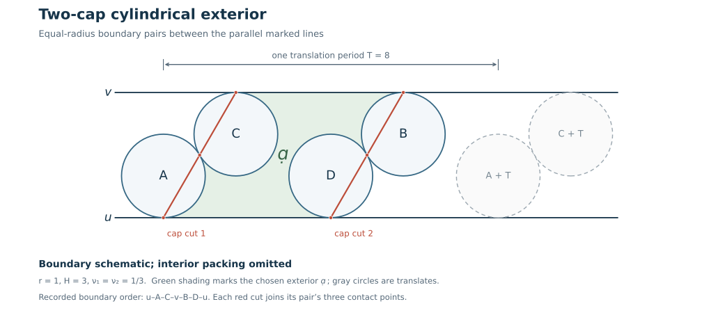

# Two residual caps: exact topology, a complete flat cylinder, and the original volume budget

31 October 2026. **analytical research theorem.**
Unpublished. Assume classified
finite-common-weight stationary data on the original simple matched
sphere, positive at every ordinary incidence, with exactly TWO strict
residual caps and CROSS at every other port. The original protected MAIN
edge is uv. A cap child receives 1-nu>1/2 and its ordinary outer receives
nu in (0,1/2); their positive weights agree. The positive-value hypothesis
excludes the all-cap tetrahedral exception.

No adjacent-mark sphere theorem is applied to nonadjacent zero vertices.
The new construction below is a complete Euclidean CYLINDER. The resulting
absolute budget is still positive: it does not prove M_cap<=Phi_D.

The figure illustrates the boundary geometry only; it does not assert
that the omitted interior admits a packing for these chosen coordinates.
Its [renderer](../experiments/render_two_cap_cylindrical_boundary.py) records
the exact schematic parameters.

## 1. Literal two-cap topology

The two protected triangles are uvC and uvD, with distinct ordinary C,D.
After relabeling the first cap is

\[
F_1=(u,A,v,C),\qquad (u,A,C),\ (u,v,C),\qquad
\text{matching edge }uC.
\]

The second has either matching vD, with child B and quartet(v,B,u,D),
or matching uD, with child B and quartet(u,B,v,D). MAIN bipartiteness
and demand one leave the following possibilities:

* Four distinct ordinary vertices A,C,B,D. The union of the two cap
  patches is a four-triangle disk sharing just uv, with hexagonal
  boundary u-A-C-v-B-D-u in the first type, or
  u-A-C-v-D-B-u in the second.
* One shared ordinary vertex, necessarily the child of one cap and
  the outer of the other. Up to exchanging the two caps and protected
  labels, the pair is

  \[
  F_1=(u,A,v,C),\qquad F_2=(v,B,u,A).\tag{1}
  \]

  Their patches share the TWO MAIN edges uv and uA. Their union is a
  four-triangle disk with protected u in its interior and boundary
  A-C-v-B-A.

Indeed two distinct caps cannot have the same child (two loads>1/2),
and the same outer would repeat an original uv triangle. A common
child/outer is impossible in the same-protected-outer type by the
MAIN bipartite colors. In the opposite type it gives exactly (1).
If both ordinary vertices were shared, the previously proved parallel
cap exception is the whole tetrahedron with zero action.

All boundary edges of these cap unions are MAIN, so every remaining
original port lies wholly in the complementary disk. No half-port is
removed or supplied an invented half-demand.

## 2. A shared ordinary vertex is impossible in the cap-only stationary case

For (1), write the two cap parameters nu1,nu2. The complementary disk
has boundary A-C-v-B. All its rows are complete CROSS triangles. Its
original residual loads and weights are

\[
\begin{gathered}
r_A=\nu_1-\nu_2>0,\qquad r_B=\nu_2<\tfrac12,\qquad
r_C=1-\nu_1>\tfrac12,\\
r_v=0,\qquad L_A=L_B=L_C>0.
\end{gathered}\tag{2}
\]

The strict first inequality follows from ordinary incidence positivity:
A has an exterior incidence, since the simple four-boundary disk cannot
triangulate its boundary neighborhood without an A corner. Interior
ordinary demands remain one. Their triangle angles sum to 2pi.

Here is a useful elementary boundary-development argument, requiring no
assumed injectivity. Develop the complete positive center triangles in
this disk. The zero boundary vertex v is represented by its ONE cooriented
line. A one-line triangle is the actual infinite Euclidean strip triangle
with two finite centers tangent to that line. Gluing across finite edges
uses the common lengths r_f+r_g; gluing across a line/finite edge uses
the same line and finite center. The full 2pi stars at interior ordinary
vertices give trivial Euclidean holonomy. Such loops generate the
punctured-disk continuation, so there is a global developing map.
The v fan is connected, so it propagates the SAME cooriented line.

Put that line horizontal and write rho_f=1/L_f for circle radii,
distinct from the residual loads r_f in (2). Equal B,C radii put their centers at equal
height on the same side of it. They are distinct: their intervening
positive line fan has horizontal length sum 2sqrt(rho_i rho_(i+1))>0.
The A center is equidistant from B,C since AB=AC=rho_A+rho_B. Thus it lies
on their perpendicular bisector. Reflection in this perpendicular
bisector exchanges the boundary rays BA and CA and fixes the directed
line normal. The recorded boundary fans at B,C are consequently equal
modulo 2pi. More explicitly, if beta=arg(A-B), then

\[
\begin{gathered}
\arg(A-C)\equiv\pi-\beta\pmod{2\pi},\qquad
\arg(n_v)=-\frac\pi2,\\
\theta_B\equiv-\frac\pi2-\beta\equiv\theta_C\pmod{2\pi}.
\end{gathered}
\]

Both actual fan sums lie strictly between0 and2pi, so they are equal.
This contradicts (2). It also excludes a degenerate collinear center
triangle, where the same angular congruence still holds. Therefore

\[
\begin{gathered}
\text{At strict cap-only finite stationary data,}\\
\text{the two ordinary cap pairs are disjoint.}
\end{gathered}\tag{3}
\]

This uses all-CROSS positivity outside the two caps. It is not a
topology-only assertion about arbitrary marked diagrams or Green data.

## 3. The correct hexagon double

We are now in the first case of section1. Let D be the remaining disk;
its six boundary vertices are distinct. Define the involution of its
boundary by

\[
u\longleftrightarrow v,\qquad
A\longleftrightarrow C,\qquad B\longleftrightarrow D.\tag{4}
\]

In either of the two cyclic orders above, (4) reverses the boundary
orientation. Gluing two copies by (4) produces a triangular spherical
CELLULATION T_cyl. Each original triangle retains three distinct
vertices and each original port its four distinct vertices. The
matching is inherited separately in each copy, because all boundary
edges were MAIN. Parallel edges may arise from doubled boundary
diagonals; we do NOT claim this cellulation is simple.

Crucially u,v are NONADJACENT. Their sole original edge uv belonged to
the removed cap union. No other uv edge existed in the original simple
sphere. Thus every triangle of T_cyl has either three ordinary vertices
or exactly one zero vertex.

Duplicate the original finite weights and complete triangle allocations.
They agree under (4) because L_A=L_C and L_B=L_D. Each boundary ordinary
demand becomes nu_i+(1-nu_i)=1; interior ordinary demands remain one;
u,v remain zero. Hence T_cyl carries an actual strictly positive
complete angle assignment at its finite weights. This fact is all that
is needed below; no nonadjacent-mark source or capacity theorem is used.

## 4. Complete flat-cylinder development, including properness and injectivity

For each ordinary face f write its circle radius r_f=1/L_f. A triangle
with three finite vertices is the Euclidean center triangle of side
lengths r_i+r_j. Its angles are precisely the complete source angles.
A triangle with zero vertex u and finite i,j is its exact one-line model:
put the line at height0 and the finite centers at

\[
(0,r_i),\qquad (2\sqrt{r_i r_j},r_j).
\]

Its carrier is the infinite half-strip triangle below their joining
segment, with two parallel rays from the centers toward the ideal
vertex. The finite side has length r_i+r_j and its finite angles are
the original complete angles, summing to pi. The same construction
applies at v. Glue these Euclidean triangles along their prescribed
edges/rays. Every ordinary vertex has angle2pi, so the resulting metric
on the topological sphere minus{u,v} is flat and has no cone point.

This metric is COMPLETE. Beyond the finite heights of all centers in
one zero-vertex star, its successive strips glue into an exact flat
cylinder. Its circumference is

\[
T_u=\sum_{\substack{i,j\text{ successive}\\\text{in the }u\text{ fan}}}
2\sqrt{r_i r_j}>0.\tag{5}
\]

and similarly at v. Vertical offsets telescope, so no longitudinal
drift is hidden in this calculation. Truncating both cylindrical ends
leaves a finite union of compact truncated triangles. A path escaping
either end has unbounded height, which is 1-Lipschitz and therefore
costs infinite length. This proves completeness rather than merely
local flatness and nonzero holonomy.

The simply connected metric cover is therefore the Euclidean plane.
One direct proof develops a local Euclidean frame and extends every
straight geodesic by completeness; path lifting makes this a covering
of R^2, and simple connectedness makes it an isometry. Its deck generator
is an orientation-preserving Euclidean isometry without a fixed point,
hence a nonzero translation. A once-around end loop is a generator of
the punctured sphere, so both (5) are the SAME translation length, not
an unspecified multiple. This establishes the developing degree and
injectivity that an arbitrary flat immersion would not supply.

Place the finite circle of radius r_f at every lifted finite vertex.
Its sector in each incident finite triangle stays inside that triangle,
by the usual tangent-center-triangle proof. The one-line version is
equally literal. For example the i-circle sector toward the infinite
vertex cannot cross the opposite vertical ray: if r_i>=r_j its maximal
horizontal projection in that sector is

\[
\frac{2r_i\sqrt{r_i r_j}}{r_i+r_j}<2\sqrt{r_i r_j},
\]

while if r_i<r_j it is at most r_i<2sqrt(r_i r_j). The other edges are
handled by the sector definition and the actual i/j tangency. The
infinite-corner sectors tile the half-plane below their common line.
Thus the finite disks, and the two zero-vertex half-planes, have disjoint
interiors in the developed plane. There are no accidental nonedge
contacts: the same strict sector-support argument applies locally,
and the center triangulation is globally embedded. More explicitly,
the opposite finite side is covered by the other two tangent disks,
with their contact strictly outside the third positive disk; the
opposite-ray estimates above are strict. Thus nonedge supports are
strict, not merely disjoint in their interiors. Periodic local finiteness
prevents an extra contact arising as an accumulation of nonincident
sectors. This also separates a finite disk from its nontrivial deck
translates.

Consequently this is a genuine PERIODIC circle packing between two
distinct parallel lines. The lines are preserved by the same nonzero
deck translation, and their disjoint half-planes face opposite ways.
Their separation H is positive because finite positive-radius disks
fit between them. This completes the cylinder theorem, without an
adjacent-mark spherical-packing hypothesis.

## 5. The original exterior and the two cap parameters

The original disk D minus its two ideal boundary vertices is simply
connected, so a copy lifts to the universal cover just constructed.
Its lift is embedded because the covering development is an isometry.
It supplies ONE circle for every original finite face and the SAME two
parallel marked lines u,v. Every original exterior contact is retained.

The [original cap-cut theorem](research_cap_star_cut_and_cross_stellar_reduction.md) excludes Av (and the analogous other-child/
opposite-line edge), because every other incidence of that child is
CROSS. The matching edge uC was removed. In the double, a possible Av
edge from the other copy would correspond under (4) to that removed
uC edge, and conversely. Therefore neither cross-line contact exists
even in the periodic packing. The same holds for the second pair.
The one-cap fan calculation now applies to each pair in this actual
strip:

\[
H=4r_i\sin^2(\pi\nu_i)>2r_i,\qquad
\frac14<\nu_i<\frac12,\qquad i=1,2.\tag{6}
\]

This is a conclusion, not a premise used to establish completeness.

Each equal-radius pair supplies three collinear finite cap contacts;
the fourth original contact uv is infinity. Their ideal quadrilateral
planes cut the infinite periodic right-angled polyhedron. Each section
is exactly its quadrilateral, by convexity and the four incident white
halfspaces, just as in the one-cap proof. The two cutting planes do
not intersect inside the white strip. Their finite contact segments
lie in disjoint pairs of packing disks (each segment consists of two
chords meeting at the pair's tangency), and the line contacts are
distinct. Thus the segments cannot cross. Intersection of the two
vertical planes, if any, lies outside the strip.

Cut between the consecutive planes corresponding to the chosen lift
of D. This gives a finite convex ideal exterior polyhedron Q_D with
the original exterior white/shaded faces and TWO new quadrilateral
faces. Local shaded supports come from the same tangent-triangle
incircles; periodicity and the two cuts leave only finitely many
faces. In coordinates where the white strip is 0<=Y<=H, each cutting
contact line is X=a_i+b_iY. The two segments do not cross in the closed
strip, so the between-cut region has bounded X,Y projection. Periodic
local finiteness leaves only finitely many finite contacts and faces
there. The old marked point infinity is now an actual ideal vertex.
No topology of an old/new filled link is inferred from this auxiliary
polyhedron construction.

Let M_2 denote the sharp cap-sector value at the actual stationary
datum. Its caps have action zero, so it is the sum of the exterior
complete triangle entropies. Coning Q_D to infinity gives

\[
\operatorname{Vol}(Q_D)=\pi M_2.\tag{7}
\]

Here the normalization can be checked directly, without inventing a
nonadjacent-mark capacity. The complete shaded/white triangle terms
give pi times the exterior entropy. At a boundary ordinary circle the
closing chord adds the Lobachevsky term of the complementary fan.
Within each cap pair those terms cancel because its fan loads are
nu_i and1-nu_i. Both line faces and both new quadrilateral faces contain
the cone apex and contribute zero. These account for every boundary
term. The [original finite-weight dual attainment](research_cap_constrained_capacity_budget.md) also identifies this
stationary value with the original closed two-cap-sector maximum.

## 6. Original group and the correct second-ball flags

Use this one positive exterior family to form the actual original
reflection heads. The restored original MAIN edge uv is the contact
at infinity of the two parallel lines. At each removed cap use the
explicit ordered collar from the [one-cap chain theorem](research_one_cap_original_chain_volume_budget.md),
with its original local frame and its own nu_i. Retain the original
oriented exterior fan when choosing that local chart. Depending on the
recorded disk order, this may be the conjugate of the displayed one-cap
normalization; no single affine normalization is presumed to send both
exterior sides to the lower half-plane. Conjugating the chart reverses
the plane orientation together with the oriented local fan, and both
collar fixed points still lie on its actual inward exterior side.
This describes the actual local matrices in their recorded coordinates;
no cap is independently reflected or reset in the global circle family.
Conjugate every local formula back by its actual coordinate change before
sewing. The tangent CROSS
collars are unchanged. The same literal Morse prefix, cup/cap and
ordered-conjugation relations therefore construct a representation
of the original untwisted drilled group, not of a periodic quotient.

There is a small generalization of the one-cap flag rule. Fix u as
the ONE reference reflection. At cap e let x_e be its protected outer
(either u or v), y_e its ordinary outer, and let O_e be a fixed flag
of P_e=r_(y_e) r_(x_e). On the FIRST original ball use O_e. On the
SECOND ball use

\[
O_e^{(2)}=r_u r_{x_e}(O_e).\tag{8}
\]

while all other flags remain r_u-reflections of their first-ball
values. The white x_e map r_(x_e)r_u sends (8) to O_e; the white y_e
map sends it to P_e(O_e)=O_e. The second shaded map r_u C_e r_u also
fixes (8), since r_(x_e) exchanges the two peripheral flags and C_e
fixes both. Its other two vertices have the original reflected
permutation. These checks hold independently at both cap vertices,
even when both lie on the same protected white face.

Keep the original compatible face fans and degree-one abstract ball
chains. The actual full peripheral subgroup at each exceptional cap
preserves its axis; all other cusps are parabolic. The [general-peripheral ideal-chain theorem](general_peripheral_representation_volume_bound.md) therefore computes the
canonical original representation volume, with no extra boundary
constant or source-action identification.

## 7. The two inward pyramids and the quantified remaining budget

In each local normalization the two collar flags lie on the existing
exterior side of its flat quadrilateral. The original-chain
boundary identity replaces that face by the four-triangle inward cone,
whose signed volume is -W(nu_i). In a conjugate local chart use the
original oriented fan and tetrahedron orientation together; the same
geometric inward subtraction is still -W, rather than assigning the
Bloch sign from an unrecorded affine chart. The two replacements have distinct
auxiliary vertices and add linearly, even on a shared white polygon.
Reflecting the second ball back by r_u changes its cap flag to the
other peripheral flag, with the same pyramid volume. Hence

\[
\operatorname{Vol}(\rho)
=2\pi M_2-2\bigl[W(\nu_1)+W(\nu_2)\bigr].\tag{9}
\]

where the SAME absolutely calibrated function is

\[
\begin{gathered}
W(\nu)=2\int_0^{\arcsin(\sqrt2\cos(\pi\nu))}
\operatorname{arsinh}(\cos t)\,dt,\\
0<W(\nu)<2G,\qquad \frac14<\nu<\frac12.
\end{gathered}\tag{10}
\]

The original representation-volume bound yields

\[
M_2-\Phi_D\le\frac{W(\nu_1)+W(\nu_2)}\pi
<\frac{4G}\pi=2C_0.\tag{11}
\]

The [fixed-word peripheral gap](general_representation_volume_peripheral_gap.md) subtracts a further g/(2pi)>0 for the
fixed original exterior (uniform on compact subsets of the two cap
parameter ranges). There is no estimate here making that subtraction
pay the entire right side. Equivalently the constrained cap defect
satisfies Delta_cap<=2C0+sum_i W(nu_i)/pi<4C0.

Together with the one-cap theorem this gives a common geometric budget
for every strict finite-common-weight cap-only configuration with at
most two caps. It neither proves M_cap<=Phi_D nor bounds an original
signed source by this volume without its remaining phase compensation.
No real-spectral cap is silently replaced by these different geometric
collars.

## dependencies and exact open scope

Inputs are the [original stationary cap classification](research_full_fiber_sharp_stationary_classification.md),
the cap-cut/forest theorem linked above, the
[complete triangle angles and strict sector support](actual_smoothed_source_capacity_blocks.md),
the one-cap ordered collar and pyramid chain, and the
[actual general-Morse group dictionary](research_general_morse_cross_action.md).
The absolute volume normalization and fixed-word gap use the linked
original general-peripheral theorems. The new topology, complete-cylinder
development, two-cap flag rule and volume assembly are proved here;
they are not applications of an adjacent-mark packing theorem to
nonadjacent marked vertices.

The two local cap charts must be returned to the same global coordinates. When a conjugate chart is required, its oriented fan is retained; one cannot choose the two cap sides independently. Completeness and developing injectivity are established before sector support and the finite exterior are used.

No quantum sector transport, universal absolute cap inequality, or
filled-volume theorem is asserted. In particular the one-cap signed
source/stability argument is not automatically iterated to two caps;
this note proves the geometric volume budget, not that separate
contraction.
